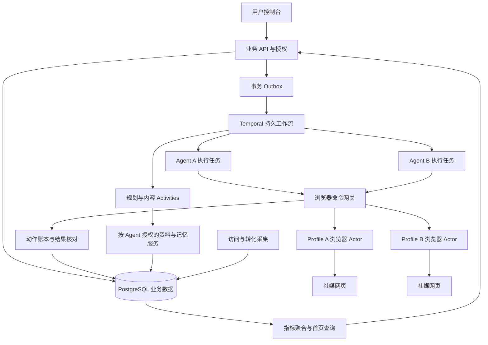

# lead 产品工程实施方案

版本日期：2026 年 10 月 29 日。适用范围：从现有交互原型推进到可试运营的 SaaS。产品名称为 lead。

首版采用共享基础设施、Agent 专属数据空间、持久化浏览器 Profile 和多 Agent 并发执行。每个活跃 Profile 使用独立浏览器进程和控制连接，不为每个 Agent 配置容器或虚拟机。正式后端采用持久工作流、受控浏览器执行和独立动作账本，实现长期自主运营及故障恢复。

现有 `dist/` 是使用本地演示数据的交互原型。正式产品以对话创建和管理 Agent，现有两步表单需要据此改造。原型尚不具备真实账号连接、持久工作流、生产数据隔离或流量归因。开发和生产环境必须明确分离演示数据。

配套材料：[数据库基线](../infra/schema.sql)、[接口和事件契约](API_CONTRACT.md)、[开发依赖与验收清单](DELIVERY_BACKLOG.md)。数据库基线需通过迁移、权限和故障测试后进入生产。

## 一 产品范围和验收边界

### 已确认要求

| 编号 | 要求 | 验收方式 |
| --- | --- | --- |
| R01 | 在对话中输入网址或介绍，由 Agent 逐步引导连接与启动 | 每轮只补问必要信息，不出现技术参数或长表单 |
| R02 | 默认自主运营 | 启动后系统自行计划、执行、观察和调整，无每日手动启动步骤 |
| R03 | 社媒操作通过真实浏览器网页完成 | 页面操作证据可核对，执行层不以发布 API、Bot API 或 MCP 发帖替代 |
| R04 | 多个 Agent 真正同时执行 | 至少三个测试 Agent 的浏览器操作时间段重叠，任一等待或失败不阻塞其余 Agent |
| R05 | 资料、记忆、登录、文件和控制不串用 | 自动化越权测试、检索测试和并发路由测试通过 |
| R06 | 关闭和重启后可恢复 | 数据和 Profile 持久化，已提交动作先核对后续接 |
| R07 | 随时暂停、接管 | 执行网关停止新写操作，旧控制者失权，其他 Agent 保持运行 |
| R08 | 用户看懂获客效果 | 首页显示工作状态、近期成果、可验证访问与转化，注明数据覆盖范围 |
| R09 | 界面简约 | 创建表单仅必要业务输入，专业偏好在详情深层，运行参数不开放给普通用户 |
| R10 | 覆盖全球十一个渠道 | 平台能力分别适配、测试和开放，见渠道计划 |
| R11 | 用户随时与 Agent 对话 | 可查询有来源的运营细节、讨论想法、调整偏好并收到真实执行回执 |

数据隔离的范围是受控工具、服务权限和应用上下文。它不承诺同一宿主机上各进程具有独立操作系统安全边界。首版禁止给模型任意 Shell、任意 SQL、任意文件路径和任意浏览器连接地址；以后开放这些能力时重新评估操作系统级隔离。

### 必须独立处理的外部条件

浏览器 Profile 可保持独立会话和稳定配置，第三方平台如何识别设备及关联账号由平台决定。配置不同、指纹测试不同或设备列表出现两条会话，都不足以证明平台的全部关联判断独立。验收分别记录会话隔离、配置连续性、平台可见结果和无法观察的部分，不承诺不可识别或永不封禁。

渠道接入需要同时满足用户授权和平台允许。X 的公开规则明确禁止非 API 的网站脚本自动化；LinkedIn 禁止未经许可的网站自动化。对这些渠道，取得适用许可前保持自主写入关闭。其他渠道逐项审查，不因本表未列限制就认定允许。[X 自动化规则](https://help.x.com/en/rules-and-policies/x-automation)、[LinkedIn 自动化规则](https://www.linkedin.com/help/linkedin/answer/a1341387/prohibited-software-and-extensions)

## 二 用户流程和产品信息架构

主导航仅保留「总览」「我的 Agent」。总览优先呈现运行健康、最近完成、访问和咨询或注册；Agent 详情以「对话」为默认页，「效果」「账号与资料」为次级入口。高级偏好和工作记录放在更多菜单。首次空白工作室直接进入创建对话，已有工作室通过「创建 Agent」进入新 Agent 对话。

首次使用流程：

1. 创建草稿 Agent 和专属主对话。Agent 首句为「想推广什么？发网址或简单介绍给我。」用户在同一输入框回复。
2. 系统形成带来源的业务档案。已有足够资料时直接推进，仅对必要缺口逐项问答；不要求用户确认一长页系统推断。
3. Agent 在消息中给出渠道连接操作卡片。用户在专属浏览器画面中完成真实登录；有多个可运营对象时，卡片中只增加必要的目标选择。
4. 在对话内展示一次性的工作范围授权，例如在指定账号发布、回复已有互动。用户点击「免费启动」。
5. 系统检查账号、目标权限、渠道能力和资源额度，进入自主工作。
6. 首页和对话可查询结果。登录验证、权限变更、结果不明且自动核对失败等必要事项进入待处理列表，并在当前 Agent 对话中给出处理入口。

正常内容不设置逐条人工审批。低置信度事实先采用已确认事实或调整内容；确实缺少必要业务事实时才请求补充。扩大运营对象、启用付费操作或改变授权用途需单独授权，不能借助原有「启动」同意无限扩大范围。

用户状态文案保持业务含义：工作中、已安排、等待验证、需要处理、已暂停。排队、资源不足、账号异常和用户暂停必须区分；页面不能仅凭 Agent 配置为开启就显示「正在工作」。

对话是业务入口，后台自主循环不以收到新消息为启动条件。运营健康信息默认保持简洁，用户询问「今天做了什么」「为什么这样发」「哪些内容有效」时，再从计划、动作账本和指标中展开细节。

对话中的浏览器登录卡片打开独立的受保护画面，密码和验证码不进入普通消息、聊天记录或模型上下文。用户明确的偏好调整可直接应用并支持撤销；讨论中的假设保留为建议。语义不足以区分讨论与执行、或超出原授权时，Agent 只询问一个明确问题。

## 三 系统架构和模块边界

采用模块化业务后端，按运行职责拆成少量进程。业务模块先保持同一代码库，浏览器执行独立部署，以便扩容与限制故障影响。

| 模块 | 责任 | 禁止越过的边界 |
| --- | --- | --- |
| 业务 API | 用户权限、业务配置、账号绑定、启动暂停、查询 | 不直接持有页面对象并执行发帖 |
| 工作流 | 定时、依赖、恢复、等待用户、下一轮排期 | 不在 Workflow 函数中直接调用浏览器、模型或外部网络 |
| 规划和内容服务 | 读取有权限的上下文，生成结构化计划与内容 | 不获得数据库管理权限或账号凭证 |
| 浏览器网关 | 校验控制版本、权限、账号、预算，路由命令 | 不接受模型提供的任意连接地址和任意脚本 |
| 浏览器 Actor | 独占一个 Profile 的连接、页面、虚拟显示和输入 | 不操作宿主机全局鼠标，不控制其他 Profile |
| 平台适配器 | 页面识别、业务动作、账号确认、结果核对 | 不使用隐藏发布 API 兜底 |
| 动作账本 | 记录意图、提交、证据、未知结果和核对结论 | 不把工作流任务完成等同于外部发布成功 |
| 资料和记忆服务 | 事实版本、来源、记忆写入及检索权限 | 不把网页文字视为系统指令 |
| 对话与命令服务 | 引导创建、消息持久化、读取运营事实、应用用户意图 | 不让自然语言绕过同一授权和执行网关 |
| 指标服务 | 事件去重、归因、覆盖率、聚合 | 不把链接预览计为有效访问 |

共享服务可以同时处理多个 Agent。共享模型客户端不意味着共享对话历史；请求必须由不可变的 AgentContext 显式携带租户、Agent、任务、授权版本和追踪 ID。

## 四 技术选型和实施决策

| 层次 | 选型 | 实施理由与条件 |
| --- | --- | --- |
| 前端 | Next.js 与 TypeScript | 复用原型的信息架构，改为服务端真实状态；表单与错误处理共用组件 |
| API | Python 3.12 与 FastAPI、Pydantic | 与浏览器、模型和 Temporal Python SDK 保持语言一致；结构化输入输出 |
| Agent 框架 | Pydantic AI | 结构化决策、工具定义、依赖注入和模型适配；持久调度统一归 Temporal |
| 数据访问 | SQLAlchemy 与 Alembic | 参数化 SQL、显式事务和可审查迁移 |
| 数据库 | PostgreSQL 18 稳定分支 | 关系约束、JSONB、事务、RLS、全文检索；精确补丁号在 M0 锁定 |
| 持久编排 | Temporal Python SDK | 长期运行、计时、信号、恢复；与用户界面分离 |
| 浏览器 | Camoufox 首轮候选，原生 Playwright 浏览器作对照 | 按渠道完成持久登录、上传、接管和稳定性测试后确定生产版本 |
| 检索 | PostgreSQL 全文检索先行 | 小型资料库先避免独立向量数据库；需要语义检索时增加 pgvector |
| 资产与备份 | S3 兼容对象存储与受管密钥 | 素材、截图、加密 Profile 备份，按用途设置保留期 |
| 实时状态 | SSE | 传输简化的业务事件，支持游标续接；接管输入使用独立 WebSocket 通道 |
| 登录 | 成熟 OIDC 身份服务 | 平台登录和社媒网页登录分别管理，不自行实现密码系统 |
| 观测 | OpenTelemetry | 关联请求、工作流、工具调用和浏览器动作；日志进行脱敏 |
| 首期部署 | 原生 Linux 执行节点与进程服务管理 | 浏览器直接运行；共享服务可按团队运维方式部署，但不要求一 Agent 一容器 |

正式后端使用 Temporal 是对上一版 PostgreSQL 任务表方案的可靠性加强。PostgreSQL 保存业务任务视图和外部动作账本；Temporal 保存执行历史及定时和恢复状态，避免维护两套任务调度器。Temporal 的恢复不提供社媒网页操作的端到端恰好一次保证。[Temporal 工作流执行机制](https://docs.temporal.io/workflow-execution)

Camoufox 的浏览器和调用包许可证不同，仓库提示可能不适合稳定生产；开源候选必须经过版本级验收。使用固定的浏览器与调用包组合，建立安全更新窗口，不长期冻结过时内核。[Camoufox 项目与许可](https://github.com/daijro/camoufox)

浏览器由节点内 Actor 直接创建持久上下文，再通过平台 RPC 接受受控命令。Camoufox 的远程浏览器服务器不能直接提供持久上下文，不把浏览器远程连接接口当作业务 RPC。Chromium 的 CDP 和 Firefox 的连接方式由 Provider 内部处理。[Camoufox 连接文档](https://github.com/daijro/camoufox/blob/main/typescript/README.md)

BrowserProvider 必须实现：创建配置、启动持久会话、观察、执行受控动作、核对账号、开启接管、关闭并清理、备份与恢复。平台适配器只依赖 BrowserSession 抽象；已经登录的 Profile 不自动切换内核，迁移需要专门流程，必要时重新登录。

## 五 Agent 设计与现成框架

一个产品 Agent 是长期业务身份，包括业务档案、主对话、记忆范围、策略、授权、任务、预算和固定浏览器 Profile；它不是一个必须永久驻留的模型进程。多个 Agent 使用独立上下文同时推进，可以共享无状态模型连接池。

首版使用 MIT 许可的 Pydantic AI 作为 Agent SDK，Temporal 负责长期工作流。框架已有类型化 Agent 循环及持久执行集成能力；lead 仍需实现业务工具、权限、数据范围和社媒适配器。[Pydantic AI](https://github.com/pydantic/pydantic-ai)、[持久执行集成](https://github.com/pydantic/pydantic-ai/blob/main/docs/durable_execution/overview.md)

采用四个职责模块，均属于同一用户 Agent：对话引导与意图识别、运营规划、内容制作、效果分析。浏览器执行和权限校验由确定性服务承担。首版不为这些职责再创建四名无限自主协商的子 Agent。模型版本、提示模板、工具集和输出 Schema 组成不可变 AgentRevision，每次任务绑定具体版本。

| 模块 | 输入与输出 | 允许的工具 |
| --- | --- | --- |
| 对话模块 | 用户消息、业务摘要、当前状态；输出回答、补问或结构化命令 | 读取状态、资料、计划、工作证据和指标；提交业务命令 |
| 规划模块 | 目标、事实、授权、预算、效果；输出带有效期的任务计划 | 有范围的读取和计划提议 |
| 内容模块 | 已确认事实、素材权限、渠道要求；输出版本化内容 | 读取素材、生成草稿、提交内容校验 |
| 分析模块 | 有覆盖范围的指标和动作证据；输出观察结论与调整提议 | 指标查询、样本充分性检查 |
| 执行服务 | 已验证任务与动作意图；输出确认、未发生或结果未知 | 仅受控 BrowserSession 与平台适配器 |

每个循环设置内部工具次数、时长、成本与重新规划上限。失败分类、暂停、核对和权限判断不由模型自由决定。上下文通过 AgentContext 传递，禁止全局消息列表和跨 Agent 对话复用。

browser-use 是 MIT 许可的现成浏览器 Agent 库，可作为支持浏览器的执行候选或读取探索工具。它的浏览器兼容性要与选定内核逐项验证，不能默认将其 CDP 连接方案直接接到 Firefox/Camoufox。若采用，所有可导致外部副作用的工具必须接入 lead 网关；网页域名允许列表不能独自约束发布、删除和支付等动作。[browser-use 项目](https://github.com/browser-use/browser-use)

OpenClaw 提供更完整的现成助手形态，官方支持多 Agent 路由、独立工作区及会话。它可用于快速验证对话和工具体验，但这些机制不能直接作为 lead 多租户 SaaS 的权限证明。若复用，需要将记忆和业务数据收敛到 lead 的范围服务，关闭未授权的系统工具，并接入同一发布账本和浏览器网关。现成聊天渠道连接也不能替代用户要求的浏览器社媒操作。[OpenClaw 多 Agent 文档](https://docs.openclaw.ai/concepts/multi-agent)

| 路线 | 适合阶段 | lead 仍需掌握的部分 |
| --- | --- | --- |
| Pydantic AI 与 Temporal | 自主可控的正式后端，首选 | 业务规则、数据隔离、浏览器、归因和产品界面 |
| OpenClaw 二次开发 | 快速验证现成助手形态 | SaaS 权限、受控工具、账号环境绑定和外部动作恢复 |
| browser-use | 浏览器 Agent 能力验证 | 运营策略、长期状态、权限、核对与浏览器兼容 |
| WorkBuddy Managed Agents | 托管供应商评估 | 自有数据与控制、外部浏览器接入及 SaaS 合同边界 |

WorkBuddy 可以作为供应商候选，不能简单归类为「只能点桌面客户端」。官方开放平台已有本地助理、云端任务和 ACP 通道，企业 Managed Agents 提供版本、会话和 API/ADK。若评估托管路线，使用正式接口并验证自定义工具、外部浏览器固定绑定、停止控制、数据范围、事件回执、费用和 SaaS 使用条款；不通过自动操作 WorkBuddy 桌面界面承载生产调度。[WorkBuddy Open API](https://open.workbuddy.cn/docs/openapi)、[Managed Agents](https://cloud.tencent.com/document/api/1831/138581)

首选保持 lead 自有数据、控制和编排，用 AgentProvider 适配自托管框架或托管服务。WorkBuddy 的定义、会话 ID 可作为供应商引用，不能代替 lead 的 tenant_id、agent_id、授权版本和动作账本。若供应商无法使所有写工具经过 lead 网关，不用于生产自主写入。供应商切换不自动切换或复制已登录浏览器。

### 对话业务逻辑

接收消息后先持久化，按 conversation_id 与 client_message_id 去重。服务端绑定 AgentContext，读取当前业务版本、授权与必要历史，再分类为查询、讨论、配置调整、控制命令或连接事项。查询和讨论不占浏览器槽位；确需观察页面时异步申请本 Agent 的浏览器能力。

消息输出由有限类型组成：文本、必要事实问题、连接卡片、授权卡片、指标卡片、计划调整和执行回执。服务端验证结构，前端不执行模型生成的任意 HTML 或按钮动作。流式文本通过 SSE 展示，最终消息、引用和命令状态保存到数据库。

命令使用 message_id 加意图序号生成幂等键。明确的普通偏好更新写入新 AgentRevision，未提交内容重新按新版本校验；「暂停」直接走控制接口；新账号或权限扩大通过授权卡片完成。过期建议必须重新检查版本后应用。对话不得将「已安排」表述为「已发布」，所有结果回答包含实际状态和必要更新时间。

对话消息按 Agent 隔离，历史摘要记录覆盖的消息序号与事实引用；只有明确业务事实或用户偏好进入长期记忆。对话请求与后台任务可以并行，写入配置采用版本控制，提交网关核对最新配置版本。用户可查询、纠正和删除保存的偏好，删除后同步清理索引和缓存。

## 六 浏览器环境身份与网络出口设计

环境身份作为正式领域对象管理，包含 browser_profiles、network_identities 和 identity_checks。其目标是稳定的浏览器会话、合理一致的设备可观测信息、明确且不串用的出口；第三方的完整关联结论仍不能保证。

| 层次 | 设计 | 验收 |
| --- | --- | --- |
| 登录与站点存储 | 每 Agent 独立持久目录、Cookie、LocalStorage、IndexedDB 与密钥依赖 | 相互登录状态不串用，受控重启后保持 |
| 浏览器可观测特征 | 保存完整配置及版本，优先与实际宿主和内核兼容的组合 | 自有采集页检查版本、平台、语言、时区、字体、显示和渲染特征是否矛盾及是否异常漂移 |
| 网络出口 | 要求独立出口的 Agent 绑定稳定、专属、已验证公网出口 | 多个 Agent 对受控服务呈现各自预期出口，出口失效时不直连 |
| DNS 与其他网络通道 | 将解析、HTTPS、WebSocket、下载、上传、IPv6 和 WebRTC 纳入同一出口策略 | 控制节点观测与远端观测结合，验证未从宿主其他出口发送 |
| 运行关联 | 不同会话、目录、控制身份及日志范围 | 不共享端口凭据，不在错误账号或目标提交 |
| 平台结果 | 在有授权且允许的环境中观察验证、会话和异常 | 保留可观察结论，不用测试网站评分代替平台验收 |

浏览器指纹包含软件、设备、系统、环境和行为等多类特征。因此不要求每个字段都不同，也不能仅换 User-Agent 或 machine-id 就认定不同设备。设备特征的一致性与连续性比随机变动更适合作为平台可控制的目标。[W3C 指纹说明](https://www.w3.org/TR/fingerprinting-guidance/)

每个生产 Profile 的网络路径为「专属浏览器进程 → 本 Agent 的本地受控转发端 → 固定绑定出口 → 社媒网页」。独立出口应由供应商明确分配与验证，不仅是不同代理端口；多个端口或账号可能仍共享同一公网 IP。公网出口不同也不意味着平台无法通过网络段、账号或内容关系关联。

浏览器代理配置本身不足以保证无直连。Linux 执行节点以专属系统 UID 或经验证的 cgroup 出站规则，将本 Profile 的浏览器及子进程限制到本地转发端；转发端只使用绑定出口。此为共享系统上的网络约束，不要求容器。若当前节点不能验证此约束，只标记出口未验证，不能开放声称独立出口的运行模式。

出口失效采用失败即停策略：不自动退回宿主直连，不在另一 Agent 的出口上继续。出口变更走受控迁移，验证实际 IP 与策略、保存新版本并检查登录状态。用户无须填写代理参数；平台内部维护供应商、认证引用、预期 IP、地域、到期、健康与成本。

浏览器保留其正常端到端 TLS 行为，不用自建 HTTP 客户端替代社媒页面操作。外部图片、上传、WebSocket、后台请求和 WebRTC 都进入测试，未受控的直连或 UDP 通道不开放。DNS、IPv6、WebRTC 的策略必须以所选浏览器版本实测，不能将启动参数视为已生效证明。

环境验收使用自有 HTTPS、WebSocket、媒体和可选 STUN 测试端，采集对象是 lead 自己的执行环境，不是网站访客。至少覆盖三环境并发、重复启动、浏览器升级、出口断开、DNS 故障和节点恢复。身份检测失败阻止新的社媒写入，已提交动作继续独立核对。

## 七 领域模型和数据库规则

### 统一约定

业务对象使用 UUID，时间字段使用 UTC `timestamptz`，用户时间只在展示和排期时转换。对外时间包含时区。金额使用定点数字与币种，避免浮点。用户可编辑对象有版本号，API 用版本冲突检测覆盖写。创建 Agent 时同时插入初始 AgentRevision，在一个事务结束时验证当前配置版本的延迟外键。

除全局渠道能力配置外，业务行均包含 `tenant_id`；Agent 专属行同时包含 `agent_id`。关系外键携带相同范围，禁止通过另一个 Agent 的对象 ID 建立关联。JSONB 仅存版本化策略、结构化内容或供应商参数；权限关系、状态与关键唯一性使用显式列和约束。

| 分组 | 表 | 主要内容 |
| --- | --- | --- |
| 身份 | tenants、memberships | 租户、OIDC 用户、角色与成员状态 |
| Agent | agents、agent_revisions、business_profiles | 展示名称、期望状态、控制版本、框架和工具版本、业务事实 |
| 对话 | conversations、conversation_messages、conversation_commands | 主对话、消息顺序、消息去重、结构化业务命令与回执 |
| 运行环境 | browser_profiles、profile_leases、browser_sessions、takeover_sessions | 固定归属、版本、节点、控制租约、会话和接管 |
| 环境身份 | network_identities、identity_checks | 固定出口、密钥引用、预期和观测 IP、特征检查与有效期 |
| 账号 | social_accounts、account_targets、authorization_grants | 登录身份、主页或频道等目标、版本化授权 |
| 平台 | platform_capabilities | 每个渠道每种动作的技术和许可状态 |
| 资料 | knowledge_documents、knowledge_chunks、memory_entries、assets | 来源、正文、检索块、带来源的长期记忆和素材 |
| 运营 | plans、content_items、tasks | 计划版本、内容版本、业务任务和工作流定位 |
| 外部动作 | actions、action_attempts | 操作意图、去重键、提交状态、账号与内容证据 |
| 获客 | tracking_links、analytics_connections、visit_sessions、conversion_events、daily_metrics | 链接、可信数据接入、访问和转化、指标版本 |
| 额度 | budget_periods、budget_reservations、usage_events | 可用额度、原子预占、实际结算与超时处理 |
| 事件与请求 | outbox_events、inbox_events、audit_events、idempotency_requests | 跨服务投递、消费与请求去重和操作审计 |

### 必须由数据库或事务保证的约束

1. 每个 Agent 只有一个活动 Profile；同一 Profile 只有一个活动浏览器会话和一个接管会话。
2. 已识别的同一社媒登录账号，在活动绑定中只有一个 Agent 拥有控制权。跨租户重复连接返回中性冲突，不泄露当前所属用户。
3. 一个登录账号可以拥有多个运营目标。例如 Telegram 的登录账号和发布频道是不同实体，用户授权落实到目标。
4. 内容、任务、动作、目标和 Profile 的归属范围一致。提交前再次核对登录账号及当前页面目标。
5. `operation_key` 在租户与 Agent 内唯一；业务操作重放复用原键。合法的后续再发布使用新的业务意图，不能仅凭文本哈希判重。
6. 所有活动运行时携带 `control_version` 与 Profile `epoch`；旧控制版本不能提交新写操作。
7. 预算预占在数据库短事务中完成，锁住额度行后检查余额；真实消耗由唯一 usage event 结算。
8. 任务和状态变更与 Outbox 事件同事务提交；消费端先以 event ID 去重。

RLS 默认拒绝；业务角色不拥有表，不具有 `BYPASSRLS`。连接池中的租户和 Agent 上下文仅在事务内设置，结束后释放，防止连接复用遗留范围。RLS 不能代替服务端授权，模型和浏览器页面均不持有数据库凭证。[PostgreSQL RLS 规则](https://www.postgresql.org/docs/current/ddl-rowsecurity.html)

### 资料与记忆的生命周期

业务档案保存事实值、来源、置信状态和版本。价格、功能、承诺等对外事实必须来源于已确认资料。网页内容、评论和附件视为不可信输入，不能修改授权策略、控制状态或工具权限。

记忆分为用户偏好、业务事实、策略经验和短期观察。用户明确偏好优先于模型推测；策略经验附数据范围和观察时间，设置复查或过期时间。模型只保存简洁决策摘要、事实引用与结果，不保存隐藏推理过程。

检索先限定租户与 Agent，再进行全文或向量检索及排序。缓存键包含范围、文档版本、模型或检索版本。删除文档同时清理检索索引与缓存；共享资料必须有显式共享关系，首版默认不共享。

## 八 状态机与控制权

| 对象 | 状态 | 关键转换 |
| --- | --- | --- |
| Agent 期望状态 | draft、running、paused、archived | 用户意图，保存在数据库中 |
| 运行健康 | provisioning、ready、working、queued、needs_auth、needs_attention、degraded、stopped | 来自实时心跳、账号状态和任务结果，不由期望状态推导 |
| 账号 | pending、connected、needs_auth、restricted、disconnected | 连接后确认稳定账号标识；受限时停止相关动作 |
| 任务 | planned、queued、running、waiting_user、reconciling、succeeded、failed、canceled | 工作流驱动，API 查询为持久投影 |
| 动作 | prepared、dispatching、confirmed、unknown、not_applied、canceled | dispatching 之后不按普通异常直接重试 |
| 接管 | requested、active、ending、ended、expired | 接管与 Agent 写入控制互斥 |

用户点击暂停：业务事务更新期望状态并增加控制版本，写入 Outbox；网关以数据库版本为准拒绝新写操作；工作流收到信号后停止后续任务。不能仅等待工作流取消信号生效。已经提交的发布动作进入结果核对，暂停不表示帖子被撤回。

用户接管：增加控制版本，阻止 Agent 写入，等待当前动作到达安全点或标记结果未知，创建短期、单次兑换的接管凭证，再把同一浏览器画面交给用户。接管结束后重新读取页面与账号，不复用旧 DOM；按照用户结束选择恢复或保持暂停。断线后先保持写入关闭，不能自动恢复到危险的半提交步骤。

停止一个 Agent 不关闭共享模型客户端或其他 Agent 浏览器。归档先停止工作、结束接管和释放会话，再按保留政策处理数据；删除有独立的数据清理与备份过期流程。

## 九 自主工作流设计

每个 Agent 对应一个长期运行的监督 Workflow，ID 为 Agent 的稳定标识。它管理当前计划、排期、等待用户和重新规划。具体任务使用独立执行单元，模型推理、内容生成、浏览器操作和采集运行在 Activities 中。

执行历史接近配置阈值时使用 Continue As New，带入小型检查点，内容和证据保存在业务数据库或对象存储。Workflow 保持确定性，时间、随机数和网络调用按 SDK 规则处理。模型调用结果作为 Activity 结果记录，恢复时不随意重新生成不同内容。[Temporal 执行历史与恢复](https://docs.temporal.io/workflow-execution)

每轮流程：

1. 检查用户期望状态、账号和平台能力、预算、待核对动作。
2. 读取当前业务档案和有权限的资料；采样账号反馈及网站结果。
3. 生成结构化 Plan，限定目标、渠道、任务数、成本和有效期。
4. 校验计划。不可用渠道不入执行队列；已有待核对发布时，不建立冲突发布任务。
5. 分配本轮任务。不同 Agent 独立领取资源并同时执行。
6. 记录已验证结果、实际消耗和工作事件，安排下次观察或执行。
7. 在观察窗口后评估效果。区分无数据、样本不足和已有结果，调整内容方向，不凭一次点击认定策略优劣。

首版自主动作包括已授权目标中的内容准备、发布、读取自身反馈、回复适用的已有互动。支付、账号安全设置、删除历史内容、扩大联系对象等能力默认关闭；只有具备单独授权和可靠执行拦截能力时才开放。

## 十 多 Agent 并发和容量管理

三个层次分别管理：Workflow 并行、模型与素材任务并行、真实浏览器并行。浏览器进程数限制只控制资源，不能把整个平台设成单一执行槽。

每个活动 Profile 有一个 Actor 和浏览器进程。Actor 内对写操作排队，跨 Actor 并行；页面引用、上传路径、下载路径、截图、虚拟显示和控制连接都按 Profile 保存。严禁全局 `current_page`、共享对话对象和宿主机全局键盘输入。

资源分配采用租户公平轮转及任务优先级，分别设置浏览器、模型请求、视频制作和上传的并发上限。等待配额不占浏览器槽位；接管占用自己的浏览器槽位并有独立优先级。系统不能为了节省资源而关闭正在提交的动作。

Profile 租约记录控制节点、单调递增 epoch 和过期时间，Actor 在每次写操作前检查租约、控制版本与授权。租约过期只触发停止新操作和故障处理，不能证明旧浏览器已终止。旧节点失联且无法确认停止时，不在另一节点启动相同 Profile 的写入副本；先完成节点或会话隔离，无法证明隔离时转人工运维处理。

跨 Agent 并发的硬性测试：A 上传大文件，B 在本地测试站提交内容，C 读取并回复测试互动；操作追踪时间段必须重叠。随后暂停 A、杀死 B 的执行进程、使 C 的模型请求超时，分别验证其他 Agent 继续推进。

容量通过代表负载实测：轻量文本、图文上传、视频上传、接管和长页面。记录浏览器进程树 RSS/PSS、CPU、磁盘增长、带宽及耗时的分位数和峰值。初期不按浏览器厂商最低配置推断生产容量。

内存预算起点为基础服务占用加活跃浏览器负载、并行媒体负载及峰值余量；还需按资源配额和外部响应限额取更小并发值。暂停进程不等于释放内存，空闲环境应在安全点关闭浏览器并保存资料。持续自主工作由排期保障。

## 十一 浏览器与渠道适配

每个 Profile 保存 Provider、浏览器和调用包版本、固定配置引用、资料目录、登录密钥依赖、节点归属和网络策略。身份配置创建后保持连续，升级有记录和验证；不每次随机创建新身份，不复制已登录 Profile 来创建另一 Agent。

默认使用可见浏览器运行在节点专属虚拟显示中，网页、上传、登录和接管使用同一个会话。是否启用图形加速根据实际媒体负载测试决定，不能把软件渲染当成没有资源成本。

PlatformAdapter 的核心能力为：检查登录、确认当前账号、列出可授权目标、观察页面、准备内容、验证待提交状态、提交、核对结果、读取自身内容表现。适配器可以使用 DOM 和截图，但写操作必须有可识别的业务提交边界；无法识别时停止该能力，不能交给无限制截图点击兜底。

| 渠道 | 主要产品用途 | 首批验证重点 | 开放条件 |
| --- | --- | --- | --- |
| Telegram | 自有频道内容与适用互动 | Web 登录、频道权限、发布结果定位 | 平台规则审查和授权目标测试通过 |
| Facebook | 品牌主页运营 | 登录身份与主页角色、页面目标 | 分动作许可与技术验收 |
| Instagram | 图文及视频内容 | 媒体上传、格式、结果确认 | 分动作许可与技术验收 |
| YouTube | 视频内容 | 长上传、转码中状态、外链位置 | 分动作许可与技术验收 |
| TikTok | 视频内容 | 网页能力、上传和处理状态 | 分动作许可与技术验收 |
| Reddit | 社区内容与适用回复 | 各社区规则、目标和回复上下文 | 分社区和动作验证 |
| Pinterest | 内容发现与产品访问 | 图片、目标链接、发布确认 | 分动作许可与技术验收 |
| Threads | 品牌内容与互动 | 身份、内容、回复上下文 | 分动作许可与技术验收 |
| WhatsApp | 已许可联系人的咨询承接 | Web 会话、接收者许可和回复范围 | 分动作许可与技术验收 |
| X | 产品与行业内容 | 已知禁止网站脚本自动化 | 取得适用许可前不开放自主写入 |
| LinkedIn | 专业内容 | 已知禁止未经许可的网站自动化 | 取得适用许可前不开放自主写入 |

本表是适配范围，不代表所有渠道的当前许可或技术测试已经通过。平台能力配置按平台、动作、目标类型和浏览器版本组合管理，支持单渠道单动作熔断。

## 十二 外部动作一致性与故障恢复

系统采用至少一次任务处理、业务幂等意图、提交前校验和提交后核对。浏览器页面缺少事务与通用幂等键，端到端外部动作不能承诺无条件恰好一次。

一次发布的顺序：

1. 以 operation_key 创建或读取原动作，固定内容版本、目标、授权版本和证据要求。
2. 准备页面和素材，此阶段可以按适配器声明安全重试。
3. 网关检查租约 epoch、Agent control_version、实时账号和页面目标、渠道能力、授权与预算。
4. 在账本写入 dispatching 和 attempt，再点击最终提交。提交前记录账号、目标、内容哈希和必要截图。
5. 通过明确的成功页面、外部内容 ID 或链接及匹配内容确认结果，写入 confirmed。
6. 超时、连接中断或浏览器崩溃时写入 unknown，进入核对流程，不重置为 prepared。
7. 只有有充分证据证明没有提交的 not_applied，才允许执行新的提交尝试；无法证明时保持 unknown 并请求必要处理。

| 失败点 | 自动处理 |
| --- | --- |
| 只读页面加载失败 | 有上限的退避重试，记录尝试次数 |
| 模型或素材生成失败 | 固定业务输入、保存可复用结果并限制重试；平台使用事件不重复结算，供应商重试费用计入预算 |
| 最终提交前失败 | 适配器确认尚未提交后重试 |
| dispatching 后无确认 | 核对外部状态，禁止普通 Activity 重试再次点击 |
| 账号失效或身份验证 | 停止相关账号，创建重新连接事项 |
| 页面布局变化或错误账号 | 停止该适配器动作并通知运维 |
| 数据库不可用 | 禁止新的外部写入；已提交动作恢复后核对 |
| 控制节点失联 | 停止租约续期，确认旧控制者隔离后恢复 |

Temporal 的提交 Activity 采用单次提交策略；重复调度先读取动作账本，同一动作交由唯一核对所有者处理。心跳和取消只是恢复信号，不能代替外部结果核对，也不能证明点击没有发生。

## 十三 获客数据与归因

指标按来源和规则版本保存：

| 指标 | 定义与条件 |
| --- | --- |
| 可验证链接访问 | 追踪入口接收到请求，经过已知预览或机器人过滤并按规则去重 |
| 目标网站访问 | 网站端或可信分析连接确认落地会话，与追踪链接关联 |
| 有效访问 | 版本化规则，例如前台活跃累计至少 10 秒并有有效交互，或发生已确认转化；只对可测会话统计 |
| 咨询 | 已授权渠道中识别到的真实咨询事件，保留来源与去重依据 |
| 注册或成交 | 网站服务端或可信连接提供的独立事件；客户端观察单独标注可信程度 |

第一版归因采用最后一次可识别的非直接追踪入口，窗口暂定七天，作为产品规则而非行业事实。保留原始来源及规则版本，可以重算；同一事件不能同时重复计入多位 Agent。跨设备、参数丢失和未接入的数据保留为未归因，不强行填补。

追踪链接绑定 Agent、渠道、内容和已授权目标域名，使用不包含敏感信息的随机标识；跳转目标使用域名允许列表，防止开放重定向。用户已有站点可以使用原站带参数链接；托管落地页仅测得其可观察的行为，不冒充原站转化。

网站采集接入需验证站点控制权。公开浏览器 SDK 的事件可被伪造，关键转化优先使用服务端签名事件。采集最少必要信息，不通过访客设备指纹拼接跨站身份。去重 ID、数据保留和用户退出策略在上线前确定。

首页返回指标数值、来源覆盖、最后更新时间和 measurement_version。没有网站数据时展示点击，不显示虚构的有效访问或零转化。归因结果不等于因果增量，后续通过对照实验评估增量价值。

## 十四 接口与事件规则

完整清单见 `API_CONTRACT.md`。所有写接口使用请求追踪 ID；创建、启动、预算预占和内容意图创建要求 Idempotency-Key。相同键与不同请求体返回冲突，相同请求返回原结果。

用户身份从登录会话获取，tenant 从已校验的成员关系确定。URL 中的 agent_id 仍需要归属检查。异步操作返回 operation_id 和可查询状态，不阻塞 HTTP 等待社媒完成。

编辑业务资料和偏好要求对象版本；版本冲突返回 409 并重新读取。暂停和接管使用控制版本，权限撤销优先于新工作。SSE 提供单调事件游标和断线续接，客户端根据服务端快照恢复，不依赖前端自增数字模拟进度。

内部命令要求短期服务身份，绑定任务、Profile、控制版本、epoch、能力和过期时间。Actor 不接受任意可执行脚本，不向前端返回浏览器调试地址、供应商管理密钥或登录资料路径。

Outbox 至少一次投递；消费端按 event_id 去重，处理失败有退避和死信事项。事件包含 schema_version、occurred_at、tenant_id、agent_id、aggregate_id、aggregate_version、trace_id 和最小必要 payload；敏感正文保留在有权限的数据服务。

## 十五 安全与授权实现

平台授权与社媒登录分别管理。用户在受保护的远程会话中输入凭证，密码和验证码不经过模型；登录期间默认不记录输入和完整画面。社媒授权范围落实到目标和动作，登录成功不自动授予全部操作权限。

浏览器调试端口仅本机或受认证内部通道可达。Profile 和备份加密，密钥独立管理；对象存储按签名短链访问。Cookie、令牌、远程会话凭证、网站连接密钥及表单敏感字段不进入应用日志、模型上下文或 Temporal 明文历史。

读取用户网址时验证协议、DNS 解析和每次跳转，阻止私网、元数据服务及本机管理接口；文件上传设置类型、大小和解析边界。文件工具将规范化路径限制在 Agent 的专属根目录，不能只检查字符串前缀。

网页和社媒内容不能修改系统指令。模型工具只接受已列举动作，授权和预算通过代码校验。新增支付、系统命令或原生软件安装属于新能力，必须重新设计执行权限和隔离。

## 十六 成本与免费服务

内部额度分别记录模型、浏览器活跃时长、媒体制作、存储和网络。用户只看到免费服务范围、工作状态和必要的额度结果，不设置 Token、线程和浏览器参数。

每个有成本动作先预占，完成后以唯一使用事件结算。超时预占不直接释放未知的已发生成本，先核对；同一工作流恢复不重复收费。额度不足暂停新增有成本工作，并安排下一可执行时间，不无限重试。

成本模型为模型调用、浏览器节点、媒体处理、网络与出口、存储、编排服务、监控及适配维护之和。开源只减少部分许可费用，不代表维护和服务器免费。免费档必须通过实际单位 Agent 成本和使用分布评估后确定。

## 十七 部署与运维

开发环境：本地前端、API、临时 PostgreSQL、Temporal 开发服务及测试浏览器站点。测试站模拟发布成功、延迟、重复事件、账号切换、验证码、页面变动和网络中断，避免在真实账号上进行破坏性故障注入。

试运营环境：Web/API、正式持久化 Temporal、受备份 PostgreSQL、对象存储和至少一台 Linux 浏览器节点。开发用 Temporal 临时服务不能直接当生产服务。API 与节点通过认证通道通信，执行节点使用专门系统身份，保留浏览器自身的安全沙箱。

扩容时增加浏览器节点及共享服务容量，Profile 优先留在原节点。迁移时排空任务、结束写入、关闭浏览器、生成一致备份、确认原控制者隔离、恢复所需密钥依赖，再在新节点验证登录和账号；不能同时挂载可写 Profile 启动两个副本。

发布使用可回滚版本，先在测试站与少量授权账号验证新适配器和浏览器版本。数据库采用先增加兼容字段、迁移数据、切换读写、最后清理旧字段的方式；已经开始的工作流固定版本，升级遵守工作流兼容规则。

建议试运营目标为业务数据库 RPO 不超过 15 分钟、Profile 备份 RPO 不超过 24 小时、演练恢复 RTO 不超过 4 小时；这些是交付验收目标，须通过恢复演练验证。Profile 在安全关闭点备份，禁止直接复制活跃数据库文件后声称一致。备份恢复无法阻止社媒平台撤销会话，重新登录后应保留全部业务和动作记录。

灾备恢复后的所有外部写入先保持关闭。数据库恢复可能丢失备份窗口中的动作记录，必须核对该窗口内的账号内容、对象存储证据和可恢复事件后建立恢复检查点，才能继续；无法确认的目标保持需要处理。不能仅恢复数据库和 Profile 就自动启动全部发布任务。

服务质量的试运营验收目标：无外部依赖的 API 请求 P95 小于 500 毫秒；用户消息先持久化并及时确认接收；长任务以异步状态反馈。暂停事务提交后网关不得接受新的旧版本写操作。浏览器或模型的外部等待单独监控，不包装成 API 已完成；达到资源上限时公平排队并显示已安排状态。所有数值目标需在代表负载下测试，不是已经达到的性能声明。

## 十八 可观测性和质量指标

每次执行关联 tenant、Agent、任务、动作、浏览器会话、工作流执行和 trace_id。使用 OpenTelemetry 统一关联追踪、指标和日志，业务事件与技术日志分别保存。[OpenTelemetry 说明](https://opentelemetry.io/docs/what-is-opentelemetry/)

核心运营指标包括：任务排队时长、并发活跃数、任务确认成功率、unknown 动作率、核对耗时、登录失效率、渠道熔断、跨范围访问拒绝、暂停后新写操作、单 Agent 成本、指标延迟和采集覆盖率。

可用性状态要求心跳新鲜度校验。运维告警关注持续异常和用户需要处理的事件；相同登录失效或同一故障合并通知，正常运营保持安静。首页业务数据有更新时间，采集断开显示未知或连接异常，不显示为真实零值。

## 十九 测试和上线门槛

| 测试层 | 必测内容 | 发布门槛 |
| --- | --- | --- |
| 单元与属性测试 | 状态机、权限、归因、预算、幂等键和内容版本 | 所有关键路径及非法转换覆盖 |
| 数据库集成 | RLS、复合外键、唯一约束、并发预占、连接池上下文 | 越权和串数据用例零通过 |
| 工作流集成 | 重放、定时、信号、恢复、重复事件、版本升级 | 重放无不确定性错误，取消不造成重复提交 |
| 浏览器契约 | 登录、目标、上传、提交与核对 | 每个开放渠道动作单独通过 |
| 多 Agent 并发 | 至少三个独立浏览器同时读写 | 时间段重叠，失败与暂停互不阻塞 |
| 故障注入 | 提交前后崩溃、数据库失联、旧节点失联、接管断线 | 未知结果不盲重试，无双控制者 |
| 端到端产品 | 创建、连接、授权、启动、结果、暂停、接管 | 核心路径无需技术配置及每日手动启动 |
| 数据测量 | 预览机器人、重复点击、重复转化、断采集、归因重算 | 测量范围和数值一致，无虚构指标 |
| 负载与耐久 | 文本、图文、视频和接管混合负载，连续 72 小时 | 无持续泄漏，资源上限可解释，异常可恢复 |
| 恢复演练 | 数据库与 Profile 备份恢复 | 满足已公布 RPO、RTO，账本不随 Profile 回滚 |

测试不以覆盖率百分比替代关键场景。真实账号测试仅使用有授权且平台允许的对象，未知结果测试优先在本地测试站完成。

## 二十 交付顺序和团队分工

| 里程碑 | 依赖与交付 | 退出条件 |
| --- | --- | --- |
| M0 决策与浏览器验证 | 确定 Agent 框架、浏览器版本、出口、许可材料和测试站 | 三个 Profile 并发、持久登录、接管、上传、出口与特征测试可复现 |
| M1 数据与控制基础 | 平台登录、成员权限、Agent 与 Profile 绑定、RLS、审计、网关与控制版本 | 数据隔离、暂停和同 Profile 独占测试通过 |
| M2 可靠执行 | Temporal、Outbox、动作账本、核对、预算和故障注入 | 提交前后恢复正确，unknown 不盲重试，旧实例无法并行提交 |
| M3 单渠道完整体验 | 对话引导、业务理解、连接卡片、一次授权、自主计划与执行 | 对话创建、运营细节查询、想法讨论、偏好调整及自主运营完整跑通 |
| M4 获客与试运营 | 网站数据接入、归因、首页、成本、备份与观测 | 真实测量闭环、72 小时耐久、恢复演练和单位成本达标 |
| M5 十一渠道扩展 | 按能力矩阵逐渠道增加适配器和回归测试 | 每项开放能力具备许可记录、技术证据、运维熔断与维护负责人 |

建议至少有产品或负责人、全栈前端、后端与编排、浏览器自动化、测试与运维这些职责。角色可以兼任，关键的数据库权限、外部提交恢复和渠道开放应有第二人复核。团队人数、浏览器测试结果和平台许可确定后再承诺日历工期，避免把十一渠道适配按同一工作量估计。

工作项和检查点见 `DELIVERY_BACKLOG.md`。M0、M1、M2 是上线主线，不能用「先让模型自由点击，后补权限和恢复」替代。界面迭代可与后端开发并行；演示界面不能作为真实自主运营验收证据。

## 二十一 后续扩展边界

虚拟机、原生桌面应用和更强隔离作为 EnvironmentProvider 的后续实现。业务 API、资料权限、计划、动作账本与归因保持复用；每个新执行能力重新定义授权、审计和恢复语义。

首期不建设全自动跨浏览器登录迁移、任意软件安装、无限制社群私信、复杂计费市场或插件生态。业务需要出现后，以独立决策记录和测试门槛扩展，不把未来功能提前加入运营小白的创建表单。

## 二十二 关键工程决策记录

| 决策 | 选择 | 再评估触发条件 |
| --- | --- | --- |
| 隔离单位 | Agent 专属数据和 Profile，受控工具隔离 | 开放系统命令、第三方代码或需要更强客户隔离 |
| 正式编排 | Temporal，业务状态留在 PostgreSQL | 运维成本无法接受时先做替代验证，不能双调度同一任务 |
| 浏览器 | Camoufox 验证主线，Provider 可替换 | 目标渠道兼容、安全更新或稳定性不达标 |
| 并发 | 跨 Agent 并行，同 Profile 写入串行 | 需要单 Agent 多窗口协作时另行设计控制边界 |
| 外部一致性 | 幂等意图、动作账本、结果核对 | 平台提供经许可且符合产品要求的新能力时重新评估 |
| 获客 | 第一方测量与可信连接，版本化归因 | 新渠道外链限制、跨设备数据或增量实验需求 |
| 基础设施 | 共享服务与原生浏览器节点 | 真实容量数据、可用性或客户合同需要更高隔离 |
