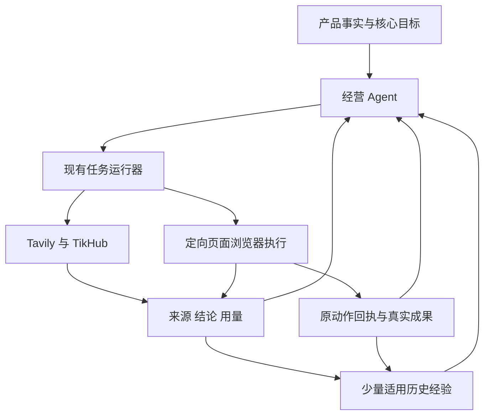

# Lead 统一浏览器执行与研究经验复用最小方案

版本 V9，2026-11-12。实施接续中：真实数据库、Linux原Task登录/发布/回复/未知回查、研究恢复与经验复用，以及同实例跨站公开帧/SSO/SW/断控完整组合已有工程证据；真实模型陌生页和正式交付仍待验收。第1–21节保留方案阶段证据，本次授权与实施状态以第22节为准。当前未发起生产发布，实号试点未授权。

目标：用户提供产品、连接账号后，一个经营 Agent 持续使用研究工具、通用浏览器和历史经验，自主推进有界获客实验。“账号已连接”必须意味着真实浏览器登录及身份核验已完成。新渠道不以专用适配器为前置；多渠道可以同时操作，不能靠轮流切换一个 current_tab 冒充并发。

本文件兼作需求、设计、必要实施步骤及验收记录。V1至V8快照仅在私有 `.state/plan-review-20261112/`，不并存多套有效规范。当前 SW/组合/崩溃取舍见第19–21节，其他底层边界见第18节，旧实验失败保留。工程交付与权限引用 [SMALL_FIX_RELEASE.md](../SMALL_FIX_RELEASE.md)。

## 1. 审查结论与范围

V1方向成立，但混淆产品能力与SDK原生行为，低估登录、持久Profile、并发及失败出口。V9按下表及第18–21节修订，不新增经营Agent、审批链或通用状态机。

| ID | 已发现的反例与根因 | 当前最小修正 | 验收 |
| --- | --- | --- | --- |
| R01 | 未登录先要求发布动作，而发布动作要求已连接账号、目标及授权；连接开始又立即设置人工接管，自动登录被自己挡住 | 连接任务在 pending 账号上独立引导；默认自动持有控制，只在真实本人步骤交还；认证不套发布前置 | C01–C04 |
| R02 | OTP、扫码过期、迟到回调、页面刷新和连接超时没有完整出口，长期显示连接中 | 一个连接根、一个当前挑战版本、明确期限/重发上限/取消及恢复生产者；会话健康与绑定事实分开 | C03–C05 |
| R03 | click门禁不控制观察；截图/302、独立OOPIF、已有SW可绕Page门禁 | 原生Agent/Tools加固定target、递归frame归属、文档门禁；保留SW功能，按实际网络请求核对归属及原意图，不把包装当浏览器硬沙箱 | C06–C08/C28/C30–C33、T12–T29 |
| R04 | 将一个浏览器实例的隔离Context、多个持久实例及storage_state混为一谈；快照不是完整Profile | 首版管理少量持久实例，兼容身份组共享完整Profile；同站多账号/项目/出口冲突才拆实例，不建快照同步或动态进程池 | C06、C09 |
| R05 | 除原有 profile 排他/Actor.lock，固定SDK同进程事件锁也使页面动作串行 | 同时改准入、实际控制及故障资源；两个有界执行 worker 连接同一 Chrome，各运行原生 Agent；等待本人释放槽，不复制浏览器 | C07–C10、T08 |
| R06 | 网关无法确定识别任意网页的身份和 JS 副作用；一律先证明再点会让所有新站点停摆 | 在原任务内有限建立有证据的身份/位置/操作方法；先建立任务意图再交互；限定可保证范围，不宣称任意网站都能可靠自动打通 | C11–C14 |
| R07 | catalog、目标 URL、SQL 权限及动作状态仍只认识已登记平台和 publish，通用入口最后仍被旧门禁拒绝 | 一次贯通通用站点、普通成员回复、publish/reply、首次验证及其 DB/界面消费者；不能只放开浏览器点击 | C12–C14、C23 |
| R08 | 沿用“有限恢复”口号，却没有登录/模型/页面/接口/未知结果的实际恢复生产者、次数及期限 | 复用原 Wait/recover_due；明确资源键、累计预算、下一检查、停止与重开条件，不新增守护层 | C04、C10、C15–C17 |
| R09 | 经验提炼、规则复核和工具调用可能变成每步必经串联；跨项目共享扩大为通用权限平台 | 经验缺失不阻止工作，按问题检索少量资料；只共享同所有者可复用的公开经验投影，不建全用户知识网络 | C18–C21 |
| R10 | 两个受控网站易被包装为全网自主；Chromium丢响应自动重投，单次点击/原帖存在被误当防重复 | 网络前持久 claim、绑定请求零重试、未知只回查；原帖DOM与服务端计数分别验收，不承诺任意站点外部恰好一次 | C11、C14、C22–C24、T10/T11 |
| R11 | 研究停滞另有确定根因：访问用错环境、网站失败扩大为公共搜索故障、提前结束无唤醒、恢复只找已完成根、UI误报 | 研究工具显式选择公共/授权账号页；按实际工具失败归属；共享依赖保留等待、转变去重通知、恢复全部有效依赖；投影真实探测结果 | C25–C27、T16 |
| R12 | Fetch与代理认证有安装顺序；浏览器认证不等于APIRequest认证；错凭据可快速重复握手 | 同一配置供管理器/APIRequest与SDK消费；门禁就绪→SDK认证→页面放行；新/变更配置一次就绪检查，407停止该路由 | C28–C30、T19–T20 |
| R13 | 门禁进程死亡，Chrome自动放行暂停请求及SW重试；prepared/0仍可能已经外发 | 门禁、浏览器和原唯一出口同管理器归属；连接状态持续约束转发，失效关闭旧隧道；不可信窗口只回查。V9受控三切点/断链通过，实际DB/Linux仍验收 | C09/C14/C31/C33–C34、T27–T34 |
| R14 | SW借用失效的认证POST/同源callback；完整URL白名单又漏查询变体；重复控制入口漏iframe归属 | 同一target入口递归认归属；认证端点按实际origin/path绑定ConnectionRef与认证页角色，查询协议由网站验证；就绪失败不授页面 | C08/C30/C32、T25–T26 |
| R15 | Python 3.12原代理先wait_closed再取消handler，活跃CONNECT造成循环等待；关闭窗口内未读完header的连接也可能遗漏 | 先关监听，再取消/收齐全部已接收连接任务，最后wait_closed；读取header前即登记任务。真实socket反例与最小顺序修正、活跃TLS及不完整连接均验证 | C33–C34、T32 |

### 1.1 用户已确认的产品契约

- 一个项目一个经营决策归属；保留 decision、research、content、account、channel、observe、recover 七类任务。执行器解释页面和执行任务，不另选营销方向。
- 统一浏览器执行、账号连接入口、控制与回执。研究不限只读，也不限新产品初始化；登录、发布、回复等可以自主操作，但都有原任务和意图归属。
- “已连接”必须有真实可用浏览器登录及自身身份依据；连接后自动继续运营，不额外要求另登浏览器或点击启动。
- 多渠道共享兼容浏览器资源，在不同固定页面真实并发；共享不等于所有账号共用同站 Cookie，也不强求全系统单进程。
- 通用执行为默认路径；平台专用脚本/API 是成本和可靠性优化，不是新站准入条件。Buffer 不作为依赖。
- Tavily、TikHub 与已有来源按需组合；历史研究、经营与操作经验有条件复用，可被新证据修正。
- 获客渠道必须有适用发布位置、受众发现机制和转化路径；渠道候选不受现有平台清单限制，只读来源仅是研究资源。

### 1.2 本轮边界

用户追加授权：在本任务私有目录进行 browser-use 最小技术验证，允许启动本地受控网站、新建临时浏览器和假账号，使用现有配置模型进行有界真实调用，然后修订方案。没有业务功能实现、依赖安装/升级、生产账号操作或生产查询；没有提交、推送、合并、发布或充值。模型调用实际次数、用量和失败见第15节，不再沿用“本轮没有调用模型”的旧阶段描述。

首版不建多级调度平台、动态进程迁移、跨内核会话同步、全用户经验池、独立向量数据库或每平台工作流；不恢复日周计划、固定营销频率、强制养号/轮换。统一浏览器协议和新路径不以全量旧账号内核迁移为前置。

## 2. 基线与代码证据

仓库 `zdaiwmm/lead`；本轮重新核对 GitHub main、origin/main、任务 HEAD 均为 `d53f32c4d3a55a64a9c5ced440c62c94bf0a7614`。规则采用该版本及用户本轮 AGENTS.md。任务目录 `/Users/zhouding/ss/lead-unified-browser-plan/lead agent`，分支 `codex/unified-browser-research-plan-20261112`，当前只有本方案未跟踪；共享旧目录的其他任务内容不改动。

锁定依赖：browser-use 0.13.14、cdp-use 1.4.5、Playwright 1.62.0、Camoufox 0.5.8、HTTPX 0.28.1、Authlib 1.9.1。不自动升级或新增 Agent 框架。精确 browser-use 官方源码说明：`Agent._prepare_context()` 原生调用浏览器状态和截图，`BrowserSession.get_tabs()` 枚举目标，`agent_focus_target_id` 可变；排除默认工具、设置 use_vision=False 并不能消除原生观察。

| 现有模块 | 可复用事实 | 必须一起改的消费者 |
| --- | --- | --- |
| `growth/agent.py`、`store.py`、`runtime.py` | 单决策者、TaskRef、独立命令组、问题预算、Wait/recover_due、结果唤醒 | 不新增 task kind；能力不能只从已连接账号的 SPECS 推导；准入/故障键不能继续按整个共享 Profile 排他 |
| `browser.py`、`account_profiles.py`、`execution_routes.py` | 持久身份、受控网络/出口、租约/代次、路由、接管 | 当前 Actor 有单 page 和整 Profile lock；拆成运行实例与受控页面，保留原网络边界 |
| `account_connection.py` | pending 账号、连接任务、完成键和身份原子核验已有基础 | begin 当前立即 active takeover，execute_account 只观察；改为自动登录与必要挑战，而非再建连接状态系统 |
| `browser_tools.py`、`hybrid_research.py`、`browser_use_runner.py` | 观察、工具网关、模型构造/用量、有界子进程调用 | 复用子进程调用方式及模型构造；旧另启Chromium和只读工具契约改为接收分配页及受控原生Tools，不直接原样复用 |
| `growth/tools.py`、`adapters/*`、`channel_contracts.py` | 内容版本、动作、终提交检查、回查/回执结构 | ChannelInput/SQL/检查仍以 publish 为主；derive_target 依赖 SPECS 且拒绝 ordinary_member；原封不动复用会卡死通用回复 |
| `fetch.py`、`knowledge.py` | 来源正文、摘要值、原文引用校验、全文检索 | 目前从 DuckDuckGo 网页取链接；补供应商元数据和经验检索，不能仅拉最近文档 |
| `budget.py`、`growth/outcomes.py` | 费用预留/结算思路、可信成果定义、追踪/归因 | 模型 token 与供应商 credits/金额分单位；保持共享额度与未知费用，曝光/点击不能替代核心成果 |

既有业务规范见 [自主经营最终记录](20261112-autonomous-growth-runtime.md)。旧固定模型 26/27 只覆盖已知经营回归，不证明新浏览器、陌生站点或真实获客。阶段性 ACCEPTANCE/BACKLOG 文案不能覆盖该最终记录；本次不重做无关评估。

## 3. 简化后的职责与主路径

只保留三处运行职责：经营 Agent 选择问题/实验；现有任务运行器负责投递、等待和恢复；工具执行层负责实际浏览器/API 操作及证据。数据库是意图、动作、费用和证据的事实来源，不再增设策略排序、浏览器经营 Agent、回查 Agent 或新的监督器。



独立工作立即可运行：公开研究不等登录；内容只等待实际需要的来源/素材；发布只等待本账号、目标及本次内容；观察不等经验提炼；Tavily 不等 TikHub；新执行路径不等全量旧账号迁移。经验提炼失败不阻止决策、回执和后续任务，原研究事实始终可直接使用。

工具由当前问题、证据缺口和预算驱动，后续反馈、效果下降、规则变化和新渠道出现均可调用。一次任务内可以研究、观察当前登录态和准备动作；认证由 account、外部内容由 channel 承载固定意图，不为每一次点击再建顶层任务/工作流或用户审批。

## 4. 账号登录闭环

### 4.1 连接引导不依赖已连接账号

复用已有 pending `social_accounts`、账号环境和 account 任务，采用 `ConnectionRef={pending_account_id, task_id, profile_id, binding_version}`。这里的 pending ID 不是已确认的外部身份；外部主体在成功后绑定。

用户开始连接或提供凭据，就是该连接的认证操作意图。account 任务可在无发布目标、grant、content、实验时导航登录页、填写凭据和提交认证；以原 account 任务的 `operation_id` 和认证检查点记录，不强塞进要求已连接账号的发布 action。其他业务任务不能借此获得发布权限。

begin 默认由自动执行器持有控制，不再立即创建 active 人工接管。原连接任务承担 `打开登录页 → 认证 → 当前自身身份核验 → 完成`，内部检查点存在任务 runtime，不增加多个审批或新的状态机。重复点击连接返回已有有效连接任务；重复回调使用原完成键，不重复生成账号/意图。

### 4.2 成功与运行健康

“已连接”的成功事务必须比较当前连接、输入/挑战版本、页面/会话代次、路由、绑定版本和观察到的自身主体；原子绑定真实身份、完成登录及经营意图，并发出一次唤醒。浏览器中仍未登录、身份歧义、只有 OAuth/token 或凭据保存成功均不能完成。

用户不需要另外登录浏览器或启动运营。后续暂停/撤销优先于更早开始的连接；同号重登不覆盖后来的意图，换号不继承原授权。公开主页作者、头像昵称不是自身登录证明。

已验证身份是绑定事实，浏览器是否存活/可达是运行健康。进程关闭后不伪装为账号退出，也不凭旧证明宣告新会话就绪；再次使用必须恢复持久环境并重验登录。真实签出自动恢复失败后显示“需要重新连接”；执行服务故障显示“暂不可执行”，不能不停让用户重绑。 V9实际硬退出偶发最新Cookie未落盘，必须先读真实自身身份；已授权凭据可用时复用原连接能力最多一次自动认证并再核身份，缺本人步骤沿原挑战。不能写成Cookie永不丢失，不能以本地已绑定事实直接恢复发布。

### 4.3 普通界面交互与挑战生命周期

优先在 Lead 普通界面输入账号信息、验证码，展示二维码/外部确认说明。凭据只由执行层注入已核验 origin/控件，敏感输入及页面中的认证字段在文本、截图和日志进入模型前屏蔽。任意新网站不保证都能自动抽象出普通表单；复杂 passkey、跨设备认证或挑战可退到原页面接管，不假装已在本地登录。

OAuth 只在能实际辅助连接时使用，不开发“先 OAuth 再要求同样账号密码”的默认双重登录链。API 授权不能生成网页登录态的渠道，直接使用适用的网页登录流程。账号注册、购买及接受新增付费协议不包含在绑定操作中。

每个连接只有一个当前挑战 `challenge={kind,version,expires_at,input_seq,owner_state}`，保存在原任务/接管记录：

| 事件 | 确定行为 |
| --- | --- |
| 遇到 OTP/扫码/设备确认 | 进入现有 owner Wait，持久化原页面和当前挑战，释放执行槽和页面动作锁；账号会话保留，其他账号继续 |
| 用户刷新/重开界面 | 读取同一挑战及版本，不重新登录、不自动重发验证码 |
| 用户提交 OTP | 校验连接/版本/有效期后仅提交一次；旧答案、重复答案或迟到回调不能操作新挑战 |
| 二维码到期/用户重发 | 在原连接根下换版本，旧挑战失效；次数与费用累计，不新开免费任务 |
| 用户正在输入或接管 | 自动动作等待交还，不能后台抢焦点/改页面；完成事件后读新页面并核验 |
| 成功/取消/超时 | 成功原子连接；取消/超时终止原等待并通知依赖任务，不永远显示连接中 |

工程默认：连接根从 begin 起总期限 30 分钟；挑战以平台较短期限优先；原根最多自动更新 2 次二维码/验证码挑战，最多提交 3 次验证码答案。被动等待不消耗业务重试次数。扫码/外部确认每 15 秒做一次无模型状态查询，平台给出更慢间隔时从其要求；OTP 不用模型轮询。期限到达由原 recover_due 结束本轮；用户再次明确连接可开新连接根，但同条件自动故障不重置累计 episode/问题费用。

passkey 需要用户设备而远端无法完成时，立即说明支持的替代登录方式或进入原环境接管；没有替代则连接未完成，停止该账号而非无限尝试。

### 4.4 SSO弹窗沿用原连接根，不另做OAuth客户端

原连接动作前登记内部ConnectionRef/代次与已核验认证依赖；围绕分配root页面的popup事件捕获候选，再核对实际opener及认证origin，派生短期PageRef。不能扫全浏览器后凭URL相似认领，也不能拿B任务的IdP窗口给A操作。每步重查连接期限、代次、窗口存活和origin；切换受控页后获取全新SDK观察，旧索引不延用。SDK基础站点名单按浏览器兼容组配置，细粒度权限仍按任务页，不能给同root的不同session配置互相冲突的全局名单。

网站自己的OAuth state、code验证由网站承担，Lead不生成/插入其协议参数，也不要求所有IdP URL可见state。能从合法流程观察到state时作附加核对；内部连接代次始终独立。postMessage、token返回、弹窗关闭都只是可能完成的提示，不能产生新的页面授权或证明登录。回原站实际读自身身份、比较预期身份/候选绑定依据后，才走原finish_connection事务。首次连接不要求事先已存在外部稳定ID；测试中的固定用户名是受控断言。

发现同IdP Cookie冲突时，只排他该实例中的相关认证依赖，从修改IdP身份到原站核验结束；普通已连接渠道不等待。等待本人时释放执行槽及动作锁，保留有期限的认证占用记录，其他同依赖登录排队或按已核验冲突拆实例；不能释放认证占用后让B换掉A身份。取消、到期、原页关闭和故障恢复明确释放该记录、使旧grant失效并只清理所属弹窗。不持DB事务锁跨网络/本人等待，也不无故锁全Profile。

## 5. 浏览器共享与真实并发

### 5.1 首版明确选定的资源结构

统一指的是产品控制入口、执行协议和新通用运行路径，不是强制同批清零全部旧内核。新通用路径优先复用 browser-use Agent/Tools 及持久 Chromium；Playwright 可用于启动、确定性检查和验证；旧 Camoufox 作为同一服务下的过渡兼容驱动，随账号实际使用逐项迁移，不再永久按研究/执行分配两个引擎。

首版不自建动态进程池。固定版本 browser-use/bubus 在同 Python 进程内用全局事件锁串行处理原生动作，Agent生命周期重叠不能证明页面真并发。最小结构是原运行器提供两个有界执行 worker，各自运行原生 Agent/BrowserSession，连接同一个 Chromium 的不同固定 target；浏览器/Profile 不随 worker 数量复制。两个worker的1.5秒服务端导航区间已真实重叠；双真实模型任务也已完成，见T08/T10。

V6补过iframe/SSO、已有SW、独立OOPIF及代理组合反例；V7追加保留SW的功能与防重放链路。V6的组合使用SW旁路/网络deny，V8另补保留SW的一层OOPIF/SSO/代理组合；仍不是浏览器级CDP权限沙箱，业务接入须完成实际部署验证。统一服务按需启动少量持久Chromium，沿用完整Profile，不把storage_state当全站恢复替代品。同一浏览器指同一持久实例。

默认以项目/所有者和兼容身份配置为组：同一项目、不同站点且登录状态不冲突、出口及设备配置兼容的账号，可以共享一个持久 Profile，分别用固定页面并发。同站不同账号、不同项目/租户、不同出口/设备要求或已发现 SSO 冲突时拆成不同实例。未知 SSO 关系不主动合并旧 Profile；首版只对新账号/新环境按此规则分组，不迁移旧 Cookie 来凑共享率。

共享是资源优化，不是成功前置。实例分配记录具体分组/拆分原因、账号归属、出口和页面；不退化成固定每渠道一实例，也不承诺任意账号都能合并。复用原域名/DNS、网络 namespace 和出口约束；若现有隔离使两个账号无法共享进程，则保留实例分离而不是削弱隔离。

### 5.2 三处同时修改的并发作用域

普通操作引用 `PageRef={profile_id,session_generation,page_id,page_generation}`，带 TaskRef 与可选 AccountRef。页面引用由服务端分配，不接受模型指定 CDP/RPC 地址。进程存活不替代账号会话证明。

| 层次 | 首版规则 |
| --- | --- |
| task 准入 | 删除普通浏览器任务的整 Profile 忙碌排他；以分配页面和机器执行槽为资源。未取得槽属于排队，不算失败 |
| 实际执行 | 不共享actor.page/current_tab；按固定Page观察/操作，同页互斥。首版用不同worker使阻塞导航及事件处理均可并发；同进程个别异步HTTP也可重叠，不能据此证明事件处理无串行 |
| 会话变更 | 登录、退出、切号、接管只短暂排他实际受影响的账号/站点会话；必要时暂停其相关页，不锁所有站点或持有 DB 锁跨模型/网络等待 |
| recovery episode | 页面异常按 page/站点故障，认证异常按 account，进程崩溃按实例，供应商异常按连接/端点；不能全部折成 profile 传播失败 |

同账号在多个页面上并行写操作不进入首版承诺；默认同账号一个写运行，回执读取不等写预算，其他账号仍并行。跨页共享 Cookie/SSO 被识别会影响身份时，锁定对应依赖组并复核，不虚报“仅一个标签受影响”。

弹窗按4.4派生受控授权，不自动跟随未知弹窗。V5已验证本地SSO操作及回原页核验，但不等于真实IdP/挑战均支持。页面或frame换文档即使origin不变也使观察代次失效；操作前重查。原生Tools对最后检查后发生的完整换文档已返回stale-index错误，复用该拒绝，不自动按坐标/JS回退。需重新观察再按原意图继续，潜在发送后先核回执。实例重启增加代次并逐账号复验。

固定Page不隔离Cookie。页面绑定允许站点/认证依赖；请求前和重定向响应交浏览器前均核验。V5用现成CDP Fetch请求/响应阶段阻断外域iframe、HTTP跳转和JS导航，保留原302/303与浏览器传输；不以关闭iframe解析替代截图隔离，也不把正常跳转改写成脚本。

未授权iframe在加载前阻断；同源及明确获准跨域frame保留原生工具。外域认证frame、CDN须有角色/资源依赖，允许图片/脚本不等于允许导航/凭据注入。`cross_origin_iframes`显式配置：无需跨域操作可false；需要获准OOPIF操作时true，配合递归归属和节点实际target/origin校验，不能单靠开关隔离截图。不可信文档曾加载后须废弃旧观察并受控重载，不能后装门禁继续用旧缓存。

新增iframe target沿已归属parent session递归附着，装原门禁后再resume；嵌套继承root任务范围，不因SDK能枚举target就获得授权。节点解析前检查target仍归属，解析后不得换target，并从实时TargetInfo复核origin。frame解绑使旧节点失效。固定SDK枚举全浏览器frames时，对未归属target按其原生ValueError跳过约定拒绝，避免外页导致整页Empty DOM；不是把外页放进白名单。

仅动作前检查还不够：观察前后核对该root所属targets的实时origin、attached状态与当前范围。已加载frame被撤销时，先拒绝整次观察，不进入SDK的DOM/截图；不能只挡下一次网络和点击，继续返回旧画面。范围代次变化结束旧SDK片段，恢复有效范围后重新观察。此规则只影响该root，B继续运行；后检查能拒不一致结果，不承诺捕获中撤销的强原子性或撤回已交付快照。

SSO弹窗在授权动作前登记root/认证范围，auto-attach暂停新page，按实际opener装门禁再恢复，不能等DOMContentLoaded。此规则属于原管理器，模型不控制CDP或批准origin；范围回调读当前连接/代次/期限，取消返回空范围，非系统页面不抢占。V6补过新/嵌套OOPIF和本地Basic代理组合，任意多级SSO popup及真实提供方仍未证明。

所有本系统分配的根页必须在交给工具前登记；没有认证占用也登记空认证范围。探针对未登记opener按非系统页面处理，漏登记不能被误当成有效授权。允许的资源与导航范围收缩也须即时生效，不仅处理整表清空。

首版节点默认 2 个实际浏览器执行槽，可按容量配置；不造自动扩缩容。队列按原任务顺序公平领取，资源等待只等待本任务 review_at，过期后明确退出。浏览器交互可以后台执行，不能依赖操作系统前台焦点。用户确认期间释放执行槽；人机共享同页的控制权需要明确交还。

现有 `hybrid_research.py` 已用 `asyncio.create_subprocess_exec` 运行SDK脚本，可复用其有界子进程调用方式：两个槽同时允许两个执行子进程即可，不新增常驻worker服务、进程池、消息总线或第二套队列。原有研究脚本的只读工具/另起浏览器行为必须调整，不能只提高并发数。

## 6. 通用执行的可实施边界

### 6.1 优先复用 browser-use，不自研 Agent 循环

本次真实验证使用已安装的browser-use 0.13.14 Agent、Tools、原生敏感输入和步骤回调。观察、模型上下文、动作选择、历史及有限失败处理由SDK承担。Lead只接账号/任务范围、预算、受控动作包装及真实回执，不自研plan_step/模型步骤循环。

原生动作通过公开 Tools 接口复用；发布包装使用独立 guarded_click 名称并排除原生 click，避免 SDK 重新注册同名工具覆盖包装。回调可以记录提案，但并非每个动作之前的强门禁；最终检查和 dispatching 记录在实际动作包装内。认证输入、导航、切页、快捷键及上传也有可能绕过仅 click 门禁，后续接入需要按实际启用动作统一覆盖，不可只包一个发布按钮就称生产安全。

同一页面只有一个执行持有者；Playwright不与browser-use同时输入/点击。本地Playwright用于浏览器管理、独立DOM/截图和重启核验，还对明确绑定的发布请求使用现成APIRequest零重试转发（页面route.fetch；SW根Fetch配合同一Context.request.fetch）；不替模型选择动作，也不写Agent推理循环。browser-use 0.13.14实际使用自己的CDP层，不能把限定请求转发误说成SDK原生防重发。

共享root原生BrowserSession没有固定target白名单，观察枚举其他页，丢页可恢复到别的target。T03失败保留；T09的65行包装过滤tabs、禁recent_events、观察前后校验target/origin、拒绝外target/跨origin显式导航，关页后停止。input/click包装每次再查scope与节点target，不只在步骤开始设置焦点。

接入包装与固定SDK/CDP版本有关。文档代次、frame归属及最终动作scope须一起核验。V6的SW受限模式、新/嵌套OOPIF及本地代理共存已有T17–T20证据；V8保留SW的一层OOPIF/SSO/代理默认组合已补验，嵌套组合及部署仍须C30；同文档DOM替换、坐标动作、opaque frame、任意多级popup及生产提供方仍未证明。只开已验收工具，不给任意JS/CDP/切页或未验证坐标回退；跨项目秘密或不能建立范围时按边界拆实例。

登录发布在T10、指定隔离/SSO反例在T12–T15通过；尚非实际运行器的C08集成验收，本轮不切业务。技术可行与生产放行分开；Tavily/经验不因此变成永久串行前置。

### 6.1.1 已有SW、代理与target初始化

默认保留SW注册、缓存、controller与正常网络功能，不设置页面bypass或worker全网deny。V6反例表明这些开关可能破坏登录续期、后台读取、合成页面与发布；不能把“网站依赖SW”直接判为能力缺口。V7证明保留功能可行，见第19节。

优先复用现成Playwright `context.route` + `request.service_worker`；但本机1.62/Chrome151恢复已有SW后，worker发出Network事件却未产生Fetch暂停，路由没有调用。新注册正常，不能泛化为Playwright全不支持SW，也不归因browser-use。固定组合采用现成浏览器根 `Fetch.enable` 拦截实际外发网络，结合所属target/session的 `Network.requestWillBeSent` 配对；缓存与纯合成响应没有外发网络，继续由SW正常处理。原Agent/Tools不变，不自建SW解释器或浏览器Agent。

实例管理器统一持有根Fetch/target就绪入口，用浏览器连接、实际Context、当前注册worker与会话代次确定网络归属；networkId仅为短期关联。缺归属有限等待，超时或缺Context只拒绝该请求，不按“不是我的”放行；管理器只处理已登记Context的当前任务，未登记Context的GET/POST一致拒绝。首版为每持久实例一个已登记默认Context，不建跨Context路由层；其他身份实例独立，不把“不是本Context”当直接放行。新worker与重连重新关联，不凭旧session或script URL自动继承业务权限。冷启动先装门禁再放行任务；热接管不能撤回在途请求，既有未知发送只回查。

按原任务区分：认证使用ConnectionRef/原认证检查点；会话续期与合法读取使用当前账号/站点范围；发布/回复使用原ActionRef。认证请求与回调按实际origin＋path等稳定端点事实识别，不靠完整URL字符串或GET推断；只允许当前有效连接的原根/派生认证页，SW不能借用。state/code与查询合法性由网站验证，内部连接代次、期限及页面归属仍必查。不能把所有POST都当发布，或所有GET都当只读。OTP发送等有次数副作用的认证仍沿原检查点；业务暂停不等于账号退出，会话维护与业务发布分别核权。探针的精确请求事实是受控输入，不代表系统已能自动推断任意站点API。

SW发布实际请求在网络前核对账号、profile/绑定代次、目标及method/URL/完整正文版本，再对原动作原子claim；同Context的APIRequest零重试/零自动重定向转发，响应交回SW。传输丢响应返回本地unknown，SW重试/离线队列重放、页面reload及恢复均只命中原ActionRef并回查，不新建意图。worker服务多个标签，不能从worker URL推断发起Page：相同注册范围/envelope只允许唯一原ActionRef，不得覆盖映射；无法区分旧队列与新意图时只暂停该发送，优先站点幂等键/唯一请求标识。SW正常读取、其他意图和渠道不因此全停。具体不可判定的是该请求的权限/唯一性，不能归咎SW依赖本身。

转发仍须验证浏览器与APIRequest的Cookie/CSRF/代理/响应语义一致；V7实测为同Context Cookie认证JSON。浏览器绑定证明、客户端证书、流式/二进制、上传、多请求事务等不据此自动转发；优先使用平台幂等能力或其适用原生路径，有限补证后只记录具体动作缺口，不偷换认证方式或无限重试。可选bypass/deny仅用于诊断或已确认兼容的受限模式，不是默认策略、不清注册和登录资料。

代理server/user/password来自同一版本配置：管理器用于Chromium/APIRequest，SDK用ProxySettings处理407。只配SDK使route.fetch仍407；只配管理器叠加Fetch也复现认证失败。统一门禁及归属就绪→SDK认证→任务导航；V6反向安装失败保留。V8根Fetch+SW、一层OOPIF及SSO popup、代理已同实例补验；不能升级为嵌套、多级弹窗或生产出口也通过。C30保留实际部署与配置恢复验收。重连/配置变更暂停受影响新提交，按统一顺序重建/复验，原未知动作不重发。

新建或实际变更代理配置时，复用原环境就绪读取做一次有界APIRequest探测（零传输重试、不自动跨origin重定向），按真实配置版本保存结果，不逐步重复。明确407停止该路由并等配置变化，未知传输错误不猜成密码错。V6错凭据原生路径曾32次握手；一次就绪检查可在1次407后不启动SDK。HTTP200只证明该探测的网络就绪，不证明账号登录/网站解封/发布成功。凭据不入模型或源站Authorization；源站401不借用代理凭据，不绕代理恢复。

page/popup/iframe/SW由原实例管理器同一个target就绪入口按类型处理，不新增SW服务、认证Agent或通用中间件平台。独立探针用了多个CDP观察客户端便于复核，正式接入不应照搬多套生命周期控制。就绪事实含实例/连接代次及已应用设置；任一失败不授业务PageRef，沿原局部恢复预算退出。

### 6.1.2 门禁归属与断控恢复

实际反例推翻“控制进程消失即请求继续暂停”的假设：只杀根Fetch所属进程，浏览器会自动释放暂停请求；SW还能在无人控制期间直发。账本prepared/0仅表示本账本未claim，在门禁连续覆盖未获证明时不代表未发送。浏览器仍活着不能替代受控事实。

根Fetch、递归target、账号作用域与原动作门禁由现有实例管理器持有，browser-use执行worker只操作分配页。统一管理器还持有实际浏览器启动上下文和原BrowserForwardProxy，APIRequest直接复用该Context.request，避免多个管理端重复接管及Cookie快照转发。worker退出/租约失效拒绝新提交；管理器退出时其唯一出口和已建CONNECT同时失去转发能力。V9在本地实际结束管理器、保留独立TLS观察流，三切点均无额外源站发布；不能升级为实际Linux/任意网站已通过。

控制连续性不能只看PID：WebSocket关闭/失效时撤销ready并关闭既有连接；转发写入同时校验当前控制连接状态及代次，不把已开始关闭的连接视作仍就绪。复用现有管理器内的连接结束通知与代理close，不增设监督服务。原生APIRequest、浏览器与SDK走同一个原出口，实际Linux隔离仍需证明无直连/备用路径、无被子进程继承而保活的出口。

关闭顺序必须修正现有BrowserForwardProxy.close：先关闭TCP/Unix监听停止接收，再取消并收齐全部连接handler，最后等待监听关闭并清理所属socket。Python 3.12的wait_closed会等待活跃连接，原先先等后取消的顺序已真实复现停等；私有最小修正与活跃TLS、不完整header连接均通过。连接在开始读header时即登记，不能等认证后才纳入回收。产品源码尚未应用该修正。

启动/恢复是原Actor.launch内部顺序：出口监听先创建但默认不转发，浏览器可用原生短暂offline启动；装好FullGate/所属target及SDK分配页会话，再允许受控只读/认证，实际核验身份后才准业务提交。固定版本首HTTPS代理认证在恢复时出现407兼容性失败，受控候选使用代理内一个固定本地健康地址完成SDK原生认证就绪，然后仍用HTTPS访问平台；不向外站降级HTTP、不发平台Cookie、不自写认证Agent，健康地址只在bootstrap范围有效。此兼容路径须在目标部署复验，不当通用代理定律。

恢复继续原TaskRef/ActionRef，核验当前账号、绑定、原授权/控制版本和执行代次，旧worker/弹窗/旧命令不得复活。授权版本必须单调，撤销再授予也不能让旧ActionRef重新有效；当前权限校验与claim复用原submission_gate/动作事务的锁和CAS，不持事务跨DOM/网络。V9用原JSON锁原语模拟排序和ABA反例，不新增生产账本，也不替代真实DB事务验收。故障扫描覆盖当前已持久绑定的原意图，不只扫描管理器启动时的快照；新增prepared经历第二次故障也进入原回查路径。

若断控窗口内无法证明唯一出口一直拒绝发送，恢复时该代次下可能外发的原意图（包括prepared/0）先进入原任务的回查/冲突处理，不能因为本地无claim就继续发，更不能换ActionRef。发现多个相同结果时保留重复/歧义，不能挑其中一帖确认唯一性；不能可靠证明未应用则保留未知。只有已证明全程受控且确实未发的prepared动作才可在当前权限下继续。一次管理器故障影响同实例，其他实例和独立研究按原故障范围继续；不全系统停摆。

### 6.2 陌生站点的最小事实与操作方法

通用不等于无需站点事实。首次在原 account/channel 任务内进行有限观察，形成声明式方法数据（可见元素引用/定位条件、身份来源、自身页、目标 canonical URL、编辑器、提交和回读位置），不写生产 Python/JS 或要求开发平台适配器。

区分候选身份、已绑定身份和当前实际发言主体；登录内自身设置/管理入口与登录控件提供的证据优先。若有个人/公司 Page 切换，当前署名必须单独读取；有 handle 无稳定 ID 时明确标记。成功后固定提取条件，再从实际页面复读比对；数据一致只能证明这些可观察事实，不宣称网关能独立理解任意站点语义。

在 owner 当前经营意图内，按可见角色/规则派生本目标/动作权限，保留排除项。普通成员回复不要求管理员权限；publish、reply、upload 分别描述。无历史成功也可以创建 `verification_required` 的正常首条业务动作，不能“先实号成功才许首次执行”。

无法建立账号自身/发言身份、目标或内容依据时，只停该动作；最多一次定向补观察，之后保留具体缺口。新页面/身份/规则证据或执行能力版本变化可恢复原任务；换名字重新探索相同缺口不得重置费用和次数。

### 6.3 主动操作、准备与提交

不存在通用的确定性网页副作用分类器；页面加载、GET、JS、Service Worker、WebSocket 都可能产生站点状态变化。产品保证的是 Lead 发出的主动操作有任务范围和记录，不能保证访问任意网站绝无隐藏副作用，也不能让模型一句 read-only 成为放行依据。

导航/观察在受控 URL 和 Page 范围执行。认证表单关联 ConnectionRef；输入/搜索表单先读取 origin、form、目标控件及方法证据，必要时使用已检查的操作方法。无法解释的潜在发送控件不试点碰运气，优先其他来源或在原任务内补一次观察。

发布/回复在第一次可能写入草稿或内容之前创建原 action，固定账号、实际目标/父帖、正文/媒体、追踪入口和允许动作范围；所以“自动保存”属于这个业务意图，不需要预先已存在一个发布成功。搜索、登录不套用发布的非空 content/target/grant 条件。

在当前授权内准备内容无需额外用户审批。最终点击之前，从实际编辑器/预览重新读取正文、附件及回复对象，与固定版本比对；不一致则修正一次或拒绝提交。身份/目标切换和自动附带旧引用需重新核验。跨页面的引用不能沿用到新页面。

提交边界不只指点击按钮：可能直接公开发送的输入、回车/快捷键或点击之前，都必须完成终提交检查并持久化 dispatching。已证实仅保存私有草稿的编辑保存其草稿检查点，不能当公开发布成功。若输入本身可能发送且无法在发送前核对完整意图，先改用可验证的编辑入口/输入方式；一次补观察仍不能建立依据则停止该动作，不能边输入边试验。潜在发送后的后续步骤先观察原结果，不能当准备失败自动重填。

沿用原状态：prepared → dispatching → pending/unknown → confirmed/not_applied。发送前先持久化 dispatching，网络后存证；停机/超时/租约过期不意味着未发送。V8补充：门禁丢失时prepared/0也不证明未发，先按6.1.2处理不可信窗口；不能用状态名称覆盖实际网络反例。恢复只核对原 action；明确未执行且原条件仍成立时才继续，不换工具/任务重发。

confirmed需有可回读原帖/回复ID或canonical链接，以及原帖实际作者、当前发言身份、目标和正文/附件证据。当前登录身份不等于帖子作者，toast、HTTP状态、模型总结不能单独证明。平台接受、审核、公开可见分别保存。

T06/T07的单次click三次POST，已在T11由DOM/CDP/netlog定位为该Chromium事务因空响应自动重启两次。最小修正是对本action绑定的Page或已核验SW请求归属、method、URL、正文版本/请求体先持久claim，再使用现成Playwright `route.fetch` / 同Context `request.fetch(max_retries=0,max_redirects=0)`；正常响应交回浏览器，传输失败返回明确的本地unknown响应，不再continue/fetch或自动点击。502/409不是平台成功。恢复、页面重载及模型重复提案均读同一持久ActionRef；dispatching/pending/unknown只回查原结果。探针用JSON账本，业务方案复用现有action事务，不新增第二套账本。

此方法只证明绑定且可拦截的单个HTTP发布请求，不在未知站点全局重写所有POST/GET。V7补验SW实际网络与自身重试，仍需精确请求和唯一原ActionRef；动态CSRF、上传、多请求提交、WebSocket等需有适用请求事实及相应用例；优先平台幂等能力。无法建立边界时记录该动作防重复缺口，不能静默换工具重发。原帖存在只证明相符结果，不证明没有其他重复；T11在没有服务端去重的条件下另验唯一性。任意外站没有适用幂等/唯一核对条件时，不承诺external exactly-once。未取得可靠回执保留pending/unknown，不把动作量当获客进展。

上述APIRequest上游不受Page/根Fetch门禁直接保护，因此发布门禁自己在claim/转发前核对当前ActionRef、Page/身份、精确目标origin/URL与请求体。授权集合仍非空但原目标已移除时必须拒绝，不能用bool(allowed_origins)作放行。两门禁组合的允许和拒绝路径分别留证，不因普通导航门禁存在就删掉发送前授权。

## 7. 不停摆与不空转的具体出口

复用现有 Wait、episode 和 recover_due，不新增监督进程。每个非终态要么持有有效短执行租约，要么有 producer、check_at、recovery_action 和终止/升级出口。定时器只做状态核对与原任务续接，不重开经营任务。

工程初值：每个浏览器片段最多 8 次模型调用、20 个主动步骤、180 秒。canonical方法发现的纯选择器定位错误可在原总纠错8次内修正；权限、身份、范围、授权拒绝与其他阶段仍最多一次定向修正，两错后停，真实计数保留。canonical growth.account/discover 需要核对规则和编辑器，重复 DOM 只保留诊断，不单独构成结束发现的充分条件；仍受上述主动步、期限、调用片段及原三片段上限约束。其他阶段连续 3 次步骤没有新页面状态、有效来源或操作进展则结束本片段。平台给出的冷却/期限优先。任务总投入仍取项目/问题和既有恢复上限中更严格者，不能切片重置。

片段耗尽不直接认定业务失败，也不立即无限续片段：已有与任务相关的有效进展、总预算及连接/任务期限仍允许时，保存原页面/检查点，释放执行槽，以页面就绪、挑战输入/交还事件或明确 check_at（无更合适事件时 15 秒后）返回原 Wait；事件或 due 入口只能再次投递同一任务，服务端重验条件后续接。累计费用、步骤与同失败链的修正次数保留。动画、时间戳、转圈和重复观察不算有效进展；无进展已达阈值则等待真实新事实，不因到点自动重开。总预算/期限到达时明确停止或转为必要本人事项并通知依赖。

挑战答复、控制交还、会话换代和方法修正的生产者必须更新对应 condition_revision，并通过现有 resume_task/outbox 唤醒原任务；只有事件名称、没有实际条件变化不能解除故障。也不能保存了新条件却仍用旧 fingerprint 拒绝有效恢复。恢复只更新该作用域，保留同故障 episode 和累计费用。

| 原因 | 原任务的恢复生产者与处理 | 停止出口 |
| --- | --- | --- |
| 缺账号/凭据 | 连接信息或 owner 明确开始连接；其他公开研究继续 | 无连接不模型轮询，不自动注册 |
| OTP/扫码/本人接管 | 当前挑战输入/确认/交还事件；扫码只做无模型状态读 | 30 分钟连接根/挑战上限/取消后终止并通知依赖 |
| 页面布局/控件歧义 | 同页一次定向新观察与方法修正 | 同条件仍无依据则局部 capability_gap；新事实/版本才恢复 |
| 会话退出 | 同账号唯一 account 恢复任务，依赖只等待其结果 | 累计 3 次认证失败或必要本人条件缺失后需重连，不自建重复登录 |
| 浏览器进程崩溃 | 守护恢复原持久实例、增加代次、重验账号；已 dispatching 先 reconcile | 同故障累计 3 次恢复失败后局部阻断，5 分钟起至 1 小时低频健康检查，受恢复预算限制 |
| 模型/接口故障 | 原 episode 按 Retry-After 或原退避；配置变更/最小探测证明原错误解除 | 累计 3 次业务失败后阻断原资源；不因另建任务重试或全工具扇出 |
| 接口额度用尽/未知计费 | 免费周期到期、余额/配置变化，或原调用账单核对 | 不自动充值；无额度/无法核对停止该供应商，其他工具按已有预算继续 |
| 动作 pending/unknown | 原帖子/原 action 回查，允许在项目暂停时做事实核对 | 首轮最多 3 次主动回查，之后 1 小时级低频核对并明确责任；永不以超时认定未发出，不重发同意图 |
| 队列/机器容量 | 释放槽、任务完成/取消和原 due 事件唤醒，FIFO 公平领取 | 到 review_at 明确 resource_deadline，排队不消耗模型/业务重试 |
| 无学习/业务进展 | 原实验观察窗口成熟后的事实复盘 | 沿原 no_progress_round_limit=2 关闭路径；未实际触达/窗口未到不判无效 |

未知结果隔离这一次重复意图，不无条件冻结整个账号或项目。自动修复只限重新观察、环境重连、原任务恢复、允许的替代来源和回查；不能改权限、账号、预算、生产代码或绕过本人挑战。

恢复事件需证明原失败条件改变；浏览器在线不能清除身份歧义，HTTP 可达不能清除无权限，换一个页面或文案不能重置同问题预算。来源重复、重新截图、心跳、任务接受和经验改写均不算新成果。

### 7.1 修正“研究一下午原因”中的调度与恢复缺口

已读该会话最终说明，并按本方案固定主线核对/离线复现；不沿用其历史生产状态作当前证明。统一浏览器只提供正确账号读取的基础，以下消费者必须同次接线，不能认为换执行引擎后自然消失。

| 具体缺口与现有位置 | 最小修改及确定行为 |
| --- | --- |
| `growth/tools._read_source`未传账号；`research.begin_run`始终public_research | 读取请求携带TaskRef、公共/授权账号模式及目标；公共读取默认匿名，仅在本任务有授权且页面需要时分配相应账号页，沿原Profile/出口/绑定。旧驱动尚不能用新执行器时明确capability_gap，不另开未登录Chromium冒充账号读取；Reddit已登录也不保证网络拦截解除 |
| `runtime._resource_condition`只要有queries便归public_search，实际网站失败污染全搜索 | 按实际失败调用记录provider/operation/endpoint或origin/access_mode/账号环境及condition；error_code单独分类，不靠换错误码新建资源/重置预算。search与原文read、各供应商操作/连接分开，网站失败只影响其站点/方式。task有query不是故障依据；部分来源缺失不挡其余有用来源 |
| `advance`的blocked分支直接failed且无wake，替代任务静默消失 | 共享故障依赖保存原任务的可恢复Wait及blocked资源引用，不直接终止；未依赖故障资源的替代研究仍执行。提前终态统一保存原因并按状态转变发一次事实通知；资源首次blocked通知使用project+resource+condition+transition稳定键，不包含新任务ID，原事务/episode记录配合outbox与消费端去重。同条件十个任务不触发十轮模型决策 |
| `runtime.probe_episode`只resume根；根succeeded即None，漏掉依赖 | 核验实际原失败已解除后，在原事务/行锁内标记该episode证据并枚举同项目、同episode/resource/失败条件的全部待恢复任务；根已成功不重跑。逐任务核验当前目标/产品/账号/权限/期限/实验和desired状态，原子增加generation并投原outbox；暂停、取消、过期、旧目标及未知发送不重投。多个资源只解除本次证明覆盖的依赖，其他Wait仍保留 |
| 拦截页在`_remember`被丢弃且read_errors空；recent/API/UI只看任务succeeded | 拦截页不作知识正文，但保留原URL、访问方式、错误分类和安全原因证据。区分network/access_denied/login_required/challenge/empty/missing/transport，未知原因保留unknown。`growth/views.recent`与`growth-status.tsx`投影probe实际output.state、原因、范围、next_check_at与恢复数量；标题使用中性的检查能力，分别显示仍受阻/已过期/预算耗尽/已验证恢复/已恢复并续做 |

恢复证明必须绑定原失败resource和failure_condition、当前observed_condition/代次及实际结果；在消费事务中核对仍最新。登录成功不证明网站封锁解除，别的论坛能读不能清除Reddit故障，HTTP200拦截页也不是恢复。配置变化允许重新核验，不直接清空历史故障或预算。有效恢复但无可续任务时显示“恢复已验证，无待续任务”，不是虚报已续做，也不因根已完成丢弃证明。

复用原runtime JSON检查点保存`blocked_resources`和已通知/已消费的条件版本，Wait仍一个当前检查入口；不新建恢复服务或全局任务依赖平台。动态工具选择的research不能在准入时因任一可能使用的工具blocked就整体失败；在实际必需调用处检查对应能力并返回可选替代。通知去重须持久，不能只用进程内set；重复probe、同一proof与旧事件重放不增加执行/模型调用。仍不可恢复时沿原预算/期限明确停止并保留原因，不无限低频空转。

## 8. Tavily 与 TikHub

| 工具 | 首版能力 | 使用方式 |
| --- | --- | --- |
| Tavily | web.search、web.extract | 搜索公开渠道/需求/规则及读取正文；默认 basic，不使用独立 Research Agent；生成 answer 不作事实 |
| TikHub | social.search、social.item、social.comments | 按真实产品选择具体平台端点和有限分页；优先无用户 Cookie 的公共接口，不一次开放所有平台 |

两者在初始化、后续研究、发布后的反馈分析及复盘中都可用。Agent 选择问题和工具，确定性封装校验启用端点、参数、来源范围和费用；不因使用多个工具增加第二个研究决策者。已充分回答的问题不重复查询，也不强制先跑某一供应商再允许浏览器。

工具封装返回统一的 source_id/原 URL、内容 ID、发布时间、获取时间、正文/片段、供应商及请求身份、指标口径/缺失、分页/抽样和用量。重要结论可追溯正文；无法独立回读的结果注明供应商来源。跨供应商同帖去重，缺失/权限不足/删除/空结果/传输错误分别表示。

所有工具和浏览器读取同时返回实际尝试的访问模式与失败作用域，不能把供应商搜索成功后某个原文读取失败记成search故障。工具错误通过原任务结果进入经营Agent上下文，包含具体原因、影响范围、已尝试方式与仍可用能力；不要求Agent从空read_errors猜故障，也不让备用工具成功替原故障作恢复证明。

当前官方额度：Tavily 每月 1,000 credits、无需信用卡，basic search 1、advanced 2；TikHub 注册验证一次性 $0.05，具体端点可能不适用。试用资格和单价必须按拟用端点核查，不把“约 50 次”当成所有平台的免费调用承诺。

复用原费用预留/结算机制，但单位分 tokens、provider credits 和金额；同次用量不能重复计钱。连接级共享额度在事务内预留，再检查项目/问题上限，网络调用在事务外；保存一个稳定 call_key、request ID/价格版本、已知/未知用量。无 provider 幂等承诺的超时调用不盲目重投，先核原响应/账单；无法核对时保留未知并停止同调用恢复。免费额度也有预算，不新增自动充值。

接口原始数据的保存、用途和缓存期限按来源条件控制，不把第三方 API 的可访问性当平台操作许可。

## 9. 历史经验的最小实现

只补一种 experience 逻辑记录，引用现有 document/task/action/event，不重复存完整证据。type 区分 research、business、operation；其余最小字段为 problem、适用产品/受众/地区语言/价值行为、位置/动作、前提、结论或操作方法、证据等级与引用、反例、checked_at、复查条件、版本/替代关系及共享范围。没有事实的字段可空，不要求每次填全表。

研究任务结束或实验复盘时，在同任务费用内最多做一次提炼；原结果先完成，提炼失败只留未提炼标记，不阻止经营或反复新开付费任务。确定事实/结构化结果可直接保存，无需每条都再次调用模型。操作方法存声明式定位及核对条件，不保存任意脚本、凭据或 Cookie。

决策前用 PostgreSQL 条件筛选和现有全文检索返回最多 4 条适用经验；检索失败/没有命中直接使用当前事实，不等待“记忆服务恢复”。比较适用条件和差异，优先复用仍成立部分，对容易变化的规则/身份/位置按当前动作需要复核，不要求每轮先重验整库经验。

旧经验不固定排序、不决定营销节奏；可以被新证据反驳，也允许提出历史外渠道。失败若只是未发布、缺触达/测量或窗口未成熟，结论保留未知，不能保存“渠道无效”。一次激活不证明规模化；旧账号权限、内容承诺和核心成果定义不能迁移给新产品。

项目内直接复用；同所有者项目间仅共享符合范围的公开通用经验投影，投影保留最少公共出处和条件，不直接开放另一项目的私有文档/动作/客户明细。若系统当前没有工作空间实体，使用现有 tenant/owner 归属，不为此新建工作空间权限产品。用户可停止共享；来源撤销/删除后检索过滤失效经验即可，首版不建跨项目来源传播图或全用户池。

## 10. 共用契约、数据与文件归属

不另建业务状态机。浏览器运行/页面状态以现有任务 runtime 检查点和最小会话租约记录承载；重启后 Page 对象不能持久化，只持久化引用/代次和可续接依据。工具调用与经验补最小持久记录，其余优先扩展现有实体。

| 接口（拟定） | 输入/输出与责任 |
| --- | --- |
| `acquire_page(TaskRef, account_id?, purpose) -> PageRef` | 服务端选择兼容持久实例、分配固定页与短租约；等待槽返回原 Wait，不调用模型 |
| `observe_page(PageRef) -> Observation` | 返回观察版本、当前 origin/URL、作用域内 DOM/必要截图及元素引用；敏感内容先屏蔽 |
| `run_browser_task(TaskRef, BrowserSession, intent, guarded_tools, limits) -> BrowserRunResult` | 直接调用 browser-use Agent.run，复用其观察/模型/动作循环；不自己实现 plan_step 或另一套 Agent |
| `guard_action(TaskRef, PageRef, native_action, connection_ref?/action_ref?) -> ActionResult` | 包装原生Tools；查当前意图/页面/内容。适用发布请求绑定Page/method/URL/正文版本与请求体，网络前持久claim、零重试转发；执行/发送/回读同ActionRef，不新增账本；不能掩盖观察隔离缺口 |
| `finish_connection(ConnectionRef, Observation) -> AccountRef` | 原子核验实际主体/版本并完成连接；无发布 target/grant/content 前置 |
| `prepare_action(TaskRef, account, target_observation, content, operation) -> ActionRef` | 同一任务内派生适用目标/权限并固定 publish/reply 意图，不要求专用适配器或历史实号成功 |
| `reconcile_action(ActionRef) -> SubmissionObservation` | 只查询原动作；输出 confirmed/pending/unknown/not_applied 和可回读证据 |
| `research_call(TaskRef, provider, operation, args, call_key) -> SourceResult` | 端点白名单、共享/项目额度、原请求身份、证据与费用，网络请求不持数据库锁 |
| `retrieve_experience(scope, product, question, limit=4) -> Experience[]` | 只返回当前可读且未失效的少量经验；失败不阻塞经营 |

这些签名是实施边界，已有等价接口直接扩展，不为满足命名重复建服务。内容最终门禁、绑定版本/意图、归因和原动作身份继续由现有事实源承担。

SourceResult/WorkResult补实际attempt的access_mode、failure_scope/condition、typed reason和证据引用；恢复proof及被阻断资源存在原runtime/文档证据。研究route贯通`growth/tools.py → research.py → browser_tools/hybrid_research → execution_routes`，不能只在入口新增account_id。恢复贯通`runtime.advance/finish/probe_episode/resume_task → 原outbox/触发消费 → growth.views/前端`。业务task仍用planned/queued加runtime.wait，不因候选脚本的waiting_resource对照标签增加状态枚举。

复用 SDK 的 BrowserStateSummary、模型输出和 ActionResult；Lead 只增加 TaskRef/PageRef、意图引用、回执及使用量等业务归属，不另建通用 Agent 的 Observation/StepProposal 历史系统。持久化只补实例归属、原任务/动作检查点、工具调用与经验所需记录；真实 Page 对象留在执行节点。共享实例与逻辑账号 Profile 的映射明确保存，旧 Profile ID/绑定关系不因共享而合并。

| 工作归属 | 复用/修改文件 | 最小新增文件职责 |
| --- | --- | --- |
| 执行基础 | browser.py、account_profiles.py、execution_routes.py、growth/runtime.py | `browser_runtime.py` 管持久实例/Page/租约；不管经营和新任务选择 |
| 通用页面执行 | browser_tools.py、hybrid_research.py、growth/tools.py | `browser_execution.py` 仅接入 SDK Agent/Tools、账号范围、限额及动作/回执检查点；不重写观察与推理循环 |
| 登录 | account_connection.py、account_setup.py、account_receipts.py、channel_contracts.py | 原模块内补自动认证和有版本挑战，复用 takeover；不另建连接服务 |
| 通用动作 | growth/contracts.py、growth/store.py、growth/tools.py、domain.py、adapters/* 与相关 SQL 函数 | publish/reply/普通成员位置贯通；SPECS 只约束旧专用路径，不再是通用通路入口 |
| 研究工具 | fetch.py、knowledge.py、budget.py、growth/tools.py | `research_providers.py` 仅 HTTP 封装、规范化来源和额度/调用账本 |
| 经验 | knowledge.py、growth/agent.py、原研究及复盘完成入口 | `experiences.py` 仅提炼/检索/失效和允许共享投影 |
| 数据与 UI | 下一可用迁移、RLS/受控函数、social-accounts.tsx、账号 API/普通输入/挑战视图、growth-status.tsx、后台设置 | 只新增实际字段/索引与必要页面状态，不增加用户维护的实验/经验表单 |

## 11. 测试与证据矩阵

下列为未来新增测试文件及必需反例。测试名与输入/预期是实施交付要求，不代表本轮已经实现或运行。

| ID | 归属文件与用例 | 输入/失败反例及必须断言 |
| --- | --- | --- |
| C01 | `test_browser_connection.py::test_pending_connection_bootstrap` | 无外部主体、目标、grant、content/实验的 pending 账号可以提交认证；保存凭据/OAuth 返回但未登录不能完成 |
| C02 | 同文件 `test_automatic_login_without_takeover` | begin 后无 active owner takeover，执行器实际填表/认证；同号重登不覆盖后来的暂停/撤销，重复 begin/回调只完成一次 |
| C03 | 同文件 `test_identity_is_self_and_acting_subject` | 同名公开主页、个人/公司切换、回复署名不一致、旧会话证据均拒绝；真实自身信息成功绑定 |
| C04 | 同文件 `test_challenge_lifecycle` | OTP/QR/扫码/passkey替代、刷新、迟到/重复答案、上限/期限/取消；依赖收到事件，等待时释放执行槽/动作锁；有期限认证占用由结束/取消/due释放，不允许跨任务换号 |
| C05 | 同文件 `test_session_restart_and_health` | 完整持久 Profile 重启后恢复再核验；真实退出与服务不可达分别展示，旧 session_generation 不得通过 |
| C06 | `test_browser_concurrency.py::test_instance_grouping_and_scope` | 同项目兼容不同域名共享一个实际持久实例；同站多账号/不同项目/出口冲突拆分；A页主动导航/重定向/弹窗到共享Profile的B账号域名，加载/DOM/截图/操作均按任务范围拒绝 |
| C07 | 同文件 `test_pages_overlap_without_current_tab` | 不同worker固定页导航/输入/观察真实重叠，记录服务端区间；同进程锁串行反例保留；故意切页/弹窗/错PageRef，截图和输入只在原页或拒绝 |
| C08 | 同文件 `test_no_native_agent_observation_escape` | 未授权DOM/截图/请求拒绝，获准同源/OOPIF可用；原302/303、旧文档/节点、SSO首请求/代次和缓存观察均受控。T12–T24是受控工程证据，实际部署/未启用动作仍需验收 |
| C09 | 同文件 `test_process_restart_has_bounded_blast_radius` | 杀死实际共享进程，成员页全部换代并重验，另一实例正常；恢复不迁移 Cookie 到别的出口，不重发 dispatching 动作 |
| C10 | 同文件 `test_scheduler_wait_and_recovery_scope` | runtime、Actor 实际控制和 episode 均不是整 Profile 全局串行；同页互斥/跨页并行；资源 FIFO、期限、接管/页面故障/进程故障作用域正确 |
| C11 | `test_generic_browser_execution.py::test_unseen_layouts_without_site_adapter` | 两个不同域名/页面结构的受控网站，不预写平台代码，完成登录/正文发布/带父帖回复/回读；第二布局在方法冻结后才提供，不能只做录制脚本重放 |
| C12 | 同文件 `test_first_member_action_without_catalog` | 未在 SPECS/PLATFORMS 登记的站点与普通成员，有限建立方法、目标和允许动作并首次执行；明确排除目标拒绝，不能自动扩成管理员权限 |
| C13 | 同文件 `test_actual_editor_matches_intent` | 旧草稿、隐含引用、错父帖、署名切换、私有草稿自动保存、回车/输入直接发送、附件错序/内容版本变化；潜在发送前先门禁/dispatching，无法预核完整内容的控件不试填，最终比对不符不提交 |
| C14 | 同文件 `test_receipt_unknown_never_resubmits` | 网络前持久claim、限定请求零重试；落账后断响应、POST页reload、旧dispatching/unknown重载只回查；同一ActionRef确认，错原帖作者/内容/目标不确认。未知站需适用请求/幂等条件，不承诺全网exactly-once |
| C15 | `test_native_discovery_progress_policy.py`、`test_native_progress_product.py`、`test_native_discovery_selector_budget_product.py` | 8 调用/20 步/180 秒；发现纯selector错误最多总8次，其余错误仍一次修正；发现阶段重复DOM仅诊断，其他阶段3次无新状态后停。原Task最多三片段且不重置纠错/期限；动画不算新进展，技术片段耗尽只续原任务，不无限due重开 |
| C16 | 同文件 `test_wait_producer_and_deadline` | 冻结时钟验证每类 Wait 的生产者、check_at 和停止出口；挑战答复/控制交还/会话换代/方法修正实际更新条件并唤醒原任务，旧/伪事件不解锁；无配置变化不重登/付费探测，前端关闭 due 仍工作 |
| C17 | 同文件 `test_unknown_receipt_does_not_block_independent_work` | 三次主动回查后低频观察原 action；同账号其他独立意图和其他渠道继续，重复同意图被拒绝；暂停不阻止事实回查 |
| C18 | `test_research_providers.py::test_sources_usage_and_error_classes` | Tavily/TikHub 固定响应、分页/抽样/缺失/删除/权限/空结果，摘要与正文不同及相同原帖跨工具；去重且不把缺失当零/无需求 |
| C19 | 同文件 `test_shared_quota_and_unknown_billing` | 两项目争最后一份额度、同 call_key 重放、超时可能已计费、周期恢复；不超花、不重复结算或自动充值，另一工具继续 |
| C20 | `test_experience_reuse.py::test_applicability_and_counterevidence` | 同标签不同受众、适用旧结论、过期规则/新反例；最多4条、允许新渠道，经验缺失/提炼失败不阻塞，旧权/旧成果不继承 |
| C21 | 同文件 `test_owner_projection_and_revocation` | 同owner允许共享的公开经验可检索，私有原文/凭据/其他tenant拒绝；撤销/删除失效，重复提炼不冒充新学习 |
| C22 | `scripts/evaluate_native_browser.py` + 原 Task/Action 全链 | 真实模型在两个合成站完成登录、发布/回复方法发现、实际发帖与回复、同一未知Action只读回查；精确源码预登记、完整计量和独立源/DOM回执，不注入Fake模型配方，不以离线机械绿代替模型通过 |
| C23 | 现有受影响回归 + 新增 SQL/RLS 集成 | TaskSpec、状态、权限、通用目标、费用、前端和现有 Telegram/Reddit 直接消费者实际一致；新动作未绕过同项目/目标约束 |
| C24 | 正常业务试点与成本报告 | 精确账号/位置、可见原帖/回复、触达或响应、到站及可信核心结果分别记录；比较耗时/用户步骤/资源/token/接口费，缺成果不称成功 |
| C25 | `test_research_recovery.py::test_actual_failure_scope_and_account_read` | 关联账号读取进入正确Profile/出口；匿名研究不自动借账号；Reddit拦截保留原因、可选择论坛来源；query存在也不扩大成search全局故障；Tavily/TikHub与浏览器实际失败资源分开 |
| C26 | 同文件 `test_recovery_fanout_and_idempotent_wake` | 成功故障根+两个有效等待依赖均正确处理；暂停/取消/过期/旧目标/闭实验/未知动作不重投；同条件10个blocked任务只一次状态转变通知；重复/并发proof与旧事件不重复续做，多依赖不全清；真实隔离DB/outbox/Temporal验收 |
| C27 | API/界面与完整研究恢复案例 | Reddit被拦→原因可见→替代研究实际执行→共享依赖等待→原能力有效恢复→全部仍有效任务续做→经营判断继续；still_blocked的recover任务succeeded仍显示受阻，错误原因/next_check/恢复数与持久事实一致 |
| C28 | `test_browser_concurrency.py::test_existing_service_worker` | 同Profile恢复已有SW，保留合成页面/cache/HttpOnly登录Cookie；原生Tools完成依赖SW的登录、会话续期、POST读取、发布/原帖回读；未授权请求0源站。浏览器/SW重启后unknown并发重放0新增、登录/cache保留；V6 deny仅保留为可选受限模式反例，不是默认平台准入条件 |
| C29 | 同文件 `test_owned_oopif_recursion` | 跨site独立target，一层/嵌套可观察点击；非法跳转/嵌套0请求；旧node不换target。已加载frame撤权后观察在SDK采集前拒绝，B正常；恢复范围后新观察/点击可用，不夸大旧快照撤回 |
| C30 | 同文件 `test_proxy_and_boundary_composition` | HTTP407/HTTPS CONNECT、401凭据隔离、两条传输同版本配置、就绪顺序/一次探测；V8保留SW+一层独立跨站iframe+SSO popup+代理在同实例完成原生Tools登录/续期/POST读取/正常与断响应发布、原帖回读。外跳/错opener/SW越界0 HTTP源站，撤权A不误停B；初始化3类失败不置ready、未登记Context一致拒绝。嵌套组合/多级popup/轮换/Linux仍另验 |
| C31 | 同文件 `test_worker_request_ownership_and_action_ref` | 无networkId/无context/正文不可得不得继续；迟到归属有限等待后可用，过期/撤销/错误账号拒绝；先核prepared精确请求再原子claim，并发仅1次。相同worker/envelope不得覆盖成新ActionRef，历史队列与新意图歧义只暂停该发送；控制进程重启须从原动作恢复并重验账号/绑定/注册代次，同URL worker更新另验 |
| C32 | `test_browser_connection.py::test_connection_scope_not_borrowed_by_worker` | SW借用已结束认证POST、同源callback，以及原根导航callback调换/附加查询参数，均在源站前拒绝；按origin/path识别认证角色，当前ConnectionRef与原根/派生页归属有效时正常SSO可完成；不让GET/同源绕过认证权限 |
| C33 | `test_browser_liveness.py::test_control_process_crash_boundaries` | V9受控同管理器三切点源站0/0/1、恢复0新增，真实SIGKILL/旧命令/动态prepared二次故障、撤权与claim竞争及撤销再授予均拒旧权限；控制连接单独断开时活跃TLS与未完成header连接关闭，SW重放0新增；正常原生登录/恢复/新意图1帖/响应Cookie可用。保留V8裸门禁反例，原victim仍unknown/dispatching，不冒称确认。产品DB/Linux唯一出口/父链/备用直连仍需实际验收 |
| C34 | `test_forward_proxy.py::test_close_with_active_connect_and_partial_header` | 原close先wait_closed再cancel在真实活动socket下超时；最小顺序停止监听→cancel/gather全部handler→wait_closed通过。故障关闭不等待平台响应，不遗漏认证前连接，不误关其他实例；明确当前产品原函数尚未修 |

C11 受控网站证明页面模式迁移，不能证明全网或实号准入。确定性页面/DB 故障注入不调用外部账号；模型语义和实际站点分别留证。任意站点的身份和 JS 效果没有通用绝对保证，无法建立足够事实的动作必须明确局部缺口。

实际平台试点只发正常业务内容。测试/团队/诊断成果排除；无触达、无测量或窗口未成熟保留未知，不为了验收制造测试垃圾或 accepted 点击。工程完成不能替代 C24。

## 12. 可执行的实施顺序与放行出口

先落实公共引用和动作契约；技术可行性、端点材料核验可只读并行。实施时执行基础与登录有同一集成归属；工具封装和经验在接口固定后可并行，禁止共写核心运行状态。下表是同一需求的步骤，不要求多 PR、多次方案审批或全部模块串行。

| 步骤 | 工作/接口与直接消费者 | 必须先失败再通过的检查与出口 |
| --- | --- | --- |
| D1 固定页面基础 | 原browser.py/route/runtime与实例管理；两个有界worker共用Chromium，递归frame归属、保留SW的请求归属/认证角色与原动作claim、同管理器门禁和唯一出口、关闭顺序/连续ready、统一代理版本及target就绪顺序 | C06–C10/C28–C34：实际并发、scope、已注册SW/重启、代理配置及组合；门禁未就绪不授页面，不能原样叠多套生命周期 |
| D2 登录闭环 | 原account begin/execute/complete、挑战/owner Wait、普通连接UI；pending引导及SSO派生页、认证依赖占用 | C01–C05/C08：真实登录才连接；SSO错opener/state或过期grant拒绝，无可见state不误拒；共享IdP冲突不串号，取消/期限清理 |
| D3 通用执行与局部恢复 | 原生SDK接入/动作账本，reply/通用目标及SQL/RLS；同次修研究访问模式、实际故障归属、准入/通知、恢复扇出 | C11–C17/C23/C25–C26/C32–C34：原回执及唯一发送；替代研究不被误杀，同proof只恢复有效任务，无静默结束或无限唤醒；不以浏览器迁移代替runtime修正 |
| D4 供应商与费用 | research_providers.research_call；research handler、预算及来源保存；按真实产品选TikHub端点 | C18–C19：固定响应/DB并发和有限试用账单；无端点试用资格先明确费用，未授权不调用付费 |
| D5 经验 | experiences 提炼/检索/失效；knowledge 和 agent context、研究/复盘完成入口 | C20–C21：跨相似产品可复用且能被反例推翻，不建记忆前置依赖；共享权限实测 |
| D6 集成与体验 | social accounts、growth/views/recent、growth-status、后台工具设置；workflow-guide单一源及需求/待办对账 | C22–C23/C27：增量模型与浏览器/DB/前端消费者；普通登录/接管可续原任务；完整故障恢复案例与实际UI状态相符，不把检查完成显示成能力已恢复 |
| D7 正常业务及交付 | 有界正常业务试点；后续授权范围内的PR/main/精确产物与迁移回读 | C24与本次精确版本工程证据分别记录；未经授权不提交/合并/发布或实号操作 |

未来本地执行命令（文件在实施时创建，不表示现在已运行）：

```text
python -m pytest tests/test_browser_connection.py tests/test_browser_concurrency.py tests/test_generic_browser_execution.py tests/test_browser_liveness.py -q
python -m pytest tests/test_research_providers.py tests/test_experience_reuse.py -q
python -m pytest tests/test_research_recovery.py -q
```

C23 按实际改动使用仓库现有 PostgreSQL/RLS、权限、归因、接管/未知动作、浏览器和前端检查入口；实施前记录实际命令、测试环境、精确 SHA、输入及结果，缺真实浏览器或数据库时不能以 mock 代替。模型与 API 实测单列预算、原请求和实际用量，不重复既有无关付费评估。

新增迁移使用当时下一个未占用版本，包含原子约束/RLS及旧数据升级；不在设计阶段假定生产 schema 或迁移序号。正式交付以主线规则为准，必需的精确 PR/main CI 和生产独立回读不由本地文档或测试替代。

## 13. 迁移、失败恢复与尚未证明的事实

旧 Camoufox 和现有发布通路保留实际账号、意图、路由、费用与未知动作。按账号或兼容组迁移，先观察新环境真实登录；不能复制 Cookie 就标成功，也不要求全部账号同时重新连接。不能恢复的账号走同一普通连接流程的必要本人步骤。

切换先停止对应账号新提交、等待或接管原动作回查、冻结绑定/路由；验证新环境后原子更新路由代次，旧执行持有者失效再恢复。未知发送不能因为引擎切换回滚成未发送，不能双写。环境回退不回滚账本和去重；原实例进程还在时先核实持有者，不盲目另开第二个。

尚未取得实测证据：实际Linux/namespace与真实代理提供方/TLS信任、配置轮换/崩溃恢复；同文档DOM替换/坐标/opaque frame、任意多级SSO弹窗；持续并发成本；真实站点身份/编辑器/挑战、真实SW后台路径与浏览器专用认证/上传兼容性（受控功能链已验）；SQL/RLS/outbox/Temporal研究恢复与UI集成；TikHub端点资格及获客效果。已有SW、新/嵌套OOPIF和本地Basic代理组合不再标为全部未知；V8保留SW的一层组合已补验，本地管理器故障闭环已通过，产品接入及实际隔离仍未验，见第18–21节。

如果某站点要求不可满足的运行身份、无可靠的自身/署名/回读依据或自动化访问方式不适用，记录该站点动作的具体缺口并选择其他路径；不承诺完全自主打通任意平台。若D1的共享与定向控制不成立，先停相应技术实施并报告真实约束，不自行改用户要求或采购新浏览器云。

## 14. 本轮审查与官方依据

前一设计审查阶段重新核对固定主线、原连接和调度/目标/费用消费者，并做两个有边界的只读专项：登录/活性，以及固定SDK/持久化/通用语义。V1的浅层“无阻断冲突”结论不足，已由第1节实质问题和对应修订替代；不把设计审查当工程验收。

V2曾判断自研Page路径可行但未证明更省维护，不是V9方案。后续定向证据补齐origin/认证依赖、续接、实际故障归属和本轮底层网络边界；文档检查不代表业务实现/验收。

探针、日志、Profile及截图只在忽略目录 `.state/browser-use-spike/` 与 `.state/browser-use-spike-v4/`、`-v5/`、`-v6/`、`-v7/`、`-v8/`、`-v9/`；业务/迁移/生产账号未变，无安装升级、充值、提交或发布。不等于C01–C34业务集成验收。

- [browser-use 0.13.14 BrowserSession 源码](https://github.com/browser-use/browser-use/blob/0.13.14/browser_use/browser/session.py)、[Agent 源码](https://github.com/browser-use/browser-use/blob/0.13.14/browser_use/agent/service.py)：原生焦点/目标枚举/状态观察的固定版本依据，不能仅靠关闭默认工具满足Page隔离。
- [Playwright 持久上下文](https://playwright.dev/python/docs/api/class-browsertype)、[认证状态](https://playwright.dev/python/docs/auth)、[隔离](https://playwright.dev/python/docs/browser-contexts)、[上下文代理](https://playwright.dev/python/docs/network#http-proxy)：持久实例与快照、上下文隔离的边界。Context7缺1.62.0精确索引，采用官方文档；实施核对实际安装接口，不自动升级。
- [Tavily Search](https://docs.tavily.com/documentation/api-reference/endpoint/search)、[Extract](https://docs.tavily.com/documentation/api-reference/endpoint/extract)、[额度](https://docs.tavily.com/documentation/api-credits)：能力/计价来源，Context7与官方文档可复用；未进行真实账户调用。
- [TikHub FAQ](https://tikhub.io/faq)、[当前端点](https://api.tikhub.io/)：按端点核对免费资格、单价/版本/覆盖；旧Context7示例不能覆盖已退休系列说明，实际账户未验证。
- [Playwright Route.fetch](https://playwright.dev/python/docs/api/class-route#route-fetch)：零网络重试、禁止自动跟随重定向的现成接口；不能自动覆盖Service Worker等所有站点请求路径。本轮固定安装版本已执行，未升级。
- [CDP Fetch](https://chromedevtools.github.io/devtools-protocol/tot/Fetch/)、[Target](https://chromedevtools.github.io/devtools-protocol/tot/Target/)、[Playwright CDPSession](https://playwright.dev/python/docs/api/class-cdpsession)、[cdp-use事件接口](https://github.com/browser-use/cdp-use/blob/main/_autodocs/api-reference/domain-target.md)：现成请求/响应拦截和新target暂停接口，不是自建协议代理。Context7有browser-use精确版本；cdp-use无1.4.5精确索引，查官方资料并以本机安装签名及实测为准，实验性响应接口不承诺跨版本不变。
- [Playwright Service Workers](https://playwright.dev/python/docs/service-workers)、[CDP Network](https://chromedevtools.github.io/devtools-protocol/tot/Network/)：对照官方能力及禁用兼容性提示；已有worker、Network.enable/bypass/blockedURLs的实际效果以本机固定版本实验为准，不能把新版route说明直接当本机已支持。

外部文档不授予账号或生产权限；本轮授权为本地受控技术验证及方案修订。


## 15. browser-use 最小技术验证结果

本节保留V3阶段实验及失败证据；T02并发解释已按原服务端日志纠正，追加根因/修正见第16节。旧表述保存在V3私有快照，不继续作为当前结论。

### 15.1 固定环境与证据范围

2026-11-12，在本任务本机使用已安装 browser-use 0.13.14、Playwright 1.62.0 和现有测试 Chromium，启动回环地址的两个受控网站、新建假账号及临时持久 Profile。模型只使用现有开发配置的服务凭据，不加载 Lead 数据库/生产配置、现有社媒会话或生产账号。没有使用 browser-use Cloud 或开通新服务。

模型循环全部由原生 Agent.run 执行。少量接入代码用于步骤开始绑定测试 target、调用记录、正文比对、dispatching/回执记录和委托原生 Tools。没有自研 Agent 循环，也没有 fork/修改已安装 SDK。测试站点明确提供自身身份、编辑器及原帖标识，因此不把本结果外推为任意站点身份语义已解决。

可复核私有证据位于 `.state/browser-use-spike/verification-summary.json`，原始run报告、SDK历史、服务器请求/原帖记录和截图在相邻目录。技术探针为 `spike.py`，无模型单击对照为 `click_loss_control.py`；有效最终轮保存当轮源文件 `spike-source.py`。私有Profile仅含本地假账号，不进入Git。

### 15.2 分项结果

| ID | 实验与实际结果 | 准确结论 |
| --- | --- | --- |
| T01 登录 | 修正fixture后的真实DeepSeek Agent完成两个假账号登录；实际浏览器会话可读取自身信息，持久Cookie的Chrome重启后两账号仍登录 | 基本账号密码登录、会话复用可行；完整“登录后继续发布”在限定步数/预算中未整体通过，不含OTP/扫码/passkey |
| T02 共享浏览器调用 | 旧记录的2.177秒是工具调用等待区间交叠；复核同轮server-events，两个慢导航HTTP区间实际重叠0。两个预登录Agent各正确1帖，点击包装区间交叠1.096秒亦不等于底层click并发 | 前次据调用区间判断真并发不成立，现已纠正；本轮T08用不同worker及服务器区间取得真正重叠证据，不以生命周期交叠证明吞吐 |
| T03 页面隔离 | A会话get_tabs得到另一站点URL和私有测试标题；控制器显式指定B target后可取得B页面状态 | 当前共享root配置未提供严格任务观察和目标所有权隔离。没有证明模型自行越权，也不能断言所有可能配置都不可行，但现配置不可直接用于要求严格隔离的业务 |
| T04 正常发布/回执 | 预登录由原生Tools确定性设置；之后两个真实Agent各3个模型步骤完成正文输入、一次guarded原生点击及原帖观察；DOM和服务端账号/正文独立比对均正确 | browser-use基本发布及原帖回读可复用；预登录设置不是该轮自主登录证据，受控站点可读标识也不等于全平台通用回执能力 |
| T05 模型与限额 | DeepSeek出现重复填写掩码密码、结构化输出缺外层action、额外标点被正文检查拒绝，以及预算终止；OpenAI对照4次请求均余额不足后停止 | 保留失败，当前模型完整链路仍需定向兼容验证；没有充值或用反复放大预算冒充通过 |
| T06 丢响应 | Agent仅调用一次发布包装，站点实际落3条相同提交后断开响应；Agent后来读到一个相符原帖并自报成功，但服务端重复断言失败 | 原帖存在不证明唯一发布。应用层一次调用不足以保证外部无重复，本场景不能通过发布防重复验收 |
| T07 无模型对照 | 同故障fixture，直接Playwright一次click、原生browser-use Tools一次click均各收到3次POST | 问题不能归为模型重复点或认定换成Playwright就能解决。未采集足够底层事件来唯一归因网络/页面/SDK，应保留这一边界 |

T06执行器的回执来自实际原帖DOM，不读取服务器内部POSTS变量来决定成功；POSTS/请求日志仅作为独立验收断言。旧初版探针曾直接借服务器状态辅助回查，未被用于最后回执结论。最后轮ledger.confirmed表示找到了相符原帖，不代表整个防重复实验通过。

第一轮fixture的sentinel停在about:blank，被SDK当空页清空标题，不能用于证明隔离；最初session-only Cookie重启失效也属于fixture问题。后续使用实际HTTP sentinel与持久Cookie修正，原失败报告保留不覆盖。

V3阶段五轮有界模型请求48次，44个响应有usage，共105,062输入、4,869输出、109,931 token；另4次OpenAI额度拒绝无usage，不虚构计费。该阶段单击对照无模型调用；本次追加另见第16节。金额未核账，不将token换算为已确认现金成本。

### 15.3 V3阶段取舍（当前由第16节更新）

1. 优先复用browser-use的结论保留：基本登录/持久会话与预登录后的发布/回读有真实证据，不需要因为SDK限制就直接自研Agent。
2. Playwright负责必要浏览器管理、确定性检查和验证；不承担我们重新实现整套页面理解/规划/纠错循环的默认职责。
3. 共享root多标签“能操作”与“严格隔离”分开；T03未通过前，D1/C08共享业务模式仍不放行。后续必须明确公开接口范围、允许的信任组或必要实例隔离及其成本，不偷偷降低用户要求。
4. 不再写“通用浏览器可保证任何站点外部恰好一次”。Lead必须不主动重发未知意图，SDK内部动作和站点/传输行为还需适用的幂等或唯一回执条件；T06未通过，不能包装为已有完整发布闭环。
5. 本轮技术验证完成不等于已具备业务上线条件。OTP/扫码、真正Lead任务进程重启、Linux/namespace、页面关闭后的错页恢复及真实社媒账号均未测试；下一步若继续，应只补T03/T05/T06等具体缺口，不重跑整轮无关评估或开始业务实现。

## 16. 定向修正验证与V4取舍

本节是V4阶段证据，当前方案和追加验证见第17节。

### 16.1 原因、最小改动与实际证据

本轮只在忽略目录做技术探针，没有改业务执行路径。GitHub main/HEAD再次核实仍为第2节SHA。隔离和丢响应是边界清楚的无模型实验，可并行核验；真实模型链路在两个最小接口稳定后集成。独立复核发现回执细节后只补相关链路，没有重跑全量业务评估。

| ID | 原因与最小修正 | 实际验证及边界 |
| --- | --- | --- |
| T08 真并发 | 同Python事件处理经过bubus全局重入锁/单信号量；两个执行worker各跑原生Agent，连接同一Chrome的不同固定target | 同Python两个1.5秒导航串行约3.235秒；独立worker起始差8.25ms，服务端区间重叠。回查旧T02，2.177秒只是调用等待重叠，HTTP实为串行。未增加浏览器/Profile或新Agent/调度平台；不证明长期吞吐 |
| T09 顶层范围 | 原生枚举所有页、可取任意target、关页恢复到其他页；65行BrowserSession包装加动作scope/节点target检查 | A不见B标签标题/URL及测试DOM；显式B target/外origin导航拒绝；A/B弹窗不抢分配；关闭A后观察/导航拒绝，B存活。跨域iframe、旧节点/跳转竞态、内部缓存不在通过范围，包装不是CDP硬权限边界 |
| T10 登录到发布 | 原生sensitive_data使每个input均反馈敏感输入，密码掩码又不显示值；历史表明模型据此重复填。仅密码走原生秘密注入，包装反馈控件+filled布尔；flash_mode=False、每步1动作，保留原生输出和纠错 | 两个新假账号的真实Agent分别6/8次调用完成登录、发布、原帖观察；B断响应后自主回首页找原帖，服务端各1条正确作者/正文；重启仍登录。该14次请求无随机密码原文、无畸形外层输出；多项配置同时变化，不能宣称永久修复模型schema或单独归因某开关 |
| T11 网络重复 | DOM click=1、submit=1、CDP POST=1但服务端POST=3；同事务netlog有3次SEND_REQUEST_HEADERS和2次RESTART_AFTER_ERROR(-324) | Playwright与原生Tools均复现；限定请求门禁使正常/断响应各1POST、发送前拒绝0POST；强制reload仍1POST；账本重载只回查、额外click=0；旧dispatching查无结果也不认定未发。没有服务端去重掩盖问题 |

原生Agent仍承担观察、选择、历史与有限纠错；新增代码仅范围、秘密反馈、意图/请求和验收包装。没有自研推理循环或修改SDK。Playwright的新增实际价值是原生click未提供的限定请求传输控制，不把这项控制扩成全站代理。

### 16.2 回执与单一账本补验

双Agent轮有原帖DOM及服务端作者计数，但结构化DOM只读取当前登录身份，没单读文章作者；点击侧与传输侧各存一份状态。独立复核发现后，未把它们写成完整持久回执闭环。最小修正：从原帖DOM读取文章作者，与登录主体分别精确比对；worker、请求门禁和DOM确认共用一份持久action记录。

仅重跑受影响的丢响应链路：`flow/run-20261112-175758/report.json`，8次模型调用，自主登录→填写→发布一次→本地unknown→回首页→打开原帖。结构化DOM分别读出原帖作者、当前身份、正文、marker和当前原帖页面URL并匹配；同一账本从dispatching→unknown→confirmed，network_dispatches=1，独立服务端仍只有1帖；重启登录仍在。该URL读取location.href，不等于已核验rel=canonical。没有用服务端POSTS变量给执行器找回执。

原生Agent没被要求事先按固定步骤点击；用户名、密码控件、正文、发布和回读链接由它在可见页面选择。守卫明确知道受控表单的提交URL/请求体，这是探针前提，不是已实现陌生站点请求学习。假密码原文未进入本轮模型请求，不能据此声称已具备所有认证截图/秘密的通用脱敏能力。

普通密码登录、单HTTP表单和可回读本地原帖是当前证明范围。OTP/QR/passkey、陌生第二布局/回复、动态CSRF、多请求/媒体/WebSocket、真实worker或Lead任务运行器被杀后的恢复均未验。JSON账本重载及注入旧dispatching只验证持久状态分支，不等同进程崩溃集成测试。

### 16.3 证据与可复现入口

私有总索引：`.state/browser-use-spike-v4/verification-summary.json`。相对路径均在该目录：

- 顶层范围/真并发：`isolation/run-20261112-175142/report.json`、服务端事件及截图；65行包装`isolation/scoped_browser.py`，边界见`isolation/REPORT.txt`。
- 网络根因：`loss/run-20261112-175053/summary.json`及netlog；8项基础对照在`loss/run-20261112-175301/summary.json`，reload/旧dispatching补测在`loss/run-20261112-175444/summary.json`。共12个无模型案例，保留未保护的3POST反例。
- 双真实Agent：`flow/run-20261112-175540/report.json`、SDK history、服务端计数/截图；回执/统一账本补验在`flow/run-20261112-175758/report.json`。
- 校准失败保留：`flow/run-20261112-175431`因160KB模型请求体总限额在各5调用停止，仅登录/填正文未发布。观察每次约29KB后将总字节界限改为350KB，调用上限仍每任务10次、输出上限1200 token。补验没有移除停止条件；首轮错密码占位符被拒后原生Agent自行修正。

受控无模型复现入口是 `isolation/probe.py` 与 `loss/probe.py`；`flow/probe.py`会真实调用现有开发模型，重跑前按当次范围及预算授权执行，不能为复核文档自动重复付费。独立服务端计数/事件只做验收oracle；模型和执行工具只通过页面取得外部回执。

本次3轮共32次模型请求，全部有usage：221,271输入、7,524输出，共228,795 token；含校准失败轮，不只统计成功部分。与V3累计80次请求，76个usage响应共338,726 token，另4次额度拒绝无usage。金额未核账，不虚构现金成本。无模型专项不消耗模型token；全部任务自有Chrome/worker已结束，无生产会话改动。

### 16.4 当前取舍与放行结论

1. 继续优先browser-use，不维护第二套浏览器Agent；首版只需有限执行worker共用浏览器、薄范围包装、原动作账本和限定请求保护。worker是执行隔离单元，项目仍只有一个经营决策归属。
2. 顶层页面常见串页已修正并实测，但完整页面权限隔离仍有明确缺口。C08未关闭前不实施共享浏览器业务切换；不能悄悄将全局串行或每渠道独占当成用户已接受的替代。
3. 登录到发布和这类断响应防重已通过受控实验，不代表任意网站都可无适配自主打通。站点请求形态无法可靠绑定时保留局部缺口，不临时生成生产脚本或假装外部恰好一次。
4. 同一有效证据可供后续实现/评审复用；只在SDK、模型、输入、运行环境或受影响范围变化时重验对应项。Linux/网络隔离、挑战、实际恢复与真实站点仍需专项验证，不重跑无关评估。
5. Tavily/TikHub和经验复用的原方案保持独立，不新增浏览器全部验收完成的运行时依赖。本轮无业务改动、生产账号、依赖升级、提交/推送/部署。

## 17. V5隔离增量、研究停滞与最终最小取舍

本节保留V5阶段证据；当前已有SW/OOPIF/代理结论由第18–19节追加，不覆盖旧失败。

### 17.1 本轮范围和分工

沿原工作树、分支和第2节固定SHA继续；只写本方案及私有 `.state/browser-use-spike-v5/`。iframe/竞态、SSO和研究故障源码核验输入独立，分别验证；主负责人组合门禁并更新同一方案。没有模型API、外部账号/供应商API、数据库或业务服务调用，没有生产操作；探针模型API请求/用量为0，不代表Codex会话本身无推理用量或计费。

| ID | 原失败、最小修正 | 实际结果与限制 |
| --- | --- | --- |
| T12 iframe与重定向 | 禁跨域解析仍有外域截图；普通route拦截被302绕过。改用原生Fetch请求/响应阶段核验URL/Location，不改写302 | 未授权iframe、302、JS导航的目标服务请求0；原生截图无外域秘密，同源iframe DOM及Tools.click可用；原302→200保留。早期GET-only/APIRequest+JS跳转探针仅作诊断，明确弃用为通用路径 |
| T13 观察到操作的竞态 | 旧页面索引跨完整导航会失效；维护页面/frame文档代次并核对实际节点目标。最后检查后用事件屏障换文档再继续原生Tools.click | 预检查发现旧代次即拒绝；检查后完整换文档时SDK明确返回stale-index，服务端误点计数0；复用该原生错误，不加坐标/JS降级。同文档节点替换、动画/坐标不在本轮证明范围 |
| T14 SSO归属及身份 | 原生会话可接管B弹窗；只凭回调/关闭不证明登录。opener+认证依赖+原连接代次派生页，回原站读真实身份 | 两路本地原生Tools SSO返回正确主体；错opener/origin、可观察state不符、旧grant拒绝，假code/关闭不算连接；取消/过期/root关闭仅清所属popup，B正常。共享IdP Cookie使A实际拿到B身份的反例被检测；只序列化该认证依赖后两方正确 |
| T15 首加载、会话复用与门禁组合 | 后装popup门禁来不及阻止首请求；原生session复用曾指定opaque页却观察到B页。先暂停新target装门禁再恢复；固定target且cached=False | 合法首文档可访问，非法首地址/首302/无授权B均0目标请求，不抢非系统页。同一Scoped session完成第二次无可见state SSO，原页正确。组合发布正常/断响应各1帖；全部撤销及集合仍非空但目标移除两种负例均0上游/0帖 |
| T16 研究停滞 | 读取入口、实际故障归属、提前退出通知、恢复扇出与UI五处缺口均有固定源码依据 | 原函数+受控替身实际复现资源碰撞、blocked提前结束0通知、成功根resume=None、拦截页失败但errors空；UI静态核对漏投影。私有候选规则隔离资源、10任务仅1转变通知、恢复两个有效依赖、重复proof恢复0并排除暂停/过期/完成等。不是实际DB/Temporal/UI修复 |

SSO无可见state的中间原生复用失败完整保留，未归咎“网站缺state”，也未用Page点击成功替代原生结果；最终T15用已有scope包装完成原生Tools操作。第二次连接强制新观察、读到当前分配页；不是按已登录B的缓存选择动作。原fixture的state/code属于网站自身协议，Lead未插入OAuth参数。

首弹窗保护用已有cdp-use `Target.setAutoAttach(waitForDebuggerOnStart=True)`、`Runtime.runIfWaitingForDebugger`及同一个Fetch处理器；不是新Agent或完整CDP代理。root页面应在导航前装门禁；给已加载页面后装再观察不算等价。其认证范围必须引用当前ConnectionRef/代次/期限，示例常量范围不等于已实现撤销事务。探针仍以新Profile、禁止Service Worker为前提。

### 17.2 关键证据索引与复用边界

总索引为 `.state/browser-use-spike-v5/verification-summary.json`，下面路径相对于该私有目录：

- `frame-race/run-20261112-181529/report.json`：原生截图泄露/302绕过基线、同源frame正例和事件屏障竞态；原始DOM/截图/服务器计数齐全。
- `sso/verification-summary.json`：双路SSO、伪消息、退出、Cookie冲突、串行对照及失败轮；`sso/generation-check.json`证明同task/page重用时代次1→2、旧grant拒绝。该模块只核实际opener，候选来自root popup事件的接线仍属控制端责任。
- `composed/run-20261112-183002/report.json`：原302/303、iframe、原生发布工具、丢响应及撤销负向组合；请求/服务器独立计数。这里固定原帖地址回读仅验传输，不冒充自主找回回执；自主找回沿用T10证据。
- `composed/run-20261112-183643/report.json`：进一步将发送回调改为精确目标origin校验；保留其他origin的非空集合、只移除原发送目标时，上游发送及帖子均0；同轮普通/断响应正例仍各1帖。不是用集合非空代替当前授权。
- `composed/sso-run-20261112-183002/report.json`：首弹窗门禁、过滤的授权child观察、同一Scoped原生session正常和opaque ticket两种SSO、返回原页真实主体；无模型规划结论。
- `composed/popup-run-20261112-183159/report.json`：安装门禁后恢复target的事件早于合法首HTTP请求；非法首文档/首重定向及未授权B均0请求，非系统页面弹窗保持可用。
- `research-loop/source-chat.json`：用户指定ChatGPT会话“研究一下午原因”，ID `6af5859d-33ec-83ec-af44-e2fe650d9509`，只作诊断线索；`REPORT.md`、`repro.py`、`results.json`是固定源码核对、实际原函数离线失败与候选对照。历史14:29/15:08及0.4秒没有本轮生产复证，不宣称仍是当前线上状态。

之前两个worker/真实模型登录发布证据相关输入未改，可继续复用，不将本轮确定性Tools测试夸大成新的自主模型/真实社媒成功。无模型原函数候选只证明策略分支，不证明SQL竞争、RLS、outbox持久去重、Temporal事件或UI已修。

### 17.3 执行决定及下一次实施的硬出口

最小架构保留：一个经营决策归属、原任务运行器、现有浏览器管理/执行层、原动作账本。范围/首target/SSO角色是执行层接入约束；故障资源/通知/扇出是原runtime修正；来源失败元数据与界面投影是原工具/API消费者补齐。没有增加SSO服务、全局恢复平台、额外数据库/消息总线或自研Agent。

本轮要求的受控反例已有具体修正证据。实施时先把这些约束接入同一路径，补实际Linux/出口及代理Fetch认证、既有Profile/Service Worker、新OOPIF、多级popup、允许的动作种类验证；不启用未验收工具来绕过范围。跨租户仍分实例，可信兼容组共享不等于任意不可信CDP进程相互隔离。

研究停滞不能靠换浏览器、增加Tavily或多投任务解决。7.1全部消费者及C25–C27必须同次覆盖：正确读取模式→准确失败→替代研究继续→受影响任务可恢复等待→有效proof恢复全部仍有效任务→一次经营唤醒→真实状态展示；根成功、重复/并发proof、项目暂停、过期与未知发送均有拒绝/退出。做到真实隔离DB/outbox/Temporal与UI集成之前，只标记“方案/离线候选已验证”，不标记业务bug已修。

本次授权到此为止：方案和本地最小技术验证，不实施业务功能、不操作生产账号、不提交/推送/合并/部署。后续批准实施可直接复用同一需求和证据，按D1–D7实施受影响部分，无需重写方案或重跑无关全量评估。

## 18. V6已有SW、新OOPIF和代理认证的定向验证（历史阶段证据）

### 18.1 实际原因、最小修正与结果

仍是第2节固定主线/HEAD，在同一隔离任务中继续。复用browser-use 0.13.14、cdp-use 1.4.5、Playwright 1.62.0及本机Chrome151.0.7922.34，无升级、模型API或真实账号。本轮SW和OOPIF独立验证，主负责人验证代理配置，再做同一Profile三者组合，不以独立模块通过代替组合结果。

| ID | 保留的反例及根因 | 最小修正、实际结果 |
| --- | --- | --- |
| T17 已有SW | 同Profile真实注册/激活、缓存和假登录Cookie后关Chrome重启。block-only仍受SW控制；一次原生点击产生2次POST，发布guard未观察到、dispatches=0。页面bypass后active worker仍可被postMessage唤醒并内部联网；worker Fetch处理器也未拦住 | 页面Network.enable+bypass，worker Network.enable+blockedURLs('*')，均用现成原生开关。注册/cache/Cookie保留；页面Tools正常、授权丢响应发送1次；后台GET+两次POST均rejected且有inspector阻断，目标服务0。热接管已有running worker，安装完成后同三请求也全拒，安装前成功记录保留，不宣称撤回在途 |
| T18 新/嵌套OOPIF | page-only允许独立iframe后续外跳（目标1请求）；scope抛RuntimeError使SDK全页Empty DOM；仅动作检查时，撤销已加载frame仍返回其DOM/截图 | 递归归属、先门禁后resume，按SDK ValueError约定跳过外target；节点不换target且查实时origin。获准一层/嵌套原生DOM/click通过，5类拒绝0请求；旧节点拒绝。另33行观察前后校验使已撤销时原生状态请求0，B正常，恢复后新观察/click通过 |
| T19 代理认证 | PW单独代理正例通过；叠加Fetch后仅PW凭据失败。仅SDK凭据可浏览，但APIRequest转发407/零帖。坏凭据原生处理曾32次目标握手；源站请求0 | 同一配置给PW管理器/APIRequest和SDK ProxySettings，先门禁后SDK。HTTP407、HTTP浏览、HTTPS CONNECT及原302/303、源站401后继续均通过；正常/丢响应各1帖，代理秘密未进源站认证头。新/坏配置先一次就绪检查：1次407后不启动SDK；有效配置1次200。未自写认证处理器 |
| T20 三者组合 | 先SDK.start再安装递归Fetch时，首HTTP出现ERR_INVALID_AUTH_CREDENTIALS；失败轮保留 | 先WorkerGate/OwnedFrameGate就绪，再SDK代理认证，再页面Network+bypass及首导航。同Profile重启保留SW/cache/cookie；后台GET/POST均0；HTTPS新OOPIF原生观察/点击；断响应unknown/1 dispatch/1帖，reload和强制同请求重放后仍1，重放409；原帖DOM正文/作者正确，A非空且只列A，B不变 |

本轮都是确定性工程探针：页面输入/点击由原生Tools执行，没有模型规划或真实获客结果。组合探针固定本地原帖地址回读仅验传输/内容，不冒充自主找回；自主找回沿用T10。组合账本仍unknown，不因测试读到了fixture原帖就宣称Lead业务确认流程已实现。

### 18.2 证据与已弃用候选

私有总索引 `.state/browser-use-spike-v6/verification-summary.json`；下列路径相对该目录：

- `service-worker/run-20261112-184404/report.json`：重启后已有SW与重复提交基线；`184455`、`184514`、`184637`等原失败/中间轮保留，分别覆盖页面bypass不足、active.postMessage、worker Fetch不足。最终 `service-worker/run-20261112-184755/report.json` 与 `hot-run-20261112-185406/report.json` 验页面及worker设置、已有running worker安装后拒绝；源码/断言在`worker_gate.py`、`probe.py`、`verify.py`、`REPORT.md`。
- `oopif/run-20261112-184744/report.json`、原DOM/截图/服务端事件与`owned_frame_gate.py`：真实跨`.test`站点、独立session，非仅端口变化；SDK空DOM和未归属节点降级风险均有定向处理。最后节点检查保留，不把工具“Clicked”文本当回执。
- `oopif/run-20261112-190901/report.json`、`revocation-summary.json`及`observation_scoped.py`：补验已加载frame撤权，原生DOM/截屏采集前拒绝，B不受影响，恢复范围后原生观察/点击仍可用。旧frame模块未改；前面组合不撤权的输入/相关路径未变，可复用，不伪称新观察器已在所有组合中重跑。
- `proxy-auth/run-20261112-184929/report.json`：PW对照、只配SDK/两条传输差异；`185120`轮重复正确配置与坏凭据32握手；`proxy-auth/run-20261112-185509/report.json`证明1次就绪探测停坏配置。`REPORT.md`区分初始诊断页导航竞态和真实认证失败，不误归因。代理服务器仅为本地fixture，不是拟建产品代理。
- `composed/run-20261112-185449/report.json`：反向初始化失败；`composed/run-20261112-185519/report.json`与代理/源站日志、原DOM/截图证明三者共存及未知结果不重复。`composed/REPORT.txt`列出了范围。嵌套/拒绝OOPIF复用独立专项证据，未伪称在所有SW/代理组合下重跑。

Context7查询固定browser-use版本及cdp-use官方接口，Playwright/CDP以安装签名、官方资料及实际结果校核。新版文档声称的SW route能力不能直接当本机已支持；本机某些配置不启用worker网络检查，也有allow恢复轮未观察到内部请求。V6当时采用实测原生开关；此取舍已由第19节保留SW的选择性请求门禁替代。不修改SDK或自研Agent。

### 18.3 V6阶段的架构约束及验收出口（SW取舍由第19节替代）

最小增量仍在原执行层：递归target归属及薄Session兼容、page/worker网络设置、同版本代理配置和就绪顺序；经营Agent、任务种类、原动作账本及恢复调度不变。正式接入合并到原浏览器生命周期入口，不照搬探针中多个观察客户端为多个服务；不另建代理认证Agent、SW平台或完整协议代理。

原实现需验证的初始化顺序为：配置/路由有效性与必要的一次就绪检查 → 持久实例及target归属门禁 → SDK原生代理认证 → page/frame设置与代次核验 → 实际登录/业务执行。每个新target须在放行前取得所属设置的完成证明；重连或配置变更不能凭旧ready继续。原已dispatching/unknown动作只回查，网络恢复或代理新密码不构成重发许可。407等代理失败归实际代理连接/条件，不能归为网站空结果或公共搜索全局故障；APIRequest的407不计发布成功，外部结果不能证明未应用时保留未知。

当前明确边界：

- V6 worker网络拒绝/页面bypass会改变依赖SW离线合成、后台同步、worker专用网络的站点行为；这是V6功能不足，第19节已撤销其默认地位，不能再据此把依赖SW本身判为能力缺口。
- 热接管只证明门禁应用后的新请求被拒；早前/在途请求不能追溯取消。冷启动组合是在首任务导航前已装控制，不宣称覆盖任何浏览器自主启动时序。
- 代理只验本地Basic及HTTP/HTTPS CONNECT。测试证书为本地自签名，组合有明确测试专用证书例外，不证明生产TLS信任/指纹兼容、NTLM/Kerberos、PAC、SOCKS认证或提供方轮换。
- SDK/浏览器/配置/运行环境变化时重验受影响C28–C30；生产Linux网络边界、真实任务恢复/SQL/outbox/UI、实际网站及经营成果另验。既有T01–T16相关输入未变，不重复模型评估。

本轮新增探针模型API调用和token为0，不代表Codex会话本身无推理用量；没有读取开发模型密钥、操作生产账号、安装升级、业务改动、提交/推送/合并/部署。任务自有浏览器及本地服务已退出。此为V6阶段收尾，V7继续见第19节；后续实施仍按同一记录D1–D7及C01–C34交付，不把受控验证提升成业务上线。

## 19. V7保留SW功能、逐请求核权与防重放（阶段证据）

本节保留V7原证据，当前完整组合和控制服务崩溃取舍由第20节补充；不抹去旧未验项及失败。

### 19.1 纠正的判断

直接拒绝worker全部网络或绕过页面SW，确实可能使平台正常登录、续期、读取和发布失效。V6只证明该受限模式的阻断效果，不能证明网站正常功能，更不能把依赖SW直接作为渠道能力缺口。默认改为保留SW；只对不能核实权限、意图或重复状态的具体请求拒绝。三类现有职责不变：实例管理器认归属，原任务/账号/动作核权，原账本原子认领与回查；不增加SW服务、站点适配器或另一套Agent。

本轮先核对实际依赖，再查Context7 Playwright文档及官方SW说明。Context7无精确1.62索引，以已安装源码、协议事件与正反对照为准。官方说明的worker网络路由能力不等于本机“恢复已有worker”已生效；本次定位到worker目标上的Fetch未产生暂停事件，而不是凭猜测归因SDK或关闭SW。

### 19.2 固定版本的实际验证

仍为第2节基线和本机固定依赖/Chrome。全部使用新建本地假站点、假账号和独立持久Profile；无外部网站账号、模型API、安装升级或业务改动。

| ID | 实验与最小处理 | 实测结果及不能外推的范围 |
| --- | --- | --- |
| T21 SW原生路由诊断 | 新注册、同Profile恢复；早/晚context.route、SDK有/无、Page Fetch有/无、重新连接对照 | 新注册有request.service_worker/route；恢复已有SW时有Network.requestWillBeSent，却无worker Fetch.requestPaused，路由未调用。重新连接无效；一次stopWorker对照未完成，不计修复。不是“所有Playwright SW都不可路由” |
| T22 保留功能的底层入口 | 直接复用浏览器根Fetch请求拦截；networkId配对所属SW session请求；不用bypass/blockedURLs | 获准POST到源站1次、未获准POST为0；正常GET、缓存及SW合成响应保留；另一独立浏览器不受影响。worker Network.setRequestInterception报错、根Network.enable不支持，未继续扩建协议 |
| T23 SW功能与原账本组合 | 恢复已有SW后用browser-use原生Tools输入/点击；SW把/api请求转为实际/session、/publish等；读取、续期与发布分别核权 | SW缓存页面正常；真实认证产生HttpOnly Cookie，自身页面为user-a；续期和POST读取正常。普通发布被SW故意再发一次，源站仍1帖；落账后断响应为unknown/1 dispatch/1帖，不伪报成功 |
| T23续 恢复与并发 | 原ActionRef/账本重载，同Profile重启；SW从Cache读待发正文并并发重放2次；另prepared动作并发首发2次 | 重启后登录/cache/controller保留，worker target已换；unknown仍unknown，两次409且源站新增0；prepared首发为200/409、源站1次。随后经实际列表链接读原帖作者/正文/URL才确认原unknown。回执来自页面DOM，服务端POST计数另作唯一性断言 |
| T23续 权限与事件竞态 | 撤销当前权限、未获准URL、注入缺networkId、注入归属延迟50ms | 前三者均源站0；延迟在0.7秒有界关联窗口内恢复，合法请求200/源站1。缺元数据与延迟为显式故障注入，未冒称浏览器本身必然产生该时序 |
| T24 专项审查修正 | 发现缺Context曾被当成其他Context放行；补缺Context拒绝、正文不可得拒绝、发送前比对prepared intent、同envelope不得改绑新ActionRef | 5项定向负向测试通过，拒绝路径未调用上游、未claim/continue。错误账号测试用权限回调拒绝，不冒充真实账号DB事务；同envelope冲突仅在当前候选映射证明，持久控制进程恢复另验 |

T23完整站点依赖SW的请求改写与缓存，未用直接/session请求伪装页面登录；没有另写模型循环。故障后回读由测试驱动原生工具和DOM核对，模型自主语义能力仍只沿用T10已有证据。本轮不重复付费模型评估。

### 19.3 证据、尚缺验证与实施约束

私有总索引 `.state/browser-use-spike-v7/verification-summary.json`，路径均相对此目录：

- `sw-routing/REPORT.md`、`protocol-summary.json`、`run-20261112-192812/report.json`及controls/new/reconnect等对照：T21原因与失败保留。
- `native-sw/REPORT.txt`、`run-20261112-192844/report.json`、`run-20261112-193002/report.json`：T22原生接口及独立实例。该初候选“归属未匹配就continue”不安全，未直接采用。
- `composed/functional_sw_gate.py`、`probe.py`、`run-20261112-195551/report.json`、同轮源站事件/帖子：T23最终组合；`test_gate_negatives.py`和`negative-tests.log`为T24。早期本地调试端点尚未确认就绪时WebSocket握手失败，后用/json/version就绪确认再连接；失败轮仍保留，未当SW权限问题。
- `composed/verify.py`重读冻结报告、独立源站计数及DOM回执断言；不把测试打印“成功”代替实际证据。旧V6模块/证据未修改；最终报告21项结果断言与5项定向负向测试通过，独立只读核验未发现本节与当前契约的阻断矛盾。

当前验证是浏览器/SW重启和账本重载；授权映射仍在同一Python控制进程，不是控制服务崩溃恢复。正式接入须从原动作记录恢复请求事实与唯一映射，重验账号/profile/绑定/注册代次及原任务当前权限，不能凭worker URL恢复旧授权。相同请求没有平台唯一nonce时，不把新ActionRef覆盖旧映射；无法区分的只有该发送等待补证，其他请求可继续。这里不增加新的持久账本。

本轮没有覆盖同URL worker升级、真实网站浏览器绑定认证/上传，以及根Fetch选择性SW网络与递归OOPIF、首SSO popup、代理认证的同实例组合。V6组合仍有效于其原受限配置，不能升级为V7默认组合证据；C30/C31和实际Linux环境须按受影响范围补验。新默认能力已在本地证实可行，未宣称全站通用、生产可用或这些组合已通过。热接管也不能撤销已到源站的请求。

方案只替换D1/D3执行层的SW处理，其他步骤、Tavily/TikHub和经验复用不追加前置依赖。业务验收仍是C01–C34及真实成果C24；本轮技术探针API模型调用/token为0。没有生产账号、业务功能实现、提交、推送、合并或部署；自有浏览器和服务退出后结束本轮。

## 20. V8完整组合、认证角色与真实进程崩溃验证（阶段证据）

本节为V8当时的结果与阻断；第21节追加V9实际闭环及最小修正，不删除裸门禁反例或旧失败。

### 20.1 范围与结果

延续同一需求和第2节固定版本，只使用私有本地站点、假账号、独立Profile。主负责人验证同实例SW/代理/跨站iframe/SSO组合；独立探针验证实际子进程被终止后的恢复，另做只读权限与证据核验。源站不去重，计数来自独立源站日志/帖子文件，回执来自实际页面。没有修改业务模块或SDK，没有模型API调用、安装升级、实号或生产操作。

| ID | 反例/原因 | 最小修正与实际结论 |
| --- | --- | --- |
| T25 一套完整浏览器组合 | V7门禁、旧frame与popup控制器直接并列，原生Tools点击成功但iframe独立/frame-read无归属，合法读取被拒；不能把“Clicked”当执行完成 | 在一个根Fetch/target入口复用递归auto-attach、每target Network元数据、NativeDocumentGate和原SW转发/账本；薄Session观察约束不变。保留SW并经本地Basic代理HTTP/HTTPS CONNECT，原生Tools观察/操作独立跨站iframe、在正确opener的SSO弹窗输入登录、303回站核验自身身份，再续期、POST读取、正常发布与断响应发布。各1帖，SW重放409/409，原帖作者/正文/链接正确；A撤权后403/403且另一渠道B仍可观察 |
| T25续 拒绝与就绪 | iframe外跳、非获准popup、B打开与A完全相同的IdP URL；已加载iframe撤权；附着异常可能悄悄留暂停target，父方法吞错还可能误置ready | 前三者HTTP源站0；撤权观察拒绝，恢复范围后继续。递归初始化、Network.enable、resume统一成功后才ready，失败记录并关闭所属target；4项注入测试覆盖这3种失败和未登记Context的GET/POST一致拒绝。本轮为单登记持久Context、一层OOPIF；不冒称嵌套/多级popup也同实例重跑 |
| T26 认证角色借用 | 已结束连接后SW借精确IdP认证POST，fetch虽然报错但源站收到1请求；同源callback GET也收到1。只按完整URL识别认证又漏过调换/追加查询的根页导航变体，callback收到1 | 以实际origin/path识别认证端点，要求当前有效ConnectionRef和原根/派生认证页；state/code仍由网站验证。修正后上述HTTP源站均0，正常SSO与后续功能仍通过。不是把所有同源GET放行，也不把所有POST禁用；静态fixture方法事实不代表任意站点已自动推断 |
| T27 执行worker故障隔离 | 门禁由子任务进程持有会随之丢失；改由存活的原实例管理器持有 | 实际task_only子进程多次终止：未发送prepared在间隙403/403、源站0；新worker恢复后200/409、1帖；源站已保存但响应未返回时终止worker，旧请求间隙拒绝、恢复重放409/409、仍1帖并可读原帖。当前撤权/绑定代次/账号变化拒绝，持久envelope改绑被拒，独立新意图及登录/cache/续期可用。这里只证明存活管理器执行边界，task_only子进程读取磁盘后等待，门禁和原映射没有随它重启 |
| T28 门禁本身死亡与冷恢复 | 真实门禁进程终止后，Chrome自动放行原暂停请求：账本prepared/0而实际累计3帖。另一次已claim/源站落账后终止门禁，断控窗口实际2帖 | 冷恢复确实从磁盘重建门禁/映射与当前权限；原已发请求409/409、新增0，旧账号/绑定/撤权拒绝，缓存/登录保留。但只能证明恢复后不再增加，不能抹掉断控重复。DOM找到其中一帖未提升唯一性确认；prepared/0不再视作无发送证明。刻意先停浏览器再恢复的prepared案例也不证明停浏览器前窗口安全 |
| T29 整个管理器与唯一出口 | 仅让另一个父进程继续持门禁会掩盖整个服务死亡；现有Actor实际在自身进程创建BrowserForwardProxy的TCP/Unix监听和CONNECT任务，提供最小复用落点 | 方案采用同实例管理器持门禁与唯一出口/隧道的生命周期，启动未就绪不转发、死亡关闭既有连接、恢复先重新门禁再准发送，不新增代理服务。该方案尚未获得真实管理器死亡的通过证据：追加fixture首轮因Unix socket路径过长未启动，后续追加试验被自动安全检查阻止。本机无Linux/bwrap运行能力，不能以源码或die-with-parent参数替代实际隔离/父链及无备用直连验证 |

T25最终组合的发布输入/点击及SSO认证由browser-use原生Tools执行，故障注入、浏览器管理与独立DOM核对使用现成Playwright/CDP，没有另写Agent。拒绝后的Chrome错误页可能与立即恢复导航竞争；探针复用Page.frameStoppedLoading确认主框架结束，再Page.stopLoading收口旧加载，仅导航一次已声明安全的/app GET，重新取得自身身份和新状态；不重试认证/发布POST。立即导航及加一次重试仍竞态的失败轮均保留；最终按浏览器事件收口后恢复通过。

### 20.2 接入结论与仍然阻断的边界

正常功能可以与逐请求授权及原动作去重同时保留，T25/T26已提供同一实例证据。不能因为SW依赖、OOPIF或SSO就一刀切降低渠道能力。对同worker相同请求的ActionRef歧义仍只停相应发送；对原实例真正断控，则必须按实例故障处理，而不是让共享账号在无门禁浏览器上继续。

最小架构仍为原经营Agent、原任务运行器、原浏览器管理器/执行层与原账本。需要改的是门禁归属、target就绪和原受控出口的放行/关闭顺序，不加Supervisor、SW平台、另一套浏览器Agent、第二账本或独立恢复服务。研究工具、经验复用不新增任何串行前置。

整个管理器死亡的安全闭环仍是D1/D3接入前的阻断：必须实际覆盖原有HTTPS CONNECT在故障时关闭、门禁未就绪不得恢复转发、旧后台请求/未登记Context/备用直连均不能外发、原动作与当前账号权限正确恢复。还须补“持久claim后、上游发送前”的真实切点；当前候选只有该分支代码，未运行通过。最终目标配置中的嵌套OOPIF、多级SSO、轮换及Linux隔离按C30/C33验收，不把独立旧证据拼成已完成的新组合。

当前恢复探针使用本地JSON账本/授权事实，不证明生产DB的权限事务和租约竞争。正式实现将准备、当前权限/代次校验、claim放在原动作事务；恢复重验后才授提交，失去可信执行边界的prepared意图只回查。新增证据未改变真实网站身份、上传/浏览器绑定认证及真实获客仍须验收的边界。

### 20.3 可复核证据与交接

私有总索引 `.state/browser-use-spike-v8/verification-summary.json`；路径相对该目录：

- `composition/full_gate.py`、`probe.py`、`verification-summary.json`、`verify.py`：最终组合、正常/越权/重复与独立源站断言；最终具体轮次及源码hash由索引固定。`test_initialization.py`、`initialization-tests.log`为4项注入检查。
- `composition/run-20261112-211058/report.json`：最终全链及认证变体/错误页收口；`composition/run-20261112-205209/report.json`：iframe真实请求无归属的原失败；`205636`/`205736`：旧认证角色误放行；`210417`：完整URL匹配遗漏查询变体；`210518`：被拒导航与错误页恢复竞争。初始whitelist/origin、HTML属性转义等fixture装配失败也保留，不误归因SDK。
- `recovery/unsafe-20261112-205108/report.json`、对应源站及生命周期日志：暂停请求释放/3帖与prepared/0反例。
- `recovery/runner-20261112-205129/report.json`、对应源站/帖子/生命周期/磁盘bindings：存活门禁下worker故障隔离。
- `recovery/controller-20261112-205338/report.json`及对应日志：真正门禁/浏览器冷恢复、多个新进程从磁盘重建事实；断控2帖保留，恢复新增0与唯一性严格区分。
- `recovery/proxy-fence-20261112-205747/report.json`：首轮监听启动失败，checks为空；不计通过。追加试验中止的原因与未完成范围已报告，未尝试绕过自动安全检查。

旧V6/V7探针及冻结证据不修改，本轮只复用其未变化的传输、账本和观察约束。最终组合、恢复报告和增量修正经过定向只读复核；结果数量不是业务放行。需求当前保留C01–C34，新增技术证据不等于业务实现或生产验收。没有业务改动、生产账号、模型API调用、提交/推送/合并/发布。

## 21. V9同管理器退出、连续门禁与恢复闭环

### 21.1 最小修正与实际结果

本轮按用户“继续解决、保留正常功能、先不实施业务”的范围，只改私有探针和本方案。版本仍为第2节基线；实际Python 3.12.14、websockets 15.0.1，其他依赖未升级。复用现有BrowserForwardProxy的start/鉴权/CONNECT/pipe、V8 FullGate、browser-use原生Tools及同一Playwright Context.request；不再使用前一候选的Cookie快照转发，也不重复创建浏览器管理归属。

正式需要接入的增量只有：原实例管理器持有门禁、上下文和唯一出口；连续ready约束转发，失效回收现有连接；原代理关闭顺序修正；原授权/动作事务及原恢复入口补齐代次与范围。未增加Agent、代理服务、监督平台、生产JSON账本或通用浏览器框架。

| ID | 真实问题与修正 | 最终受控结果 |
| --- | --- | --- |
| T30 启动及代理恢复 | 首HTTPS恢复反复407且SDK认证回调未出现；分配页会话、额外SDK接管/认证处理尝试未单独解决，不能把猜测当根因。候选统一一个浏览器管理归属，并用代理内部固定健康地址完成SDK原生代理认证就绪，再访问平台HTTPS；试过但无必要的自写auth回调已移除 | 三个管理代次均完成本地认证、真实自身身份/会话续期及SW页面/cache；健康响应由本地代理直接产生，不访问外站、不携带平台Cookie、不把站点降级HTTP，健康origin仅bootstrap可用。这是固定组合的兼容路径，目标代理/浏览器版本仍需复验 |
| T31 三个真实故障切点 | 同一管理器持Chrome、FullGate、APIRequest及原代理；父测试进程只通过原生CDP观察，不再用另一个Playwright管理端接管。实际强制终止管理器，独立TLS读取流在故障前已收到BEFORE且仍未完成 | 发送前、持久claim后上游前、源站保存后响应未回，原意图源站分别0/0/1；三轮恢复重放均409/409、源站新增0。已建HTTPS流EOF关闭；原victim仍unknown/dispatching，未伪称已确认，也不据本地0计数盲目补发 |
| T32 控制连接单独丢失及关闭死锁 | 管理器仍在时关闭控制WebSocket，先撤销ready再用原出口回收；每次转发写入校验当前控制连接/代次。原close在Python 3.12先wait_closed再cancel，真实活动socket下超时；最小候选改为先关监听，再cancel/gather所有连接handler，最后wait_closed；读header前即登记连接 | 两项真实socket回归证明原顺序会停等、新顺序可结束。三轮控制断链时，管理器仍活着、活跃TLS流及未完成header连接都关闭，随后SW重放0/0且源站新增0；不把仅禁止新CONNECT当作关闭旧隧道 |
| T33 当前授权、代次与二次故障 | 复用原锁/CAS思路，在claim内比较完整当前授权快照及单调revision；绑定保留原授权版本。旧命令比较执行代次；恢复扫描当前持久bindings，不只启动快照 | 撤权在claim前获胜：源站0、未claim；撤销再授予后旧ActionRef仍403/403、源站0；旧执行命令拒绝；账号/绑定/旧授权组合变化拒绝。启动后新增prepared经历第二次故障转unknown，重放0新增；相同envelope不得换新ActionRef。三个403案例也有revision失配，不能声称各字段分支已独立实测 |
| T34 登录与正常成果 | 硬退出偶发最新Cookie未落盘；先实际读取自身身份，signed_out且有已授权假凭据时只做一次原生Tools认证再核验，不以已绑定缓存代替登录，不静默覆盖另一主体 | 最终三轮均完成三次管理器就绪，实际主体user-a、SW/cache保留；committed轮记录了一次恢复重认证。每轮新合法意图200/409、实际仅1帖；原帖DOM作者/正文/URL及原Context的响应Set-Cookie均吻合。另一已登录主体的拒绝为源码守卫，本矩阵未注入该场景 |

本轮所有站点、账号、密码及证书均为本地临时样本；平台数据路径始终HTTPS。浏览器显式代理和fixture.test禁止直连解析用于这个受控场景，不代替Linux唯一出口证明。原子授权使用原JsonLedger文件锁原语模拟，锁只覆盖权限比较/claim，不跨DOM或网络；正式实现直接复用原submission_gate、control_version及动作事务，不能照搬成另一套生产权限系统。

### 21.2 现有架构落点与放行范围

- `browser.py`的Actor.launch/close：实例、门禁、浏览器实际上下文和原出口共同持有；启动只放受控认证/读取，核实当前身份后恢复业务；关闭先撤销转发。SDK先有分配页会话，不能把任意初始tab的就绪当该任务就绪。正常SW持续保留，原生offline只用于短暂启动阶段。
- `forward_proxy.py`的close及连接回收：必须实施上述关闭顺序，覆盖活跃CONNECT和读取header前的连接。当前业务原函数仍未修改；通过的是私有最小修正，不是现有产品已修复上线。
- 原动作/权限/任务事务：比较实际账号、绑定、授权与执行代次，当前权限和claim统一排序；未知或不可信prepared只沿原ActionRef回查。撤销再授予不能复活旧意图；新增意图必须纳入该执行代次的故障范围。
- 原account连接与恢复：恢复后重验真实登录；必要时复用一次已授权自动认证或原挑战，不再要求用户另开一套浏览器，也不承诺所有平台Cookie永久有效。原动作不因重新登录重置或重发。

此前“管理器死亡如何收口”的核心问题，在固定本地条件下已得到闭环证据。正式业务接入仍需C01–C34：实际DB/RLS/租约/通知、目标Linux父链/控制连接/唯一出口与备用直连、真实代理和网站分别验收。现有隔离使用的控制管道不能未经核验就当作Chromium CDP控制通道；不能为连上CDP而开放宿主/公网网络破坏原边界。没有把这些待验部署事实标为通过。

V8正常SW/OOPIF/SSO组合及旧反例继续有效于其固定输入；本轮三故障切点是单根本地JSON站点，没有把独立结果拼成“所有嵌套iframe/多级SSO/真实认证都经历过同样故障”的新结论。不承诺任意网站external exactly-once，也不把测试帖子计获客成果。

### 21.3 冻结证据

总索引 `.state/browser-use-spike-v9/verification-summary.json`；详细索引 `recovery/verification-summary.json` 固定实际导入源码闭包、运行时版本及证据hash，不仅冻结主脚本。

- 最终三轮：`recovery/owned-beforeclaim-20261112-221107/`、`owned-afterclaim-20261112-221107/`、`owned-committed-20261112-221107/`。各含报告、独立源站/帖子、生命周期、绑定/账本及主脚本快照。
- `recovery/owned_manager_probe.py`为最终候选，`test_proxy_close.py`/`close-tests.log`为真实socket反例与顺序修正，`verify.py`重读源站、账本、DOM回执、Cookie及完整报告，共79项证据断言通过。
- `owned-*-20261112-220413`含活跃连接关闭超时，`owned-committed-20261112-220738`含Cookie未落盘后未恢复就绪；早期Unix路径、SSL、跨管理端认证、流读取等待及首HTTPS407失败均保留。失败轮不计通过；临时诊断代码未变成必需产品模块。
- Context7查websockets 15.0.1的连接状态/关闭语义及Playwright持久上下文/offline资料；Playwright无精确1.62.0索引，以实际安装签名、源码和运行结果为准。close死锁另对照本机Python 3.12.14 asyncio.Server.wait_closed源码与真实socket，不泛化到未测运行时。

独立只读增量复核未发现本轮受控范围的新阻断。没有应用代码/数据库变更、生产账号、模型API调用、依赖升级、提交/推送/合并/发布；自有进程及临时出口清理后结束本轮，后续按同一记录D1–D7接入，不重写方案或重做无关评估。

## 22. 本次实施授权与交付接续（2026-11-12，进行中）

本次用户明确授权：“新开一个会话，按照此方案实施，并完成验证，合并部署”。本节接续同一V9记录，第1.2、17.3及18–21节中的阶段限制和“未实施”结论保留为当时证据，不作为本次实施/提交/推送/一个PR/合并/部署的禁止。没有授权真实平台账号操作、营销测试帖子、自动充值或采购；C24仍单独保留未验。

基线与规则重新核对：GitHub实时main及origin/main均为`d53f32c4d3a55a64a9c5ced440c62c94bf0a7614`；规则来自同提交的AGENTS.md、SMALL_FIX_RELEASE.md及HOME_RELEASE.md。共享旧目录HEAD为`d8878314c2ed9b7760818ff20ef24c6d55822b2c`且有多任务未提交内容，完整保留。实施独立分支`codex/unified-browser-implementation-20261112`从已核实main建立；只复制本需求记录，不复制原方案目录的私有Profile、日志或凭据。

生产独立只读盘点：应用、Telegram和Reddit执行器均为`7940fbefc93dff2c3ac8c4b43d20e07aefa88253`，schema为`0031_growth_runtime`；到开工main仅增长需求文档差异。最近正式部署请求已success，无新在途发布；盘点时无维护、prepared/dispatching/unknown动作，无未完成growth切换。上述是开工快照，切换前仍须重新读当前事实。

分工：统一浏览器/登录/动作事务归同一核心实现负责人；研究runtime恢复、供应商/经验与发布产物按稳定接口在独立目录并行。主负责人集成tools/agent消费者、保留单PR和最终放行；不共写同一核心状态或生产锁。

### 22.1 已取得的增量证据（不等于完整放行）

- C34：在当前产品BrowserForwardProxy上新增真实活动CONNECT及不完整header用例，原代码两项均在wait_closed超时；修正为停监听→取消并收齐全部handler及pipe→wait_closed后通过。新增每次转发的当前控制代次核对，真实旧隧道在换代后不能继续写入；管理器仍须接失效先撤ready再close。
- Linux控制通道：复用原namespace入口，增加管理器持有的0700目录及0600 Unix CDP桥，只连namespace内部固定回环端口。目标Linux双控制客户端、双页面、唯一出口attestation、宿主无调试TCP监听和终止父进程后双连接EOF通过；旧Juggler管道、出口/私网拒绝与挂载回归通过。双SDK子进程原生Tools固定页实测重叠，仍不能替代SW/OOPIF/动作事务完整组合。
- D3研究恢复：实际provider/operation/origin/access_mode故障键、调用时持久Wait、条件转变通知去重、同事务恢复扇出及真实probe状态投影已接线。独立36项真实PostgreSQL/Temporal恢复回归通过。免费probe补同episode累计次数和期限；旧成功根不会阻止仍有效依赖恢复，旧proof/暂停/取消/过期/未知发送不重投。
- D4/D5：供应商使用原budget_reservations/usage_events，区分provider credits/金额/token，未知账单不重投；同凭据所属工作室、当前claim/控制代次/期限限制、后台配置和费用消费者已接线。经验缺失不阻塞，提炼在原结果持久成功之后尽力执行，公开投影只能来自实际公开来源的有限摘录，不能借私有文档和外部URL洗白。39项供应商/经验及设置真实DB定向回归通过；HTTPX固定响应测试没有外部付费调用。
- 主集成首轮研究/经验/恢复27项通过，另一次直接消费者15项通过；之后修改继续按受影响输入重验。新0032在实施中补过函数/触发器，测试库重新建立，不把已跑旧DDL的库当最终迁移证明。
- 独立审查实际复现并交回修正：取消/过期任务仍可预留费用、跨tenant复用全局key额度、私有经验公开投影及源删除失效、供应商漏调用前故障检查、浏览器异常误归direct_http。反例及修正测试均保留，不以旧绿掩盖新发现。

- 增量集成：迁移0033后85项供应商/经验、动作事务、控制桥、打包与交付检查通过。公开来源共享开关关闭时，同事务撤回既有公开投影且禁止新增；私有经验仍可用。前端合成数据验证1440/390宽度、近期探测仍受阻状态、供应商缺密钥与2.5credits→2500单位、原账户操作及指南通过，无外部请求或真实操作。前两次UI验证失败分别来自独立目录依赖链接和测试页未展开历史/辅助JSON溢出，修正测试环境后通过，未将失败算通过。

- 扩大兼容性检查的首次隔离运行共1220通过、49失败、29错误；按原失败XML核对，72项为macOS Unix socket路径长度、3项本机无Docker、3项迁移head断言仍为0031。改用短隔离目录并更新本需求新增0033的断言后，179项受影响定向检查通过；不能将本机缺Docker视为Linux演练通过。随后原生旧读取记录器补当前范围/全部frame/loader前后核对与每页锁，账户来源独立去重不可借公开来源身份，30项定向通过。
- 发布独立审查复现P1：最后核验前已解除DB调度hold并开入口。修正为原app、两执行器、schema和已安装独立verifier全部通过后再恢复，并持久记录restore/start丢响应后的真实DB/入口状态；不能从pending文件推断仍hold，不自动重新pause或回滚已可能执行动作。固定源码独立138项及新增6项故障测试通过，根目录另6项通过；仍非真实Linux/生产演练。
- 最终研究安全复核新增实际反例：参数准备期间停用供应商，旧配置仍会放行预留/请求。正在修为原预留事务取得项目锁后重读当前配置、额度与凭据，模型配置发布同序串行所有受共享连接影响项目；原28项与停用反例修正版1项通过，额度收紧/轮换及并发继续复核。浏览器恢复探测改在当前recover TaskRef上使用原provider/URL，不以匿名HTTP证明浏览器恢复；53项相关恢复/费用定向通过，实际账户恢复页仍待核心helper接合。

- 同项费用窗口修复已独立复核：停用、额度降低、密钥轮换均在参数准备后发出0请求/0usage；global与project模型发布统一先catalog advisory再Agent锁，真实双连接发布等待时第三连接可立即取得Agent锁，释放后两项成功，避免反向锁序。独立4项及主集成同4项通过，保留反例与修正证据。

- 连接前端接入一次可选凭据、通用网站、按origin选择多账号；仅保留内存并在发出/卸载清理，自动阶段拒绝人工输入，owner输入/恢复/取消绑定challenge_version，旧owner回包不能重开控制。独立1440/390合成界面通过，主集成同脚本复验通过；此项模拟API，不替代真实账户执行。
- 新ConnectionRef合同独立反例曾确认7类8个缺口：共享A/B串连接、非默认协议端口丢失、兄弟子域Domain Cookie共享、control权限错归、inflight恢复、过期凭据未清及旧challenge proof。修正后固定`7c17f34`的32项独立SQL/API/晚prepared/正常close检查通过；还发现owner阶段重开返回旧协议标志，已交核心修正，未视作放行。runtime补过期扫尾，即使原Task已失败也清密钥、换版本并只发一次事件。
- 供应商恢复补相关配置/凭据内容条件hash（不把spend当条件）；只读取故障后同provider/operation/当前配置的既有真实响应作proof，不发新付费请求，不结算unknown。独立反例暴露project/原question无额度仍误报恢复后，补下一次完整预留的三层headroom，7项通过。局部额度/旧claim/goal/product错误现携带服务端实际question/project/TaskRef限定身份，不能毒化其他问题或新任务的provider资源；9项新增及原恢复/费用共46项通过。
- 核心真实Linux验收使用独立空库与loopback SSH反向连接本机自有隔离PG，非生产库；临时worker-venv与bu-venv依赖分别核实，无生产环境安装或.env复制。fixture A为普通HTTP网页、真实密码表单/HttpOnly Cookie/私有self入口/普通成员规则/post/reply/父帖DOM/断响应/OTP，独立源站oracle没有HTTP入口；2项fixture HTTP自验通过。第二布局将在方法生产者冻结后才提供，不给执行器预置selector recipe。

- `de1c411`补单例记忆反证入口；默认旧27轮不变，新例只允许原primary及一次repair。9项假模型/真实DB检查通过，实际context含同产品旧经验、当前低触达/零到站反证、可发布的当前Page能力及核心成果unknown；报告保留原proposal/输入hash/usage，不用自动rubric替代语义审查。真实单例在独立`mce27`库预注册最多2请求、160000 token单位保守上限后执行，不运行其提出的业务任务。真实DeepSeek单例primary1次、8380 reported token（输入7230/输出1150）、27108单位预留已settled，无repair/未知账单；选择公开受众场所研究，明确拒绝当前反证下旧每日同页建议，核心成果仍unknown。其低触达即断言受众不在/第四帖已证伪的措辞过强，保留为语义局限，不称通用经营判断已通过；研究任务未执行，供应商0调用，货币成本无公布费率不能计算。原输入/输出和独立语义复核留在私有报告。
- C20增量反例：4条各6000汉字的合法经验使原context先丢当前证据再报超限，反而阻塞工作。真实DB先复现失败，改为超限优先舍弃可选低排序经验，保留当前证据/目标；决策、经验和定向评估27项通过。上述真实单例输入仅16537字节，不触发此分支，输入与system未变，复用原模型结果而不重复付费。
- 两次较早Linux原生连接尝试超时，原DB各保留40000单位费用预留，合计80000状态未知、没有usage回执；不能认定已消费80000，也不能视作零调用/零费用或清账重跑。跨机DB延迟已用自有Linux本机PG隔离环境移除，机械链路改先用本地假模型核对。

- `e3e7a5f`接入实际原生自动认证：Linux真实浏览器/原Task/ConnectionRef用本地假模型5次原生调用填两字段、只发一次`POST /session`、读私有`/account`后DB绑定真实Account ID，执行器返回completed（原helper尚未调用finish落Task终态，此缺口已发现，待后续持久完成复核）；错误私有主体拒绝。固定Linux2项12.65秒通过，实际模型请求及SDK工作目录的用户名/密码双literal扫描均false，假HTTP接收端独立扫描同样无明文。此为执行器机械证据、真实模型API0，不是陌生页语义验收。独立cookie空identity probe仅允许既定GET，不能借社媒Cookie或POST；生产出口双公网来源仍待实测。
- 同段补原ExecutionRef generation、出口usable及配置指纹逐次核对；owner重开仍保留有版本的原生协议；8模型调用/20主动步骤上限。主集成45项连接/动作/读取/当前回执投影与旧出口消费者通过。两个独立真实DB反例曾确认不同transport误共享并改A路由、原生Reddit遗漏已配置固定出口；修为兼容transport/出口cohort分组及保留原公共/社媒出口消费者后，两例转绿，旧Profile不迁移。

- C28/C30另有独立三站夹具冻结于`622e49c`，源文件SHA256为`2c2b0e74eb3a6cda8366bbfe473889c35756e1b053879700ea779da97cdd9976`。真实完整Chromium151/Playwright1.62独立3项4.74秒、主集成3项4.49秒证明SW cache/合成/HttpOnly续期POST、POST读取、嵌套独立OOPIF、SSO正/错opener、旧认证端点SW借用及非幂等重放都可实际触发；仅Python oracle、无HTTP oracle且不记密码。夹具故意允许负例，产品门禁尚须在同实例组合证明0源站；不能把夹具自验计作C28/C30产品通过。standalone便利参数含无代理配置，严禁带入产品运行。

- C07/C10产品准入增量`80f804d`：真实双Task触发旧profile全局排他，独立DB反例4红1过；现同一原生profile最多2个不同账号有效运行claim，同账号继续互斥，连接占用只阻当前账号，等待finish释放名额，旧Firefox/profile任务仍排他。故障resource按原生账号分开、进程/原动作隔离仍由原profile lease负责。修后直接消费者36项通过，补同号有空槽仍互斥后6项专测通过；真实双业务浏览器及内部身份辅助页并发待核心接续，不能用DB claims代替浏览器重叠。

- `8bc586e`补服务器签发ExecutionRef的可选registry内容hash：同名transport热改后新ActionRef及unknown回查不能改向新地址；旧账本无hash不补造历史条件、不重投。16项新增与原消费者78项通过；`80f804d`准入另6项独立真实DB复核通过。原生运行实例/出口即时fence随下一核心增量接入。
- `3ce50c7`冻结完整方法发现producer（源`a78f00e550bc13194ba6211142a2e51498ea39b9`）：Linux两个产品机械例21.02秒，现实际finish后DB succeeded/waiting_user终态均有assert；第二origin兼容账号真实登录、两个原TaskRef持主页时fresh私有self辅助页可并行，过时编辑署名不能掩盖当前私有主体变化。原discover入口经SDK导航/propose_method两次假模型取得实际方法及grant，receipt仍unobserved，未伪造verified marker。新空库方法/回执投影/registry/准入/动作46项2.66秒通过。3片段与180秒等硬上限不等于完整C15；一次定向修正/连续无新状态及各Wait生产者继续补验。
- 第二布局B在上述producer冻结、释放记录写入后才解封；原独立文件SHA256仍`840b0467e1fd11642a5409f104fd53b188e3773528efec4d564adf4988453b54`，未为产品修改页面。`23d79c8`入库仅按Ruff排序stdlib imports，模块其余AST和imports集合与原版完全一致，仓库文件SHA256为`6badeffc6b75802b31cb8c51f5f0f5ff4c8934ae3d1fecb2514c6d031f731e1a`，5项HTTP自验2.57秒；此不是未见页面实际模型验收。核心负责人为进一步减少动作消费者受布局影响，仍主动不读B，先完成通用发送/回查后才使用。

- 新独立真实Temporal整合`95833ba`（源`e664e38703a87d271d0d6830ac7cb40747fcc578`）2项30.21秒，未调用真实模型/网站：实际DB/outbox→原worker.deliver_workspace→原Workflow/活动→真实research/probe/consume→经营decision；仅最低HTTP HTML与模型输出受控。替代来源文档持久成功，still_blocked probe虽succeeded真实view仍blocked；原source proof真实并发租约仅一次，两个有效依赖续原gen2，另一case过期依赖由Workflow自然终止且不复活；重复outbox不增probe/source/wake，3份Workflow历史replay通过。主线CI使用自己的隔离Compose端点，补严格GitHub-hosted环境核对以实际执行此case；本地仍强制私有manifest，不因CI缺该manifest跳过。
- 独立原生live fence36项通过：同alias URL热改、Tokyo profile/endpoint/绑定/IP与配置撤回、FB split撤回均拒旧scope，原public空storage与pending→verified合法转换保持。随后真实P1反例确认：原discover RPC回包在pause→resume后给已canceled任务铸造新rev4 grant。`0b70f05`修为服务器producer_scope及原Task/claim/control/意图/route/绑定同事务校验，整批任一stale全部回滚；独立先以完整有效scope在旧码复红，固定新码12项1.30秒通过，原任务canceled、currentintent仍running/rev4、target/grant均0且旧attempt未改，拒绝非缺字段误绿。

- C04真实Linux原生挑战4例39.25秒通过：owner等待释放执行槽，另一兼容origin账号可完成登录；原挑战实际输入/恢复后续原Task并finish成功，取消/过期拒绝迟到操作。新增反例保留：验证码已填但未提交，旧码恢复后产生3次无意义假模型请求；`e000fd7`在导航与每次原生步骤前检查本人挑战，修后新增请求0、继续等待本人。假模型HTTP接收端仅保存验证码literal是否出现，扫描为false。QR、passkey和挑战刷新仍未验收，不以OTP覆盖代替。
- C25实际账号读取身份漂移反例：浏览器当前私有主体已是B、DB仍绑定A时，旧码会将B正文作为A来源持久化；未调用模型。`7af4c04`在账户读取开始、SDK观察及来源捕获前后核对当前私有自身身份，错误主体仅把运行健康置needs_auth，保留绑定/主体/原意图/授权。`2a99d0a`将两个严格类型错误沿原工具/WorkResult保留账户故障范围。独立真实Linux强化例先红后绿1项7.13秒，确认DTO与文档无B正文、任务不成功、绑定等事实未改，零新增模型请求。
- C16 `8276936`：原owner恢复/取消API实际改变连接条件并唤醒或终止原Task，沿原generation/outbox/claim执行，不重置累计次数/费用/期限，不将恢复提示当proof。连接版本、模式、期限及真实verified_at进入条件；普通输入不换挑战版本。3项真实DB反例先红，修后原消费者共66项2.08秒通过；各类Wait和有效进展续片仍须核心补齐。
- `1b2d1c3`修正实际Node APIRequest发送普通HTTP时使用CONNECT:80而原代理只允443导致的502；仍仅允许80/443、当前认证/控制代次和公网IP核对。实际固定Playwright Node请求经原代理向私有假上游只POST一次，加旧80/443隧道、私网/其他端口拒绝及关闭等共11项0.95秒通过。此前默认长state导致的Unix路径失败已单列，短隔离state的旧代码2红6绿才作为产品反例。实际发布动作仍待核心完整链路，不将代理单项通过视作发布通过。
- C16独立补发现owner resume早于旧worker finish的真实交错：API已返回automatic，但旧结果随后写回10分钟owner Wait。`f4283b2`保留反例，`e074b24`仅对迟到owner Wait重读原ConnectionRef并续原任务；原automatic recheck退避不变。主集成45项2.06秒、独立5项1.17秒通过，finish只新增一次原work，原input/期限/generation/attempts保留，重复wake不新增事件。没有把任何resume事件当身份或资源恢复proof。
- 0033契约由核心确认稳定后，`93a4fd0`将实际DB函数体hash、5项约束、3项唯一索引、2项清理/控制触发器及auth/runtime权限接入发布回读；12种真实DDL/权限漂移均拒绝，原0031列/控制/未知动作数据的加法迁移与幂等检查保留。本机146项1.90秒、目标Linux同146项1.54秒通过。Linux首轮在27项后因unit fixture发现现机已安装维护工具而等待（run始终mock，未执行生产命令），修fixture TOOLS隔离；次轮115绿31红为现机umask002使合成可信目录775，显式标准umask022后通过，保留两轮失败记录。该结果不代替正式生产克隆/切换演练、CI或独立生产回读，发布文件blob仍UNFROZEN。
- `1b9a5db`接入原生发布稳定段（源`4d7029a`）：真实Linux原Task→prepare/publish→SDK输入/点击→原代理唯一POST→303→当前DOM作者/正文/URL与baseline唯一新帖→原attempt/action confirmed→growth_receipt_valid及首次promotion→Task succeeded。单例20.03秒，动作阶段3次假模型请求，真实模型/实号均0。根集成直接消费者89项21.17秒通过；合并helper时重复的同值OTP诊断key已去重，未改变实际行为。
- `d3e459e`接入普通成员reply及receipt关系守卫（源`4bb639f`）：Linux发布/回复两个产品case合42.76秒通过，实际reply POST只有1次，回执包含原parent。该轮整体另有3项DOM fixture错误，未记全绿；便携fixture修正后当地3项1.26秒通过，拒绝错父帖页面中全局导航或其他article的正确parent链接。截图先在内存采集，再核对document/scope与整份receipt，最后写0600证据。主集成上述DOM3项、C17和相关消费者共34项3.34秒通过；浏览器测试沿显式LEAD_BROWSER_TESTS开关，main CI已启用。
- C17 `e136d9c`（源`a57ea2a`）：原growth未知动作不再永远5分钟轮询，三次有效claim完成原动作回查后转1小时级核对；初始prepared/发送、过期与重复finish不累计。保留ActionRef、原任务/期限、费用及检查次数，pending Wait同样受低频下界约束，暂停仍可回查原事实。冻结时钟反例先红；独立5项及原消费者30项2.26秒通过，主集成相关34项通过。纯本地37单位合成账本校验未产生模型或外部费用；同账号不同意图、其他渠道可实际prepare，原意图不能改名再发。实际native未知断响应仍待核心完整执行例。
- `1494926`（源`d1310a0`）补实际native未知回查：Linux原提交断响应后只留原Action/attempt1、源站POST1；账号及项目均pause，先读到旧的同作者/正文帖子被baseline拒绝，随后新原帖DOM回执确认原Action，完整intent及grants均未改变。该轮unknown和便携DOM3共4绿，另一C15子例因测试复用同material返回旧终态Task而失败，未记整体绿；测试改独立dedupe_key后仅C15重验1项23.89秒。主集成相关55项23.14秒通过。
- 同段C15已接官方Agent.run on_step_start：每步读取真实DOM/字段/滚动/文档状态，只持久hash；实际无新状态在3次假模型调用后停，两次无效方法（初次+一次修正）在2次后停，目标/grant零变化。不过完整innerText/loader/hash仍会将时钟、动画、自动reload或来回滚动误算进展，已列为未关闭缺口；有效进展耗片段后的原Task/checkpoint/due续接正例仍待补，不以这两个负例宣称C15完成。
- C28/C30产品独立红例固定为测试`4409df4`（源码SHA256 `2132e09c74633907e0a5b8dcd8fd26cb7ca3f5a01af4874fbdd0c09972d44973`，夹具未改）：真实ConnectionRef认证POST1/HttpOnly会话成立、Chrome实际代理与三origin可信标记正确、secureContext=true、页面引用无随机端口冲突。SW脚本Fetch含frameId，关联的唯一当前SW Network会话缺frameId，但networkId/URL/method/context吻合，原resolve_owner因frame严格比较拒绝，sw.js源站0；普通/read POST正确解析page owner后authorize拒绝、源站0。首轮与两次只读诊断均保留，末轮1失败17.943秒；refresh尚未触发，cache/synthetic/OOPIF/SSO及完成绑定后的NativeResearch组合仍未覆盖。核心接最小关联修正与角色生产者，不按路径名或任意同源POST直接放行。
- `eb01a47`（源`1d2d037`）仅修上述SW无frame关联特例，仍要求唯一同networkId的当前SW会话、同managed context及精确URL/method/body；错context/type/非空frame/歧义/退役均拒。实际Linux7.88秒轮已证明sw.js/cache安装各源站1次、SW合成响应源站0、再次cache读取源站增量0；POST refresh/read都真正进入门禁并被拒、源站0，结束认证后的worker借用同样0且有拒绝观测。整轮1失败，普通POST角色尚未完成。根关联/动作/读取消费者14项1.20秒通过。
- C09独立首阶段`17f52a9`（源`e940cf5`）：真实Linux唯一Chrome主PID经本test父链、精确user-data-dir/实际exe/无--type/CDPport双核对后SIGKILL；双原Task页关闭、runtime.closed/actor.disconnected、旧session结束/旧有效租约失效、双scope_view/current_scope拒绝、原forward token撤销，零新增模型。1项15.60秒全绿；当前仅证明共享实例死亡撤销，不能替代恢复换代/当前私有身份再核或独立另一实例正常，后两项继续补。
- C10 `ca0cdc3`（源`fd20ac4`）补原ActionRef稳定共享锁和原dispatch Task attempt token；同Action/同claim重复RPC不另起SDK，其他Action不锁整个profile。Linux实际并发2次调用只产生一套4次假模型步骤、POST1/attempt1，两返回unknown；下一原claim仍可只读拒旧帖并确认新帖，pause/intent/grants不变，Actor锁字典最终清空。1项28.65秒通过，无真实模型。
- C17/C23增量`613ef00`（源`920f1aa`）修复真实DB复现的两层去重缺口：旧planned material与已有unknown Action都曾把同ContentRef的publish/replyP1/replyP2合成一项。现按operation/实际reply parent区分，默认publish及publish无效parent仍归同意图，旧hash仅在原语义相同时兼容复用；same primitive/parent改名仍回原Task，reply grant/method校验未变。6项红例→独立42项3.44秒、主集成29项1.83秒通过，没有模型/浏览器或新增权限。
- C15语义反例修正`88979d6`（源`acbc242`）：采样可见语义文字/字段/视区，排除time/status/aria-live/实际动画与时间格式；loader仍防stale但不计新进展，原Task只留最多32个seen摘要，回访不重置计数。Linux2项53.66秒通过，真实20ms时钟、每SDK步同URL reload（loader确换）、长页bottom/top往返各在3/3/4次假模型调用后no_progress3停止。此覆盖静态/一次修正及上述三种假进展，正向checkpoint/原Wait/due续接仍继续补验。
- C05/C09扩展`8cdcdc9`（源`c0f7b08`）：同一真实故障case新输入在Linux1项18.18秒通过。共享实例死亡时epoch仍1而lease released、session closed/ended、双旧scope拒绝；独立public_research实际factory创建的Chrome/原Task页继续读取，原进程/epoch/session不变且forwardtoken有效。经原gateway.get一次恢复，共享原storage/registered出口不变，新actor/session及epoch1→2，旧targets双拒；A/B新页面均generation2，实际fresh private self认证成功，零新增模型。首轮死亡证据保留，未将Chrome死亡等同于整个管理器死亡；后者仍属独立必验。
- C15正向`3c7bc82`（源`4a26794`）实际Linux1项41.34秒通过：8次有效新视区假模型调用后，在第9次HTTP前停；原Task保存URL/scroll/frozen ExecutionRef checkpoint，结算已知usage、释放页/控制器，等真实15秒Wait，recover_due发新的原TaskRef outbox，原generation新claim恢复scroll后2次观察方法成功，Task succeeded/fragments2。前次测试列名错误及实际恢复502均保留。`c19e737`（源`d8d8282`）以rawsocket反例证明原代理会在零HTTP请求的idle preconnect超时主动发送502；现未完整请求头只关闭连接，完整请求策略不变，原proxy14项3.42秒通过，随后同续接输入通过。
- C04纯可见事实`d2310dd`：5个专用QR/通行密钥/受信设备页面原预检false，3个正文提及/hidden/密码登录旁可选按钮不阻断；修后新增person_challenge返回kind/摘要/reason，保留原CAPTCHA规则，输入值和倒计时不换摘要、真实QR像素或原challenge nonce变化换摘要，原runner在credentials/model前handoff。11项4.32秒、原adapter/connection55项79.27秒通过。此只证明检测和预检，不代表扫码/硬件密钥协议已验。`6d6d40a`接API resume前实际owner_status及GET后重读DB；2红1绿→32项1.74秒，旧版恢复拒绝/无wake、失联503不恢复、取消不依赖浏览器。完整owner换版/刷新/恢复由核心继续验收。
- C28 DOM事实`b95e5a0`（源`5f4345c`）47项真实Chromium27.61秒通过；仅当前唯一同origin/POST/urlencoded搜索form及完整字段/静态字段/动态nonce名，DTO无query/nonce值，不是授权。`e16b575`（源`d809942`）补form/base有效target只允当前页，6红后相关16绿9.92秒。`ad57ba0`（源`6c91447`）接原scope的搜索与会话维护角色，实际当前worker/page scriptId的编译源码及摘要、控件message/nonce、原Task/page/binding/document匹配，失效context/target清证据；同实例SW cache/synthetic、refresh POST1/renew-cookie1、search POST1/200、nonce重放/夹带body/结束认证worker源站均无新增，LinuxC28及首次发布消费者2项28.13秒通过，直接31项1.72秒。后续独立DOM负例又确认“Renew membership”和费用上下文可能误当免费会话维护，3红1绿已交核心补拒，不能据当前正例放生产。
- C33/C34实际整个管理器死亡测试`d32ef41`/`e874ff7`（源`1cd67df`/`6674291`）仅新增独立harness，未改core/helper；父源站/FakeHTTP模型/PG继续存活，原endpoint/registry/route不热改，独立child运行原Actor/namespace/唯一proxy。三切点：claim前prepared/未claim/源站0，claim后dispatching/无transport/源站0，源站真实append后响应字节前dispatching/无receipt/源站1；双核PID/argv/starttime后SIGKILL真正管理器。每例真实TLS先收BEFORE后EOF，新代理连接拒，原epoch2→3、同Action/attempt1，恢复只回查：前两例unknown/源站0，第三confirmed/源站始终1。首例26.53秒、后两例52.29秒通过，未重跑未变首例。fixture仅本测试响应追加Max-Age=3600用于持久会话条件，原session-only cookie正常关闭后fresh-self拒绝两轮保留，不泛称网站Cookie必恢复。每死亡片段40000合成费用预留仍reserved并守恒，0600关键行留证，无真实模型，与此前真实80k未知预留分别记录。
- C04/C25增量`59b416d`/`cfa8edc`：原页nonce/QR/文档/人工步骤完成实际换版，倒计时与输入不误换版；旧输入/恢复409，导航期间校验延至下一次GET/input，原输入序列与挑战CAS保留。unknown回查在SDK前及每次scope检查fresh private self，Cookie换B只将原账号标needs_auth，原绑定/意图/grant不变且零SDK/模型；真实A恢复经原认证入口完成。Linux组合9项105.11秒，主集成直接消费者70项8.23秒（私有证据`/private/tmp/ncw27/reports/owner-maintenance-current.xml`）。专用QR/passkey页面检测不等于硬件协议实测。
- C28费用拒绝`92670a6`：独立3红1绿修后，membership续费、付款/金额/订阅/充值上下文及危险endpoint均不产生免费维护角色；普通会话续期仍可用。相关DOM/parser20项2.51秒通过，前项费用缺口已修；C30完整SSO/iframe组合仍待闭合。
- C03身份事实`1767f7b`仅新增纯DOM模块与42项真实Chromium测试23.81秒：相邻rel=me身份入口、完整带prefix/suffix私有主体成立，正文/引用/多候选/凭据表单不成立。当前Connection/Task/Research消费者接线与产品证据继续由核心补齐，不能用纯模块通过替代。
- C16确认方法修正恢复反例：原grant仍active且同会话prepared动作尚未发送时，真实derive修selector后不改condition、不wake；三次旧方法门禁失败使原Task永久失败，同意图仍去重到失败任务。独立原证据1红4绿，`7882b5d`保留可移植真实SQL合同。`cab4730`将实际operation方法纳入condition，6项通过；`8c7485b`让producer严格绑定实际ready session/held lease epoch，源17项1.54秒通过。`ac307bd`增加共享只读候选与commit后wake入口，原Wait保持Task/generation、失败终态只换同Task generation并给一次原恢复permit；原输入、累计attempt/failure次数、期限不重置。主集成22项2.33秒（`method-wake-runtime.xml`），授权/绑定/意图/控制/会话/lease/producer/已有发送记录均不能唤醒。derive完成后的调用、有效方法执行快照及SQL回执投影尚在接线，故不称C16完成。
- 0033将因上述有效方法回执/确认合同发生变化，先前`93a4fd0`的函数MD5冻结明确撤回；须在最终源码上用新空库重验迁移/实际schema并重新冻结。发布脚本的UNFROZEN文件项继续阻止提前放行。当前主线仍核实为`d53f32c4d3a55a64a9c5ced440c62c94bf0a7614`，任务独立目录、原授权及单PR交付范围不变。
- C16独立并发审查`912787b`先在真实DB复现2红3绿：候选JOIN行锁先session再等lease，与真实心跳lease→session死锁；已有browser_transport但claimed=false/outcome空也错误wake。`c6ad4ba`改为显式lease→session两查询，transport/receipt键只要存在就拒；27项2.49秒通过，独立只读复核接受修复。`c1202eb`补真实session id/epoch/ready/held稳定条件（心跳/延期不误变）与ready后原nonterminal recheck入口，旧/伪/重复事件不解锁，running/failed不复活，paused unknown仍只读回查。4红→相关14绿1.62秒。`9c44708`为core有效方法执行持久化canonical修复marker（原grant/session/epoch/当前Task generation）；终态与其他依赖最终恢复均同步实际generation，不改原Action.intent。当前直接消费者62项4.32秒，launch ready锁外调用与实际执行/回执接线仍待核心提交。
- C13实际产品`4f277e4`仅新增反例测试：原SDK input触发站点JS自动保存`/drafts`及Enter触发`/posts`提前发送，两者均在源站前拒绝、原Action prepared/attempt unclaimed；后续正常submit各源站POST1、原Action/attempt confirmed、真实DOM回执valid。Linux2项53.837秒（`/private/tmp/ncw27/reports/editor-side-effect.xml`），不改原A夹具或producer、零真实模型。
- C31当前controller增量`e9d7f66`（源`08181e6`）：实际同URL worker旧registration仍running且编译metadata仍在，主registration真实从v1更新到v2并接管原页；旧worker借主页面新nonce的维护POST源站0，而当前controller同nonce源站1。原代码1红9.22秒、修后1绿9.15秒，per-page CDP observer保留controlledClients投影，不能用全局version覆盖；主集成36直接消费者1.74秒。C07/C17新独立测试`193bb9e`实证两个原Task发布源站重叠0.500秒，但unknown慢回查期间另一账号新SDK启动仍被拖住20秒；两轮真实红例保留，正在定位，不能以最终业务均confirmed放行C17。
- C16执行段`ab5a03c`与commit后hook`5e0f8a7`：有效方法只存在原attempt的`effective_method/method_repair`，原Action意图与grant不改；原request仅一次claim，确认/readiness读取同一有效投影，历史主体重绑后仍可保留旧回执事实，但不推广新绑定的能力。`d48da5d`真实Linux1项28.79秒：原prepared attempt1/源站0→原Wait→站点DOM修正submit id→真实discover producer/整批derive commit→原Task新claim→SDK输入/点击→源POST1与独立DOM回执→同Action/attempt confirmed、Task succeeded。`89a6dd8`补未建attempt的窗口，仅immutable原producer证明同session/epoch/control/intent/route/oldhash才首次绑定；更换session即使原grant仍active也拒。新空库85直接消费者5.28秒。`81312e4`保首次修订history/gen不变，仅canonical新generation与同proof/hash/grant/session完全一致且尚无发送时续同一修订；旧claim及已发送拒。包括独立代次红例的74项5.77秒通过。
- C03/C25实际消费者`fac0f5b`：相邻self入口与整p的Account ID字段沿原ConnectionRef绑定，并供Task/Research fresh private self复用；仅私有辅助页绕过SW/cache，正常业务页SW继续保留。真实Linux三项31.43秒，正常A绑定/发现、错误主体拒绝与原Cookie B零新模型控制均通过；首轮只因测试读错公开DTO字段失败已保留。未将此身份布局证明称为SSO组合通过。
- C07/C17最终修复`4c8d256`：一次私有安全stack诊断实证SDK在scope绑定前初始化所有existing targets，Page.enable/Downloads Network.enable等待foreign慢导航；viewport分支实测关闭，排除该猜测。现在SDK SessionManager启动只初始化server分配root/frames并优先原root，原Agent/Tools/监控保留。初版attached→fresh scope→private辅助页→attached引入重入，真实159.91秒失败保留；改成事件只取最近server scope缓存、观察/动作仍fresh，补原生命周期ready及晚到owned frame在fresh证明exact target后重新attach。原固定产品用例52.976秒通过：两发布源区间重叠0.50013秒，unknown回查与另一账号新发布重叠0.50050秒，原A源POST1/B源POST2，同原Action/attempt回查确认；没有真实模型。当前提交SDK/runner SHA256与实测overlay逐文件相同（私有`mrw28/reports/parallel-scoped-start-final.*`），授权嵌套/晚到frame与撤权恢复专项仍继续核对。
- 0033有效方法SQL新空库回读后，`07ee759`把unified放行限定为三项实际原生函数的精确prosrc摘要，旧应用兼容检查继续接受0031与当前加法迁移。真实反例曾在0033表保留但回装旧0031 receipt/confirm时误放行；现在分别回装旧连接/回执/确认函数均拒，schema/维护消费者24项2.45秒通过。源文件UNFROZEN项仍保留，C30/catalog/模型及最终发布产物尚未放行。

- C29 `a4c1c3e`（源`7b799`）在实际Linux/固定SDK/namespace/原ControlBridge与门禁上通过：一层和嵌套独立target可观察点击；撤销嵌套frame后在SDK采集前拒绝，B继续点击，恢复范围后新观察与点击成功。晚到iframe的SDK事件刻意早于门禁owner登记0.35046秒，期间源请求0，fresh scope重新附着后正常点击；7次源GET均有对应门禁放行。1项14.30秒，原测试准备/时序注入错误保留。此为服务端显式授予范围的工程证据，不证明任意业务页面会自动获跨站权限。
- 固定SDK默认行为专项`bee41c9`（源`633`）实际复现：默认浏览器级clipboard/notifications权限，以及关闭下载标志后仍挂载的DownloadsWatchdog，会修改全浏览器下载行为并收到另一页文件事件。`dbb5822`仅在本实例ScopedSession禁用该watchdog，并显式空permissions/关闭下载与PDF自动下载；未调用全浏览器deny/reset影响B。原SDK事件路径旧1红0.54秒→新1绿0.49秒，正常原页初始化保留。该测试使用真实SDK与合成CDP，不冒称真实文件下载测试（`mrw28/reports/sdk-watchdog-{before,after}.xml`）。
- C30/C32 `5a354d6`（源`b3e3015`）沿原ConnectionRef接静态可观察SSO入口、实际opener及最多6跳redirect证据、本人IdP表单和回原站fresh self核验，复杂动态入口/任意多级认证仍不承诺。Linux两种SSO入口及catalog已登记平台走同一通用消费者共3项50.429秒；错opener源GET0，IdP自动POST0/本人完成后1、callback1、旧resume409。额外SSO阶段入口点击由测试Playwright触发服务端验证，不能当作真实模型选择入口；原bootstrap登录仍由SDK执行。catalog验证明确禁止旧站点adapter，未迁移旧Profile或宣称13平台均支持。
- C32 `0d17757`（源`11a398a`）把隐藏/选择控件中的action=delete、operation=purchase、role=admin纳入认证前及实际wire body核对，模型DTO不暴露密码/nonce。真实HTML名为action的控件覆盖form.action也改用getAttribute/baseURI正确读取。5红1绿→14直接消费者绿；Linux7项67.766秒，三种DOM提交和对应真实Chrome fetch均源POST0，正常OTP/SSO保留；原根callback及query调换拒绝、正确派生popup callback1，旧SW重放无新增。
- 私有身份新鲜度`5685d41`（源`f666732`）用真实SW缓存A的私有self页、相同Cookie下源站身份换B作反例：旧reader1红9.19秒（未读源站，错误保留connected并产两份文档）；当前NativeResearch1绿8.256秒，专属辅助页fresh GET增加1并报wrong subject/needs_auth，无模型/文档产物，绑定和经营意图不变，业务页面原SW缓存仍保留。`8d4fc7a`（源`52b992a`）只把原operation/body/parent_url以不可变数据提供回执核对模型，不扩大权限；原unknown完整产品case43.552秒，源POST1、旧帖不误认、暂停后同Action/attempt只读确认。
- 模型费用边界`82d8d9c`新增ModelCallMeter：已发请求缺usage、超时、非2xx、无效/负数/布尔/不一致usage后，下一次HTTP传输前停止；已知用量、请求数、保守token envelope及凭据字面量检查继续执行。11项真实HTTPX传输边界通过。`4693d7f`在真实SDK登录首响应仅删除usage，实际只发1次模型HTTP，40000原预留保持unknown、账号pending/本人Wait、认证POST0；同轮正常首次发布仍唯一确认，2项33.005秒。该轮模型为受控假服务，不是C22；此前80000真实调用未知预留继续保留，不能据此解除或称零费用。
- C17 `3647181`（源`b9777a4`）新增同账号产品反例：旧runtime真实1红41.98秒，原unknown只读claim占住写互斥，新独立写入resource_wait。`e9abe6c`（源`d5b3dfa`）只从canonical Action dispatching/unknown/confirmed判断只读，不信runtime flag；只读也计入Profile的两个执行槽，同号两写、legacy/current-tab及同号认证/本人占用仍排他。7项新真实DB测试含正反向认证排他，独立相关34项6.33秒、主集成20项4.96秒。原产品case完全不变后1绿50.67秒：原A慢GET与新A2源POST重叠0.500203秒，两个Action各attempt1且confirmed，源POST2/帖2，原intent及account intent/grants全行不变，同意图仍复用原Task。无真实模型；私有red/green证据在`lead-native-same-account-parallel/lead agent/.state/`，自有进程/数据库清理完成。

- 费用最终结算独立复核又复现6红11绿：先收到已知usage，再在第二次200响应头后的正文读取失败，原runner曾把responses计数误作完整usage，调用方会只结算已知部分并释放未知预留。`59b6d01`保留真实HTTPX流式红例及实际runner/调用方表达式检查；`f7e21f2`在正文异常计unknown，最终按request_count与entry_count对账并导出billing_unknown，两处结算均独立拒不完整记录。17项0.09秒通过，独立只读复核接受。`fbad9a7`再走真实Linux SDK进程，首响应缺usage、第二响应正文断开及正常首次发布共3项36.364秒：两故障均保持原40000 reservation unknown，无认证POST，正常发布仍唯一确认。响应头不再被当成已知账单（`mrw28/reports/model-body-{meter-before,meter-after,sdk-final}.xml`）；此前80000未知预留不变。
- 当前实际schema/升级/恢复合同在目标Linux再次以当前源码核对，18项4.140秒通过（`mrw28/reports/schema-linux-final.xml`及source-generation），覆盖原列/控制/未知动作数据保留、幂等加法迁移、实际函数/权限/约束拒漂移及恢复时先独立回读后放调度。首轮私有取件漏带升级helper导致18项fixture导入错误，未执行迁移验证；补齐原源码后通过，两轮隔离父数据库及自有进程均已清理。此仍不代替正式生产备份克隆演练或精确main CI。当前全仓静态/843文件凭据扫描、32项CI交付合同及前端类型检查通过；应用与两执行器只读回读仍为`7940fbefc93dff2c3ac8c4b43d20e07aefa88253`，没有新发布请求。

- SDK模型观察增量`9207860`只投影当前获准、可见DOM的有限属性（32项/3000字符），保留真实selector map与操作路径；表单值、AX value、隐藏/外站内容、nonce及URL查询不进入模型副本。固定SDK实际消息与本地HTTP接收端反例修后通过；真实Linux A六阶段在此观察增量上3项53.879秒通过，17次受控模型HTTP、三份独立DOM回执、凭据literal均未见。此为机械消费者证据，不作真实模型能力结论。
- 连接窗口`1978450`/`a206ae5`接入原挑战版本下的公开嵌入内容确认：只在实际owner能力标志成立时读取候选，批准/拒绝各一次明确提交，提交期间不允许恢复自动执行；旧版本回包、重复点击和503不产生自动重试或虚构授权。实际React界面在1440、390及320×640检查通过，短屏按钮可达且无横向溢出。后台权限、隔离及实际批准后消费的C30证据另行记录，模拟API界面通过不替代产品组合。
- C22执行器`9f22d2a`补完整producer/锁文件/namespace/夹具及凭据hash预注册，两个独立`.test`域名分别经原代理到各自私有源站，未登记域名/端口拒绝；默认仍只生成draft、不发模型请求。`369abaf`将两个验收脚本登记为本地验证来源（不进入应用镜像或工具安装），实际部署路径4红修后相关21绿，未知脚本继续拒绝。真实模型验收仍须最终通用producer冻结后才可执行，先前80000未知预留不变。
- 原生SDK模型通道`6a226da`复用现有配置选择、官方HTTPS目的地和TLS/SNI验证，经Unix通道发送并保留费用钩子；显式通道无效或连接失败不得回落直连。现网只读核对的浏览器通道配置数为0，不能称已发生生产故障。52项定向检查通过；两个NativeRunner入口接入后的实际Linux SDK A消费者6项56.223秒通过，六原Task分别5/2/3/2/3/2次受控模型请求，真实SDK零模型故障种子、原unknown只读确认无新增POST。该轮仅受控模型HTTP，不是付费C22（`mrw28/reports/c22-sdk-model-route-a.*`）；两个入口另有真实函数专项10项通过（旧函数同例10红）：未配置显式None、配置路径只经stdin，无效配置在attempt/fragment/费用预留前拒绝，启动参数/环境/日志不泄漏凭据；主集成10项0.38秒。

- C22网络准备继续按真实消费者验证：原A完整机械链路改用`alpha-c22.test`及与注册执行器相同的域名映射，6项46.524秒通过，六阶段仍5/2/3/2/3/2次受控模型HTTP，三个独立DOM回执均为该域名，unknown回查无重发；此前双域名原代理测试分别达到两个独立源站并拒绝未登记域名/端口。实际SDK的105项依赖均与锁一致；Playwright/greenlet/pyee由分离的管理端环境提供固定1.62.0/3.5.6/13.0.1。此为开发隔离环境，不能冒充同轮CI生产运行时产物（`mrw28/reports/c22-sdk-domains-*`）。

- C28/C31正式fresh订阅`2af4856`（源`f0e40d8`）在原Task.start/Action.prepare_submit接当前页session刷新，前后核对原lease/document/page对象，实际新per-page事件须在1秒内证明当前root/version/worker，global退役/替换target继续拒绝；无controller只清本页旧投影，15秒提交proof期限不扩大。12项主集成检查0.14秒；真实原组合不带测试侧fresh已完成正常confirmed、NoAck unknown、持页Task取得当前投影、worker v1→v2、v2从原Cache并发重放2次源0、原unknown Task同Action/attempt1 confirmed。源POST/帖总2，原grant/intent不变，11次假模型HTTP且凭据literal0。整体首轮仍红62.67秒，停在可选C33第一个TLS CONNECT收到502、尚未断控；已定位为测试resolver未登记其本地TLS目标，不算产品断控反例。修测试接线后才可继续完整C33，原失败保留。helper关于投影缺失只陈述观察，不将其归因于尚未证实的about:blank/导航机制。

- C33修正测试TLS目标映射后，实际走到CONNECT200/TLS BEFORE及未完整header，单独关闭gate控制连接后runtime.closed/actor.disconnected/proxy.tasks0，但TLS读抛WRONG_VERSION_NUMBER，不能称clean EOF。主负责人在短真实TLS与原plain CONNECT用例复现2红1绿，plain流实际读到关闭时追加的HTTP502；旧测试仅等待EOF而忽略尾部字节，漏检。代理现对取消或已经开始的CONNECT/认证响应只关闭，不追加第二段HTTP；15项真实代理/原生失败不回落直接消费者4.08秒通过，仍待同实例完整C33复验。无新增真实模型请求。

- C33修后`d4447cf`完整原组合1项63.26秒通过，输入原392行+独立8行TLS测试映射，无诊断spy/测试fresh。真实SSO与producer、正常/NoAck、SW当前v1→v2及原Cache双重放、原unknown同Action/attempt1确认均通过；仅关闭原gate.ws后TLS与partial-header均clean EOF，原Chrome/CDP和同SW仍存活，旧Cache重放源增量0/新模型0、新代理连接拒绝。两个Action各attempt1，总POST/帖2，原grants/intent不变；独立窄审接受代理修正，原预响应502/407与写前控制fence保留。该例明确不含foreign iframe；这条组合仍需新增实际获准静态frame的同实例正向验收，不能把分段绿拼成C30全链。
- C30 `11b4d30`（源`31c9ac7`，含独立`7bf6cef`/`f88347b`反例）已集成原Connection owner API、静态公开frame授权与实际隔离/绑定/新Task读取。两处真实DOM/批准竞态修后，采用原ElementHandle/documentRoot/src/原属性同Renderer校验、await后与CAS后复核、失败撤回来源；completed bound source仍能在新Task新文档安全重导。所有query在此新角色拒绝；no-referrer属性与实际wire去Referer/凭据，不改普通请求。Fetch过滤Set-Cookie时，使用同requestId/manager session的Network.responseReceivedExtraInfo只取status/头存在布尔，原Response暂停期间缺证据最多0.5秒即拒。目标Linux9项37.313秒、主集成权限/竞态23项1.55秒通过；独立审查实际运行5文件SHA256与提交5/5相同，复用同轮9绿接受。Cookie/Referer wire0、响应Cookie前拒正文、opaque隔离与默认B存储保留均留证，仍不称任意嵌套/动态认证支持。
- C30读取来源继续为原account_read/browser；credentialless只改变技术隔离，不改变ResearchInput访问分类。经验提炼与public_projection仍只接受public_read，独立只读复核确认不会把账户来源洗成公开经验。当前全仓Ruff、865文件凭据扫描通过；上述新测试未调用真实模型/生产平台，B仍未读。

- 连续C30组合使用新增第四个私有静态源及真实两次owner交还，不改原400行组合/冻结夹具/机械模型配方。它复现并修正三处单模块正例未覆盖的衔接：`fe88ccf`将原严格SSO授权置于public-frame外域fallback前（真实IdP此前源0；修后58项通过）；`585c7a4`仅让未完成popup抑制来源预检，已完成SSO返home必须先交回本人，真实consumer64项通过，实际批准前预算预留/SDK目录/模型HTTP均零新增；`4413b79`保留NativeTask的canonical薄claim，完整claim仍供原SQL事务，避免同token不同字典使已准角色误过期，真实DB及原消费者39项通过、旧token/代次仍拒。三次窄审均接受，未扩origin或改SQL。
- 最新组合已通过SSO、两次ownerWait、原API精确批准、私有身份绑定与SDK公开文本观察（公共源Cookie/Referer均0）；输入及点击也已执行。整体仍红：原Document POST由SW暂停时，scope_view新增的嵌入内容证明在原页page.evaluate等待，停在claim_private_identity，源POST0。此时仅取得等待调用栈，不能将关闭后的TargetClosed当首原因或称私有self失败；正核验内部提交授权与模型DOM观察的依赖。NoAck/回查/C33在这个新foreign组合中仍未到达，已有不含foreign的d444完整证据保留。
- 集成11b后的普通A域名六原Task再验6项44.660秒通过（5/2/3/2/3/2次受控模型HTTP、故障种子0、原回查无重发）。所选DeepSeekFlash SDK协议另以实际SDK0.13.14向loopback假接口仅1请求核验：结构化结果可解析，thinking disabled/max_tokens1800/max_retries0，原HTTP meter完整计20个合成token且无未计量。SDK对象usage为空但原HTTP usage存在，两者不混用；无非loopback连接/真key读取/真实模型调用。这些准备仍不算C22真实模型能力通过。

- `d571245`（源`c49ec2b`）修复上述原Document请求暂停与SDK DOM导出的循环等待：内部请求claim改核当前authority，辅助私有self/fresh editor与原SQL claim均保留；SDK观察仍走完整frame证明。真实Chrome因果对照及48项直接消费者通过，独立窄审接受。去除已完成诊断wrapper后的相同组合输入固定为`16e97fb0`，原400行组合和机械模型AST均未变；唯一复验41.801秒仍红，已真实发送正常POST1、原attempt1且claimed=true。首因是后续导航替换renderer时，scope_view→frame observation→root_facts.evaluate抛Execution context destroyed；尚无receipt模型调用，Action/未知费用预留的原状态已归档在该轮证据中，不能当作正常确认或NoAck通过。自有数据库和进程清理完成，原80000真实调用未知预留不变。当前只窄修导航期间的有界fresh观察，不重跑付费验收或更改夹具配方。

- 已核对升级helper、0032/0033、namespace/runner及固定依赖/打包脚本共11个实际Git blob，部署兼容入口只冻结这批已审源码；174项交付/升级/CI合同1.31秒通过。该冻结只约束未来正式取件，不代表C30/C22、精确main CI或生产迁移通过；尚未安装节点工具、创建生产请求或改变线上服务。当前只读回读应用仍`7940fbe`，实时main仍`d53f32c`。

- `67082b9`（源`2800380`）只在scope_view捕获确定的Playwright导航上下文销毁后重新完整采集，至多3次、确认错误后的重取窗口2秒；权限/来源/CAS/其他协议错误/取消/超时均不吞，root_facts与owner批准原样保留。真实Linux导航原语旧4红2绿→修后6绿，另42项直接消费者通过，独立窄审接受。相同完整组合的实际pytest229.194秒1红（XML SHA256 `5164e6bd11b632840d2fbccac1c084d49e22d17ffd26b5f141a9712d726b74ff`）：正常发布confirmed/attempt1/源POST1，NoAck保持unknown/attempt1/源总POST2，新hold Task上的SW v2及两次缓存重放源0均通过；原unknown只读回查在首个模型请求前超时，保持同Action/attempt，C33未达。子worker未生成transport-status/result，已知等待落在start_scoped返回前，尚无唯一内部awaiter证据；未将候选frame角色归因当结论。外层SSH260秒收尾超时与实际完成的pytest结果分别保留，自有DB/进程已清理；本轮无真实模型调用。当前改用SDK启动原语定位，不重复整轮或更改测试配方。

- `6563e2f`（源`fc97d526`）补齐已独立确认的只读消费者合同：只从服务器验证的原Action冻结身份查找原owner来源，当前Task/claim/实例/路由仍由原门禁核对；不向scope添加普通business account字段，暂停/业务grant撤销不重挂running意图。来源撤回/过期/错Action/旧身份/旧claim仍拒，拒绝响应亦按原source_proof持久撤回；normal来源逻辑和发送链不变。真实DB直接消费者59绿、1显式浏览器跳过，预留及usage均0；主负责人逐行核对接受，实际DOM/CDP部分仍须完整组合。
- `e1feedc`（源`94e93ba`）通过同版本SDK启动失败对照确认清理缺口：有stop约0.45秒退出，无stop在原ScopeViolation后仍有eventservice/reconnect等待至25秒监督终止。ScopedSession.start_scoped现仅在失败/取消时先intentional_stop，再有界stop并原样抛原异常；正常Agent finally不变，runner及部署冻结blob未改。实际SDK七种合同通过，无显式stop的真实Chrome原语修后0.44896秒自行退出、两原页面仍存活；独立按固定0.13.14源码核对stop(force=False)/keep_alive语义接受。没有真实模型、DB或完整组合调用；两项集成后的唯一完整组合正在固定输入上复验，C22仍仅草案。

- `e1feedc`的原同输入完整组合首次全绿：实际Linux 1项70.758秒，真实SSO两次owner交还/API精确批准/fresh私有身份、公开文本实际SDK观察、正常发布confirmed/源POST1、NoAck unknown/源总POST2、SW v2与双重放源0、同原Task/Action/attempt1回查confirmed、C33单独断gate后的TLS/partial clean EOF全部通过。两Action最终各attempt1且confirmed，原intent/grants全行未改；公开源7次GET的Cookie/Referer均无，回查首个假模型调用也观察到公开marker。11次受控模型HTTP无凭据literal，5份预留settled/unknown0；这是隔离假模型工程证据，不算C22。原无foreign的报告常量保留，新外层同实例与实际源站证据证明本轮foreign组合，不改旧报告字面来冒充通过。核心作者再次明确未读B源码、页面或配方，现冻结generic producer，后续由协调者独立适配B并精确预注册；首个付费失败/等待/未知账单即停止全部后续阶段。

- `94c037d`完成上述工程组合后建立了零模型冻结检查点；核心作者再次确认未读B。随后协调者为独立协议adapter读取了原B，静态兼容审阅发现通用合同过窄：导航中的当前身份、等价明确自动化许可语法、数字父帖字段、语义address作者，以及编辑器与帖列表分离。先做零模型实际DOM反例并补通用事实验证，保留B原字节、不给付费执行器selector配方，不把协调者已读代码的B再称严格盲测。该冻结检查点已归档为superseded_before_paid，最终冻结入口撤下；真实模型请求仍0，原80000未知预留不变。新实现必须保持父帖映射单义/危险字段拒绝、原作者与私有身份、冻结回执索引和旧基线不扩大；不是放松权限或唯一性以迎合网页。

- `3c93856`补通用声明式HTML合同：当前导航身份仍须唯一私有self证明，不把导航当私有证据；Account ID与Username可并存但同类冲突拒绝。数字父帖字段只能从当前canonical/书签及唯一安全隐藏字段建立服务器事实；回执索引最多3个当前第一层安全同源页、500链接，在原attempt未claim时冻结，旧baseline不扩权。原Task claim后只许当前真实普通读取链接，不开放新submit或新Action。核心Chrome新合同56项、相关实际DB41项通过；扩大134项时一条旧“导航一律拒绝”断言与已批准合同冲突，改归具有完整强证据的正例后相关13项通过，泛导航负例保留。此为工程兼容证据，模型API0。
- `ed665da`补唯一实际self-bookmark的数字映射及`address`内By作者附带展示名/ID/时间的等价语义；危险form endpoint/提交名称仍拒绝，正文提及危险词不误拒。核心Chrome84项及原27项方法/回执回归通过；独立B窄验`bcmp31`九项确认两处原兼容缺口转绿，规范fragment回执及父帖关系通过。旧无parent_binding数字请求、重定向query冒充canonical、无普通成员规则的aside继续拒绝；未改B源字节或付费adapter。
- `da95069`修正独立反例暴露的许可边界：允许语句后另句“管理员批准必需”不能视为无条件许可；article、blockquote、可编辑内容及其main祖先不能把用户内容当站点规则。实际可见第一方规则须前后重读，明确无需批准的正例保留。核心相关14项、24项及原24项通过；独立固定源码`f81fcdd5…ef6dbd1`的5项语法、10项真实DOM来源和2项实际B主区域控制均符合预期，证据`/private/tmp/bcmp32`，旧红证据保留。未跑SDK/DB或模型，不以helper绿代替完整六Task。
- 固定`da95069`的本地静态检查、876个跟踪文件凭据扫描、32项发布契约及前端类型检查通过，实时main仍`d53f32c`。最终冻结尚未恢复；先由独立负责人在原namespace/SDK/DB及六Task/unknown seed入口跑B机械链，专用假模型配方仅在私有before_stage，不进入产品、adapter或付费执行器。

- B六Task机械验收保留两次私有配方失败，真实模型API均0：首轮13.829秒在discover_publish得到空targets后停；Fake只选缺少ordinary-member上下文的aside，产品拒绝符合既有`bcmp32`真实DOM负例，完整main为既有正例。仅改Fake局部选择后，第二轮35.015秒通过login6/discover_publish2/publish3/discover_reply2请求，发帖已有原confirmed与独立DOM/source回执；reply唯一POST已在源站创建，但Fake漏点当前规范bookmark，直接对带query跳转页报回执，原Action保持unknown/attempt1。后一原因由真实303/创建ID记录、冻结handler及实际Fake动作序列对账，未声称已独立采样page.url；既有`bcmp31`实际规范fragment正例/不同query负例复用。两轮失败库、Task/Action/ledger、worker与源站证据均保留，未重投原unknown。下一轮只补私有Fake的实际普通bookmark读取；不改产品、B、adapter或公共harness，也不把机械配方当模型能力。
- 2026-11-13 12:58–13:06 CST独立只读生产盘点（`/private/tmp/rinv29`）：app/TG/Reddit仍`7940fbe`、schema0031，原工具摘要`fa2d8437…64fb6f`，最新请求7728622792 success，无在途审批/未知动作/维护hold。另3笔历史reserved共51246单位、11月3–5日创建且无usage，原样保留；与本任务80000未知预留分别记账。真实poll timer disabled/inactive，不可在apply前启用抢跑。TG旧provision plan的前态仍指7514、实际selector/current/registry/boot均7940；正式S切换前按本次已有授权备份旧计划，仅刷新新计划的现态预期，保留旧journal。unified finalizer不自动置备渠道：app到S而渠道仍旧时属于持hold的未完成中间态，沿同request.started接续TG/Reddit/register/finalize再独立verify，不重复deploy或误报自动全链成功。

- B机械链第三轮1项50.265秒通过，固定产品`da95069`及未改公共NativeCase、B源`6badeffc…731e1a`、私有协议adapter`88b8e2cb…fb3f7`，只含上述两处私有Fake修正。六原Task的请求数为6/2/3/2/4/3，共20，各片均在8请求/40000单位/180秒内；六预留均settled、凭据literal均false，真实模型API0。原zero-model seed以实际SDK输入/点击造成唯一POST和unknown，随后同Task/Action/attempt1回查confirmed且新增POST0；最终三帖与登录合四POST，三回执均有原SQL有效性、独立source及实际DOM核验。红1/红2原库与unknown保留，成功测试独立库/进程按原约定清理。后续只在全新独立DB/runtime执行真实C22，不带Fake配方；产品与`da95069`间的文档提交不改变任何相关输入。

- 最终候选`6faea4e`在250项源码、原B机械证据、实际运行包/适配器与预注册对账后准备独立C22库；付费前窄审补私有guard：重算实际helper、SDK Python完整集合、Chromium和依赖版本，不只信manifest字节。正常包通过、仅改本轮helper副本被拒、恢复原字节且无执行标记的正负证据已保存。A生命周期仅提取原SiteA/create_a定义，与实际3.12 parser AST完全等值；A dry_model及B私有recipe均物理排除，原未执行空库/凭据文件已清理，未动既有unknown账本。
- 首次注册命令`6faea4e / 9284f118…`在`validate_prereg`阶段因干净`-S`进程未显式导入`importlib.util`而停止，尚未进入execute_registered、创建Agent/Task或启动model worker。独立原库实查agents/tasks/actions/attempts/reservations/usage全部0、worker结果0，模型API0；原nonce/失败日志保留，仅删除本轮空库和私有model env。新增全新`-S`子进程预检先复现同一AttributeError，再补显式标准库导入后本文件5项通过/2项需实际Linux产品环境故skip；NativeCase与execute_registered的AST完全未变，不重跑已有效的机械链。后续须按修正源重新冻结和注册、先验证实际Linux命令预检，再启动尚未发生的真实付费阶段；不清旧标记或将预检失败冒称付费验收结果。

- 真实C22首阶段已在`f964b39 / a889946a…`运行并触发预定停止：A/login 8次实际DeepSeek-flash请求、15.355秒、20977 reported tokens（19813输入/1164输出，12800缓存包含在输入内），原40000预留已settled、usage20977、period spent20977/reserved0，billing_unknown=false/unmeasured0。货币cost=null且无公布费率，不能称零费用或推算金额。源认证POST仅1，business Action0；模型到登录后home，但inspect_self三次仅见HTTP409，未读私有self/未report_connection，明确拒造身份，Task waiting_user。因此C22不通过，A后续和B全部未运行，没有重试。原DB/nonce/报告保留，本轮进程0，移除仅本测试env中的模型key；停止记录同时拦截prepare/execute，已实测在任何remote调用前拒绝。旧80000未知预留及生产3笔历史reserved均未动。
- 独立语义/费用复核固定A报告SHA256`39eab751…ea2e324`：认可模型未伪称身份成功，不能从409推出未保存的selector/校验分支。中间transport-status measured_responses=7与最终result entries8不同，只用最终result和实际账本核八条计量，不把快照当最终计费凭证。代码链已明确身份普通ValueError无.code，middleware把英文原因屏蔽，SDK raise_for_status又只给通用409；正在离线补固定白名单typed身份错误及安全RPC反馈，不改身份/唯一性/affix许可，不声称能保证下轮模型通过。按原“首付费失败即停”约定，新的真实模型轮次需在可审核离线修复完成后取得新一轮限额授权；原部署授权保留，当前仍不合并/部署未通过C22的候选。

- `c6adc9b`（源`b3aae40`）完成离线修复：原身份parser的完整AST在仅还原异常类型/移除新import后与前版相等；固定14种无值code/hint只供409且inspect_self/report_connection，未知/畸形code、其它操作/status及任意response detail/body不透传。11项unit及原43项身份DOM通过；实际SDK0.13.14的A-only fake 1项8.060秒，故意坏suffix→下一实际请求含identity_value_missing→修正→私有self/report→原Task succeeded/connected，6假HTTP、认证POST1/posts0、凭据双literal false，6执行源码hash与主集成一致。独立窄审接受，只证明错误反馈链可用，不改原8paid失败或保证模型下轮通过。runner新blob`bb4a76b6…a8495b`已按精确字节刷新11项部署冻结中的唯一对应项，另10项不变；主集成201项反馈/发布契约/升级/运行包回归、全静态及879文件凭据扫描通过。
- 用户随后明确回答“允许新一轮限额验证”：新增仅A/B测试页、最多96次模型请求/480000 token及保守预留单位、首失败仍停，真实社媒/C24及经营反例不执行；原8次/20977 tokens及旧80000未知预留均保留，总账不归零。原合并部署授权继续有效。新源码需另冻结/另prereg/新空库及运行目录，保留首次paid原库/nonce/失败结果，不重用原连接任务或清除停止证据。

- 第二付费轮`7ab37ef / af5ec510…`仍按约首阶段停止：A/login 7请求、18312 tokens（17007输入/1305输出，11776缓存为输入子集），一笔40000预留settled，usage/period spent18312、reserved0、unmeasured0/unknown=false；认证POST1、业务Action0，Task waiting_user。模型真实收到两次identity_value_missing及一次current_self_unestablished，拒伪造未见的私有身份；A后续/B均未运行。两次native付费合15请求/39289 reported tokens，原库/nonce/报告留存、进程0、仅各自测试env的模型key移除，旧80000未知预留仍原样。独立真实SDK假模型7.52秒红例直接证实：观察是分段/遮罩的身份文字与分列rel=me，而完整元素innerText还含链接标签，精确模型affix与实际元素不匹配；不是以猜测原selector代替证据。
- `20d4428`/`2021952`（源`68ed651`/`51659ca`）修事实合同：服务器从当前root里唯一强身份节点及其自身局部唯一同源rel=me提取完整单ID、实际selector/affixes，拒UGC/editable/hidden、遥远链接、额外未知文字、双主体/双链接及换文档；不读取保存用户名作identity。连接仅在四类可修proposal错误重新完整采集，origin/doc/selector歧义/ID切分仍拒，最终仍fresh私有self exact；方法消费者复用并exact等于已核私有ID，表单/权限/claim不变。自动值复用300/150长度合同，长ID退同元素有界CSSpath，空/缺失/空白raw href拒，raw href进入双读。原新旧87项DOM、最终受影响64项身份、10项边界真实Chrome检查通过；actualSDK A-only三例覆盖正常auto、明确selector错误反馈及错误私有主体不绑定，最终正例5假HTTP/8.363秒、认证POST1/privateSelf/Task succeeded且凭据双false。边界补丁未改变该正例的短selector/affixes与非空/account输入，复用该SDK证据；runner仍bb4，未跑B/真实key/第三paid。
- 已建立唯一[PR #62](https://github.com/zdaiwmm/lead/pull/62)。旧精确head`7ab37ef`的PR快速CI`43377774280/1`及镜像源校验`43377774131/1`通过，不能冒充后续源码head或main完整应用证明；新事实/预算增量仍须推送同PR并核精确head。没有合并/生产请求。
- 用户明确选择“在剩余额度内继续”：把上一新增96/480000批准额度尚余的89请求/461688单位作为本任务累计验证余额，每次失败先停、完成离线修复验证后重新登记，所有尝试累计扣减，不追加额度，直到A/B通过或余额用尽。新增可选execution_allowance从原同aid跨A/B累计账本，在advance之前为完整8请求/40000单位片段留足余量，未知reservation或未计量usage拒；seed前也留回查余量，不把预算hook当fake模型。默认None旧路不变；单run闸门不冒称自动跨库记账，协调者依据原只读账本扣除旧消耗并冻结下一prereg，private prepare同时校对累计debit及上一attempt已对账，不能新建库重置额度。原停止记录保留，新的付费尝试尚未开始。

- `37f99e9`（源`7d921b5`）关闭同一事实合同的手动旁路：真实普通DOM6红2绿证实旧method/prepare在文字恰匹配时可借opacity0旧A而忽略可见B，或忽略第二acting主体。现方法建立无条件核完整/唯一/可见current==fresh私有ID，保存实际selector/affixes并前后重核；点击前prepare同样核完整事实，原savedselector/body/target/parent/dynamic/document检查保留，15秒proof不扩大，verify_request原方法字节完全未改，未向paused sender新增DOM调用。共享private visible补祖先opacity0拒，原1红1绿→3绿；必要DOM/旧method36项25.31秒，实际A SDK正常publish/reply两消费者64.46秒通过、各原Action/attempt1和DOM回执/源POST1成立，独立窄审接受。最后private opacity一行不改变正常opacity1输入，按已核来源复用SDK正例。明确收缩：没有实际关联元数据来源的“Signed in as member-A (Display name)”尾文不再凭任意manual suffix证明完整ID，保留为局部gap而不放宽身份。

- 第三次实际尝试`f517a3f / 834096cb…`仍在A/login停止（8.625秒）：模型传入数字观察编号形式`*[57]`，真实Playwright在identity节点查询抛无效CSS异常，原命令返回500；worker未留下最终result，不能把harness显示requests0/tokens0当作零调用或零费用。原transport快照有requests_started4/responses_received4/measured_responses3，仅证明至少4请求，不能据此结算部分usage。独立原库核验一笔40000 reservation unknown、usage0、period spent0/reserved40000，Task planned/temporarily_unavailable、认证POST1、业务Action0；A后续/B均未运行。保留原DB/nonce/日志及unknown，不重试原Task，进程0，仅移除本轮测试env的模型key。按完整片段保守扣8请求位/40000单位：native已计量仍15请求/39289 tokens，累计扣23请求位/79289单位；批准新增额度尚余81请求/421688单位。旧80000未知预留另列且未动。先离线修复无效selector的失败边界，并查明worker最终计量的异常收尾缺口；原worker stderr未保存，不能断言具体退出异常。未宣称身份或C22通过。

- `159d155`/`b6ef6a1`（源`e7d478c`/`1275571`）完成本次离线修复并交叉窄审：原生CSS SyntaxError只转固定无值code，页面关闭/导航/取消等不吞；连接全空提示直接重核完整唯一strong-current，显式歧义/origin/doc/拆ID仍拒，私有字段继续实际CSS及fresh-network exact proof。SDK接口允许省略提示，明确数字观察编号不是CSS。runner对执行/清理异常导出失败及原meter，不输出异常正文；清理有2秒界且取消传播，不补造缺失usage。旧真实SDK假响应红例7.24秒同样4started/4responses/3measured且无result，支持可复现症状，不能还原原付费worker未保存的具体异常。最终精确prompt/app及runner两例真实SDK14.464秒通过：错误数字selector与空参数各5假HTTP，均原Task succeeded/connected、私有self、结果/完整计量及正常退出、凭据双false；实际私有值元素id元数据可见，不靠保存用户名或泄露value。47项真实DOM、13项反馈通过；主集成114项/31.21秒、13项需专用Linux产品环境skip，另184项交付合同通过，全静态及881文件凭据扫描通过。正式runner冻结blob仅该项更新为`ee306bac…f1533`、其余10项不变；原第三次40000 unknown及保守扣额不变，新真实尝试尚未开始。

- 第四次真实尝试`b5d9b54 / 67ac7d76…`在A/login按约停止：8请求/21478 reported tokens（20549输入/929输出，14720缓存为输入子集）、16.763秒，最终worker结果和原usage均完整、unknown=false/unmeasured0，40000预留settled、period spent21478/reserved0。认证POST0、业务Action0，Task waiting_user，A后续/B均未运行。worker最终错误仅留下三条request-limit、text空、history steps12；不能把本地12步当12实际请求，也不能据无operation字段的200 telemetry推断模型选了什么。先补不含文本/值/selector/URL/私密异常的有界动作/错误码投影，停止无诊断付费尝试，不凭猜测放宽登录门禁。原DB/nonce/报告、前三次失败及第三次unknown保留，进程0、本轮测试env模型key已移除。native已测23请求/60767 tokens，另第三次保守8位/40000未知，累计扣31请求位/100767单位；新增授权余额现73请求/400210单位，不追加额度。精确head的PR快速CI`43392358229/1`通过；镜像检查`43392358234/1`在未改脚本的公开InRelease TLS连接前置5秒超时，签名/apt未执行，只读诊断留证并仅重试该失败检查，仍须核实际结果。

- `a07d1f3`（源`24e6717`）补有界安全诊断并独立窄审接受：只投影既有SDK history中的固定操作名/错误码、有限索引及结果状态，最多32步、每步8项，0600原子落盘；不保存参数、正文、身份、selector、URL或原异常，不改变观察、权限、提示、预算或重试。结构/写盘异常只标记不可用并保留meter，取消继续传播。实际SDK先留缺trace红及RootModel形状红，最终同一A-only假响应例1项8.193秒通过：失效索引、错误凭据placeholder两类早期错误均留存，随后原任务/私有self/connected完成，7假HTTP及7条完整usage、双凭据literal false、正常进程退出、测试库清理。五项执行源码及packaged runner均精确对账，runner blob冻结为`16fb499…e8c868`，其余10项不变。主集成61项/2项专用Linux skip，另184项交付合同、全静态及884文件凭据扫描通过。该投影仅作模型提案/工具结果诊断，不作身份、源站发送或计费凭证，也不能反推未留动作记录的第四次行为。两次镜像CI在不同runner均于单镜像连接前置超时，原签名/apt检查未运行，下一head自然重验后再决定可达性修复，未改校验规则。尚无第五次付费结果，授权余额73/400210不变。

- 第五次真实尝试`6be2809 / 4f687c58…`在A/login按约停止：8请求/21586 tokens（20473输入/1113输出，15360缓存为输入子集）、15.799秒，原最终worker/usage完整、unknown=false/unmeasured0，40000预留settled、period spent21586/reserved0；认证POST0、业务Action0、Task waiting_user，A后续/B未运行。有界trace完整12步且无写失败：前两步input编号3、click5后有未分类错误，再出现不支持控件/失效编号及多次input；末四条本地request-limit不计新增请求。不能据跨观察的相同编号认定同一DOM节点或具体漏填字段。下一步只在A-only真实SDK离线核对字段/占位符和表单提交就绪反馈，不猜测或放宽授权。原库/nonce/报告、进程0、本测试env模型key已移除；native已测31请求/82353 tokens，第三次另保守8位/40000未知，累计扣39位/122353单位，新增授权余额65请求/378624单位。更早80000未知预留未动。精确`6be2809`的快速CI`43396696986/1`及镜像CI`43396697132/1`均通过，原镜像代码未改，两轮超时证据保留；不把PR检查当main完整应用放行。

- `0dfadf3`/`4036d32`/`ffe5b0e`（源`ad233f9`/`d854847`/`ebbbf29`）关闭已复现的原生表单反馈缺口：A-only真实SDK中，bare及secret-tag用户名都正确替换；重复填用户名后缺密码的submit原返回ok但没有POST。现真正submit空密码给固定无值拒绝；required/format校验遵守[HTML提交语义](https://html.spec.whatwg.org/multipage/form-control-infrastructure.html#form-submission-algorithm)，尊重form/submitter的novalidate，普通typebutton继续/显密步骤保留。仅读空值与validity布尔，不触发invalid事件、不选填字段；原request gate/SQL/owner/SSO/授权不变。两实际SDK红→2绿15.211秒，每例7假HTTP、原私有self/connected/双literal false；其后的novalidate/typebutton收窄按未变标准submit输入复用该SDK证据，分别以30项4.755秒和新增显密focused2项1.073秒实测覆盖，先前4红及准备按钮2红保留，不称最后source重跑了SDK全链。主集成91项/2项专用环境skip、最新请求入口16项/11项Linux条件skip、Ruff及886文件扫描通过；runner blob仍16fb499，11项正式冻结均不变。另仅在连接goal显示同一min(8,配置值)请求上限及按当前反馈避免重复输入，未改硬上限/计费/重试。此为离线修复，不能反推第五次究竟漏填哪字段；第六次尚未付费，余额65/378624不变。

- 第六次真实尝试`d8c97ee / ebb1cf2c…`首次完成A/login：5请求/13133 tokens、10.693秒，fresh私有身份核验及原Task succeeded，认证POST1。随后discover_publish 4请求/10211 tokens、15.337秒，提案一次仅见HTTP409，再导航后触发原bounded_progress_stop；worker未宣称成功，产品按无可用方法完成unsupported发现，targets空，C22正确以publish_method_not_learned停止，未发帖/回复/回查/B。安全trace只证明发生过被拒提案，不能还原未保留的selector或具体失败分支。两笔40000预留settled、2条usage合9请求/23344 tokens、period spent23344/reserved0、unknown=false/unmeasured0、业务Action0，原库/nonce/报告与先前失败保留，进程0、仅本测试env模型key移除。native已测40请求/105697 tokens，第三次另保守8位/40000未知，累计扣48位/145697单位；新增授权余额56请求/355280单位，更早80000未知预留未动。正在离线补方法事实的静态安全错误码供一次定向修正，保持验证门槛与进展计数；不能把旧模型结果当新源码通过。精确d8c97ee的快速CI43401334833/1及镜像CI43401334831/1通过，未合并/发布。

- `8c927b2`（源`33130e0`）补方法事实安全反馈，独立窄审接受：32个facts/4个controller显式常量改typed ValueError，原str不变；SDK只在409且record_method返回固定Method/原Identity白名单code+hint，未知code/status/operation、原body/detail/selector均不透。trace仅投影相同固定code。主集成独立归一raise/import后确认facts及整个NativeTask AST与旧版完全相等，门槛、来源/权限、进展及一次修正计数未改。实际A-onlySDK先12.293秒红（http409且下一请求没有反馈），后1项12.799秒绿：错误提案→下一请求确见固定element-ambiguous code→一次正确修正→原target/method落库，corrections1，方法worker2条known假HTTP、字面凭据false；不反推第六次原409分支。39项反馈及24项旧A DOM共63项19.831秒通过；旧DOM原启动缺headless-shell的24环境setup错误留存，后仅在私有测试副本加fullChrome channel一处重跑24，应用/断言不改，不冒称仓库原测试字节已跑；正式CI仍安装默认Chromium并运行原测试。主集成108项/2项Linux skip、184项交付合同、Ruff及889文件扫描通过；正式runner blob仅更新为`d4b33c76…6c6b05`，另10项不变。第七次尚未付费，累计余额56/355280不变。

- 第七次真实尝试`b33ee3a / 53b6d773…`仍未通过C22：A/login 7请求/18655 tokens、13.253秒，fresh私有身份与原Task succeeded、认证POST1；安全反馈使模型在缺密码submit被拒后补密码并完成身份验证。随后discover_publish 3请求/8182 tokens、11.908秒，固定反馈`method_discovery_scope_changed`后出现一次未分类输出错误，原no_progress=3/corrections=1/fragments=1触发bounded_progress_stop、targets空。未保留提案参数，不能断言具体是operation还是目标origin不符。两笔40000预留settled、合10请求/26837 tokens、period spent26837/reserved0、unknown=false/unmeasured0、业务Action0；发帖/回复/回查/B均未运行。原库、nonce、报告和前六轮失败保留，进程0、仅本测试env模型key移除。native累计已测50请求/132534 tokens，第三次另保守8请求位/40000未知，累计扣58位/172534单位；新增授权余额46请求/328443单位，更早80000未知预留与生产旧reserved均未动。精确b33ee3a的PR检查43405331721/1、镜像检查43405331636/1通过，未合并/发布。

- 用户明确质疑配置及SDK强制关视觉，并要求评价长期实验成果。结论分开记录：工程机械链有进展，真实模型仅登录通过，尚不足以上线。实际browser-use 0.13.14构造器按模型名含deepseek强制`use_vision=False`，现官方Flash已支持图像；该兼容限制可在已知支持的单实例内修正，不改共享SDK或伪装模型名。另SDK即使visionFalse仍会采集截图、现有文本脱敏不覆盖像素，不能仅翻开配置。当前整合原manager/page内存截图脱敏、SDK采集前安全截口、原frame/owner/scope门槛及图像费用上界；同时关闭flash精简模式、启用原SDK决策/规划、每步最多2动作且逐动作重验，不提高每片8请求/40000单位/1800输出限制。上述为进行中方案，尚不称视觉或隐私验证通过。

- 负责人据本次反馈收紧执行：停止纯文字付费试验；实际脱敏图进入SDK、像素隐私/动态竞态、作用域与预算边界完成离线证据及独立核验后，才在现有余额内登记一次集成视觉完整验证。本地未入库的freeze/prepare/execute三层闸门已要求精确源码的完整视觉证明并限一次启动，当前continuation_authorized=false、视觉尝试数0；失败后不自动追加付费轮次、不合并发布，向用户报告具体失败和后续选择。旧累计授权、已失败账本与未知预留均不重置。

- 后续用户明确修订优先级：“如果脱敏会影响执行效率和质量，我觉得可以放弃脱敏这个要求，我们先跑通，不要增加各种复杂度和限制”。据此取消本任务新增的截图像素脱敏要求，不再以mask、绘制区域、字体或ABA像素隐私证明阻挡视觉接线；此前像素原型的红/绿只保留历史，不是本轮放行条件。最小路径在原ScopedSession截图前后核对原live_scope，复用原SDK当前获准页面截图，单实例恢复官方Flash视觉并保留必要图像计量。取消新增manager截图RPC、三controller薄hook及raw截图禁令；不引入新的截图平台。已有文字sensitive_data、原账号/owner/frame批准、逐动作门槛、未知不重发和费用上限继续使用，未新增平台权限或模型额度。

- 最终视觉验证以实际`vision_images_sent`计数确认请求确有当前页面图像，不再称sanitized或宣称像素隐私。freeze的必需证明同步取消pixel privacy，记录用户本次取舍；仅保留实际SDK图像序列化、原逐动作作用域、预算边界和独立核验。一次最终真实验证的收敛承诺及失败即停继续适用，当前仍未发起新的真实模型请求。

- 直接视觉候选已集成：配置源`e951401`、视觉源`7ca790b`，root集成为`fbaeb9e`/`b0a20b4`，无mask/broker或新增三controller/ControlBridge路径。仅官方DeepSeek Flash实例恢复视觉；原SDK当前页面截图前后使用原live_scope，关闭视觉不采图。原SDK完整决策/规划、最多两动作及逐动作重验已在实际SDK四例中覆盖，未把规划字段当真实进展。两次真实SDK/Chrome/原数据库登录离线正例各4次loopback假模型请求、认证POST1且完成私有身份绑定，实际image parts与vision_images_sent匹配；不调用真实模型，不据此声称能力提升。

- 独立源`7ed461c`只新增测试，固定8个SDK消费者源码hash与core`7ca790b`及root`58c608b`一致：实际SDK0.13.14/Chrome/官方模型名和URL形状，经HTTPX MockTransport发1请求/1张当前页图，当前页色区72638像素、另一任务页色区0；视觉关闭实际parent截图调用0、state/cache均空；另一任务、撤回origin、foreign iframe均拒，两原页仍存活。两个canary页不是C22站点A/B。13项HTTPX图像/预算/未知边界0.16秒通过；同轮只对新增图像编码采用官方每图最多1024 tokens加文字/JSON保守字节上界，原8请求/40000单位/1800输出不变。SDK追加纯user规划提示后图像不再位于消息最后一项的兼容阻断已修，只要求唯一user图与本次PNG/hash及当前scope。独立接受证据`/private/tmp/vbp30/review-final.json`（SHA256 `bb863e8970fe8582aed850cc69a97afe9588ac1ed76cf621af63a35d41388d38`）；没有pixel隐私或真实模型能力通过的声明。

- root集成时117项相关检查通过/2项Linux条件skip，新增可选发现上下文使两例旧路由消费者因缺input报错；可选投影退空后，受影响caller与配置15项0.60秒通过，原server snapshot/授权不变。另19项升级/发布、161项CI/节点发布合同通过，全静态及894文件扫描通过；11个正式冻结blob全部匹配，runner更新为`56c860688b0a663513436ae4ff66f6c916b9dee1`。独立接受该两行收尾；已有假模型工程证据按实际未变源码/输入复用，主线完整CI仍待C22通过后按正式流程执行。下一步只登记一次直接视觉真实验证，余额仍46请求/328443单位；截至此条记录没有新增付费请求。

- 第八次真实直接视觉尝试`ff929eb / 9fd89c60…`按一次最终验证约定停止：A/login仅1请求/8397 reported tokens（8117输入/280输出、256缓存已含输入），实际`vision_images_sent=1`，5.483秒；首次真实响应执行guarded_input编号3与4均ok，之后四步均在下次HTTP前报固定`model_token_envelope`，认证POST0/业务Action0/Task waiting_user，后续及B未运行。不能把这次失败归为模型不会看图或不会填写；实际阻断是完整SDK模式的提示/状态体积与原40000保守包围不匹配：已用8397、预留输出1800及图片上界1024后，后续非图片文本/JSON须不超过28779字节，实际被本地闸门拒。离线假模型usage为0的正例没有提前覆盖这种累计实际用量，是本轮验证方案缺口。

- 第八次独立原库对账：一笔40000预留settled、usage8397/requests1、period spent8397/reserved0，billing_unknown=false/unmeasured0，原DB/nonce/报告保留、进程0，仅本测试env模型key移除，没有重试。native累计已测51请求/140931 tokens；第三次40000未知继续保守扣8位，总扣59请求位/180931单位，新增授权现余45请求/320046单位；更早80000未知与生产旧reserved未动。一次最终视觉启动计数保留1、结果false、automatic_paid_continuation=false，当前入口关闭。精确ff929eb的PR快速43418235116/1及镜像43418235056/1通过，未合并/部署。证据`/private/tmp/mrw28/reports/native-c22-trial8-paid-stop-readback.json`。

- 最小后续配置方向已只读核实：保留已通的视觉和每步两动作，恢复原SDK flash_mode=True、use_thinking=False、enable_planning=False，缩减原生输入；不改系统框架、自造prompt、8请求/40000片段或累计余额。代价是放弃完整规划字段，不能同时宣称planning开启。当前仅准备这份可审查的零付费修复并用真实SDK核对请求投影；不自动启动第九次真实试验，不把配置方向当全链通过。

- 精简修复源`fbe985f`已集成为`373ee7c`，生产仅runner的flash/thinking/planning三项配置变化，视觉与两动作保留，Scope/owner/账号/计量等9个app文件与上一候选相同；root自己的可选context退空行继续保留。配置契约先2红4绿，改后6项通过；真实SDK/Chrome/manager双case 2项14.812秒通过，普通及每响应固定8117输入+280输出的高压例都4请求、每请求1图、认证POST1/private connected。高压非图片投影字节为9567/9654/10101/9862，对应含已用量、1024图片和1800输出的包围12391/20875/29719/37877，累计33588已知，第四次仍低于原40000；该假用量用于压力核验，不计入真实费用总账。自有DB已删、无真key或付费调用、未读B；离线证据`/Users/zhouding/ss/native-sdk-execution-config/lead agent/.state/flash-sdk-final.json`（SHA256 `655356f5abe7a3c64ed91a902bed9ba915e524c03ef6c062e11653ad2643ba81`）。正式runner blob同步为`e2b2ac55b01484bb1b110efa650c64cbf7d39795`，其余10项未变。此为后续可审查候选，不宣称C22已过，未登记或启动第九次真实试验。

- 用户再明确选择“用现有45次请求／320046单位余额，再做一次完整验证，不追加额度”。旧视觉尝试计数与账本保留，另登记第九次精简视觉`30cc4dd / 6b242e27…`。A/login 4请求/12966 tokens、9.651秒、4图，输入两项→submit→inspect_self→report_connection四步均无错，fresh私有身份通过、认证POST1。discover_publish随后2请求/7077 tokens、10.345秒、2图；两次propose_method都得到固定`browser_method_selector_contract_missing`，无可用方法，原corrections=2/no_progress=2/fragments=1/one_correction_exhausted停止，C22以publish_method_not_learned正确拒绝，业务Action0、后续及B未运行。此次预算阻断未再出现。

- 第九次具体接口缺口已只读核实：facts要求selectors键集合精确为publish的self_subject/editor_target/editor_body/submit，reply另加editor_parent；SDK工具仅声明dict[str,str]，description及固定hint没有这些字段名。实际提案参数未保留，不能还原模型用了哪些键，但服务端明确拒于该键集合门槛。不能把工具合同没有公开造成的失败归为模型不会使用浏览器。当前零付费修复将准确字段及语义暴露给SDK schema，后端facts/权限/原一次纠错/预算不变；核对同工具target页、identity affixes及permission参数，避免下一轮继续猜隐藏必填项。不启动第十次真实请求。

- 第九次原库独立对账：2笔40000预留settled、6请求合20043 tokens、period spent20043/reserved0、unknown=false/unmeasured0；进程0、仅自身test.env模型key移除，原DB/nonce/报告全部保留。native累计57已测请求/160974 tokens，第三次另保守8位/40000未知，总扣65位/200974单位，新增授权尚余39请求/300003单位；更早80000未知和生产旧reserved未动。总直接视觉尝试计数2、当前phase已停止，automatic_paid_continuation=false。精确30cc4dd的PR43420593842/1及镜像43420594006/1通过；未合并/部署。证据`/private/tmp/mrw28/reports/native-c22-trial9-paid-stop-readback.json`。

- 工具合同修复源`651184e`已集成为`10e699e`：实际SDK可见PublishMethodSelectors四项、ReplyMethodSelectors五项，extra forbid，7个原参数完整必填/长度/字段说明；target为editor_target实际目的/规则页，permission在该页读取，body明确为TEXTAREA。固定错误hint同步列精确keys。独立真实0.13.14 registry首次发现其递归model_dump后给函数传dict，原候选再调selectors.model_dump会失败；两真实execute红保留，现只兼容已验证dict传原RPC，typed schema不变。缺字段/未知字段前置拒绝，publish/reply两实际DTO均送达原manager；原A真实SDK两提案一次纠错后canonical publish方法落库，1项12.596秒、纠错恰1、无POST。32项单元/1个显式SDK环境skip通过，事实/权限/Task/Action/scope/meter与上一候选同hash，不扩允许范围。

- root补充唯一一处prefix说明字面量，明示原允许的current-identity提示语族与尾部空白/冒号边界；独立AST核除这句description外与651相同，schema形状及执行未变，复用上述证据，不重复Linux全矩阵。最终限定接受`/private/tmp/vbp30/method-review-final.json`（SHA256 `b87f6a51ce7ae81e4142d3ccac31ab2cbe953a8c838380ac28f79ea52d35c5af`），实施证据`/Users/zhouding/ss/native-sdk-execution-config/lead agent/.state/method-tool-final.json`（SHA256 `ca8a36b7c7aadfea3c4cf8576f883fbe1aa7ea7595c17ce8e72a1b8145e22f15`）。正式runner blob更新为`0856644fede8685787f1b183f1a43946d65cf9e6`，其余10项未变。此为完整可审查离线修复，真实模型方法发现/发布仍未通过；未登记或启动第十次付费尝试，余额仍39请求/300003单位。

- 用户明确恢复累计余额方式：“在现有累计余额内继续，按上述规则完成验证”，即39请求/300003单位内，失败先停、离线修复核验后新登记继续，直到两站通过或余额不足，不追加且不再逐轮确认。原96/480000总账及前序扣减不重置；新continuation授权只记录此时余额，不另发额度。

- 第十次`7025338 / 4f54c971…`真实视觉：A/login 4请求/12964 tokens、9.326秒、4图无错；discover_publish仅1请求/4209 tokens、6.293秒、1图，首次propose_method成功，工具合同修复已有实际效果。publish 4请求/12159 tokens、16.231秒、4图，连续四次guarded_input均ok，未click submit，原no_progress=3停止，C22为bounded_stage_failed:publish，后续/B未运行。授权器只允许原learned textarea且text等于不可变body，不能据此称填错正文；也不能仅凭四次ok认定实际DOM或模型判断原因。原源站业务POST0，Action unknown/attempt1/browser_request.claimed=false保持，不算NoAck故障种子或已发布。原Task growth.channel planned，两growth.account succeeded。

- 第十次原库对账：3笔40000预留settled、9请求合29332 tokens、period spent29332/reserved0，账单unknown=false/unmeasured0，进程0、仅自身test.env模型key移除；原DB/nonce/报告/Action保留，无重试。native累计66已测请求/190306 tokens，第三次另保守8位/40000未知，总扣74位/230306，新增授权余30请求/270671单位。总直接视觉尝试3、此phase已停，更早80000未知及生产reserved未动。精确7025338的PR43423685488/1及镜像43423685479/1通过；未合并/部署。证据`/private/tmp/mrw28/reports/native-c22-trial10-paid-stop-readback.json`。

- 正文反馈增量源`7a9d929`集成为`d9f409a`：实际SDK基线33.46秒红已证填后textarea.value==immutable body=true，下一模型DOM无当前值、原工具无匹配确认，但截图有新增文字；不能说模型完全看不见，也不能据此断言第十次原因。现只由原NativeAction已allowed的正文输入附固定role，native工具成功后，在同owned backend textarea及live_scope前后只读比较value===已授权text，只返回body_matches_authorized布尔与固定提示，不读/回其他字段。无第二authorize、steps/纠错/C15/SQL/claim或费用变化，凭据不走此role。25定向检查及同输入真实SDK1项33.596秒通过：下一请求确见匹配true，仍3假HTTP/3图、源POST1、原回执有效/attempt1。独立接受`/private/tmp/vbp30/tail-body-review.json`（SHA256 `0b66b3197d1e91c731c5cd726ad8bee3a8397c1588b2eb696f1078d95498d625`），实施`/Users/zhouding/ss/native-sdk-execution-config/lead agent/.state/body-input-final.json`（SHA256 `ed818ac3c61442690849ad90b84d0ec1816adad800b35af606ed93977077a393`）。未新增真实调用，不保证后续模型会提交。

- C22-only预算尾段源`60ac65b`移除固定“剩余至少8请求才准入”的多余空位：原账本先拒unknown/未计量且仍留足40000单位；单片请求上限取min(原模型配置,8,累计剩余)，通过临时当前aid/models读取包装自然进入原NativeRunner payload，原model/key/version和其他aid/kind不变，finally还原，不写DB设置、不改生产模块或模型响应。stage记录实际cap并严格核requests<=cap，结束按真实累计requests/units<=原授权，最终用完不再要求预留下一片。默认allowance=None/原机械路不patch；只用于当前单aid顺序隔离验收。真实caller参数3红后43项/2skip通过，异常还原及超限/unknown边界均覆盖；独立接受，不增加额度。

- 最新root集成77项/3专用环境skip、全Ruff/900文件凭据扫描及11正式blob核对通过；runner仍`0856644f…`，本反馈不改runner及原paused sender/进展/计量。当前30/270671余额按累计授权继续，新的付费轮次须完成精确源码冻结、离线证据与新登记，不重发第十次原unknown Action。

- 第十一次`7813347 / 1a2b49da…`：A/login仍4请求/12976 tokens、8.911秒、4图通过；discover_publish 2请求/8868 tokens、11.661秒、2图，两次propose_method均browser_method_element_ambiguous，无可用方法即停，未到发布，故正文匹配反馈尚未真实模型评估。上一次方法1请求成功不能证明稳定。本错误只证明某些候选没有选到唯一可见节点，原具体字段未保留，不从合成反例倒推。原库2笔40000 settled、6请求合21844、period spent21844/reserved0，unknown=false/unmeasured0，业务Action0，进程0/key已清、所有旧报告/unknown保留。累计72已测请求/212150 tokens，第三次另保守8位/40000未知，总扣80位/252150，余额24请求/248827单位；更早80000与生产旧reserved未动。证据`/private/tmp/mrw28/reports/native-c22-trial11-paid-stop-readback.json`。

- 错误定位增量源`e77eecb`已集成为`50420cb`：保原MethodFactError str/code，仅对两类selector错误投影最多6个去重固定field/issue，一次汇总required selectors的已知失败；未知field/issue、selector原文、detail及页面文本不传，其他异常/取消不转成字段事实。middleware只认typed错误，RPC仍仅409+record_method+原code白名单；任一失败仍抛原首code，原唯一/可见/identity/permission/doc门槛、Task/Action/C15/meter/runner不变。实际SDK基线12.64秒红的下一请求无字段，修后同输入1项12.655秒绿：同时得self_subject与submit的not_found，一次纠错后原canonical method/target1落库、无POST。42项/1 SDK环境skip及独立限定接受，未新增付费调用。实施`/Users/zhouding/ss/native-sdk-execution-config/lead agent/.state/method-fields-final.json`（SHA256 `689770791944249457c4edaeedb499ae6e5517c77736374649df3a93a9ddcb1e`），独立`/private/tmp/vbp30/method-fields-review.json`（SHA256 `8f40e407f053ccb2e76545c1f6383c4f72f80561bda6cdcf1f7dcf7591406b39`）。root89项/3环境skip、全Ruff/900扫描、11冻结blob通过，按累计授权继续新登记。

- 额外只读SDK配置核验：供应商thinking与SDK flash是独立层，但当前pinned ChatDeepSeek结构化输出强制named tool_choice，官方thinking模式拒required/named选择；serializer也不保后续要求的reasoning_content。因而不能直接翻provider thinking开关作为本轮修复，当前disabled保持。此为源码/官方文档兼容性结论，不是新的实际故障、模型效果或计量服务边界实测，不新增模型或框架。参考官方Chat API及thinking文档，后续若走该路线须另做离线适配，当前不扩范围。

- 第十二次真实视觉 `0e258ca / b71b6ce8…` 已按首失败停止：A/login 4请求/12996、discover_publish 2/8862、publish 3/9083均通过，发布原Action/attempt1 confirmed，源站唯一业务POST、原SQL/source与独立DOM回执一致。discover_reply 3请求/13036本身Task/worker成功，却返回同一publish方法，C22以reply_method_not_learned拒绝；没有执行reply、unknown回查或B。12请求均有当前截图，合43977 tokens，4笔预留settled、原period spent43977/reserved0、计量完整，进程0/仅自身模型key清除，原库及所有旧unknown保留。native累计84已测请求/256127 tokens，另第三次保守8位/40000未知，总扣92位/296127，新增授权余额12请求/204850单位。证据 `/private/tmp/mrw28/reports/native-c22-trial12-paid-stop-readback.json` 与 `native-c22-trial12-discovery-readback.json`。

- 第十二次直接根因已由原Task/DB/安全trace和独立源码核验交叉确认：harness期望reply，但原discover payload仅给parent起始URL，服务端goal却允许publishing or reply，工具任一合法方法即done、后端也允许两者。模型按通用目标重新学习publish是产品允许的结果，不能据此断言模型不会回复、图片不清或费用不足。正在沿原Task补可选desired_operation并传到goal/context及record_method核对，缺省保通用discover，导航hint不提升为授权或canonical target。修复不重发原已确认发帖。

- 用户再次明确“先把流程跑通，以后再优化成本”。后续以任务正确性和完整决策质量优先；精简的是SDK决策/规划而非取消当前截图，不能把flash关掉等同图像质量提升，也不能把此前完整模式的本地token envelope拒绝归为模型能力失败。完整SDK配置与相应预留需一并离线核验后再固定候选，不继续盲目精简重试；供应商thinking现有SDK协议不兼容仍不得只翻开关。原累计余额不因优先级调整自动增加，当前没有付费执行。

- 质量优先候选已离线核验：仅native_scope恢复SDK flash_mode=False/use_thinking=True/enable_planning=True，保当前真实截图/两动作、原8请求/20步/180秒及所有身份/范围/一次纠错边界；legacy配置保持。NativeRunner取消1800经济夹紧，直接沿原ModelSettings输出默认4000/上限8000，两个入口预留和worker token包围同步为100000；HTTP前原计量/unknown拒绝照常。C22 v2片上界100000、输出上界8000、两站总容量96/120万，仅为可登记容量，不是新额度授权，私有总账仍12/204850且paid关闭。正式runner blob为`96843665500cd02523b53de41662a0b6bbc8066f`，其余10项不变。

- 真实SDK0.13.14/Chrome/原manager的loopback假模型普通及每响应8397压力例2项14.767秒通过，均4请求/4当前图、唯一认证POST/fresh私有身份成功；实际normal/thinking/planning字段齐全、输出4000、provider thinking disabled。压力非图字节32268/32482/32992/32816，保守包围37292/45903/54810/63031<100000，说明旧40000会在第二次拒绝，此候选不需要再压回flash。合成33588不是新付费用量，也不证明8次或两站必成功；原逐HTTP上界仍生效。自有离线DB已删，0真实模型请求，证据root `.state/quality-sdk-proof.json`；旧完整模式/精简模式及失败证据仍保留。接下来统一核验明确操作目标，不在这两个候选之间反复付费试错。

- 完整模式固定`9747e03`获独立限定接受，证据 `/private/tmp/vbp30/quality-review-final.json`（SHA256 `95f624f50c36bcdf24ad255a428d915a7b71e8f035dbf39c0887b6ddf6c3dc5a`）；两个SDK压力case的actual source/packaged runner均对齐，代码容量不等于新额度。该精确PR检查`43436621339/1`及镜像`43436621362/1`通过，非main完整放行。另补旧compact专用测试残留的反向字段断言，并在同生产源码真实SDK重验4个batch/逐动作case，4项25.602秒通过：正常登录4假请求+discovery2，导航变化2、owner交还1、DOM替换2均业务/认证POST0且不输入后续密码。数据 `.state/quality-batch-proof.json`，自己的离线DB已删，真实模型调用0；原scope/逐动作实现与前轮相同，未改门禁换取通过。

- 目标合同修复源`86335e6`集成为`0cbab3f`：原AccountInput/DiscoverRequest及Task payload可选desired_operation仅publish/reply；从canonical Task snapshot进入goal/context，record_method重读原Task，不符固定mismatch且不写方法、不is_done，沿原一次纠错计数；缺省/旧无payload保通用发现，target_urls继续导航hint。真实target.propose原consumer既漏复制该字段，又会对web调用不存在的legacy catalog SPECS；后者源`d28d9bc`集成为`0a9371c`，仅web+chromium按绑定connection_origin接受同源有效http(s) hint，其他平台/legacy仍原路，不授予发布权限。

- 新完整视觉与目标链的实际SDK离线联合证据已取得：官方DeepSeek Flash→既有loopback假模型，19项32.262秒通过（目标SDK32.198秒+18个真实caller参数case）。原target.propose→真实Task→AccountInput→DiscoverRequest→canonical goal/context均收到reply；故意错提publish被拒且observations0，一次修正后只落reply方法，原publish方法保持、业务POST0。目标worker4请求/4当前截图、normal/thinking/planning/operation enum齐全、实际输出4000，原meter完整、凭据literal false；这不是实际模型质量或C22通过。root `.state/discovery-operation-joint-raw.json` 中4项产品源hash与当前集成逐一相符。首个真实web入口KeyError红及私有测试bundle漏配置/入口的红均保留，没有以直submit或改fixture平台绕过。

- root新集成153项定向/3专用环境skip、全Ruff及902文件扫描通过。真实SQL事务17项通过；本地误用默认验证DB曾38pass/19项setup认证失败并停止，改为自有Linux隔离DB后事务通过；恢复文件首次因私有bundle漏实际pyproject.toml的asyncio_mode未执行，保留红，只补该配置重跑恢复5项2.052秒通过，没有改产品迎合。自有离线DB已删，0真实模型请求；原17项绿未重复。新完整两站候选尚未付费，旧累计余额12/204850不因候选代码容量自动增加，原合并部署授权继续待C22实测满足。

- 联合视觉目标测试源`ff39a1e`已集成为`c7a580f`（tests-only）。固定core最终证据 `.state/discovery-operation-final.json` SHA256 `93fc1b7e0755aaa027b576c69ac8a7027c04822f97d184fc2e88d4a9ecd4b228`；15项实际执行/测试源hash与root精确一致，生成runtime runner与scripts同hash。独立最终限定接受root`c7a580f`，报告 `/private/tmp/vbp30/discovery-operation-review.json` SHA256 `3bdd9517a995055606a28a24b6f7c046d1ff9087b90ab86ae6598e440e5e1188`；只覆盖A合成模型工程链，不冒称真实C22/B或新增额度。此前质量2/4case的相关生产配置、scope、wire与非目标分支未变，按已核相同输入复用；原paid12/余额12/204850及合并阻断不变。

- 用户最新明确“继续，不用考虑额度限制，当前任务只保证跑通流程不用管成本优化”，取代此前本任务累计费用/请求上限；不再逐轮请求额度，优先完成完整视觉/决策/规划流程。原全部实际消耗、第三次未知40000、更早未知80000及生产旧reserved均留账不重置。协调者仍每次精确登记一次执行与完整账单；96请求/120万只是当前技术执行窗口，可按本任务授权续登记，不是新的用户成本上限。范围仍为原合成两站和已授权合并部署，不因此运行实号业务试点。

- 第十三次 `8936e8b / 9892044e…`完整视觉真实模型运行已停止并对账：A登录4请求/34243（12.461秒）、发布方法2/19562（13.416秒）、发帖3/25590（18.657秒）及原confirmed/唯一源POST/独立回执通过；回复发现4/38918（24.583秒）四次导航/点击均ok，却未提案，原no_progress=3、仅两个seen_states提前停止，C22仍reply_method_not_learned。没有触发100000 token或8请求边界，不能归为余额不足，也不能据未保存的URL/history猜81/120具体意图。13请求均有图、118313完整计量、四笔100000 settled、原period spent118313/reserved0；进程0、仅自身key清除、原库/报告保留。native累计97已测请求/374440 tokens，第三次另保守8位/40000未知，总扣105位/414440；当前执行窗口83请求/1081687单位。证据`/private/tmp/mrw28/reports/native-c22-trial13-paid-stop-readback.json`与`native-c22-trial13-worker-traces.json`，不再将此窗口余额作为用户成本限额。

- 第十三次源码已定位一个过早停止条件：发现阶段需要在规则页与编辑器间核对，当前实现对32项历史中任何重复DOM都累加无进展，不只连续原地不动；第三次重复会在下一次提案前截断。正在用实际SDK复现必要往返，并仅对canonical growth.account/discover把seen-state计数保留为诊断，保留现有20主动步/180秒、真实错误一次纠正、身份/范围/权限和其他阶段原规则，不引入新的知识分类或规划平台。此为进行中的离线修复，尚未启动第十四次，不倒推本轮模型意图或声称完整流程已通过。

- 按用户不限成本的新取向，单片token预留与HTTP前包围同步从100000宽放到200000，原输出默认4000/≤8000及完整SDK/截图不缩减，8请求/20步/180秒等执行边界保持。第十三次回复每请求平均近10000实际tokens，8次累计再加完整wire保守字节和输出余量可能超过100000；因此提前留足输入空间，避免下一轮又因节约额度中断。这是基于实际用量的容量余量，不是第十三次的失败原因或新用户费用上限。C22 v3两站技术登记容量同步为96/240万，实际旧消耗不重置；每次仍先完整计量再核验。

- 发现阶段早停修复源a5b5c65集成为507530b，tests-only e8a81ba集成为4a932df。仅NativeTask的canonical growth.account/discover把重复DOM保留诊断、不再单独触发停机；真实错误、20主动步/180秒/三片段及非发现阶段原规则保持，§7/C15和流程图同步缩小启发式适用范围。

- 实际SDK相同往返输入旧码4请求/4图、NP3/seen2时在提案前结束（34.776秒红保留）；新码5请求/5图记录reply成功且NP3/seen2诊断仍在，循环对照8请求/8图在技术片段边界waiting/checkpoint、NP7、无方法/POST或虚报成功。两项78.997秒和10边界unit通过，root163项/3专用环境skip通过；未重整旧clock/reload/scroll产品矩阵，只同步策略断言并复用未变权限/计量/DOM源。官方Flash/完整决策规划/输出4000/200000包围，自己的离线DB已删、真实模型调用0，不还原trial13点击意图。最终core证据SHA256 441be4620f1e980b09bc5af1fadef9039926336b2f457988bd4bcaad6f8e6e5e，10项tracked执行/测试hash与root一致；独立最终接受报告 /private/tmp/vbp30/discovery-np3-review.json SHA256 c51199ec3c2225d67130d4fd7e17ce2da087cf16a0b57fe4c97a0c471e1b723f。下一真实登记仍不等于C22/B已通过。

- 第十四次 f577d0c/bcfc5476…：登录4请求/34181通过，方法两次element_ambiguous后停，未发布；6请求/6图/55123完整结算、进程0/key清除。累计103已测请求/429563 tokens，另第三次8位/40000未知，总扣111位/469563；技术窗口90/2344877不是用户费用上限，原库/失败/未知均保留。旧trace未存字段，不能倒推本轮具体错误项。

- 新修复移除模型不可观察、后续又被覆盖的身份hint前置门槛，继续使用原独立强current/private exact/唯一可见/非UGC/root/document双读。官方SkipJsonSchema从模型wire隐藏纯兼容hint，实际模型仅5实参与发布3/回复4编辑字段，旧7参数仍兼容；实际Pydantic2.13.5，Context7邻patch2.13.4官方文档，无升级或共享SDK改动。仅canonical发现typed selector错误使用原总8纠错余量，每错照计；权限/身份/scope/授权拒绝和其他阶段仍两错停。SDK discovery失败余量同步8、其他3，避免第三次错误后被强制done-only；所有实际facts检查保持。

- 最终源03af/4a65879/8b79424/b33，测试baf0ae0均已集成。实际SDK3例62.096秒：三次坏submit后第四提案存方法、八次坏selector停、权限两错停，共14假请求14图/POST0；6真DOM4.872秒仍拒错误主体/仅UGC/多个current；真实Registry新5/旧7四例兼容。原四轮红全部留证，不改XML。最终core证据SHA256 af0e15b57d0ad72924b124754772be19f0f35a355340b3afe1271bbb69cc0ad0，15执行hash与root一致；独立报告 /private/tmp/vbp30/discovery-selector-review.json SHA256 cedfb060ab381f1f3b659f06aa58529489db11aa1250fe5a4b5721e1a816ab26。196定向/3环境skip、全Ruff/906扫描通过；SafeTrace仅存固定field/issue，不存selector/URL/值。runner冻结blob07cb6edacf56be6d8c62c64ef6d11ca6515e86ef，其余10不变。新实际C22/B尚未通过，下一登记不再问额度。

- 第十五次 `2f8fafb / 0edf9c85…`：A登录4请求/34116、发布方法1/9268、实际发帖2/16618及原confirmed/独立回执通过；回复发现8请求/77975均为无错误点击，未提案，片段用尽后原Task planned/checkpoint。共15请求/15图/137977完整结算，进程0且自身key清除；累计118已测请求/567540tokens，另第三次8位/40000未知，总扣126位/607540，原未知与历史reserved不变。按该轮预登记“首waiting停”已停止并归档，不能追认继续旧资源；尚不代表回复或B通过。

- 独立限定审查确认验收消费者只执行一片，与产品原发现Task合法三片续接不一致；记录 `/private/tmp/vbp30/trial15-continuation-contract-review.json` SHA256 `0082ed20c819a78e6b009e34a1b5abed602ee3c9fb2a22efd2922ed4201e94ea`。现仅evaluator/v4登记允许 canonical growth.account/discover 的同Task/代次、planned、原native_discovery checkpoint及account_connection/bounded_browser_fragment/product/recheck等待，按原check_at再advance，最多共三片；逐片先核验原图/计量/settled/180秒/POST增量，其他waiting/failed/unknown仍首失败停。六个顶层stage保留逐片与总量，技术容量诚实覆盖两站各10片/80请求/200万单位，非用户费用上限。定向测试先1红6绿，现40绿/2专用环境skip；旧R15失败、账本和归档不改写。

- `c3238ac`固定验收续接，`7de5c4b`集成通用跨页发现文案：编辑器与target_url规则页可以分开，观察规则后回到所需编辑器提案，服务端仍另页独立核验；移除必访私有设置页与隐藏兼容hint的模型提示。未加入A/B网址或选择器配方，权限、片段次数与完整视觉配置不变。独立限定审查 evaluator SHA256 `387dbc8e9a6ff9823ec39a11d9a24381e2f7589f73211d8060c647ad62aa12a2`、goal `e208104193e6af000e882fe347808df53f6a8399adeb43cd0c999808c656758d`；runner新blob `7abc6429011cd5087ca5413b1916ab24969116df`，其余10冻结项不变，2项精确兼容检查通过。root定向126通过/3专用环境skip；误纳入的1个未变DB-only operation-map测试在本机因数据库认证不匹配setup-error，原XML保留且不算行为通过，该功能复用前轮真实DB证据，精确main完整CI仍必验。真实模型回复/B尚未通过。

- A-only实际SDK两页受控验证2项101.639秒通过：点击确实换文档；规则页有许可而无reply编辑器，编辑器页有parent/target/body而无规则；4次点击往返后第5次原方法提案成功，8次纯循环则原checkpoint且无POST。新goal+v4组合已有同Task/代次1的两片实际记录：8次首片planned、原DB due约15秒后第二片1次提案成功/Task succeeded，单stage共9图/9假请求/2笔settled/POST0。原私有测试67.449秒XML仍1红，仅UUID与JSON字符串直接比较的仪器断言；规范化已有report后同Task/gen相等，未重跑SDK/未改XML。原claim token未落盘，后置新token比较断言未执行，不冒称新token实证，复用未变canonical advance/finish约束。core证据 `.state/discovery-click-continuation-final.json` SHA256 `639637ee5d6cdfca31784d5277d94ca3972cdaa755ac3770b3f22462cf767b20`，11项业务/packaged源码和evaluator d9ee84与root一致；新goal/schema在9个实际SDK请求均可见。旧schema测量只查message而未查tool字段，不用于根因结论；受控索引相同亦不能证明旧真实模型点击意图。零真实模型调用，core仍未读B，自己的DB已删；不替代下一真实C22。

### 22.2 尚未放行与部署约束

- 第十六次 `1af38bd / a1682f88…` 已停止并一次性对账：A登录4请求/34303、发布方法2/19520、实际发帖3/24982及独立回执通过；回复发现合法续接三片共24请求/236022，最终targets为空，C22为`reply_method_not_learned`，不是完整回复成功。第三片两次提案均`editor_parent=not_found`，第二/三片各有一次空actions/unclassified_error；旧日志不足以判定具体提案CSS和当前页。共33请求/33图/314827完整结算、进程0且自身key清除；native累计151已测请求/882367tokens，另第三次8位/40000未知，总扣159位/922367。先前80000未知及生产旧reserved均不改写。

- 第十七份登记仅准备了A只读诊断（`ea4ea443…`，无模型调用）；随后用户提出优先考虑Multica式设备本地Codex CLI。已核`execution-started`不存在、worker结果0、进程0，清除该准备目录自身key并封存，未将其计为真实C22尝试或追加消耗。证据 `/private/tmp/mrw28/reports/native-c22-trial17-not-executed.json`。不继续旧诊断，也不据准备成功放行生产。

D1/D2主要执行链与跨站读取权限/后台脚本完整组合已有机械产品证据；C22和正式交付仍待完成，当前尚未放行共享生产。现生产服务只有应用Playwright1.62.0/websockets17.3，缺browser-use/cdp-use/Chromium运行时；固定SDK需要独立依赖，不能混入主应用环境。ROOT/scripts仍是旧bin挂载，镜像含scripts不意味着正在运行的服务使用它。

本次采用同SHA应用镜像中的`services/browser-runtime/`承载固定SDK依赖、Chromium与由唯一scripts源复制的运行脚本，复用既有current/services只读挂载；不开放宿主/公网CDP，不另装生产框架，不依赖未经核实的旧控制管道。已有工程证据按实际不变输入复用；陌生布局真实模型、正式备份克隆迁移/回退演练及精确PR/main必需CI尚待完成。最终部署须复用同SHA成功run/attempt产物并独立回读，当前没有提交任何生产发布请求。

### 22.3 当前验收对账（尚未最终放行）

下表归纳第22.1节的实际证据；机械执行、真实模型判断和正式部署分别核验。已有工程证据可按未变输入复用，不能替代最终精确main CI或生产回读。

| 验收 | 当前证据与消费者 | 尚存边界或阻断 |
| --- | --- | --- |
| C01–C03 | `test_native_connection_product`、身份DOM及实际Connection/Task/Research消费者：pending认证、原Task终态、私有self及当前acting subject | 不能以公开主页/旧Cookie/保存凭据代替真实身份；陌生布局模型判断待C22 |
| C04–C05 | OTP原挑战、QR/nonce/文档换版、旧输入409、取消/due、真实Chrome重启与fresh-self/一次原认证恢复 | QR检测和版本控制不代表扫码或硬件passkey协议已实测；Cookie能否恢复受站点持久策略限制 |
| C06–C10 | 实例/出口cohort与live fence、不同账号实际重叠、同Action重复RPC仅一次执行、认证占用及两槽准入 | 旧Profile不迁移；原作用域和当前控制/绑定/会话代次始终有效，不推广任意跨站权限 |
| C11–C12 | A/B不同布局完整六原Task机械链路、普通成员规则和catalog通用消费者均已实际运行；第十二/十三/十五次真实模型A登录、发布方法及原首次发帖/回执通过；回复目标已接通 | 回复/unknown回查/B尚未真实模型通过，不能称陌生网站迁移能力已通过 |
| C13 | 原SDK输入自动保存与Enter提前发送均源站0，随后正常submit唯一确认；DOM/父帖/完整正文核对 | 无法事前建立完整请求事实的控件仍为局部能力缺口 |
| C14 | 原unknown在暂停下只读回查，同作者旧帖拒绝，新原帖确认；effective method SQL投影及首次promotion；同SW更新/重放组合续原Action确认 | 不承诺任意站点外部恰好一次；原intent、grant及attempt1保留，禁止重新发送 |
| C15–C16 | 发现阶段保留重复DOM诊断而不早停，其他阶段仍3次无进展停；发现纯selector总8/其余一次修正、时钟/reload/来回滚动、主动步/期限/三片段上限及原Task续接；真实方法修正/owner交还 | 不把动画或model计划算新进展，不因due无限重开，不重置期限/次数/旧费用；新SDK往返/循环两case及10边界unit已通过，实际模型全链待重新登记 |
| C17 | 不同账号及同账号独立unknown读取/新写入真实源区间重叠；同意图仍回原Task，两个Action各attempt1 | readonly由canonical Action状态判定，legacy/认证/同号两写继续排他 |
| C18–C19 | provider来源/缺失/分页/计量、跨项目额度与配置发布锁序、停用/收紧/轮换0请求，未知账单停止后续HTTP | 固定响应不代表供应商实时可用；此前80000真实调用未知预留保留，不能释放或算作已消费 |
| C20–C21 | 经验检索/公开投影/撤销/反证/超限不阻塞；真实单例primary1、8380 reported token且settled，独立语义局限已记录 | 该单例不是通用经营能力或获客成果证明，不重复付费运行旧27轮 |
| C22 | 十六次真实尝试：本轮A登录、方法、发帖/独立回执通过，回复合法三片24请求后仍无方法，最后两提案parent not_found。累计151已测/882367tokens，另8位/40000未知；第17份只准备诊断，0模型后封存 | C22未通过，reply/未知回查/B未完成。用户现优先讨论本地Codex执行层；未启动新付费/生产。所有旧失败/账本保留，不重发原confirmed/unknown；B非严格盲测 |
| C23 | 真实DB/RLS、原Task/Action/grant、费用、恢复、现有直接消费者、真实React界面定向证据 | 最终精确PR检查、main完整CI、同轮打包及应用/两渠道独立回读待完成 |
| C24 | 未运行实号业务试点 | 本次未授权；触达、到站与核心业务成果均不作工程通过结论 |
| C25–C27 | fresh账户读取错主体拒绝、SW旧私有self缓存反例；真实outbox/Temporal恢复扇出/幂等/期限，still_blocked界面保持受阻 | 不用匿名HTTP证明账户浏览器恢复，不将probe任务成功当业务能力恢复 |
| C28 | 现有SW脚本/HttpOnly维护、POST读取及当前controller更新已取证；测试侧fresh订阅后正常/NoAck各唯一发送 | 正式订阅、SW版本更新后并发重放及原unknown回查已有产品证据；C33尾段亦已完成，先前测试侧fresh仍不计产品修复 |
| C29 | 实际一层/嵌套/晚到OOPIF观察点击、撤权在SDK采集前拒绝，另一页继续，恢复后fresh重新附着；C30已覆盖owner批准公开来源 | 显式服务端范围工程证据，不能从iframe.src自行授信或推广任意跨站读取 |
| C30 | 权限/隔离/响应/竞态独立证据及e1feedc同实例70.758秒完整绿：SSO、owner公开frame批准、opaque读取、SW正常/NoAck、原回查与C33 | 证明受控静态公开frame组合；不推广任意嵌套、动态身份依赖或真实平台准入 |
| C31–C32 | 原Network/Fetch正文关联、worker当前版本/target替换拒绝、旧认证/错误callback/危险字段源站0 | 正式fresh、版本更新后重放/原回查已取证；C33断控尾段亦已通过，仍不用同URL脚本或全局投影代替当前归属 |
| C33–C34 | 实际整个管理器三切点SIGKILL、TLS EOF/新连接拒绝、原Action恢复只回查；实际proxy关闭活动CONNECT/未完整header通过 | Chrome与同SW仍活、仅断gate控制的连续组合已通过；生产唯一出口/父链按正式独立回读核验 |

### 22.4 设备本地 Codex CLI 方向（评估中，尚未改造）

用户当前提出参考Multica，使用设备上已安装并登录的Codex CLI，以免另配大模型API key，并询问是否统一替换Agent及改动范围。此为方案评估；没有宣称已切换、C22通过或原PR可部署。旧A诊断已在0调用时封存，不再继续扩展旧Agent配置实验。

本机只读核验：Codex CLI `0.167.0-alpha.4.1`存在，`login status`退出0且认证类型为ChatGPT；仅读取状态，没有读取或打印认证内容，也未启动Codex模型任务。官方[认证文档](https://learn.chatgpt.com/docs/auth)确认本地CLI支持ChatGPT登录，[非交互文档](https://learn.chatgpt.com/docs/non-interactive-mode)说明执行可复用已有CLI登录；实际可用权益仍取决于用户本人账号。模型调用仍由Codex连接模型服务。

Multica官方主线固定为[`773569db3ab53e304f2d08310621f1b15be393f0`](https://github.com/multica-ai/multica/commit/773569db3ab53e304f2d08310621f1b15be393f0)。其[Codex适配器](https://github.com/multica-ai/multica/blob/773569db3ab53e304f2d08310621f1b15be393f0/server/pkg/agent/codex.go)通过本地daemon启动`codex app-server --listen stdio://`，使用线程/轮次RPC和事件流，保存thread与会话存储续接；浏览器依赖另配MCP。借鉴这一架构，不直接复制其自动批准、启动重试、fresh-thread fallback或带额外许可条件的源码。独立只读证据 `/private/tmp/vbp30/multica-local-cli-review.json` SHA256 `326106f3f327902ecfe055449166c9d99dde9f67680d7cca789aabbc0f35330c`。官方[app-server](https://learn.chatgpt.com/docs/app-server)与[MCP](https://learn.chatgpt.com/docs/extend/mcp?surface=cli)为实现接口来源，不依赖已废弃的Codex MCP-server旧路线。

建议目标是统一Agent执行层：规划、记忆、研究、内容生成及浏览器编排由用户设备的Codex负责；Lead保留Task/Action/账号、业务数据、研究与浏览器工具、真实回执及调度。现有browser-use可保留为浏览器工具实现，避免再次自建Agent循环或记忆平台。仅替换浏览器Agent并不能实现整产品免模型API key，因为其他服务端推理调用仍需迁移。外部研究供应商的可选工具凭据与模型登录分别管理。

实际改动分为本地连接器/登录状态检测与设备接入、原Task到Codex thread映射及续接/取消、现有工具通过MCP或官方接口接入、进度/结果/用量回传及配置UI。完整免模型key属于中等偏大的执行架构调整；现有业务系统可继续复用，不能按换一条命令估计。Codex登录留在用户设备，后台接收任务与结果；设备需要保持在线，关闭前端后由本地后台程序继续，休眠/离线则等待同一任务恢复。CLI事件用量与原HTTPX逐请求账本不同，需单独记录来源，历史已知/未知费用保持。

最小验证先覆盖当前Mac上的成熟执行层与原受控浏览器跨页任务，再接原Task/Action并完成两个网站的登录/发布/回复/同一unknown只读回查；最后验证设备离线、重连、关前端和线程续接。独立CLI演示不替代原C22，尚未实施的连接器和全模型调用迁移不计完成。原生产合并/发布仍须精确版本全部验证和既有正式流程。

### 22.5 Codex 原生能力优先复用清单（设计边界，未计接入完成）

用户进一步明确：能直接使用成熟Agent能力就直接使用，避免重复造轮子。后续按“Codex原生能力 → 现成插件/Skills/MCP → 必要业务适配”选择实现，不再另建通用Agent框架。本轮仅只读核文档/代码/功能标志，没有运行Codex模型任务或部署切换。

| 能力 | 优先复用方式 | Lead保留工作 |
| --- | --- | --- |
| 任务拆解、执行、依据工具结果纠错 | 原生Agent执行循环/计划 | 提供业务目标、可用数据和验收条件 |
| 会话历史、上下文压缩、续接 | 原生thread/resume/compaction | 保存Task与thread对应、核对当前任务状态 |
| 文件、代码、终端、数据分析 | 原生工作区与执行工具 | 提供任务资料与产物位置 |
| 公开网页调查 | 原生web search | 业务来源/结果落库，特殊结构化来源仍走已有工具 |
| 子Agent分工与汇总 | 原生subagents | 业务角色指令及必要的工具范围 |
| 可重复业务流程 | Skills/AGENTS.md/现成插件 | 品牌规范、研究/内容/复盘流程与模板 |
| 中断、追问、过程进度、工具事件、token用量 | app-server原生RPC/事件 | 接收、保存、映射到产品界面；不冒称等价原HTTPX逐请求账本 |
| 通用工具接入 | 原生MCP/插件机制 | 对既有业务接口做少量适配 |
| 生命周期扩展 | 原生Hooks | 仅编写实际业务需要的回调 |
| 本地文件/命令权限 | Codex现有执行权限机制 | 账号归属、业务提交与真实回执仍由原业务服务核验 |

浏览器控制需要连接browser-use/Playwright等工具；Codex视觉输入不等于已自带当前账号浏览器。社媒结构化数据、渠道发送、文档/表格/图表及媒体产物优先复用已有工具或现成插件，需核安装、账号权益和运行依赖，不能一概当裸CLI内置。任务内会话记忆与经营经验分开：品牌资料可用工作区/Skills，已验证经营事实、经验来源、撤销与共享记录继续落Lead。定时触发、设备在线/离线、跨用户数据、渠道凭据、成果归因及unknown Action防重复仍是产品业务职责。

本机只读flags：`hooks`、`multi_agent`、`shell_tool`为stable/true；`memories`为stable/false。因此不把独立长期记忆功能写成已经启用；会话续接/压缩已有官方接口。当前CLI版本仍为0.167.0-alpha.4.1；能力存在、配置启用与Lead完整流程通过分别核验。

来源：[CLI能力](https://learn.chatgpt.com/docs/cli)、[app-server](https://learn.chatgpt.com/docs/app-server)、[Skills与插件](https://learn.chatgpt.com/docs/skills-and-plugins)、[子Agent](https://learn.chatgpt.com/docs/agent-configuration/subagents)、[公开搜索](https://learn.chatgpt.com/docs/web-search?surface=cli)、[MCP](https://learn.chatgpt.com/docs/extend/mcp?surface=cli)、[Hooks](https://learn.chatgpt.com/docs/hooks)。具体集成以设备已安装版本的协议为准，尚不据文档可用性宣称C22或本地执行层改造完成。

## 23. 本地 Codex 完整执行层（2026-11-14，已批准实施与部署）

用户确认完整方案并指令“按照方案实施，并完成验证，部署”。本次授权包括方案内实现、验证、PR62交付和既有生产环境部署；不复发旧 confirmed/unknown Action，不恢复封存的第17次实验。初期业务主线程与子Agent均为 `gpt-6.1-sol / medium`，功能质量优先，不新增小额窗口、视觉裁剪、规划裁剪或自动降模型。原已知/未知消耗不改写。

### 23.1 已确认架构与基线

- GitHub实时main与规则来源为 `d53f32c4d3a55a64a9c5ced440c62c94bf0a7614`，需求HEAD `9c9cec2`。共享目录保留所有原任务未提交内容，本次继续同需求干净隔离工作树及唯一PR62。
- 本地Node24/TypeScript连接器管理官方 `codex app-server --listen stdio://`，复用本人原Codex登录，不读取复制认证文件，不做模型API代理。MCP适配采用官方TS SDK1.32.2。设备出站HTTPS连接Lead，无公网本机端口。
- Codex是唯一通用Agent运行时：规划、实时搜索、视觉、终端/脚本、子Agent、工作区、Skills/插件/MCP、压缩、事件、中断与续接全部复用原生能力。原生长期记忆支持按本次配置启用，先核本人home与其他项目的边界，不新造记忆平台；业务事实和可撤销经验留Lead。
- 首版保留现有受控浏览器及账号/出口。MCP只暴露经过原Task/Connection/Action校验的观察、页面动作、认证、方法发现、提交和回执工具，不暴露CDP，不再在工具内运行browser-use Agent/LLM。
- 本机CLI0.167.0-alpha.4.1已只读核到ChatGPT认证及实际model/list中的Sol/medium（默认low须覆盖）；尚未启动模型thread/turn。稳定schema证据位于 `/private/tmp/lead-codex-runtime-schema-20261114`。

### 23.2 固定接口与实现包

1. 连接器 `services/local-executor/`：pair/run/status/用户级后台安装；app-server双向RPC；每session串行、跨任务并行；WAL/outbox；稳定请求marker与原thread对账；支持steer/interrupt/respond及图片MCP结果。
2. 后端 `local_executor*` 与0034迁移：配对、设备、请求/命令/事件；tenant/agent复合归属与RLS；固定device/epoch/thread。`submit(aid,request_key,payload,session_key,task_id)`同key/hash幂等，结果不直接放行业务Task。
3. 浏览器工具：拆出原身份/提交契约与无模型BrowserSession；退出新路径的180秒分片、三片、20步等旧通用循环限制。所有工具从request固定scope取身份，不用进程全局current_task。
4. 全部19处run_model消费者迁移：对话/官网2、决策与探活2、新研究/内容2、旧策略/研究3、社群发现3、社群运行/改稿3、内容池/Reddit/Telegram/旧发稿4；改模型key就绪隐性门槛，服务器无模型key可运行。
5. 产品入口：设备/连接状态、配对、问题与审批、执行进度和控制；同步运营流程图。旧API模型配置仅兼容既有模式，Codex工作区不静默回退。
6. 生命周期：持久异步请求释放Temporal Activity；续租、离线等待、设备epoch；同Task generation/thread续接，取消阻止后续提交但晚到回执仍落账。RPC ACK未知先读原thread/items，不能证明时execution_unknown，不新开thread或盲重发。

连接器协议：`POST /executor/v1/pair`；Bearer认证的`poll/events/tools`。命令为run/steer/interrupt/respond，事件含稳定id/request_id/method/params；result.output承载模型结果。run payload含session_key/input/instructions/output_schema/model/effort/tools/tool_context。owner入口为`/api/agents/{aid}/executor`及其pairing/mode/requests控制。

### 23.3 分阶段与检查点

- [x] P0：固定协议/工具契约及故障测试，设备与登录能力探测。
- [x] P1：Lead目标→真实Codex研究/决策/内容→A原Task/Action发布→独立回执；同时验证追加、中断、关前端、进程重启与命令防重。P1不冒称全产品迁完或C22通过。
- [x] P2：A回复、B陌生布局、unknown只读回查；19入口及key门槛全部迁移；无服务器模型key矩阵。分阶段机械/模型、原失败与混合源范围见23.7，不宣称单次盲测。
- [ ] P3：原生压缩/记忆边界、并行账号、断网/休眠/取消晚到回执、旧库迁移与回退；精确候选检查、main完整验证、同轮产物、正式部署与独立回读。

工程行为、模型判断、业务效果分别留证。原A通过证据只按未变输入复用，不能记为Codex业务链通过。PR62原227文件/34200新增行中保留必要账号/研究/经验/回执契约，改造执行入口；旧Agent循环与模型计量退出新路径，旧实验和账单保留。

### 23.4 开工状态与分工

主负责人负责模型消费者、生命周期、产品集成、真实闭环和发布；连接器、持久后端和浏览器工具各自独立任务目录/分支实施，按固定接口顺序汇合，不共写核心文件。纯工程验证使用专用隔离库，不连接默认库或生产数据。PR62旧verify失败为外部Ubuntu镜像连通性检查超时，不能沿用旧绿放行；最终精确head仍核全部必需检查。

已查GitHub最近生产请求7728622792为7940fbef、状态success（2026-11-12），仅证明该次回传；实施期间仍需核实际运行版本/在途发布，不把GitHub历史当现场版本。

### 23.5 集成验证进度（仍未发布）

- 本机真实官方 Codex→Lead 请求已验证实时搜索、严格结构化输出、原线程进程重启续接、steer 与 interrupt；连接器 WAL/outbox、未知 start ACK、原 marker/turn 对账、每项目后台服务、权限审批与图像 MCP 均有工程回归。原生主线程及子Agent配置 Sol/medium，不新增模型 token/步数/180秒分片窗口。
- 实际19个 `run_model` 消费者接入同桥接，API Agent/模型预留退出 Codex 路径；旧模式仅用于既有未迁项目，不静默回退。官网首次原 Draft 因严格 JSON schema 缺少 additionalProperties:false 被官方拒绝，原失败请求 `066151d1-d8db-4a46-b698-fc0014c42fa2` 和原始错误保留，未自动重发。17d0146 改用 OpenAI3.40.0 公共 strict helper；DecisionProposal 的动态 Command.payload 用严格 JSON 字符串信封可逆传输，完整原 schema 随请求提供，解码后仍过原 Pydantic/业务校验，不关闭动态键。旧 frozen payload 保留原传输。
- 修复后独立新 fixture 真实跑通官网分析→同 draftID 确认、原 decision Task/claim→DecisionProposal→accept_commands 创建 experiment+research Task、原 content Task→ContentDraft→content_items 与3项来源声明核验；actions0、模型 API reservations/usage_events0。官网原线程单次 `thread/compact/start` 产生 contextCompaction，随后同线程无任何工具的续问仍识别原产品与 about URL。4请求/3独立线程报告累计211656 tokens（官网线程96307、decision52731、content62618），只取每线程末次快照，不重复加官网旧快照；压缩没有独立增量证据，不估算金额。证据 `/private/tmp/lead-codex-product-consumers-strict-20261114`，旧失败独立保留。
- 新 Codex C22 的 A 六阶段全部通过：登录、发布发现、原 Action 发帖与独立回执、回复发现、原回复与精确父帖回执、真实丢 ACK 后同一 unknown Action 只读回查（POST0、attempt1）。A 原证据不因后续 B 修复重跑。B 先发现私有稳定 AccountID 与当前 username 不同命名空间，原双源身份校验正确拒绝；通用 inspect_self 返回已观察当前主体和 namespace、固定纠错反馈穿透 worker IPC，机械正反实测原登录 POST1。新 B fixture 登录已通过，发布方法发现因未能核验 shadow DOM 编辑器目标而首失败停，保留原 Task/native 请求、POST0，正在核查成熟选择器能力，不加入 B 特定配方。
- 工程证据分开留存：218项定向发布/镜像/桥接/浏览器适配、前端 typecheck、16项连接器/真实 MCP 进程测试与 build；隔离真实 PostgreSQL 85 passed/1环境skip，覆盖新设备/成员权限/预算与来源/业务生命周期/迁移。另有真实 Temporal 单槽释放、worker restart 丢内存重建同 claim/request（仅1条 run）、模式切换仍原归属、history replay；长 pending 的 continue-as-new 保持原 claim/job/tick 正在收尾。旧本机试跑缺 Temporal、Camoufox外部下载及缺 scripts 打包的环境失败保留，未计作产品通过。
- 生产只读核验应用与 Telegram/Reddit 均为7940fbef、schema0031、安全点空闲且无未知 Action、没有在途切换，备份/恢复点可用。0034采用原统一浏览器升级入口从0031/0033可加性迁移，保存原列与权限/任务/Action/费用对账、克隆演练与恢复；本机连接器包须同轮 CI、同SHA REVISION，发布工具精确 blobs 冻结后才能放行。最终 PR 检查、main完整验证、工具安装、应用及两个执行器切换、本机安装与项目启用、独立回读尚未完成。

### 23.6 候选冻结与最后复验

- 原生子Agent真实验证完成：Lead请求409f0d6c、主thread01a1d669-9e48-7073-9bfb-24e29fb8f51c及子thread01a1d669-c1d3-7e20-9008-4c4991b1f8de；主子实际thread/read、两份rollout turn_context均为Sol/medium。子Agent只读取随机标记与7本蓝色笔记本的本地fixture，主Agent正确汇总，无浏览或发送。原生子线程事件完整保留，后端主指针不被替换；父67073、子43430 token快照单列，不当金额、不默认相加。完整证据 `/private/tmp/lead-codex-product-subagent-20261114/final-summary.json`；自有API/隧道/进程均已关闭，原DB、线程与失败保留。
- 完成首项目入口、19消费者、独立成员权限及短Activity集成。最终连接器21项测试/构建通过，包含已知turn精确ID、未知turn原userMessage前缀marker、ACK前完成与历史快照前完成双向竞态、离线取消、MCP图像、设备epoch；canonical `request/started` 仅在ACK/历史证明后建立主指针，原生raw事件不能改指针，usage仅明确主thread更新。最新隔离PG协议50 passed/1环境skip；发布/镜像/桥接202项和旧A DOM/浏览器适配48项通过。Temporal长pending/旧Run接管13项、旧工作流回归13项、9段旧历史Replay通过，已清理全部自有测试服务/临时库。
- B新暴露的通用问题已分别修复并保留原失败：私有ID与当前username命名空间的固定纠错反馈；新MCP字段说明补齐、去除A特定页面标签要求；明确authorized browser assistant/or browser automation许可绑定实际操作列表。独立审查先复现“助手只读但写入手动”及but尾句误放行，修复为保留完整限制句、仅剥明确可选手动从句。最终5拒绝/4可选正例专项复核接受，parser/适配77项、实际B HTTP/Chrome DOM及反例61项通过，不放宽身份/权限/表单/父帖/正文/回执。
- B六阶段机械链已对真实Chrome、规则页与编辑器分离、实际publish/reply POST及独立DOM回执、真实丢ACK后同Action/attempt1只读确认全部通过（回查POST0）。最后B真实模型复验以新fixture原工具机械身份setup接同device给官方daemon，阶段报告明确标注机械login与后5个真实模型阶段；复用之前未变身份源码的真实B登录证据，不宣称新fixture续旧Task、不重发旧Action。结果以原[PR62](https://github.com/zdaiwmm/lead/pull/62)交付栏持续对账。
- 正式源文件已固定42个Git blob，连接器明确清单28个文件，未知路径继续拒绝；真实npm pack 3669成员通过安全结构、包名/bin和精确REVISION检查。此本地包仅验证布局，生产仍只用精确main成功run/attempt产物。a9ff553先行PR快速检查43494525050/1及镜像入口检查43494525032/1通过，最终head仍须全部必需检查；合并后精确main才执行完整应用验证，不用PR结果放行业务。
- 只读发布交接位于 `/private/tmp/lead-codex-release-readonly-20261114/handoff.md`：已核现场仍7940/0031、历史reserved51246原样、零在途/维护/unknown。按同轮工具安装、精确main源与镜像独立挂载、备份克隆演练、保护审批原ZIP、迁移hold、正式应用切换、Telegram→Reddit各自置备/登记、finalize和独立回读执行；Telegram旧计划的expected.selector只按当次实际前态留原字节刷新，不改账号、凭据、出口或权限。
- 生产项目配对必须真实owner在 `https://shui.click` 生成，本环境没有已连接浏览器，不能伪造OIDC或从DB造会话。软件部署、同SHA本机包安装及实际Codex能力检查可以先完成；项目启用依赖一次真实owner配对。后续精确main SHA、CI run/attempt、部署请求/独立回读与配对状态记录在同一PR交付栏，不为状态文案更换已经冻结的应用产物。

### 23.7 原任务恢复与回执唯一性收尾

- 原生改稿两轮采用稳定且独立的请求键，pending 不计轮，正文与轮数原子保存；原Task绑定的社群消费者关闭新任务模式后仍续原本机归属。隔离PG25项/1专用环境skip及嵌套消费者3项通过，不改legacy业务语义。
- 冷账户恢复缺口已修：先fresh当前主体，再独立fresh私有页，保存的选择器仅作候选；缺当前主体、错主体、权限拒绝或已提交认证都交还原owner，caller不再重复取凭据。8条真实B HTTP/Chrome DOM先红后绿，3条入口续接及root定向84项通过/13专用环境skip，独立审查接受。
- 回执唯一性不以当前ID/URL选择器读不到其他候选作为排除证据。所有新候选先独立读取完整回执；可读的不同作者/正文/父帖可排除，不可读继续未知。作者主页也必须先实际读取：仅全索引均为强作者byline且有独立bookmark、目的页fresh双读给出明确profile及精确成员身份、无文章/回执/原正文冲突时排除。原baseline始终冻结全部URL；任一普通/导航/permalink混合引用、完整第二回执、UGC及嵌套文章来源均保留为候选。独立19条实际Chrome反例与此前未变的18条回执回归通过，最后UGC祖先反例先真实红再绿，固定d04865a获得限定接受。
- B原Action `e2b78e4e-601f-4cf0-8653-b7935c73949d` 已正式confirmed，原Task `4cf516dd-064d-4ff0-92d8-a644511b5992` succeeded，generation1、原attempt1及intent/grant/binding/account/profile均不变。新只读请求99523961在原thread01a1d68d、新turn中自然completed；不冒称旧native turn继续。原站点/API进程和原7001帖子未重建，独立HTTP DOM及SQL receipt核验通过，源文章集合前后同为7001/482；透明代理记录进入的POST0、blocked0，未由代理替产品挡住重发。旧失败和费用记录均保留，原线程用量只取累计快照不相加、不估金额。证据 `/private/tmp/lead-codex-b-original-receipt-confirmed-20261114.json`，root校验摘要 `/private/tmp/lead-codex-production-20261114/original-b-receipt-verified.json`。
- 隔离验收服务升级只替换固定源码gateway，保留原API/站点/DB和逻辑端点；认证过期用各自独立的新标准认证Task通过原guarded工具恢复，每Task一次提交、无业务发布，不改旧Action。丢ACK使用原站前的固定loopback代理，唯一UID/端口规则、私有一次arm、原正文hash及真实上游成功后断ACK；14项机械与20轮并发精确一次通过。只读阶段同时核进入代理的所有POST和blocked均0，不用上游POST0冒充产品无重发。验收结束后将按原精确记录清理两条测试规则，不碰生产服务。
- 回复发现531c6f58/f4a6f31c由真实Sol通过。首次实际回复Task a79dc9c9/Action428208fb在提交前遇到定位语义不一致：原方法用Playwright `:text-is`，执行guard用原生Element.matches解析，导致正确textarea也被拒。原native6653534f自然completed、proxy进入POST0，随后排查期间epoch6空闲关闭，把未发送的prepared记录保守转unknown；保活衔接未及时是本轮工程疏漏。原Action/attempt1及失败原样留存，不用POST0或claimed=false恢复、清账或重发旧正文。
- 46081ec将执行定位统一为完整Playwright Locator，通过只读结构路径和pinned ElementHandle严格比对SDK实际backend node，前后核唯一性、原target/document、实物节点与完整selector语义；不裁剪伪类、靠坐标/属性/contains替代身份，也未加短超时。13真实DOM先4红9绿，修复后全绿，覆盖shadow、同属性不同节点、多匹配/foreign/detached/替换/导航/label变化；root最终版13 passed14.36秒，Ruff/diffcheck与限定独立审查接受。后续在同原Board/父帖7001用新独立正文/Task/Action验证，不冒称原a79或原失败Run已通过；技术配方刷新通过正常discover/propose_method重新核当前session字段，机械步骤不计真实模型发现。
- 新独立回复Task de1482b8/native20acb608由真实Sol/medium完成，Action e5d0a48d/attempt1 confirmed；冻结submit仍为完整`:text-is`，实际输入与提交验证460新校验。原Board独立DOM核完整正文/作者/永久URL/父帖7001，SQL receipt_valid=true，透明代理进入POST1/blocked0；旧428未知原样保留，不把它改写成通过。证据 `/private/tmp/lead-codex-b-reply_verified-verified-20261114.json`，root独立对账摘要 `independent-b-reply-verified.json`。
- 最后独立seed Task e6968438/Action9dc93240经原受控MCP机械提交一次（0模型），完整上游303后真实丢ACK，Task reconciling/Action unknown、attempt9e14319f/attempt1。随后同Task/generation1/Action/attempt只读Sol请求27b3c0dc自然completed，正式confirmed，原Board7003完整正文/作者与SQL回执独立核验通过；seed代理进入POST1/drop1/blocked0，只读阶段进入POST0/blocked0，没有靠代理防重替产品洗成功。机械seed无原生thread，真实只读请求建立首个native thread；不伪称同旧model turn继续。两份原始JSON及root摘要 `/private/tmp/lead-codex-production-20261114/b-lost-ack-recovery-verified.json`保留。
- B能力按实际来源分列：本fixture初始化和会话技术刷新为机械；历史独立发布发现511e/nativeb271为真实Codex，其native_method_facts/native_task两组件c541→460字节未变；真实回复发现531c/nativef4a为d048；历史B认证9d9e/nativefbc2有真实thread/turn及completed记录，旧harness未标engine不补写标签。原API/Board保留b09，本轮gateway为460；本机测试daemon来自原checkout，部分ACK/provider/revision/安装代码与候选不同，正常模型/工具业务证据和后续工程回归分别核验，不宣称全组件单SHA、单次不中断或严格盲测。完整校准摘要 `/private/tmp/lead-codex-b-final-acceptance-summary-20261114.json`；旧Case原始5815/POST0历史不用于最终e2链。
- 42冻结blob/28连接器路径与460精确树全部一致；975 tracked files凭据扫描、全Ruff/diffcheck通过。候选460的全部PR必需检查已通过。精确main完整验证、同轮工具/镜像、正式迁移/切换/独立回读尚未开始；此源码记录在发布前冻结，P3及最终准确SHA/CI/生产回读/owner配对状态由同PR62交付栏持续对账，不为状态文案重建已验证产物。

### 23.8 精确主线打包故障（未触及生产）

PR62在最终72775e9必需快速检查全绿后合入main为055242721d3ee0cb7cc4f6eeb295d31042052e0e。主线完整验证43523539356/attempt1在Linux应用打包阶段失败：build_home_image.sh隐含依赖构建机未安装的rg，且tar列表管道产生写错误；放行门正确失败，backend和tool-bundle未运行。原CI及日志保留，不把前端部分步骤或旧绿当完整应用证明。没有为该SHA安装工具、取件发布、建立hold/DDL或创建生产请求，现场仍7940/0031。

该独立打包故障按原交付授权在最新main055的独立worktree/分支修复：用打包脚本已具备的Python标准库tarfile完整读取目录，核唯一regular CLI和精确REVISION，不新增构建依赖或早退管道；只更新原home_systemd_release.py的该builder冻结blob，不修改旧7079兼容入口或业务执行代码。既有runtime-image/home-helper142项、语法/Ruff/diffcheck通过；无rg且CLI首成员加2048长名条目的真实Linux专项5项先红后绿，实际SquashFS生成并回读原SHA及tgz原字节，错误/重复REVISION、重复或symlink CLI均在生成镜像前拒绝。绿跑builder blob独立核为77023d7fa2a3ab679d3556c25936a278d0641cc8，Mac端5项明确skip，不冒充Linux成功。原C22、协议及业务证据仅按未变代码复用，不追加模型。修复走独立小PR及其合并后精确main完整验证，生产只使用随后成功同SHA/run/attempt的原产物；准确后续版本与发布状态仍在PR交付栏记录。

### 23.9 低权限镜像检查的验证器路径

打包修复PR63合并为e46f8a1364f26ff144b52998f28ba365acead67f；精确main CI43525855071/attempt1已成功生成应用镜像，且nobody可读镜像root/REVISION/API源码，随后读取构建工作目录中的build_browser_runtime.py因父目录私有权限失败。放行门再次正确阻断，没有发布或生产配置/数据库变更。

后续仅修CI验证器传递路径：从同checkout复制唯一临时只读verifier并逐字节比较，原setpriv继续以UID/GID65534、无附加组读取同只读镜像、校验manifest完整inventory并实际启动SDK/Chromium；第二段在公开的只读runtime目录执行，不放宽工作目录权限或改成root验收。CI放行契约32项、实际step shell语法和凭据扫描已通过；完整受影响step的真实Linux私有路径红/公开只读路径绿另留定向证据。业务及原受审builder/发布工具代码不变，不追加模型。最终仍只认后续精确main完整成功及同轮原产物；诊断运行时不作为发布产物。

完整Linux回归已完成：旧step通过镜像/launcher首段后，准确在private checkout读取处报PermissionError；修补后的真实完整step为1 passed/4.56秒，实际执行12369文件inventory及SDK/Chromium151启动和版本检查，没有stub验收函数。自有mount、verifier、loop设备均核无残留。
诊断使用既有隔离SDK及临时公开CPython3.12.3副本，六核心版本与锁对照无差异；不是精确CI产物或发布证明，未完成的大包下载已停且未使用。来源、ABI、哈希及清理记录见`/private/tmp/lead-ci-nonroot-20261114/proof.json`。Mac的显式Linux用例跳过，32项CI契约通过。
测试所用PyYAML实际6.0.3与锁一致；Context7精确版本片段未覆盖BaseLoader，已补核官方文档与本机API，没有升级依赖。

### 23.10 完整回归的测试契约与隔离库补正

PR64合并为b7f4068d2bc19f1a4b76302469a1f1f19d83521b，精确main CI43530615586/attempt1的frontend、真实低权限镜像检查及namespace均通过；backend在2532项回归中到67%后达到原25分钟墙钟限制。取消前日志准确映射33处F，没有完整失败汇总、Application verification或工具包放行。该镜像仅预取并核传输摘要，未用于安装或发布；生产仍7940/0031，没有正式工具、hold、DDL或新请求。

定向实际Linux复现先定位旧测试替身缺native_runtime/lock、旧API模型用例虚构项目ID穿过新增路由，以及旧模型能力stub不接受项目参数。仅补齐对应测试契约，不放宽UUID或产品路由。代理测试按已批准协议核80/443及两种IPv6表示的实际SOCKS目的端口，81/8443及非法地址继续拒绝；半截请求取消可为EOF或TCP RST，完整CONNECT仍要求EOF，半头无上游/无转发且非空响应仍失败。7份测试文件在独立PG和Linux下35 passed/2.61秒并清理克隆，独立审查无阻断；Mac短私有目录24项代理检查通过，最初过长socket路径的环境失败另留，不算产品失败。

原共享测试站的/login对已登录cookie也固定显示匿名form，导致新版fresh current+private双源身份检查正确拒绝。测试站改为有效当前session实际303到已有/home，私有/account仍独立核验；首4个真实SDK输入/发布/回复/unknown回查场景通过，HTTP回归3项通过，其余映射场景继续定向核验。产品身份、权限、发送及回执逻辑不改，原失败/unknown不改写、不重放。

评估程序的生产库名保护保持。原CI的隔离容器仍用lead库名，按实际配置会触发合成记忆夹具的拒绝；backend改为明确创建lead_ci并让迁移/API/测试继承该库，默认生产配置及infra不变。整组失败立即输出short traceback，成功仍执行完整集合；墙钟预算调整到45分钟，不改模型token/步数/原生turn等待限制。32项CI契约及完整Ruff/凭据检查通过；pytest实际9.2.0、pytest-asyncio1.4.1未变，Context7精确pytest9.2文档已核参数组合与测试作用域替换。最终合并精确main完整成功、同轮产物及正式发布独立回读仍待完成。

专项已收口：原19个native失败逐项具备passing证据。首4项139.52秒；其余首批19绿/5失败中的3项为旧frame seam占位UUID路由，明确原SDK lane后6项预检通过。SW机械诊断跳过正式NativeTask.start，改调用其已有同manager-page控制关系刷新，真实1项8.17秒通过，原session_maintenance/search、重复刷新/越权写/结束授权断言全保留。崩溃fixture原两个cookie确为session-only；仅该场景服务器显式持久化，读自己profile的SQLite核domain/name/path/expiry/persistent已落盘且PID argv未变后才SIGKILL，重启比同原token并fresh私有验证两账户，旧epoch拒绝及public survivor保留。真实Chrome与10项helper共11 passed/37.82秒；默认HTTP仍session-only，本机HTTP/helper/frame合21 passed/3.19秒。各轮独立DB均finally drop，既有19绿和core4按未变默认行为复用，不再重复。

评估12项实际隔离PG通过，默认selected_cases公共行为仍原9组各3次、memory仅显式1次，新增缺flag/生产库名lead的实际拒绝且不进入夹具写入；不改CLI或guard。research recovery的官方CI精确库名同步lead_ci，其余仓库/runner/workspace/host/port/Temporal/production/私有文件条件保持拒绝，受控代码契约验证不冒充GitHub现场。最终修补为PR65，仅CI、测试和记录，业务/依赖/发布工具字节与b7一致，0新增付费模型或生产操作。33处原F及首次专项失败全部保留；准确最终head、精确main完整CI、产物与正式发布状态继续写同PR交付栏。
