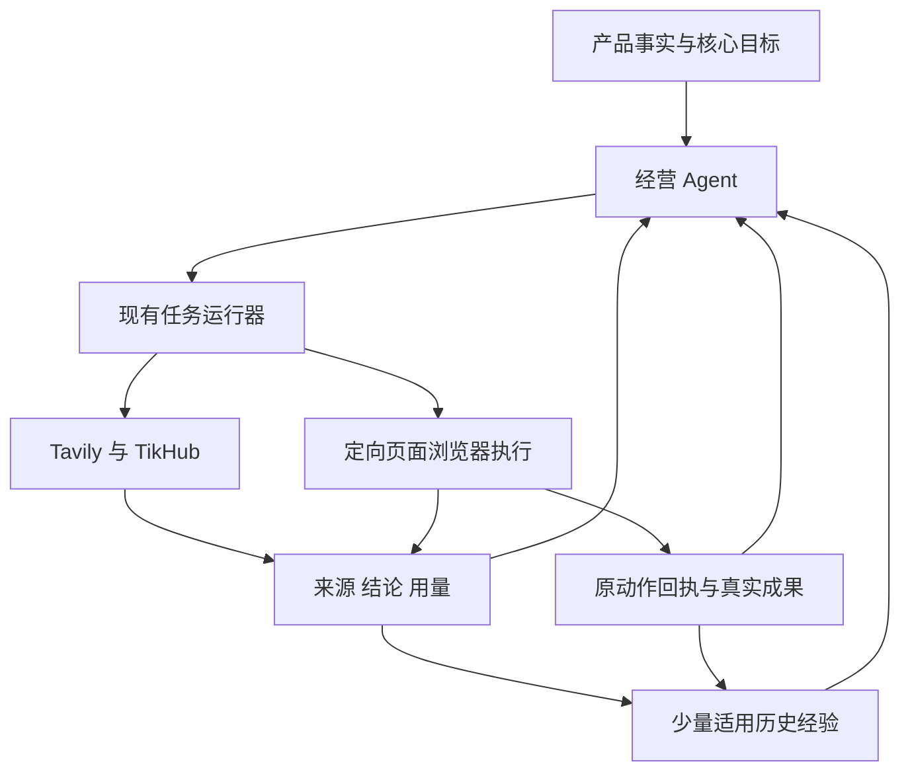

# Lead 统一浏览器执行与研究经验复用最小方案

版本 V9，2026-11-12。状态：门禁、浏览器与原唯一出口同归属的本地受控闭环通过，覆盖三故障切点、控制断链与活跃连接关闭、旧权限及二次故障；原代理关闭顺序死锁已在私有候选修正验证。产品源码尚未接入，DB/Linux/实号仍未验收。仅技术探针与方案，业务功能和生产均未改。

目标：用户提供产品、连接账号后，一个经营 Agent 持续使用研究工具、通用浏览器和历史经验，自主推进有界获客实验。“账号已连接”必须意味着真实浏览器登录及身份核验已完成。新渠道不以专用适配器为前置；多渠道可以同时操作，不能靠轮流切换一个 current_tab 冒充并发。

本文件兼作需求、设计、必要实施步骤及验收记录。V1至V8快照仅在私有 `.state/plan-review-20261112/`，不并存多套有效规范。当前 SW/组合/崩溃取舍见第19–21节，其他底层边界见第18节，旧实验失败保留。工程交付与权限引用 [SMALL_FIX_RELEASE.md](../SMALL_FIX_RELEASE.md)。

## 1. 审查结论与范围

V1方向成立，但混淆产品能力与SDK原生行为，低估登录、持久Profile、并发及失败出口。V9按下表及第18–21节修订，不新增经营Agent、审批链或通用状态机。

| ID | 已发现的反例与根因 | 当前最小修正 | 验收 |
| --- | --- | --- | --- |
| R01 | 未登录先要求发布动作，而发布动作要求已连接账号、目标及授权；连接开始又立即设置人工接管，自动登录被自己挡住 | 连接任务在 pending 账号上独立引导；默认自动持有控制，只在真实本人步骤交还；认证不套发布前置 | C01–C04 |
| R02 | OTP、扫码过期、迟到回调、页面刷新和连接超时没有完整出口，长期显示连接中 | 一个连接根、一个当前挑战版本、明确期限/重发上限/取消及恢复生产者；会话健康与绑定事实分开 | C03–C05 |
| R03 | click门禁不控制观察；截图/302、独立OOPIF、已有SW可绕Page门禁 | 原生Agent/Tools加固定target、递归frame归属、文档门禁；保留SW功能，按实际网络请求核对归属及原意图，不把包装当浏览器硬沙箱 | C06–C08/C28/C30–C33、T12–T29 |
| R04 | 将一个浏览器实例的隔离Context、多个持久实例及storage_state混为一谈；快照不是完整Profile | 首版管理少量持久实例，兼容身份组共享完整Profile；同站多账号/项目/出口冲突才拆实例，不建快照同步或动态进程池 | C06、C09 |
| R05 | 除原有 profile 排他/Actor.lock，固定SDK同进程事件锁也使页面动作串行 | 同时改准入、实际控制及故障资源；两个有界执行 worker 连接同一 Chrome，各运行原生 Agent；等待本人释放槽，不复制浏览器 | C07–C10、T08 |
| R06 | 网关无法确定识别任意网页的身份和 JS 副作用；一律先证明再点会让所有新站点停摆 | 在原任务内有限建立有证据的身份/位置/操作方法；先建立任务意图再交互；限定可保证范围，不宣称任意网站都能可靠自动打通 | C11–C14 |
| R07 | catalog、目标 URL、SQL 权限及动作状态仍只认识已登记平台和 publish，通用入口最后仍被旧门禁拒绝 | 一次贯通通用站点、普通成员回复、publish/reply、首次验证及其 DB/界面消费者；不能只放开浏览器点击 | C12–C14、C23 |
| R08 | 沿用“有限恢复”口号，却没有登录/模型/页面/接口/未知结果的实际恢复生产者、次数及期限 | 复用原 Wait/recover_due；明确资源键、累计预算、下一检查、停止与重开条件，不新增守护层 | C04、C10、C15–C17 |
| R09 | 经验提炼、规则复核和工具调用可能变成每步必经串联；跨项目共享扩大为通用权限平台 | 经验缺失不阻止工作，按问题检索少量资料；只共享同所有者可复用的公开经验投影，不建全用户知识网络 | C18–C21 |
| R10 | 两个受控网站易被包装为全网自主；Chromium丢响应自动重投，单次点击/原帖存在被误当防重复 | 网络前持久 claim、绑定请求零重试、未知只回查；原帖DOM与服务端计数分别验收，不承诺任意站点外部恰好一次 | C11、C14、C22–C24、T10/T11 |
| R11 | 研究停滞另有确定根因：访问用错环境、网站失败扩大为公共搜索故障、提前结束无唤醒、恢复只找已完成根、UI误报 | 研究工具显式选择公共/授权账号页；按实际工具失败归属；共享依赖保留等待、转变去重通知、恢复全部有效依赖；投影真实探测结果 | C25–C27、T16 |
| R12 | Fetch与代理认证有安装顺序；浏览器认证不等于APIRequest认证；错凭据可快速重复握手 | 同一配置供管理器/APIRequest与SDK消费；门禁就绪→SDK认证→页面放行；新/变更配置一次就绪检查，407停止该路由 | C28–C30、T19–T20 |
| R13 | 门禁进程死亡，Chrome自动放行暂停请求及SW重试；prepared/0仍可能已经外发 | 门禁、浏览器和原唯一出口同管理器归属；连接状态持续约束转发，失效关闭旧隧道；不可信窗口只回查。V9受控三切点/断链通过，实际DB/Linux仍验收 | C09/C14/C31/C33–C34、T27–T34 |
| R14 | SW借用失效的认证POST/同源callback；完整URL白名单又漏查询变体；重复控制入口漏iframe归属 | 同一target入口递归认归属；认证端点按实际origin/path绑定ConnectionRef与认证页角色，查询协议由网站验证；就绪失败不授页面 | C08/C30/C32、T25–T26 |
| R15 | Python 3.12原代理先wait_closed再取消handler，活跃CONNECT造成循环等待；关闭窗口内未读完header的连接也可能遗漏 | 先关监听，再取消/收齐全部已接收连接任务，最后wait_closed；读取header前即登记任务。真实socket反例与最小顺序修正、活跃TLS及不完整连接均验证 | C33–C34、T32 |

### 1.1 用户已确认的产品契约

- 一个项目一个经营决策归属；保留 decision、research、content、account、channel、observe、recover 七类任务。执行器解释页面和执行任务，不另选营销方向。
- 统一浏览器执行、账号连接入口、控制与回执。研究不限只读，也不限新产品初始化；登录、发布、回复等可以自主操作，但都有原任务和意图归属。
- “已连接”必须有真实可用浏览器登录及自身身份依据；连接后自动继续运营，不额外要求另登浏览器或点击启动。
- 多渠道共享兼容浏览器资源，在不同固定页面真实并发；共享不等于所有账号共用同站 Cookie，也不强求全系统单进程。
- 通用执行为默认路径；平台专用脚本/API 是成本和可靠性优化，不是新站准入条件。Buffer 不作为依赖。
- Tavily、TikHub 与已有来源按需组合；历史研究、经营与操作经验有条件复用，可被新证据修正。
- 获客渠道必须有适用发布位置、受众发现机制和转化路径；渠道候选不受现有平台清单限制，只读来源仅是研究资源。

### 1.2 本轮边界

用户追加授权：在本任务私有目录进行 browser-use 最小技术验证，允许启动本地受控网站、新建临时浏览器和假账号，使用现有配置模型进行有界真实调用，然后修订方案。没有业务功能实现、依赖安装/升级、生产账号操作或生产查询；没有提交、推送、合并、发布或充值。模型调用实际次数、用量和失败见第15节，不再沿用“本轮没有调用模型”的旧阶段描述。

首版不建多级调度平台、动态进程迁移、跨内核会话同步、全用户经验池、独立向量数据库或每平台工作流；不恢复日周计划、固定营销频率、强制养号/轮换。统一浏览器协议和新路径不以全量旧账号内核迁移为前置。

## 2. 基线与代码证据

仓库 `zdaiwmm/lead`；本轮重新核对 GitHub main、origin/main、任务 HEAD 均为 `d53f32c4d3a55a64a9c5ced440c62c94bf0a7614`。规则采用该版本及用户本轮 AGENTS.md。任务目录 `/Users/zhouding/ss/lead-unified-browser-plan/lead agent`，分支 `codex/unified-browser-research-plan-20261112`，当前只有本方案未跟踪；共享旧目录的其他任务内容不改动。

锁定依赖：browser-use 0.13.14、cdp-use 1.4.5、Playwright 1.62.0、Camoufox 0.5.8、HTTPX 0.28.1、Authlib 1.9.1。不自动升级或新增 Agent 框架。精确 browser-use 官方源码说明：`Agent._prepare_context()` 原生调用浏览器状态和截图，`BrowserSession.get_tabs()` 枚举目标，`agent_focus_target_id` 可变；排除默认工具、设置 use_vision=False 并不能消除原生观察。

| 现有模块 | 可复用事实 | 必须一起改的消费者 |
| --- | --- | --- |
| `growth/agent.py`、`store.py`、`runtime.py` | 单决策者、TaskRef、独立命令组、问题预算、Wait/recover_due、结果唤醒 | 不新增 task kind；能力不能只从已连接账号的 SPECS 推导；准入/故障键不能继续按整个共享 Profile 排他 |
| `browser.py`、`account_profiles.py`、`execution_routes.py` | 持久身份、受控网络/出口、租约/代次、路由、接管 | 当前 Actor 有单 page 和整 Profile lock；拆成运行实例与受控页面，保留原网络边界 |
| `account_connection.py` | pending 账号、连接任务、完成键和身份原子核验已有基础 | begin 当前立即 active takeover，execute_account 只观察；改为自动登录与必要挑战，而非再建连接状态系统 |
| `browser_tools.py`、`hybrid_research.py`、`browser_use_runner.py` | 观察、工具网关、模型构造/用量、有界子进程调用 | 复用子进程调用方式及模型构造；旧另启Chromium和只读工具契约改为接收分配页及受控原生Tools，不直接原样复用 |
| `growth/tools.py`、`adapters/*`、`channel_contracts.py` | 内容版本、动作、终提交检查、回查/回执结构 | ChannelInput/SQL/检查仍以 publish 为主；derive_target 依赖 SPECS 且拒绝 ordinary_member；原封不动复用会卡死通用回复 |
| `fetch.py`、`knowledge.py` | 来源正文、摘要值、原文引用校验、全文检索 | 目前从 DuckDuckGo 网页取链接；补供应商元数据和经验检索，不能仅拉最近文档 |
| `budget.py`、`growth/outcomes.py` | 费用预留/结算思路、可信成果定义、追踪/归因 | 模型 token 与供应商 credits/金额分单位；保持共享额度与未知费用，曝光/点击不能替代核心成果 |

既有业务规范见 [自主经营最终记录](20261112-autonomous-growth-runtime.md)。旧固定模型 26/27 只覆盖已知经营回归，不证明新浏览器、陌生站点或真实获客。阶段性 ACCEPTANCE/BACKLOG 文案不能覆盖该最终记录；本次不重做无关评估。

## 3. 简化后的职责与主路径

只保留三处运行职责：经营 Agent 选择问题/实验；现有任务运行器负责投递、等待和恢复；工具执行层负责实际浏览器/API 操作及证据。数据库是意图、动作、费用和证据的事实来源，不再增设策略排序、浏览器经营 Agent、回查 Agent 或新的监督器。



独立工作立即可运行：公开研究不等登录；内容只等待实际需要的来源/素材；发布只等待本账号、目标及本次内容；观察不等经验提炼；Tavily 不等 TikHub；新执行路径不等全量旧账号迁移。经验提炼失败不阻止决策、回执和后续任务，原研究事实始终可直接使用。

工具由当前问题、证据缺口和预算驱动，后续反馈、效果下降、规则变化和新渠道出现均可调用。一次任务内可以研究、观察当前登录态和准备动作；认证由 account、外部内容由 channel 承载固定意图，不为每一次点击再建顶层任务/工作流或用户审批。

## 4. 账号登录闭环

### 4.1 连接引导不依赖已连接账号

复用已有 pending `social_accounts`、账号环境和 account 任务，采用 `ConnectionRef={pending_account_id, task_id, profile_id, binding_version}`。这里的 pending ID 不是已确认的外部身份；外部主体在成功后绑定。

用户开始连接或提供凭据，就是该连接的认证操作意图。account 任务可在无发布目标、grant、content、实验时导航登录页、填写凭据和提交认证；以原 account 任务的 `operation_id` 和认证检查点记录，不强塞进要求已连接账号的发布 action。其他业务任务不能借此获得发布权限。

begin 默认由自动执行器持有控制，不再立即创建 active 人工接管。原连接任务承担 `打开登录页 → 认证 → 当前自身身份核验 → 完成`，内部检查点存在任务 runtime，不增加多个审批或新的状态机。重复点击连接返回已有有效连接任务；重复回调使用原完成键，不重复生成账号/意图。

### 4.2 成功与运行健康

“已连接”的成功事务必须比较当前连接、输入/挑战版本、页面/会话代次、路由、绑定版本和观察到的自身主体；原子绑定真实身份、完成登录及经营意图，并发出一次唤醒。浏览器中仍未登录、身份歧义、只有 OAuth/token 或凭据保存成功均不能完成。

用户不需要另外登录浏览器或启动运营。后续暂停/撤销优先于更早开始的连接；同号重登不覆盖后来的意图，换号不继承原授权。公开主页作者、头像昵称不是自身登录证明。

已验证身份是绑定事实，浏览器是否存活/可达是运行健康。进程关闭后不伪装为账号退出，也不凭旧证明宣告新会话就绪；再次使用必须恢复持久环境并重验登录。真实签出自动恢复失败后显示“需要重新连接”；执行服务故障显示“暂不可执行”，不能不停让用户重绑。 V9实际硬退出偶发最新Cookie未落盘，必须先读真实自身身份；已授权凭据可用时复用原连接能力最多一次自动认证并再核身份，缺本人步骤沿原挑战。不能写成Cookie永不丢失，不能以本地已绑定事实直接恢复发布。

### 4.3 普通界面交互与挑战生命周期

优先在 Lead 普通界面输入账号信息、验证码，展示二维码/外部确认说明。凭据只由执行层注入已核验 origin/控件，敏感输入及页面中的认证字段在文本、截图和日志进入模型前屏蔽。任意新网站不保证都能自动抽象出普通表单；复杂 passkey、跨设备认证或挑战可退到原页面接管，不假装已在本地登录。

OAuth 只在能实际辅助连接时使用，不开发“先 OAuth 再要求同样账号密码”的默认双重登录链。API 授权不能生成网页登录态的渠道，直接使用适用的网页登录流程。账号注册、购买及接受新增付费协议不包含在绑定操作中。

每个连接只有一个当前挑战 `challenge={kind,version,expires_at,input_seq,owner_state}`，保存在原任务/接管记录：

| 事件 | 确定行为 |
| --- | --- |
| 遇到 OTP/扫码/设备确认 | 进入现有 owner Wait，持久化原页面和当前挑战，释放执行槽和页面动作锁；账号会话保留，其他账号继续 |
| 用户刷新/重开界面 | 读取同一挑战及版本，不重新登录、不自动重发验证码 |
| 用户提交 OTP | 校验连接/版本/有效期后仅提交一次；旧答案、重复答案或迟到回调不能操作新挑战 |
| 二维码到期/用户重发 | 在原连接根下换版本，旧挑战失效；次数与费用累计，不新开免费任务 |
| 用户正在输入或接管 | 自动动作等待交还，不能后台抢焦点/改页面；完成事件后读新页面并核验 |
| 成功/取消/超时 | 成功原子连接；取消/超时终止原等待并通知依赖任务，不永远显示连接中 |

工程默认：连接根从 begin 起总期限 30 分钟；挑战以平台较短期限优先；原根最多自动更新 2 次二维码/验证码挑战，最多提交 3 次验证码答案。被动等待不消耗业务重试次数。扫码/外部确认每 15 秒做一次无模型状态查询，平台给出更慢间隔时从其要求；OTP 不用模型轮询。期限到达由原 recover_due 结束本轮；用户再次明确连接可开新连接根，但同条件自动故障不重置累计 episode/问题费用。

passkey 需要用户设备而远端无法完成时，立即说明支持的替代登录方式或进入原环境接管；没有替代则连接未完成，停止该账号而非无限尝试。

### 4.4 SSO弹窗沿用原连接根，不另做OAuth客户端

原连接动作前登记内部ConnectionRef/代次与已核验认证依赖；围绕分配root页面的popup事件捕获候选，再核对实际opener及认证origin，派生短期PageRef。不能扫全浏览器后凭URL相似认领，也不能拿B任务的IdP窗口给A操作。每步重查连接期限、代次、窗口存活和origin；切换受控页后获取全新SDK观察，旧索引不延用。SDK基础站点名单按浏览器兼容组配置，细粒度权限仍按任务页，不能给同root的不同session配置互相冲突的全局名单。

网站自己的OAuth state、code验证由网站承担，Lead不生成/插入其协议参数，也不要求所有IdP URL可见state。能从合法流程观察到state时作附加核对；内部连接代次始终独立。postMessage、token返回、弹窗关闭都只是可能完成的提示，不能产生新的页面授权或证明登录。回原站实际读自身身份、比较预期身份/候选绑定依据后，才走原finish_connection事务。首次连接不要求事先已存在外部稳定ID；测试中的固定用户名是受控断言。

发现同IdP Cookie冲突时，只排他该实例中的相关认证依赖，从修改IdP身份到原站核验结束；普通已连接渠道不等待。等待本人时释放执行槽及动作锁，保留有期限的认证占用记录，其他同依赖登录排队或按已核验冲突拆实例；不能释放认证占用后让B换掉A身份。取消、到期、原页关闭和故障恢复明确释放该记录、使旧grant失效并只清理所属弹窗。不持DB事务锁跨网络/本人等待，也不无故锁全Profile。

## 5. 浏览器共享与真实并发

### 5.1 首版明确选定的资源结构

统一指的是产品控制入口、执行协议和新通用运行路径，不是强制同批清零全部旧内核。新通用路径优先复用 browser-use Agent/Tools 及持久 Chromium；Playwright 可用于启动、确定性检查和验证；旧 Camoufox 作为同一服务下的过渡兼容驱动，随账号实际使用逐项迁移，不再永久按研究/执行分配两个引擎。

首版不自建动态进程池。固定版本 browser-use/bubus 在同 Python 进程内用全局事件锁串行处理原生动作，Agent生命周期重叠不能证明页面真并发。最小结构是原运行器提供两个有界执行 worker，各自运行原生 Agent/BrowserSession，连接同一个 Chromium 的不同固定 target；浏览器/Profile 不随 worker 数量复制。两个worker的1.5秒服务端导航区间已真实重叠；双真实模型任务也已完成，见T08/T10。

V6补过iframe/SSO、已有SW、独立OOPIF及代理组合反例；V7追加保留SW的功能与防重放链路。V6的组合使用SW旁路/网络deny，V8另补保留SW的一层OOPIF/SSO/代理组合；仍不是浏览器级CDP权限沙箱，业务接入须完成实际部署验证。统一服务按需启动少量持久Chromium，沿用完整Profile，不把storage_state当全站恢复替代品。同一浏览器指同一持久实例。

默认以项目/所有者和兼容身份配置为组：同一项目、不同站点且登录状态不冲突、出口及设备配置兼容的账号，可以共享一个持久 Profile，分别用固定页面并发。同站不同账号、不同项目/租户、不同出口/设备要求或已发现 SSO 冲突时拆成不同实例。未知 SSO 关系不主动合并旧 Profile；首版只对新账号/新环境按此规则分组，不迁移旧 Cookie 来凑共享率。

共享是资源优化，不是成功前置。实例分配记录具体分组/拆分原因、账号归属、出口和页面；不退化成固定每渠道一实例，也不承诺任意账号都能合并。复用原域名/DNS、网络 namespace 和出口约束；若现有隔离使两个账号无法共享进程，则保留实例分离而不是削弱隔离。

### 5.2 三处同时修改的并发作用域

普通操作引用 `PageRef={profile_id,session_generation,page_id,page_generation}`，带 TaskRef 与可选 AccountRef。页面引用由服务端分配，不接受模型指定 CDP/RPC 地址。进程存活不替代账号会话证明。

| 层次 | 首版规则 |
| --- | --- |
| task 准入 | 删除普通浏览器任务的整 Profile 忙碌排他；以分配页面和机器执行槽为资源。未取得槽属于排队，不算失败 |
| 实际执行 | 不共享actor.page/current_tab；按固定Page观察/操作，同页互斥。首版用不同worker使阻塞导航及事件处理均可并发；同进程个别异步HTTP也可重叠，不能据此证明事件处理无串行 |
| 会话变更 | 登录、退出、切号、接管只短暂排他实际受影响的账号/站点会话；必要时暂停其相关页，不锁所有站点或持有 DB 锁跨模型/网络等待 |
| recovery episode | 页面异常按 page/站点故障，认证异常按 account，进程崩溃按实例，供应商异常按连接/端点；不能全部折成 profile 传播失败 |

同账号在多个页面上并行写操作不进入首版承诺；默认同账号一个写运行，回执读取不等写预算，其他账号仍并行。跨页共享 Cookie/SSO 被识别会影响身份时，锁定对应依赖组并复核，不虚报“仅一个标签受影响”。

弹窗按4.4派生受控授权，不自动跟随未知弹窗。V5已验证本地SSO操作及回原页核验，但不等于真实IdP/挑战均支持。页面或frame换文档即使origin不变也使观察代次失效；操作前重查。原生Tools对最后检查后发生的完整换文档已返回stale-index错误，复用该拒绝，不自动按坐标/JS回退。需重新观察再按原意图继续，潜在发送后先核回执。实例重启增加代次并逐账号复验。

固定Page不隔离Cookie。页面绑定允许站点/认证依赖；请求前和重定向响应交浏览器前均核验。V5用现成CDP Fetch请求/响应阶段阻断外域iframe、HTTP跳转和JS导航，保留原302/303与浏览器传输；不以关闭iframe解析替代截图隔离，也不把正常跳转改写成脚本。

未授权iframe在加载前阻断；同源及明确获准跨域frame保留原生工具。外域认证frame、CDN须有角色/资源依赖，允许图片/脚本不等于允许导航/凭据注入。`cross_origin_iframes`显式配置：无需跨域操作可false；需要获准OOPIF操作时true，配合递归归属和节点实际target/origin校验，不能单靠开关隔离截图。不可信文档曾加载后须废弃旧观察并受控重载，不能后装门禁继续用旧缓存。

新增iframe target沿已归属parent session递归附着，装原门禁后再resume；嵌套继承root任务范围，不因SDK能枚举target就获得授权。节点解析前检查target仍归属，解析后不得换target，并从实时TargetInfo复核origin。frame解绑使旧节点失效。固定SDK枚举全浏览器frames时，对未归属target按其原生ValueError跳过约定拒绝，避免外页导致整页Empty DOM；不是把外页放进白名单。

仅动作前检查还不够：观察前后核对该root所属targets的实时origin、attached状态与当前范围。已加载frame被撤销时，先拒绝整次观察，不进入SDK的DOM/截图；不能只挡下一次网络和点击，继续返回旧画面。范围代次变化结束旧SDK片段，恢复有效范围后重新观察。此规则只影响该root，B继续运行；后检查能拒不一致结果，不承诺捕获中撤销的强原子性或撤回已交付快照。

SSO弹窗在授权动作前登记root/认证范围，auto-attach暂停新page，按实际opener装门禁再恢复，不能等DOMContentLoaded。此规则属于原管理器，模型不控制CDP或批准origin；范围回调读当前连接/代次/期限，取消返回空范围，非系统页面不抢占。V6补过新/嵌套OOPIF和本地Basic代理组合，任意多级SSO popup及真实提供方仍未证明。

所有本系统分配的根页必须在交给工具前登记；没有认证占用也登记空认证范围。探针对未登记opener按非系统页面处理，漏登记不能被误当成有效授权。允许的资源与导航范围收缩也须即时生效，不仅处理整表清空。

首版节点默认 2 个实际浏览器执行槽，可按容量配置；不造自动扩缩容。队列按原任务顺序公平领取，资源等待只等待本任务 review_at，过期后明确退出。浏览器交互可以后台执行，不能依赖操作系统前台焦点。用户确认期间释放执行槽；人机共享同页的控制权需要明确交还。

现有 `hybrid_research.py` 已用 `asyncio.create_subprocess_exec` 运行SDK脚本，可复用其有界子进程调用方式：两个槽同时允许两个执行子进程即可，不新增常驻worker服务、进程池、消息总线或第二套队列。原有研究脚本的只读工具/另起浏览器行为必须调整，不能只提高并发数。

## 6. 通用执行的可实施边界

### 6.1 优先复用 browser-use，不自研 Agent 循环

本次真实验证使用已安装的browser-use 0.13.14 Agent、Tools、原生敏感输入和步骤回调。观察、模型上下文、动作选择、历史及有限失败处理由SDK承担。Lead只接账号/任务范围、预算、受控动作包装及真实回执，不自研plan_step/模型步骤循环。

原生动作通过公开 Tools 接口复用；发布包装使用独立 guarded_click 名称并排除原生 click，避免 SDK 重新注册同名工具覆盖包装。回调可以记录提案，但并非每个动作之前的强门禁；最终检查和 dispatching 记录在实际动作包装内。认证输入、导航、切页、快捷键及上传也有可能绕过仅 click 门禁，后续接入需要按实际启用动作统一覆盖，不可只包一个发布按钮就称生产安全。

同一页面只有一个执行持有者；Playwright不与browser-use同时输入/点击。本地Playwright用于浏览器管理、独立DOM/截图和重启核验，还对明确绑定的发布请求使用现成APIRequest零重试转发（页面route.fetch；SW根Fetch配合同一Context.request.fetch）；不替模型选择动作，也不写Agent推理循环。browser-use 0.13.14实际使用自己的CDP层，不能把限定请求转发误说成SDK原生防重发。

共享root原生BrowserSession没有固定target白名单，观察枚举其他页，丢页可恢复到别的target。T03失败保留；T09的65行包装过滤tabs、禁recent_events、观察前后校验target/origin、拒绝外target/跨origin显式导航，关页后停止。input/click包装每次再查scope与节点target，不只在步骤开始设置焦点。

接入包装与固定SDK/CDP版本有关。文档代次、frame归属及最终动作scope须一起核验。V6的SW受限模式、新/嵌套OOPIF及本地代理共存已有T17–T20证据；V8保留SW的一层OOPIF/SSO/代理默认组合已补验，嵌套组合及部署仍须C30；同文档DOM替换、坐标动作、opaque frame、任意多级popup及生产提供方仍未证明。只开已验收工具，不给任意JS/CDP/切页或未验证坐标回退；跨项目秘密或不能建立范围时按边界拆实例。

登录发布在T10、指定隔离/SSO反例在T12–T15通过；尚非实际运行器的C08集成验收，本轮不切业务。技术可行与生产放行分开；Tavily/经验不因此变成永久串行前置。

### 6.1.1 已有SW、代理与target初始化

默认保留SW注册、缓存、controller与正常网络功能，不设置页面bypass或worker全网deny。V6反例表明这些开关可能破坏登录续期、后台读取、合成页面与发布；不能把“网站依赖SW”直接判为能力缺口。V7证明保留功能可行，见第19节。

优先复用现成Playwright `context.route` + `request.service_worker`；但本机1.62/Chrome151恢复已有SW后，worker发出Network事件却未产生Fetch暂停，路由没有调用。新注册正常，不能泛化为Playwright全不支持SW，也不归因browser-use。固定组合采用现成浏览器根 `Fetch.enable` 拦截实际外发网络，结合所属target/session的 `Network.requestWillBeSent` 配对；缓存与纯合成响应没有外发网络，继续由SW正常处理。原Agent/Tools不变，不自建SW解释器或浏览器Agent。

实例管理器统一持有根Fetch/target就绪入口，用浏览器连接、实际Context、当前注册worker与会话代次确定网络归属；networkId仅为短期关联。缺归属有限等待，超时或缺Context只拒绝该请求，不按“不是我的”放行；管理器只处理已登记Context的当前任务，未登记Context的GET/POST一致拒绝。首版为每持久实例一个已登记默认Context，不建跨Context路由层；其他身份实例独立，不把“不是本Context”当直接放行。新worker与重连重新关联，不凭旧session或script URL自动继承业务权限。冷启动先装门禁再放行任务；热接管不能撤回在途请求，既有未知发送只回查。

按原任务区分：认证使用ConnectionRef/原认证检查点；会话续期与合法读取使用当前账号/站点范围；发布/回复使用原ActionRef。认证请求与回调按实际origin＋path等稳定端点事实识别，不靠完整URL字符串或GET推断；只允许当前有效连接的原根/派生认证页，SW不能借用。state/code与查询合法性由网站验证，内部连接代次、期限及页面归属仍必查。不能把所有POST都当发布，或所有GET都当只读。OTP发送等有次数副作用的认证仍沿原检查点；业务暂停不等于账号退出，会话维护与业务发布分别核权。探针的精确请求事实是受控输入，不代表系统已能自动推断任意站点API。

SW发布实际请求在网络前核对账号、profile/绑定代次、目标及method/URL/完整正文版本，再对原动作原子claim；同Context的APIRequest零重试/零自动重定向转发，响应交回SW。传输丢响应返回本地unknown，SW重试/离线队列重放、页面reload及恢复均只命中原ActionRef并回查，不新建意图。worker服务多个标签，不能从worker URL推断发起Page：相同注册范围/envelope只允许唯一原ActionRef，不得覆盖映射；无法区分旧队列与新意图时只暂停该发送，优先站点幂等键/唯一请求标识。SW正常读取、其他意图和渠道不因此全停。具体不可判定的是该请求的权限/唯一性，不能归咎SW依赖本身。

转发仍须验证浏览器与APIRequest的Cookie/CSRF/代理/响应语义一致；V7实测为同Context Cookie认证JSON。浏览器绑定证明、客户端证书、流式/二进制、上传、多请求事务等不据此自动转发；优先使用平台幂等能力或其适用原生路径，有限补证后只记录具体动作缺口，不偷换认证方式或无限重试。可选bypass/deny仅用于诊断或已确认兼容的受限模式，不是默认策略、不清注册和登录资料。

代理server/user/password来自同一版本配置：管理器用于Chromium/APIRequest，SDK用ProxySettings处理407。只配SDK使route.fetch仍407；只配管理器叠加Fetch也复现认证失败。统一门禁及归属就绪→SDK认证→任务导航；V6反向安装失败保留。V8根Fetch+SW、一层OOPIF及SSO popup、代理已同实例补验；不能升级为嵌套、多级弹窗或生产出口也通过。C30保留实际部署与配置恢复验收。重连/配置变更暂停受影响新提交，按统一顺序重建/复验，原未知动作不重发。

新建或实际变更代理配置时，复用原环境就绪读取做一次有界APIRequest探测（零传输重试、不自动跨origin重定向），按真实配置版本保存结果，不逐步重复。明确407停止该路由并等配置变化，未知传输错误不猜成密码错。V6错凭据原生路径曾32次握手；一次就绪检查可在1次407后不启动SDK。HTTP200只证明该探测的网络就绪，不证明账号登录/网站解封/发布成功。凭据不入模型或源站Authorization；源站401不借用代理凭据，不绕代理恢复。

page/popup/iframe/SW由原实例管理器同一个target就绪入口按类型处理，不新增SW服务、认证Agent或通用中间件平台。独立探针用了多个CDP观察客户端便于复核，正式接入不应照搬多套生命周期控制。就绪事实含实例/连接代次及已应用设置；任一失败不授业务PageRef，沿原局部恢复预算退出。

### 6.1.2 门禁归属与断控恢复

实际反例推翻“控制进程消失即请求继续暂停”的假设：只杀根Fetch所属进程，浏览器会自动释放暂停请求；SW还能在无人控制期间直发。账本prepared/0仅表示本账本未claim，在门禁连续覆盖未获证明时不代表未发送。浏览器仍活着不能替代受控事实。

根Fetch、递归target、账号作用域与原动作门禁由现有实例管理器持有，browser-use执行worker只操作分配页。统一管理器还持有实际浏览器启动上下文和原BrowserForwardProxy，APIRequest直接复用该Context.request，避免多个管理端重复接管及Cookie快照转发。worker退出/租约失效拒绝新提交；管理器退出时其唯一出口和已建CONNECT同时失去转发能力。V9在本地实际结束管理器、保留独立TLS观察流，三切点均无额外源站发布；不能升级为实际Linux/任意网站已通过。

控制连续性不能只看PID：WebSocket关闭/失效时撤销ready并关闭既有连接；转发写入同时校验当前控制连接状态及代次，不把已开始关闭的连接视作仍就绪。复用现有管理器内的连接结束通知与代理close，不增设监督服务。原生APIRequest、浏览器与SDK走同一个原出口，实际Linux隔离仍需证明无直连/备用路径、无被子进程继承而保活的出口。

关闭顺序必须修正现有BrowserForwardProxy.close：先关闭TCP/Unix监听停止接收，再取消并收齐全部连接handler，最后等待监听关闭并清理所属socket。Python 3.12的wait_closed会等待活跃连接，原先先等后取消的顺序已真实复现停等；私有最小修正与活跃TLS、不完整header连接均通过。连接在开始读header时即登记，不能等认证后才纳入回收。产品源码尚未应用该修正。

启动/恢复是原Actor.launch内部顺序：出口监听先创建但默认不转发，浏览器可用原生短暂offline启动；装好FullGate/所属target及SDK分配页会话，再允许受控只读/认证，实际核验身份后才准业务提交。固定版本首HTTPS代理认证在恢复时出现407兼容性失败，受控候选使用代理内一个固定本地健康地址完成SDK原生认证就绪，然后仍用HTTPS访问平台；不向外站降级HTTP、不发平台Cookie、不自写认证Agent，健康地址只在bootstrap范围有效。此兼容路径须在目标部署复验，不当通用代理定律。

恢复继续原TaskRef/ActionRef，核验当前账号、绑定、原授权/控制版本和执行代次，旧worker/弹窗/旧命令不得复活。授权版本必须单调，撤销再授予也不能让旧ActionRef重新有效；当前权限校验与claim复用原submission_gate/动作事务的锁和CAS，不持事务跨DOM/网络。V9用原JSON锁原语模拟排序和ABA反例，不新增生产账本，也不替代真实DB事务验收。故障扫描覆盖当前已持久绑定的原意图，不只扫描管理器启动时的快照；新增prepared经历第二次故障也进入原回查路径。

若断控窗口内无法证明唯一出口一直拒绝发送，恢复时该代次下可能外发的原意图（包括prepared/0）先进入原任务的回查/冲突处理，不能因为本地无claim就继续发，更不能换ActionRef。发现多个相同结果时保留重复/歧义，不能挑其中一帖确认唯一性；不能可靠证明未应用则保留未知。只有已证明全程受控且确实未发的prepared动作才可在当前权限下继续。一次管理器故障影响同实例，其他实例和独立研究按原故障范围继续；不全系统停摆。

### 6.2 陌生站点的最小事实与操作方法

通用不等于无需站点事实。首次在原 account/channel 任务内进行有限观察，形成声明式方法数据（可见元素引用/定位条件、身份来源、自身页、目标 canonical URL、编辑器、提交和回读位置），不写生产 Python/JS 或要求开发平台适配器。

区分候选身份、已绑定身份和当前实际发言主体；登录内自身设置/管理入口与登录控件提供的证据优先。若有个人/公司 Page 切换，当前署名必须单独读取；有 handle 无稳定 ID 时明确标记。成功后固定提取条件，再从实际页面复读比对；数据一致只能证明这些可观察事实，不宣称网关能独立理解任意站点语义。

在 owner 当前经营意图内，按可见角色/规则派生本目标/动作权限，保留排除项。普通成员回复不要求管理员权限；publish、reply、upload 分别描述。无历史成功也可以创建 `verification_required` 的正常首条业务动作，不能“先实号成功才许首次执行”。

无法建立账号自身/发言身份、目标或内容依据时，只停该动作；最多一次定向补观察，之后保留具体缺口。新页面/身份/规则证据或执行能力版本变化可恢复原任务；换名字重新探索相同缺口不得重置费用和次数。

### 6.3 主动操作、准备与提交

不存在通用的确定性网页副作用分类器；页面加载、GET、JS、Service Worker、WebSocket 都可能产生站点状态变化。产品保证的是 Lead 发出的主动操作有任务范围和记录，不能保证访问任意网站绝无隐藏副作用，也不能让模型一句 read-only 成为放行依据。

导航/观察在受控 URL 和 Page 范围执行。认证表单关联 ConnectionRef；输入/搜索表单先读取 origin、form、目标控件及方法证据，必要时使用已检查的操作方法。无法解释的潜在发送控件不试点碰运气，优先其他来源或在原任务内补一次观察。

发布/回复在第一次可能写入草稿或内容之前创建原 action，固定账号、实际目标/父帖、正文/媒体、追踪入口和允许动作范围；所以“自动保存”属于这个业务意图，不需要预先已存在一个发布成功。搜索、登录不套用发布的非空 content/target/grant 条件。

在当前授权内准备内容无需额外用户审批。最终点击之前，从实际编辑器/预览重新读取正文、附件及回复对象，与固定版本比对；不一致则修正一次或拒绝提交。身份/目标切换和自动附带旧引用需重新核验。跨页面的引用不能沿用到新页面。

提交边界不只指点击按钮：可能直接公开发送的输入、回车/快捷键或点击之前，都必须完成终提交检查并持久化 dispatching。已证实仅保存私有草稿的编辑保存其草稿检查点，不能当公开发布成功。若输入本身可能发送且无法在发送前核对完整意图，先改用可验证的编辑入口/输入方式；一次补观察仍不能建立依据则停止该动作，不能边输入边试验。潜在发送后的后续步骤先观察原结果，不能当准备失败自动重填。

沿用原状态：prepared → dispatching → pending/unknown → confirmed/not_applied。发送前先持久化 dispatching，网络后存证；停机/超时/租约过期不意味着未发送。V8补充：门禁丢失时prepared/0也不证明未发，先按6.1.2处理不可信窗口；不能用状态名称覆盖实际网络反例。恢复只核对原 action；明确未执行且原条件仍成立时才继续，不换工具/任务重发。

confirmed需有可回读原帖/回复ID或canonical链接，以及原帖实际作者、当前发言身份、目标和正文/附件证据。当前登录身份不等于帖子作者，toast、HTTP状态、模型总结不能单独证明。平台接受、审核、公开可见分别保存。

T06/T07的单次click三次POST，已在T11由DOM/CDP/netlog定位为该Chromium事务因空响应自动重启两次。最小修正是对本action绑定的Page或已核验SW请求归属、method、URL、正文版本/请求体先持久claim，再使用现成Playwright `route.fetch` / 同Context `request.fetch(max_retries=0,max_redirects=0)`；正常响应交回浏览器，传输失败返回明确的本地unknown响应，不再continue/fetch或自动点击。502/409不是平台成功。恢复、页面重载及模型重复提案均读同一持久ActionRef；dispatching/pending/unknown只回查原结果。探针用JSON账本，业务方案复用现有action事务，不新增第二套账本。

此方法只证明绑定且可拦截的单个HTTP发布请求，不在未知站点全局重写所有POST/GET。V7补验SW实际网络与自身重试，仍需精确请求和唯一原ActionRef；动态CSRF、上传、多请求提交、WebSocket等需有适用请求事实及相应用例；优先平台幂等能力。无法建立边界时记录该动作防重复缺口，不能静默换工具重发。原帖存在只证明相符结果，不证明没有其他重复；T11在没有服务端去重的条件下另验唯一性。任意外站没有适用幂等/唯一核对条件时，不承诺external exactly-once。未取得可靠回执保留pending/unknown，不把动作量当获客进展。

上述APIRequest上游不受Page/根Fetch门禁直接保护，因此发布门禁自己在claim/转发前核对当前ActionRef、Page/身份、精确目标origin/URL与请求体。授权集合仍非空但原目标已移除时必须拒绝，不能用bool(allowed_origins)作放行。两门禁组合的允许和拒绝路径分别留证，不因普通导航门禁存在就删掉发送前授权。

## 7. 不停摆与不空转的具体出口

复用现有 Wait、episode 和 recover_due，不新增监督进程。每个非终态要么持有有效短执行租约，要么有 producer、check_at、recovery_action 和终止/升级出口。定时器只做状态核对与原任务续接，不重开经营任务。

工程初值：每个浏览器片段最多 8 次模型调用、20 个主动步骤、180 秒；最多一次定向修正，纳入同片段预算；连续 3 次步骤没有新页面状态、有效来源或操作进展则结束本片段。平台给出的冷却/期限优先。任务总投入仍取项目/问题和既有恢复上限中更严格者，不能切片重置。

片段耗尽不直接认定业务失败，也不立即无限续片段：已有与任务相关的有效进展、总预算及连接/任务期限仍允许时，保存原页面/检查点，释放执行槽，以页面就绪、挑战输入/交还事件或明确 check_at（无更合适事件时 15 秒后）返回原 Wait；事件或 due 入口只能再次投递同一任务，服务端重验条件后续接。累计费用、步骤与同失败链的修正次数保留。动画、时间戳、转圈和重复观察不算有效进展；无进展已达阈值则等待真实新事实，不因到点自动重开。总预算/期限到达时明确停止或转为必要本人事项并通知依赖。

挑战答复、控制交还、会话换代和方法修正的生产者必须更新对应 condition_revision，并通过现有 resume_task/outbox 唤醒原任务；只有事件名称、没有实际条件变化不能解除故障。也不能保存了新条件却仍用旧 fingerprint 拒绝有效恢复。恢复只更新该作用域，保留同故障 episode 和累计费用。

| 原因 | 原任务的恢复生产者与处理 | 停止出口 |
| --- | --- | --- |
| 缺账号/凭据 | 连接信息或 owner 明确开始连接；其他公开研究继续 | 无连接不模型轮询，不自动注册 |
| OTP/扫码/本人接管 | 当前挑战输入/确认/交还事件；扫码只做无模型状态读 | 30 分钟连接根/挑战上限/取消后终止并通知依赖 |
| 页面布局/控件歧义 | 同页一次定向新观察与方法修正 | 同条件仍无依据则局部 capability_gap；新事实/版本才恢复 |
| 会话退出 | 同账号唯一 account 恢复任务，依赖只等待其结果 | 累计 3 次认证失败或必要本人条件缺失后需重连，不自建重复登录 |
| 浏览器进程崩溃 | 守护恢复原持久实例、增加代次、重验账号；已 dispatching 先 reconcile | 同故障累计 3 次恢复失败后局部阻断，5 分钟起至 1 小时低频健康检查，受恢复预算限制 |
| 模型/接口故障 | 原 episode 按 Retry-After 或原退避；配置变更/最小探测证明原错误解除 | 累计 3 次业务失败后阻断原资源；不因另建任务重试或全工具扇出 |
| 接口额度用尽/未知计费 | 免费周期到期、余额/配置变化，或原调用账单核对 | 不自动充值；无额度/无法核对停止该供应商，其他工具按已有预算继续 |
| 动作 pending/unknown | 原帖子/原 action 回查，允许在项目暂停时做事实核对 | 首轮最多 3 次主动回查，之后 1 小时级低频核对并明确责任；永不以超时认定未发出，不重发同意图 |
| 队列/机器容量 | 释放槽、任务完成/取消和原 due 事件唤醒，FIFO 公平领取 | 到 review_at 明确 resource_deadline，排队不消耗模型/业务重试 |
| 无学习/业务进展 | 原实验观察窗口成熟后的事实复盘 | 沿原 no_progress_round_limit=2 关闭路径；未实际触达/窗口未到不判无效 |

未知结果隔离这一次重复意图，不无条件冻结整个账号或项目。自动修复只限重新观察、环境重连、原任务恢复、允许的替代来源和回查；不能改权限、账号、预算、生产代码或绕过本人挑战。

恢复事件需证明原失败条件改变；浏览器在线不能清除身份歧义，HTTP 可达不能清除无权限，换一个页面或文案不能重置同问题预算。来源重复、重新截图、心跳、任务接受和经验改写均不算新成果。

### 7.1 修正“研究一下午原因”中的调度与恢复缺口

已读该会话最终说明，并按本方案固定主线核对/离线复现；不沿用其历史生产状态作当前证明。统一浏览器只提供正确账号读取的基础，以下消费者必须同次接线，不能认为换执行引擎后自然消失。

| 具体缺口与现有位置 | 最小修改及确定行为 |
| --- | --- |
| `growth/tools._read_source`未传账号；`research.begin_run`始终public_research | 读取请求携带TaskRef、公共/授权账号模式及目标；公共读取默认匿名，仅在本任务有授权且页面需要时分配相应账号页，沿原Profile/出口/绑定。旧驱动尚不能用新执行器时明确capability_gap，不另开未登录Chromium冒充账号读取；Reddit已登录也不保证网络拦截解除 |
| `runtime._resource_condition`只要有queries便归public_search，实际网站失败污染全搜索 | 按实际失败调用记录provider/operation/endpoint或origin/access_mode/账号环境及condition；error_code单独分类，不靠换错误码新建资源/重置预算。search与原文read、各供应商操作/连接分开，网站失败只影响其站点/方式。task有query不是故障依据；部分来源缺失不挡其余有用来源 |
| `advance`的blocked分支直接failed且无wake，替代任务静默消失 | 共享故障依赖保存原任务的可恢复Wait及blocked资源引用，不直接终止；未依赖故障资源的替代研究仍执行。提前终态统一保存原因并按状态转变发一次事实通知；资源首次blocked通知使用project+resource+condition+transition稳定键，不包含新任务ID，原事务/episode记录配合outbox与消费端去重。同条件十个任务不触发十轮模型决策 |
| `runtime.probe_episode`只resume根；根succeeded即None，漏掉依赖 | 核验实际原失败已解除后，在原事务/行锁内标记该episode证据并枚举同项目、同episode/resource/失败条件的全部待恢复任务；根已成功不重跑。逐任务核验当前目标/产品/账号/权限/期限/实验和desired状态，原子增加generation并投原outbox；暂停、取消、过期、旧目标及未知发送不重投。多个资源只解除本次证明覆盖的依赖，其他Wait仍保留 |
| 拦截页在`_remember`被丢弃且read_errors空；recent/API/UI只看任务succeeded | 拦截页不作知识正文，但保留原URL、访问方式、错误分类和安全原因证据。区分network/access_denied/login_required/challenge/empty/missing/transport，未知原因保留unknown。`growth/views.recent`与`growth-status.tsx`投影probe实际output.state、原因、范围、next_check_at与恢复数量；标题使用中性的检查能力，分别显示仍受阻/已过期/预算耗尽/已验证恢复/已恢复并续做 |

恢复证明必须绑定原失败resource和failure_condition、当前observed_condition/代次及实际结果；在消费事务中核对仍最新。登录成功不证明网站封锁解除，别的论坛能读不能清除Reddit故障，HTTP200拦截页也不是恢复。配置变化允许重新核验，不直接清空历史故障或预算。有效恢复但无可续任务时显示“恢复已验证，无待续任务”，不是虚报已续做，也不因根已完成丢弃证明。

复用原runtime JSON检查点保存`blocked_resources`和已通知/已消费的条件版本，Wait仍一个当前检查入口；不新建恢复服务或全局任务依赖平台。动态工具选择的research不能在准入时因任一可能使用的工具blocked就整体失败；在实际必需调用处检查对应能力并返回可选替代。通知去重须持久，不能只用进程内set；重复probe、同一proof与旧事件重放不增加执行/模型调用。仍不可恢复时沿原预算/期限明确停止并保留原因，不无限低频空转。

## 8. Tavily 与 TikHub

| 工具 | 首版能力 | 使用方式 |
| --- | --- | --- |
| Tavily | web.search、web.extract | 搜索公开渠道/需求/规则及读取正文；默认 basic，不使用独立 Research Agent；生成 answer 不作事实 |
| TikHub | social.search、social.item、social.comments | 按真实产品选择具体平台端点和有限分页；优先无用户 Cookie 的公共接口，不一次开放所有平台 |

两者在初始化、后续研究、发布后的反馈分析及复盘中都可用。Agent 选择问题和工具，确定性封装校验启用端点、参数、来源范围和费用；不因使用多个工具增加第二个研究决策者。已充分回答的问题不重复查询，也不强制先跑某一供应商再允许浏览器。

工具封装返回统一的 source_id/原 URL、内容 ID、发布时间、获取时间、正文/片段、供应商及请求身份、指标口径/缺失、分页/抽样和用量。重要结论可追溯正文；无法独立回读的结果注明供应商来源。跨供应商同帖去重，缺失/权限不足/删除/空结果/传输错误分别表示。

所有工具和浏览器读取同时返回实际尝试的访问模式与失败作用域，不能把供应商搜索成功后某个原文读取失败记成search故障。工具错误通过原任务结果进入经营Agent上下文，包含具体原因、影响范围、已尝试方式与仍可用能力；不要求Agent从空read_errors猜故障，也不让备用工具成功替原故障作恢复证明。

当前官方额度：Tavily 每月 1,000 credits、无需信用卡，basic search 1、advanced 2；TikHub 注册验证一次性 $0.05，具体端点可能不适用。试用资格和单价必须按拟用端点核查，不把“约 50 次”当成所有平台的免费调用承诺。

复用原费用预留/结算机制，但单位分 tokens、provider credits 和金额；同次用量不能重复计钱。连接级共享额度在事务内预留，再检查项目/问题上限，网络调用在事务外；保存一个稳定 call_key、request ID/价格版本、已知/未知用量。无 provider 幂等承诺的超时调用不盲目重投，先核原响应/账单；无法核对时保留未知并停止同调用恢复。免费额度也有预算，不新增自动充值。

接口原始数据的保存、用途和缓存期限按来源条件控制，不把第三方 API 的可访问性当平台操作许可。

## 9. 历史经验的最小实现

只补一种 experience 逻辑记录，引用现有 document/task/action/event，不重复存完整证据。type 区分 research、business、operation；其余最小字段为 problem、适用产品/受众/地区语言/价值行为、位置/动作、前提、结论或操作方法、证据等级与引用、反例、checked_at、复查条件、版本/替代关系及共享范围。没有事实的字段可空，不要求每次填全表。

研究任务结束或实验复盘时，在同任务费用内最多做一次提炼；原结果先完成，提炼失败只留未提炼标记，不阻止经营或反复新开付费任务。确定事实/结构化结果可直接保存，无需每条都再次调用模型。操作方法存声明式定位及核对条件，不保存任意脚本、凭据或 Cookie。

决策前用 PostgreSQL 条件筛选和现有全文检索返回最多 4 条适用经验；检索失败/没有命中直接使用当前事实，不等待“记忆服务恢复”。比较适用条件和差异，优先复用仍成立部分，对容易变化的规则/身份/位置按当前动作需要复核，不要求每轮先重验整库经验。

旧经验不固定排序、不决定营销节奏；可以被新证据反驳，也允许提出历史外渠道。失败若只是未发布、缺触达/测量或窗口未成熟，结论保留未知，不能保存“渠道无效”。一次激活不证明规模化；旧账号权限、内容承诺和核心成果定义不能迁移给新产品。

项目内直接复用；同所有者项目间仅共享符合范围的公开通用经验投影，投影保留最少公共出处和条件，不直接开放另一项目的私有文档/动作/客户明细。若系统当前没有工作空间实体，使用现有 tenant/owner 归属，不为此新建工作空间权限产品。用户可停止共享；来源撤销/删除后检索过滤失效经验即可，首版不建跨项目来源传播图或全用户池。

## 10. 共用契约、数据与文件归属

不另建业务状态机。浏览器运行/页面状态以现有任务 runtime 检查点和最小会话租约记录承载；重启后 Page 对象不能持久化，只持久化引用/代次和可续接依据。工具调用与经验补最小持久记录，其余优先扩展现有实体。

| 接口（拟定） | 输入/输出与责任 |
| --- | --- |
| `acquire_page(TaskRef, account_id?, purpose) -> PageRef` | 服务端选择兼容持久实例、分配固定页与短租约；等待槽返回原 Wait，不调用模型 |
| `observe_page(PageRef) -> Observation` | 返回观察版本、当前 origin/URL、作用域内 DOM/必要截图及元素引用；敏感内容先屏蔽 |
| `run_browser_task(TaskRef, BrowserSession, intent, guarded_tools, limits) -> BrowserRunResult` | 直接调用 browser-use Agent.run，复用其观察/模型/动作循环；不自己实现 plan_step 或另一套 Agent |
| `guard_action(TaskRef, PageRef, native_action, connection_ref?/action_ref?) -> ActionResult` | 包装原生Tools；查当前意图/页面/内容。适用发布请求绑定Page/method/URL/正文版本与请求体，网络前持久claim、零重试转发；执行/发送/回读同ActionRef，不新增账本；不能掩盖观察隔离缺口 |
| `finish_connection(ConnectionRef, Observation) -> AccountRef` | 原子核验实际主体/版本并完成连接；无发布 target/grant/content 前置 |
| `prepare_action(TaskRef, account, target_observation, content, operation) -> ActionRef` | 同一任务内派生适用目标/权限并固定 publish/reply 意图，不要求专用适配器或历史实号成功 |
| `reconcile_action(ActionRef) -> SubmissionObservation` | 只查询原动作；输出 confirmed/pending/unknown/not_applied 和可回读证据 |
| `research_call(TaskRef, provider, operation, args, call_key) -> SourceResult` | 端点白名单、共享/项目额度、原请求身份、证据与费用，网络请求不持数据库锁 |
| `retrieve_experience(scope, product, question, limit=4) -> Experience[]` | 只返回当前可读且未失效的少量经验；失败不阻塞经营 |

这些签名是实施边界，已有等价接口直接扩展，不为满足命名重复建服务。内容最终门禁、绑定版本/意图、归因和原动作身份继续由现有事实源承担。

SourceResult/WorkResult补实际attempt的access_mode、failure_scope/condition、typed reason和证据引用；恢复proof及被阻断资源存在原runtime/文档证据。研究route贯通`growth/tools.py → research.py → browser_tools/hybrid_research → execution_routes`，不能只在入口新增account_id。恢复贯通`runtime.advance/finish/probe_episode/resume_task → 原outbox/触发消费 → growth.views/前端`。业务task仍用planned/queued加runtime.wait，不因候选脚本的waiting_resource对照标签增加状态枚举。

复用 SDK 的 BrowserStateSummary、模型输出和 ActionResult；Lead 只增加 TaskRef/PageRef、意图引用、回执及使用量等业务归属，不另建通用 Agent 的 Observation/StepProposal 历史系统。持久化只补实例归属、原任务/动作检查点、工具调用与经验所需记录；真实 Page 对象留在执行节点。共享实例与逻辑账号 Profile 的映射明确保存，旧 Profile ID/绑定关系不因共享而合并。

| 工作归属 | 复用/修改文件 | 最小新增文件职责 |
| --- | --- | --- |
| 执行基础 | browser.py、account_profiles.py、execution_routes.py、growth/runtime.py | `browser_runtime.py` 管持久实例/Page/租约；不管经营和新任务选择 |
| 通用页面执行 | browser_tools.py、hybrid_research.py、growth/tools.py | `browser_execution.py` 仅接入 SDK Agent/Tools、账号范围、限额及动作/回执检查点；不重写观察与推理循环 |
| 登录 | account_connection.py、account_setup.py、account_receipts.py、channel_contracts.py | 原模块内补自动认证和有版本挑战，复用 takeover；不另建连接服务 |
| 通用动作 | growth/contracts.py、growth/store.py、growth/tools.py、domain.py、adapters/* 与相关 SQL 函数 | publish/reply/普通成员位置贯通；SPECS 只约束旧专用路径，不再是通用通路入口 |
| 研究工具 | fetch.py、knowledge.py、budget.py、growth/tools.py | `research_providers.py` 仅 HTTP 封装、规范化来源和额度/调用账本 |
| 经验 | knowledge.py、growth/agent.py、原研究及复盘完成入口 | `experiences.py` 仅提炼/检索/失效和允许共享投影 |
| 数据与 UI | 下一可用迁移、RLS/受控函数、social-accounts.tsx、账号 API/普通输入/挑战视图、growth-status.tsx、后台设置 | 只新增实际字段/索引与必要页面状态，不增加用户维护的实验/经验表单 |

## 11. 测试与证据矩阵

下列为未来新增测试文件及必需反例。测试名与输入/预期是实施交付要求，不代表本轮已经实现或运行。

| ID | 归属文件与用例 | 输入/失败反例及必须断言 |
| --- | --- | --- |
| C01 | `test_browser_connection.py::test_pending_connection_bootstrap` | 无外部主体、目标、grant、content/实验的 pending 账号可以提交认证；保存凭据/OAuth 返回但未登录不能完成 |
| C02 | 同文件 `test_automatic_login_without_takeover` | begin 后无 active owner takeover，执行器实际填表/认证；同号重登不覆盖后来的暂停/撤销，重复 begin/回调只完成一次 |
| C03 | 同文件 `test_identity_is_self_and_acting_subject` | 同名公开主页、个人/公司切换、回复署名不一致、旧会话证据均拒绝；真实自身信息成功绑定 |
| C04 | 同文件 `test_challenge_lifecycle` | OTP/QR/扫码/passkey替代、刷新、迟到/重复答案、上限/期限/取消；依赖收到事件，等待时释放执行槽/动作锁；有期限认证占用由结束/取消/due释放，不允许跨任务换号 |
| C05 | 同文件 `test_session_restart_and_health` | 完整持久 Profile 重启后恢复再核验；真实退出与服务不可达分别展示，旧 session_generation 不得通过 |
| C06 | `test_browser_concurrency.py::test_instance_grouping_and_scope` | 同项目兼容不同域名共享一个实际持久实例；同站多账号/不同项目/出口冲突拆分；A页主动导航/重定向/弹窗到共享Profile的B账号域名，加载/DOM/截图/操作均按任务范围拒绝 |
| C07 | 同文件 `test_pages_overlap_without_current_tab` | 不同worker固定页导航/输入/观察真实重叠，记录服务端区间；同进程锁串行反例保留；故意切页/弹窗/错PageRef，截图和输入只在原页或拒绝 |
| C08 | 同文件 `test_no_native_agent_observation_escape` | 未授权DOM/截图/请求拒绝，获准同源/OOPIF可用；原302/303、旧文档/节点、SSO首请求/代次和缓存观察均受控。T12–T24是受控工程证据，实际部署/未启用动作仍需验收 |
| C09 | 同文件 `test_process_restart_has_bounded_blast_radius` | 杀死实际共享进程，成员页全部换代并重验，另一实例正常；恢复不迁移 Cookie 到别的出口，不重发 dispatching 动作 |
| C10 | 同文件 `test_scheduler_wait_and_recovery_scope` | runtime、Actor 实际控制和 episode 均不是整 Profile 全局串行；同页互斥/跨页并行；资源 FIFO、期限、接管/页面故障/进程故障作用域正确 |
| C11 | `test_generic_browser_execution.py::test_unseen_layouts_without_site_adapter` | 两个不同域名/页面结构的受控网站，不预写平台代码，完成登录/正文发布/带父帖回复/回读；第二布局在方法冻结后才提供，不能只做录制脚本重放 |
| C12 | 同文件 `test_first_member_action_without_catalog` | 未在 SPECS/PLATFORMS 登记的站点与普通成员，有限建立方法、目标和允许动作并首次执行；明确排除目标拒绝，不能自动扩成管理员权限 |
| C13 | 同文件 `test_actual_editor_matches_intent` | 旧草稿、隐含引用、错父帖、署名切换、私有草稿自动保存、回车/输入直接发送、附件错序/内容版本变化；潜在发送前先门禁/dispatching，无法预核完整内容的控件不试填，最终比对不符不提交 |
| C14 | 同文件 `test_receipt_unknown_never_resubmits` | 网络前持久claim、限定请求零重试；落账后断响应、POST页reload、旧dispatching/unknown重载只回查；同一ActionRef确认，错原帖作者/内容/目标不确认。未知站需适用请求/幂等条件，不承诺全网exactly-once |
| C15 | `test_browser_liveness.py::test_step_and_repair_bounds` | 8 调用/20 步/180 秒、一次修正/3 次无新状态后停；有效进展耗尽片段保存检查点并只续原任务，无进展不自动重开；动画不算进展，总预算/期限耗尽不再切片 |
| C16 | 同文件 `test_wait_producer_and_deadline` | 冻结时钟验证每类 Wait 的生产者、check_at 和停止出口；挑战答复/控制交还/会话换代/方法修正实际更新条件并唤醒原任务，旧/伪事件不解锁；无配置变化不重登/付费探测，前端关闭 due 仍工作 |
| C17 | 同文件 `test_unknown_receipt_does_not_block_independent_work` | 三次主动回查后低频观察原 action；同账号其他独立意图和其他渠道继续，重复同意图被拒绝；暂停不阻止事实回查 |
| C18 | `test_research_providers.py::test_sources_usage_and_error_classes` | Tavily/TikHub 固定响应、分页/抽样/缺失/删除/权限/空结果，摘要与正文不同及相同原帖跨工具；去重且不把缺失当零/无需求 |
| C19 | 同文件 `test_shared_quota_and_unknown_billing` | 两项目争最后一份额度、同 call_key 重放、超时可能已计费、周期恢复；不超花、不重复结算或自动充值，另一工具继续 |
| C20 | `test_experience_reuse.py::test_applicability_and_counterevidence` | 同标签不同受众、适用旧结论、过期规则/新反例；最多4条、允许新渠道，经验缺失/提炼失败不阻塞，旧权/旧成果不继承 |
| C21 | 同文件 `test_owner_projection_and_revocation` | 同owner允许共享的公开经验可检索，私有原文/凭据/其他tenant拒绝；撤销/删除失效，重复提炼不冒充新学习 |
| C22 | 增量模型验收报告 | 模型真实理解陌生页面、挑战/错误身份/未知回执与旧经验反例；每例预先定义预期、预算和停止，不能只测结构化假输出 |
| C23 | 现有受影响回归 + 新增 SQL/RLS 集成 | TaskSpec、状态、权限、通用目标、费用、前端和现有 Telegram/Reddit 直接消费者实际一致；新动作未绕过同项目/目标约束 |
| C24 | 正常业务试点与成本报告 | 精确账号/位置、可见原帖/回复、触达或响应、到站及可信核心结果分别记录；比较耗时/用户步骤/资源/token/接口费，缺成果不称成功 |
| C25 | `test_research_recovery.py::test_actual_failure_scope_and_account_read` | 关联账号读取进入正确Profile/出口；匿名研究不自动借账号；Reddit拦截保留原因、可选择论坛来源；query存在也不扩大成search全局故障；Tavily/TikHub与浏览器实际失败资源分开 |
| C26 | 同文件 `test_recovery_fanout_and_idempotent_wake` | 成功故障根+两个有效等待依赖均正确处理；暂停/取消/过期/旧目标/闭实验/未知动作不重投；同条件10个blocked任务只一次状态转变通知；重复/并发proof与旧事件不重复续做，多依赖不全清；真实隔离DB/outbox/Temporal验收 |
| C27 | API/界面与完整研究恢复案例 | Reddit被拦→原因可见→替代研究实际执行→共享依赖等待→原能力有效恢复→全部仍有效任务续做→经营判断继续；still_blocked的recover任务succeeded仍显示受阻，错误原因/next_check/恢复数与持久事实一致 |
| C28 | `test_browser_concurrency.py::test_existing_service_worker` | 同Profile恢复已有SW，保留合成页面/cache/HttpOnly登录Cookie；原生Tools完成依赖SW的登录、会话续期、POST读取、发布/原帖回读；未授权请求0源站。浏览器/SW重启后unknown并发重放0新增、登录/cache保留；V6 deny仅保留为可选受限模式反例，不是默认平台准入条件 |
| C29 | 同文件 `test_owned_oopif_recursion` | 跨site独立target，一层/嵌套可观察点击；非法跳转/嵌套0请求；旧node不换target。已加载frame撤权后观察在SDK采集前拒绝，B正常；恢复范围后新观察/点击可用，不夸大旧快照撤回 |
| C30 | 同文件 `test_proxy_and_boundary_composition` | HTTP407/HTTPS CONNECT、401凭据隔离、两条传输同版本配置、就绪顺序/一次探测；V8保留SW+一层独立跨站iframe+SSO popup+代理在同实例完成原生Tools登录/续期/POST读取/正常与断响应发布、原帖回读。外跳/错opener/SW越界0 HTTP源站，撤权A不误停B；初始化3类失败不置ready、未登记Context一致拒绝。嵌套组合/多级popup/轮换/Linux仍另验 |
| C31 | 同文件 `test_worker_request_ownership_and_action_ref` | 无networkId/无context/正文不可得不得继续；迟到归属有限等待后可用，过期/撤销/错误账号拒绝；先核prepared精确请求再原子claim，并发仅1次。相同worker/envelope不得覆盖成新ActionRef，历史队列与新意图歧义只暂停该发送；控制进程重启须从原动作恢复并重验账号/绑定/注册代次，同URL worker更新另验 |
| C32 | `test_browser_connection.py::test_connection_scope_not_borrowed_by_worker` | SW借用已结束认证POST、同源callback，以及原根导航callback调换/附加查询参数，均在源站前拒绝；按origin/path识别认证角色，当前ConnectionRef与原根/派生页归属有效时正常SSO可完成；不让GET/同源绕过认证权限 |
| C33 | `test_browser_liveness.py::test_control_process_crash_boundaries` | V9受控同管理器三切点源站0/0/1、恢复0新增，真实SIGKILL/旧命令/动态prepared二次故障、撤权与claim竞争及撤销再授予均拒旧权限；控制连接单独断开时活跃TLS与未完成header连接关闭，SW重放0新增；正常原生登录/恢复/新意图1帖/响应Cookie可用。保留V8裸门禁反例，原victim仍unknown/dispatching，不冒称确认。产品DB/Linux唯一出口/父链/备用直连仍需实际验收 |
| C34 | `test_forward_proxy.py::test_close_with_active_connect_and_partial_header` | 原close先wait_closed再cancel在真实活动socket下超时；最小顺序停止监听→cancel/gather全部handler→wait_closed通过。故障关闭不等待平台响应，不遗漏认证前连接，不误关其他实例；明确当前产品原函数尚未修 |

C11 受控网站证明页面模式迁移，不能证明全网或实号准入。确定性页面/DB 故障注入不调用外部账号；模型语义和实际站点分别留证。任意站点的身份和 JS 效果没有通用绝对保证，无法建立足够事实的动作必须明确局部缺口。

实际平台试点只发正常业务内容。测试/团队/诊断成果排除；无触达、无测量或窗口未成熟保留未知，不为了验收制造测试垃圾或 accepted 点击。工程完成不能替代 C24。

## 12. 可执行的实施顺序与放行出口

先落实公共引用和动作契约；技术可行性、端点材料核验可只读并行。实施时执行基础与登录有同一集成归属；工具封装和经验在接口固定后可并行，禁止共写核心运行状态。下表是同一需求的步骤，不要求多 PR、多次方案审批或全部模块串行。

| 步骤 | 工作/接口与直接消费者 | 必须先失败再通过的检查与出口 |
| --- | --- | --- |
| D1 固定页面基础 | 原browser.py/route/runtime与实例管理；两个有界worker共用Chromium，递归frame归属、保留SW的请求归属/认证角色与原动作claim、同管理器门禁和唯一出口、关闭顺序/连续ready、统一代理版本及target就绪顺序 | C06–C10/C28–C34：实际并发、scope、已注册SW/重启、代理配置及组合；门禁未就绪不授页面，不能原样叠多套生命周期 |
| D2 登录闭环 | 原account begin/execute/complete、挑战/owner Wait、普通连接UI；pending引导及SSO派生页、认证依赖占用 | C01–C05/C08：真实登录才连接；SSO错opener/state或过期grant拒绝，无可见state不误拒；共享IdP冲突不串号，取消/期限清理 |
| D3 通用执行与局部恢复 | 原生SDK接入/动作账本，reply/通用目标及SQL/RLS；同次修研究访问模式、实际故障归属、准入/通知、恢复扇出 | C11–C17/C23/C25–C26/C32–C34：原回执及唯一发送；替代研究不被误杀，同proof只恢复有效任务，无静默结束或无限唤醒；不以浏览器迁移代替runtime修正 |
| D4 供应商与费用 | research_providers.research_call；research handler、预算及来源保存；按真实产品选TikHub端点 | C18–C19：固定响应/DB并发和有限试用账单；无端点试用资格先明确费用，未授权不调用付费 |
| D5 经验 | experiences 提炼/检索/失效；knowledge 和 agent context、研究/复盘完成入口 | C20–C21：跨相似产品可复用且能被反例推翻，不建记忆前置依赖；共享权限实测 |
| D6 集成与体验 | social accounts、growth/views/recent、growth-status、后台工具设置；workflow-guide单一源及需求/待办对账 | C22–C23/C27：增量模型与浏览器/DB/前端消费者；普通登录/接管可续原任务；完整故障恢复案例与实际UI状态相符，不把检查完成显示成能力已恢复 |
| D7 正常业务及交付 | 有界正常业务试点；后续授权范围内的PR/main/精确产物与迁移回读 | C24与本次精确版本工程证据分别记录；未经授权不提交/合并/发布或实号操作 |

未来本地执行命令（文件在实施时创建，不表示现在已运行）：

```text
python -m pytest tests/test_browser_connection.py tests/test_browser_concurrency.py tests/test_generic_browser_execution.py tests/test_browser_liveness.py -q
python -m pytest tests/test_research_providers.py tests/test_experience_reuse.py -q
python -m pytest tests/test_research_recovery.py -q
```

C23 按实际改动使用仓库现有 PostgreSQL/RLS、权限、归因、接管/未知动作、浏览器和前端检查入口；实施前记录实际命令、测试环境、精确 SHA、输入及结果，缺真实浏览器或数据库时不能以 mock 代替。模型与 API 实测单列预算、原请求和实际用量，不重复既有无关付费评估。

新增迁移使用当时下一个未占用版本，包含原子约束/RLS及旧数据升级；不在设计阶段假定生产 schema 或迁移序号。正式交付以主线规则为准，必需的精确 PR/main CI 和生产独立回读不由本地文档或测试替代。

## 13. 迁移、失败恢复与尚未证明的事实

旧 Camoufox 和现有发布通路保留实际账号、意图、路由、费用与未知动作。按账号或兼容组迁移，先观察新环境真实登录；不能复制 Cookie 就标成功，也不要求全部账号同时重新连接。不能恢复的账号走同一普通连接流程的必要本人步骤。

切换先停止对应账号新提交、等待或接管原动作回查、冻结绑定/路由；验证新环境后原子更新路由代次，旧执行持有者失效再恢复。未知发送不能因为引擎切换回滚成未发送，不能双写。环境回退不回滚账本和去重；原实例进程还在时先核实持有者，不盲目另开第二个。

尚未取得实测证据：实际Linux/namespace与真实代理提供方/TLS信任、配置轮换/崩溃恢复；同文档DOM替换/坐标/opaque frame、任意多级SSO弹窗；持续并发成本；真实站点身份/编辑器/挑战、真实SW后台路径与浏览器专用认证/上传兼容性（受控功能链已验）；SQL/RLS/outbox/Temporal研究恢复与UI集成；TikHub端点资格及获客效果。已有SW、新/嵌套OOPIF和本地Basic代理组合不再标为全部未知；V8保留SW的一层组合已补验，本地管理器故障闭环已通过，产品接入及实际隔离仍未验，见第18–21节。

如果某站点要求不可满足的运行身份、无可靠的自身/署名/回读依据或自动化访问方式不适用，记录该站点动作的具体缺口并选择其他路径；不承诺完全自主打通任意平台。若D1的共享与定向控制不成立，先停相应技术实施并报告真实约束，不自行改用户要求或采购新浏览器云。

## 14. 本轮审查与官方依据

前一设计审查阶段重新核对固定主线、原连接和调度/目标/费用消费者，并做两个有边界的只读专项：登录/活性，以及固定SDK/持久化/通用语义。V1的浅层“无阻断冲突”结论不足，已由第1节实质问题和对应修订替代；不把设计审查当工程验收。

V2曾判断自研Page路径可行但未证明更省维护，不是V9方案。后续定向证据补齐origin/认证依赖、续接、实际故障归属和本轮底层网络边界；文档检查不代表业务实现/验收。

探针、日志、Profile及截图只在忽略目录 `.state/browser-use-spike/` 与 `.state/browser-use-spike-v4/`、`-v5/`、`-v6/`、`-v7/`、`-v8/`、`-v9/`；业务/迁移/生产账号未变，无安装升级、充值、提交或发布。不等于C01–C34业务集成验收。

- [browser-use 0.13.14 BrowserSession 源码](https://github.com/browser-use/browser-use/blob/0.13.14/browser_use/browser/session.py)、[Agent 源码](https://github.com/browser-use/browser-use/blob/0.13.14/browser_use/agent/service.py)：原生焦点/目标枚举/状态观察的固定版本依据，不能仅靠关闭默认工具满足Page隔离。
- [Playwright 持久上下文](https://playwright.dev/python/docs/api/class-browsertype)、[认证状态](https://playwright.dev/python/docs/auth)、[隔离](https://playwright.dev/python/docs/browser-contexts)、[上下文代理](https://playwright.dev/python/docs/network#http-proxy)：持久实例与快照、上下文隔离的边界。Context7缺1.62.0精确索引，采用官方文档；实施核对实际安装接口，不自动升级。
- [Tavily Search](https://docs.tavily.com/documentation/api-reference/endpoint/search)、[Extract](https://docs.tavily.com/documentation/api-reference/endpoint/extract)、[额度](https://docs.tavily.com/documentation/api-credits)：能力/计价来源，Context7与官方文档可复用；未进行真实账户调用。
- [TikHub FAQ](https://tikhub.io/faq)、[当前端点](https://api.tikhub.io/)：按端点核对免费资格、单价/版本/覆盖；旧Context7示例不能覆盖已退休系列说明，实际账户未验证。
- [Playwright Route.fetch](https://playwright.dev/python/docs/api/class-route#route-fetch)：零网络重试、禁止自动跟随重定向的现成接口；不能自动覆盖Service Worker等所有站点请求路径。本轮固定安装版本已执行，未升级。
- [CDP Fetch](https://chromedevtools.github.io/devtools-protocol/tot/Fetch/)、[Target](https://chromedevtools.github.io/devtools-protocol/tot/Target/)、[Playwright CDPSession](https://playwright.dev/python/docs/api/class-cdpsession)、[cdp-use事件接口](https://github.com/browser-use/cdp-use/blob/main/_autodocs/api-reference/domain-target.md)：现成请求/响应拦截和新target暂停接口，不是自建协议代理。Context7有browser-use精确版本；cdp-use无1.4.5精确索引，查官方资料并以本机安装签名及实测为准，实验性响应接口不承诺跨版本不变。
- [Playwright Service Workers](https://playwright.dev/python/docs/service-workers)、[CDP Network](https://chromedevtools.github.io/devtools-protocol/tot/Network/)：对照官方能力及禁用兼容性提示；已有worker、Network.enable/bypass/blockedURLs的实际效果以本机固定版本实验为准，不能把新版route说明直接当本机已支持。

外部文档不授予账号或生产权限；本轮授权为本地受控技术验证及方案修订。


## 15. browser-use 最小技术验证结果

本节保留V3阶段实验及失败证据；T02并发解释已按原服务端日志纠正，追加根因/修正见第16节。旧表述保存在V3私有快照，不继续作为当前结论。

### 15.1 固定环境与证据范围

2026-11-12，在本任务本机使用已安装 browser-use 0.13.14、Playwright 1.62.0 和现有测试 Chromium，启动回环地址的两个受控网站、新建假账号及临时持久 Profile。模型只使用现有开发配置的服务凭据，不加载 Lead 数据库/生产配置、现有社媒会话或生产账号。没有使用 browser-use Cloud 或开通新服务。

模型循环全部由原生 Agent.run 执行。少量接入代码用于步骤开始绑定测试 target、调用记录、正文比对、dispatching/回执记录和委托原生 Tools。没有自研 Agent 循环，也没有 fork/修改已安装 SDK。测试站点明确提供自身身份、编辑器及原帖标识，因此不把本结果外推为任意站点身份语义已解决。

可复核私有证据位于 `.state/browser-use-spike/verification-summary.json`，原始run报告、SDK历史、服务器请求/原帖记录和截图在相邻目录。技术探针为 `spike.py`，无模型单击对照为 `click_loss_control.py`；有效最终轮保存当轮源文件 `spike-source.py`。私有Profile仅含本地假账号，不进入Git。

### 15.2 分项结果

| ID | 实验与实际结果 | 准确结论 |
| --- | --- | --- |
| T01 登录 | 修正fixture后的真实DeepSeek Agent完成两个假账号登录；实际浏览器会话可读取自身信息，持久Cookie的Chrome重启后两账号仍登录 | 基本账号密码登录、会话复用可行；完整“登录后继续发布”在限定步数/预算中未整体通过，不含OTP/扫码/passkey |
| T02 共享浏览器调用 | 旧记录的2.177秒是工具调用等待区间交叠；复核同轮server-events，两个慢导航HTTP区间实际重叠0。两个预登录Agent各正确1帖，点击包装区间交叠1.096秒亦不等于底层click并发 | 前次据调用区间判断真并发不成立，现已纠正；本轮T08用不同worker及服务器区间取得真正重叠证据，不以生命周期交叠证明吞吐 |
| T03 页面隔离 | A会话get_tabs得到另一站点URL和私有测试标题；控制器显式指定B target后可取得B页面状态 | 当前共享root配置未提供严格任务观察和目标所有权隔离。没有证明模型自行越权，也不能断言所有可能配置都不可行，但现配置不可直接用于要求严格隔离的业务 |
| T04 正常发布/回执 | 预登录由原生Tools确定性设置；之后两个真实Agent各3个模型步骤完成正文输入、一次guarded原生点击及原帖观察；DOM和服务端账号/正文独立比对均正确 | browser-use基本发布及原帖回读可复用；预登录设置不是该轮自主登录证据，受控站点可读标识也不等于全平台通用回执能力 |
| T05 模型与限额 | DeepSeek出现重复填写掩码密码、结构化输出缺外层action、额外标点被正文检查拒绝，以及预算终止；OpenAI对照4次请求均余额不足后停止 | 保留失败，当前模型完整链路仍需定向兼容验证；没有充值或用反复放大预算冒充通过 |
| T06 丢响应 | Agent仅调用一次发布包装，站点实际落3条相同提交后断开响应；Agent后来读到一个相符原帖并自报成功，但服务端重复断言失败 | 原帖存在不证明唯一发布。应用层一次调用不足以保证外部无重复，本场景不能通过发布防重复验收 |
| T07 无模型对照 | 同故障fixture，直接Playwright一次click、原生browser-use Tools一次click均各收到3次POST | 问题不能归为模型重复点或认定换成Playwright就能解决。未采集足够底层事件来唯一归因网络/页面/SDK，应保留这一边界 |

T06执行器的回执来自实际原帖DOM，不读取服务器内部POSTS变量来决定成功；POSTS/请求日志仅作为独立验收断言。旧初版探针曾直接借服务器状态辅助回查，未被用于最后回执结论。最后轮ledger.confirmed表示找到了相符原帖，不代表整个防重复实验通过。

第一轮fixture的sentinel停在about:blank，被SDK当空页清空标题，不能用于证明隔离；最初session-only Cookie重启失效也属于fixture问题。后续使用实际HTTP sentinel与持久Cookie修正，原失败报告保留不覆盖。

V3阶段五轮有界模型请求48次，44个响应有usage，共105,062输入、4,869输出、109,931 token；另4次OpenAI额度拒绝无usage，不虚构计费。该阶段单击对照无模型调用；本次追加另见第16节。金额未核账，不将token换算为已确认现金成本。

### 15.3 V3阶段取舍（当前由第16节更新）

1. 优先复用browser-use的结论保留：基本登录/持久会话与预登录后的发布/回读有真实证据，不需要因为SDK限制就直接自研Agent。
2. Playwright负责必要浏览器管理、确定性检查和验证；不承担我们重新实现整套页面理解/规划/纠错循环的默认职责。
3. 共享root多标签“能操作”与“严格隔离”分开；T03未通过前，D1/C08共享业务模式仍不放行。后续必须明确公开接口范围、允许的信任组或必要实例隔离及其成本，不偷偷降低用户要求。
4. 不再写“通用浏览器可保证任何站点外部恰好一次”。Lead必须不主动重发未知意图，SDK内部动作和站点/传输行为还需适用的幂等或唯一回执条件；T06未通过，不能包装为已有完整发布闭环。
5. 本轮技术验证完成不等于已具备业务上线条件。OTP/扫码、真正Lead任务进程重启、Linux/namespace、页面关闭后的错页恢复及真实社媒账号均未测试；下一步若继续，应只补T03/T05/T06等具体缺口，不重跑整轮无关评估或开始业务实现。

## 16. 定向修正验证与V4取舍

本节是V4阶段证据，当前方案和追加验证见第17节。

### 16.1 原因、最小改动与实际证据

本轮只在忽略目录做技术探针，没有改业务执行路径。GitHub main/HEAD再次核实仍为第2节SHA。隔离和丢响应是边界清楚的无模型实验，可并行核验；真实模型链路在两个最小接口稳定后集成。独立复核发现回执细节后只补相关链路，没有重跑全量业务评估。

| ID | 原因与最小修正 | 实际验证及边界 |
| --- | --- | --- |
| T08 真并发 | 同Python事件处理经过bubus全局重入锁/单信号量；两个执行worker各跑原生Agent，连接同一Chrome的不同固定target | 同Python两个1.5秒导航串行约3.235秒；独立worker起始差8.25ms，服务端区间重叠。回查旧T02，2.177秒只是调用等待重叠，HTTP实为串行。未增加浏览器/Profile或新Agent/调度平台；不证明长期吞吐 |
| T09 顶层范围 | 原生枚举所有页、可取任意target、关页恢复到其他页；65行BrowserSession包装加动作scope/节点target检查 | A不见B标签标题/URL及测试DOM；显式B target/外origin导航拒绝；A/B弹窗不抢分配；关闭A后观察/导航拒绝，B存活。跨域iframe、旧节点/跳转竞态、内部缓存不在通过范围，包装不是CDP硬权限边界 |
| T10 登录到发布 | 原生sensitive_data使每个input均反馈敏感输入，密码掩码又不显示值；历史表明模型据此重复填。仅密码走原生秘密注入，包装反馈控件+filled布尔；flash_mode=False、每步1动作，保留原生输出和纠错 | 两个新假账号的真实Agent分别6/8次调用完成登录、发布、原帖观察；B断响应后自主回首页找原帖，服务端各1条正确作者/正文；重启仍登录。该14次请求无随机密码原文、无畸形外层输出；多项配置同时变化，不能宣称永久修复模型schema或单独归因某开关 |
| T11 网络重复 | DOM click=1、submit=1、CDP POST=1但服务端POST=3；同事务netlog有3次SEND_REQUEST_HEADERS和2次RESTART_AFTER_ERROR(-324) | Playwright与原生Tools均复现；限定请求门禁使正常/断响应各1POST、发送前拒绝0POST；强制reload仍1POST；账本重载只回查、额外click=0；旧dispatching查无结果也不认定未发。没有服务端去重掩盖问题 |

原生Agent仍承担观察、选择、历史与有限纠错；新增代码仅范围、秘密反馈、意图/请求和验收包装。没有自研推理循环或修改SDK。Playwright的新增实际价值是原生click未提供的限定请求传输控制，不把这项控制扩成全站代理。

### 16.2 回执与单一账本补验

双Agent轮有原帖DOM及服务端作者计数，但结构化DOM只读取当前登录身份，没单读文章作者；点击侧与传输侧各存一份状态。独立复核发现后，未把它们写成完整持久回执闭环。最小修正：从原帖DOM读取文章作者，与登录主体分别精确比对；worker、请求门禁和DOM确认共用一份持久action记录。

仅重跑受影响的丢响应链路：`flow/run-20261112-175758/report.json`，8次模型调用，自主登录→填写→发布一次→本地unknown→回首页→打开原帖。结构化DOM分别读出原帖作者、当前身份、正文、marker和当前原帖页面URL并匹配；同一账本从dispatching→unknown→confirmed，network_dispatches=1，独立服务端仍只有1帖；重启登录仍在。该URL读取location.href，不等于已核验rel=canonical。没有用服务端POSTS变量给执行器找回执。

原生Agent没被要求事先按固定步骤点击；用户名、密码控件、正文、发布和回读链接由它在可见页面选择。守卫明确知道受控表单的提交URL/请求体，这是探针前提，不是已实现陌生站点请求学习。假密码原文未进入本轮模型请求，不能据此声称已具备所有认证截图/秘密的通用脱敏能力。

普通密码登录、单HTTP表单和可回读本地原帖是当前证明范围。OTP/QR/passkey、陌生第二布局/回复、动态CSRF、多请求/媒体/WebSocket、真实worker或Lead任务运行器被杀后的恢复均未验。JSON账本重载及注入旧dispatching只验证持久状态分支，不等同进程崩溃集成测试。

### 16.3 证据与可复现入口

私有总索引：`.state/browser-use-spike-v4/verification-summary.json`。相对路径均在该目录：

- 顶层范围/真并发：`isolation/run-20261112-175142/report.json`、服务端事件及截图；65行包装`isolation/scoped_browser.py`，边界见`isolation/REPORT.txt`。
- 网络根因：`loss/run-20261112-175053/summary.json`及netlog；8项基础对照在`loss/run-20261112-175301/summary.json`，reload/旧dispatching补测在`loss/run-20261112-175444/summary.json`。共12个无模型案例，保留未保护的3POST反例。
- 双真实Agent：`flow/run-20261112-175540/report.json`、SDK history、服务端计数/截图；回执/统一账本补验在`flow/run-20261112-175758/report.json`。
- 校准失败保留：`flow/run-20261112-175431`因160KB模型请求体总限额在各5调用停止，仅登录/填正文未发布。观察每次约29KB后将总字节界限改为350KB，调用上限仍每任务10次、输出上限1200 token。补验没有移除停止条件；首轮错密码占位符被拒后原生Agent自行修正。

受控无模型复现入口是 `isolation/probe.py` 与 `loss/probe.py`；`flow/probe.py`会真实调用现有开发模型，重跑前按当次范围及预算授权执行，不能为复核文档自动重复付费。独立服务端计数/事件只做验收oracle；模型和执行工具只通过页面取得外部回执。

本次3轮共32次模型请求，全部有usage：221,271输入、7,524输出，共228,795 token；含校准失败轮，不只统计成功部分。与V3累计80次请求，76个usage响应共338,726 token，另4次额度拒绝无usage。金额未核账，不虚构现金成本。无模型专项不消耗模型token；全部任务自有Chrome/worker已结束，无生产会话改动。

### 16.4 当前取舍与放行结论

1. 继续优先browser-use，不维护第二套浏览器Agent；首版只需有限执行worker共用浏览器、薄范围包装、原动作账本和限定请求保护。worker是执行隔离单元，项目仍只有一个经营决策归属。
2. 顶层页面常见串页已修正并实测，但完整页面权限隔离仍有明确缺口。C08未关闭前不实施共享浏览器业务切换；不能悄悄将全局串行或每渠道独占当成用户已接受的替代。
3. 登录到发布和这类断响应防重已通过受控实验，不代表任意网站都可无适配自主打通。站点请求形态无法可靠绑定时保留局部缺口，不临时生成生产脚本或假装外部恰好一次。
4. 同一有效证据可供后续实现/评审复用；只在SDK、模型、输入、运行环境或受影响范围变化时重验对应项。Linux/网络隔离、挑战、实际恢复与真实站点仍需专项验证，不重跑无关评估。
5. Tavily/TikHub和经验复用的原方案保持独立，不新增浏览器全部验收完成的运行时依赖。本轮无业务改动、生产账号、依赖升级、提交/推送/部署。

## 17. V5隔离增量、研究停滞与最终最小取舍

本节保留V5阶段证据；当前已有SW/OOPIF/代理结论由第18–19节追加，不覆盖旧失败。

### 17.1 本轮范围和分工

沿原工作树、分支和第2节固定SHA继续；只写本方案及私有 `.state/browser-use-spike-v5/`。iframe/竞态、SSO和研究故障源码核验输入独立，分别验证；主负责人组合门禁并更新同一方案。没有模型API、外部账号/供应商API、数据库或业务服务调用，没有生产操作；探针模型API请求/用量为0，不代表Codex会话本身无推理用量或计费。

| ID | 原失败、最小修正 | 实际结果与限制 |
| --- | --- | --- |
| T12 iframe与重定向 | 禁跨域解析仍有外域截图；普通route拦截被302绕过。改用原生Fetch请求/响应阶段核验URL/Location，不改写302 | 未授权iframe、302、JS导航的目标服务请求0；原生截图无外域秘密，同源iframe DOM及Tools.click可用；原302→200保留。早期GET-only/APIRequest+JS跳转探针仅作诊断，明确弃用为通用路径 |
| T13 观察到操作的竞态 | 旧页面索引跨完整导航会失效；维护页面/frame文档代次并核对实际节点目标。最后检查后用事件屏障换文档再继续原生Tools.click | 预检查发现旧代次即拒绝；检查后完整换文档时SDK明确返回stale-index，服务端误点计数0；复用该原生错误，不加坐标/JS降级。同文档节点替换、动画/坐标不在本轮证明范围 |
| T14 SSO归属及身份 | 原生会话可接管B弹窗；只凭回调/关闭不证明登录。opener+认证依赖+原连接代次派生页，回原站读真实身份 | 两路本地原生Tools SSO返回正确主体；错opener/origin、可观察state不符、旧grant拒绝，假code/关闭不算连接；取消/过期/root关闭仅清所属popup，B正常。共享IdP Cookie使A实际拿到B身份的反例被检测；只序列化该认证依赖后两方正确 |
| T15 首加载、会话复用与门禁组合 | 后装popup门禁来不及阻止首请求；原生session复用曾指定opaque页却观察到B页。先暂停新target装门禁再恢复；固定target且cached=False | 合法首文档可访问，非法首地址/首302/无授权B均0目标请求，不抢非系统页。同一Scoped session完成第二次无可见state SSO，原页正确。组合发布正常/断响应各1帖；全部撤销及集合仍非空但目标移除两种负例均0上游/0帖 |
| T16 研究停滞 | 读取入口、实际故障归属、提前退出通知、恢复扇出与UI五处缺口均有固定源码依据 | 原函数+受控替身实际复现资源碰撞、blocked提前结束0通知、成功根resume=None、拦截页失败但errors空；UI静态核对漏投影。私有候选规则隔离资源、10任务仅1转变通知、恢复两个有效依赖、重复proof恢复0并排除暂停/过期/完成等。不是实际DB/Temporal/UI修复 |

SSO无可见state的中间原生复用失败完整保留，未归咎“网站缺state”，也未用Page点击成功替代原生结果；最终T15用已有scope包装完成原生Tools操作。第二次连接强制新观察、读到当前分配页；不是按已登录B的缓存选择动作。原fixture的state/code属于网站自身协议，Lead未插入OAuth参数。

首弹窗保护用已有cdp-use `Target.setAutoAttach(waitForDebuggerOnStart=True)`、`Runtime.runIfWaitingForDebugger`及同一个Fetch处理器；不是新Agent或完整CDP代理。root页面应在导航前装门禁；给已加载页面后装再观察不算等价。其认证范围必须引用当前ConnectionRef/代次/期限，示例常量范围不等于已实现撤销事务。探针仍以新Profile、禁止Service Worker为前提。

### 17.2 关键证据索引与复用边界

总索引为 `.state/browser-use-spike-v5/verification-summary.json`，下面路径相对于该私有目录：

- `frame-race/run-20261112-181529/report.json`：原生截图泄露/302绕过基线、同源frame正例和事件屏障竞态；原始DOM/截图/服务器计数齐全。
- `sso/verification-summary.json`：双路SSO、伪消息、退出、Cookie冲突、串行对照及失败轮；`sso/generation-check.json`证明同task/page重用时代次1→2、旧grant拒绝。该模块只核实际opener，候选来自root popup事件的接线仍属控制端责任。
- `composed/run-20261112-183002/report.json`：原302/303、iframe、原生发布工具、丢响应及撤销负向组合；请求/服务器独立计数。这里固定原帖地址回读仅验传输，不冒充自主找回回执；自主找回沿用T10证据。
- `composed/run-20261112-183643/report.json`：进一步将发送回调改为精确目标origin校验；保留其他origin的非空集合、只移除原发送目标时，上游发送及帖子均0；同轮普通/断响应正例仍各1帖。不是用集合非空代替当前授权。
- `composed/sso-run-20261112-183002/report.json`：首弹窗门禁、过滤的授权child观察、同一Scoped原生session正常和opaque ticket两种SSO、返回原页真实主体；无模型规划结论。
- `composed/popup-run-20261112-183159/report.json`：安装门禁后恢复target的事件早于合法首HTTP请求；非法首文档/首重定向及未授权B均0请求，非系统页面弹窗保持可用。
- `research-loop/source-chat.json`：用户指定ChatGPT会话“研究一下午原因”，ID `6af5859d-33ec-83ec-af44-e2fe650d9509`，只作诊断线索；`REPORT.md`、`repro.py`、`results.json`是固定源码核对、实际原函数离线失败与候选对照。历史14:29/15:08及0.4秒没有本轮生产复证，不宣称仍是当前线上状态。

之前两个worker/真实模型登录发布证据相关输入未改，可继续复用，不将本轮确定性Tools测试夸大成新的自主模型/真实社媒成功。无模型原函数候选只证明策略分支，不证明SQL竞争、RLS、outbox持久去重、Temporal事件或UI已修。

### 17.3 执行决定及下一次实施的硬出口

最小架构保留：一个经营决策归属、原任务运行器、现有浏览器管理/执行层、原动作账本。范围/首target/SSO角色是执行层接入约束；故障资源/通知/扇出是原runtime修正；来源失败元数据与界面投影是原工具/API消费者补齐。没有增加SSO服务、全局恢复平台、额外数据库/消息总线或自研Agent。

本轮要求的受控反例已有具体修正证据。实施时先把这些约束接入同一路径，补实际Linux/出口及代理Fetch认证、既有Profile/Service Worker、新OOPIF、多级popup、允许的动作种类验证；不启用未验收工具来绕过范围。跨租户仍分实例，可信兼容组共享不等于任意不可信CDP进程相互隔离。

研究停滞不能靠换浏览器、增加Tavily或多投任务解决。7.1全部消费者及C25–C27必须同次覆盖：正确读取模式→准确失败→替代研究继续→受影响任务可恢复等待→有效proof恢复全部仍有效任务→一次经营唤醒→真实状态展示；根成功、重复/并发proof、项目暂停、过期与未知发送均有拒绝/退出。做到真实隔离DB/outbox/Temporal与UI集成之前，只标记“方案/离线候选已验证”，不标记业务bug已修。

本次授权到此为止：方案和本地最小技术验证，不实施业务功能、不操作生产账号、不提交/推送/合并/部署。后续批准实施可直接复用同一需求和证据，按D1–D7实施受影响部分，无需重写方案或重跑无关全量评估。

## 18. V6已有SW、新OOPIF和代理认证的定向验证（历史阶段证据）

### 18.1 实际原因、最小修正与结果

仍是第2节固定主线/HEAD，在同一隔离任务中继续。复用browser-use 0.13.14、cdp-use 1.4.5、Playwright 1.62.0及本机Chrome151.0.7922.34，无升级、模型API或真实账号。本轮SW和OOPIF独立验证，主负责人验证代理配置，再做同一Profile三者组合，不以独立模块通过代替组合结果。

| ID | 保留的反例及根因 | 最小修正、实际结果 |
| --- | --- | --- |
| T17 已有SW | 同Profile真实注册/激活、缓存和假登录Cookie后关Chrome重启。block-only仍受SW控制；一次原生点击产生2次POST，发布guard未观察到、dispatches=0。页面bypass后active worker仍可被postMessage唤醒并内部联网；worker Fetch处理器也未拦住 | 页面Network.enable+bypass，worker Network.enable+blockedURLs('*')，均用现成原生开关。注册/cache/Cookie保留；页面Tools正常、授权丢响应发送1次；后台GET+两次POST均rejected且有inspector阻断，目标服务0。热接管已有running worker，安装完成后同三请求也全拒，安装前成功记录保留，不宣称撤回在途 |
| T18 新/嵌套OOPIF | page-only允许独立iframe后续外跳（目标1请求）；scope抛RuntimeError使SDK全页Empty DOM；仅动作检查时，撤销已加载frame仍返回其DOM/截图 | 递归归属、先门禁后resume，按SDK ValueError约定跳过外target；节点不换target且查实时origin。获准一层/嵌套原生DOM/click通过，5类拒绝0请求；旧节点拒绝。另33行观察前后校验使已撤销时原生状态请求0，B正常，恢复后新观察/click通过 |
| T19 代理认证 | PW单独代理正例通过；叠加Fetch后仅PW凭据失败。仅SDK凭据可浏览，但APIRequest转发407/零帖。坏凭据原生处理曾32次目标握手；源站请求0 | 同一配置给PW管理器/APIRequest和SDK ProxySettings，先门禁后SDK。HTTP407、HTTP浏览、HTTPS CONNECT及原302/303、源站401后继续均通过；正常/丢响应各1帖，代理秘密未进源站认证头。新/坏配置先一次就绪检查：1次407后不启动SDK；有效配置1次200。未自写认证处理器 |
| T20 三者组合 | 先SDK.start再安装递归Fetch时，首HTTP出现ERR_INVALID_AUTH_CREDENTIALS；失败轮保留 | 先WorkerGate/OwnedFrameGate就绪，再SDK代理认证，再页面Network+bypass及首导航。同Profile重启保留SW/cache/cookie；后台GET/POST均0；HTTPS新OOPIF原生观察/点击；断响应unknown/1 dispatch/1帖，reload和强制同请求重放后仍1，重放409；原帖DOM正文/作者正确，A非空且只列A，B不变 |

本轮都是确定性工程探针：页面输入/点击由原生Tools执行，没有模型规划或真实获客结果。组合探针固定本地原帖地址回读仅验传输/内容，不冒充自主找回；自主找回沿用T10。组合账本仍unknown，不因测试读到了fixture原帖就宣称Lead业务确认流程已实现。

### 18.2 证据与已弃用候选

私有总索引 `.state/browser-use-spike-v6/verification-summary.json`；下列路径相对该目录：

- `service-worker/run-20261112-184404/report.json`：重启后已有SW与重复提交基线；`184455`、`184514`、`184637`等原失败/中间轮保留，分别覆盖页面bypass不足、active.postMessage、worker Fetch不足。最终 `service-worker/run-20261112-184755/report.json` 与 `hot-run-20261112-185406/report.json` 验页面及worker设置、已有running worker安装后拒绝；源码/断言在`worker_gate.py`、`probe.py`、`verify.py`、`REPORT.md`。
- `oopif/run-20261112-184744/report.json`、原DOM/截图/服务端事件与`owned_frame_gate.py`：真实跨`.test`站点、独立session，非仅端口变化；SDK空DOM和未归属节点降级风险均有定向处理。最后节点检查保留，不把工具“Clicked”文本当回执。
- `oopif/run-20261112-190901/report.json`、`revocation-summary.json`及`observation_scoped.py`：补验已加载frame撤权，原生DOM/截屏采集前拒绝，B不受影响，恢复范围后原生观察/点击仍可用。旧frame模块未改；前面组合不撤权的输入/相关路径未变，可复用，不伪称新观察器已在所有组合中重跑。
- `proxy-auth/run-20261112-184929/report.json`：PW对照、只配SDK/两条传输差异；`185120`轮重复正确配置与坏凭据32握手；`proxy-auth/run-20261112-185509/report.json`证明1次就绪探测停坏配置。`REPORT.md`区分初始诊断页导航竞态和真实认证失败，不误归因。代理服务器仅为本地fixture，不是拟建产品代理。
- `composed/run-20261112-185449/report.json`：反向初始化失败；`composed/run-20261112-185519/report.json`与代理/源站日志、原DOM/截图证明三者共存及未知结果不重复。`composed/REPORT.txt`列出了范围。嵌套/拒绝OOPIF复用独立专项证据，未伪称在所有SW/代理组合下重跑。

Context7查询固定browser-use版本及cdp-use官方接口，Playwright/CDP以安装签名、官方资料及实际结果校核。新版文档声称的SW route能力不能直接当本机已支持；本机某些配置不启用worker网络检查，也有allow恢复轮未观察到内部请求。V6当时采用实测原生开关；此取舍已由第19节保留SW的选择性请求门禁替代。不修改SDK或自研Agent。

### 18.3 V6阶段的架构约束及验收出口（SW取舍由第19节替代）

最小增量仍在原执行层：递归target归属及薄Session兼容、page/worker网络设置、同版本代理配置和就绪顺序；经营Agent、任务种类、原动作账本及恢复调度不变。正式接入合并到原浏览器生命周期入口，不照搬探针中多个观察客户端为多个服务；不另建代理认证Agent、SW平台或完整协议代理。

原实现需验证的初始化顺序为：配置/路由有效性与必要的一次就绪检查 → 持久实例及target归属门禁 → SDK原生代理认证 → page/frame设置与代次核验 → 实际登录/业务执行。每个新target须在放行前取得所属设置的完成证明；重连或配置变更不能凭旧ready继续。原已dispatching/unknown动作只回查，网络恢复或代理新密码不构成重发许可。407等代理失败归实际代理连接/条件，不能归为网站空结果或公共搜索全局故障；APIRequest的407不计发布成功，外部结果不能证明未应用时保留未知。

当前明确边界：

- V6 worker网络拒绝/页面bypass会改变依赖SW离线合成、后台同步、worker专用网络的站点行为；这是V6功能不足，第19节已撤销其默认地位，不能再据此把依赖SW本身判为能力缺口。
- 热接管只证明门禁应用后的新请求被拒；早前/在途请求不能追溯取消。冷启动组合是在首任务导航前已装控制，不宣称覆盖任何浏览器自主启动时序。
- 代理只验本地Basic及HTTP/HTTPS CONNECT。测试证书为本地自签名，组合有明确测试专用证书例外，不证明生产TLS信任/指纹兼容、NTLM/Kerberos、PAC、SOCKS认证或提供方轮换。
- SDK/浏览器/配置/运行环境变化时重验受影响C28–C30；生产Linux网络边界、真实任务恢复/SQL/outbox/UI、实际网站及经营成果另验。既有T01–T16相关输入未变，不重复模型评估。

本轮新增探针模型API调用和token为0，不代表Codex会话本身无推理用量；没有读取开发模型密钥、操作生产账号、安装升级、业务改动、提交/推送/合并/部署。任务自有浏览器及本地服务已退出。此为V6阶段收尾，V7继续见第19节；后续实施仍按同一记录D1–D7及C01–C34交付，不把受控验证提升成业务上线。

## 19. V7保留SW功能、逐请求核权与防重放（阶段证据）

本节保留V7原证据，当前完整组合和控制服务崩溃取舍由第20节补充；不抹去旧未验项及失败。

### 19.1 纠正的判断

直接拒绝worker全部网络或绕过页面SW，确实可能使平台正常登录、续期、读取和发布失效。V6只证明该受限模式的阻断效果，不能证明网站正常功能，更不能把依赖SW直接作为渠道能力缺口。默认改为保留SW；只对不能核实权限、意图或重复状态的具体请求拒绝。三类现有职责不变：实例管理器认归属，原任务/账号/动作核权，原账本原子认领与回查；不增加SW服务、站点适配器或另一套Agent。

本轮先核对实际依赖，再查Context7 Playwright文档及官方SW说明。Context7无精确1.62索引，以已安装源码、协议事件与正反对照为准。官方说明的worker网络路由能力不等于本机“恢复已有worker”已生效；本次定位到worker目标上的Fetch未产生暂停事件，而不是凭猜测归因SDK或关闭SW。

### 19.2 固定版本的实际验证

仍为第2节基线和本机固定依赖/Chrome。全部使用新建本地假站点、假账号和独立持久Profile；无外部网站账号、模型API、安装升级或业务改动。

| ID | 实验与最小处理 | 实测结果及不能外推的范围 |
| --- | --- | --- |
| T21 SW原生路由诊断 | 新注册、同Profile恢复；早/晚context.route、SDK有/无、Page Fetch有/无、重新连接对照 | 新注册有request.service_worker/route；恢复已有SW时有Network.requestWillBeSent，却无worker Fetch.requestPaused，路由未调用。重新连接无效；一次stopWorker对照未完成，不计修复。不是“所有Playwright SW都不可路由” |
| T22 保留功能的底层入口 | 直接复用浏览器根Fetch请求拦截；networkId配对所属SW session请求；不用bypass/blockedURLs | 获准POST到源站1次、未获准POST为0；正常GET、缓存及SW合成响应保留；另一独立浏览器不受影响。worker Network.setRequestInterception报错、根Network.enable不支持，未继续扩建协议 |
| T23 SW功能与原账本组合 | 恢复已有SW后用browser-use原生Tools输入/点击；SW把/api请求转为实际/session、/publish等；读取、续期与发布分别核权 | SW缓存页面正常；真实认证产生HttpOnly Cookie，自身页面为user-a；续期和POST读取正常。普通发布被SW故意再发一次，源站仍1帖；落账后断响应为unknown/1 dispatch/1帖，不伪报成功 |
| T23续 恢复与并发 | 原ActionRef/账本重载，同Profile重启；SW从Cache读待发正文并并发重放2次；另prepared动作并发首发2次 | 重启后登录/cache/controller保留，worker target已换；unknown仍unknown，两次409且源站新增0；prepared首发为200/409、源站1次。随后经实际列表链接读原帖作者/正文/URL才确认原unknown。回执来自页面DOM，服务端POST计数另作唯一性断言 |
| T23续 权限与事件竞态 | 撤销当前权限、未获准URL、注入缺networkId、注入归属延迟50ms | 前三者均源站0；延迟在0.7秒有界关联窗口内恢复，合法请求200/源站1。缺元数据与延迟为显式故障注入，未冒称浏览器本身必然产生该时序 |
| T24 专项审查修正 | 发现缺Context曾被当成其他Context放行；补缺Context拒绝、正文不可得拒绝、发送前比对prepared intent、同envelope不得改绑新ActionRef | 5项定向负向测试通过，拒绝路径未调用上游、未claim/continue。错误账号测试用权限回调拒绝，不冒充真实账号DB事务；同envelope冲突仅在当前候选映射证明，持久控制进程恢复另验 |

T23完整站点依赖SW的请求改写与缓存，未用直接/session请求伪装页面登录；没有另写模型循环。故障后回读由测试驱动原生工具和DOM核对，模型自主语义能力仍只沿用T10已有证据。本轮不重复付费模型评估。

### 19.3 证据、尚缺验证与实施约束

私有总索引 `.state/browser-use-spike-v7/verification-summary.json`，路径均相对此目录：

- `sw-routing/REPORT.md`、`protocol-summary.json`、`run-20261112-192812/report.json`及controls/new/reconnect等对照：T21原因与失败保留。
- `native-sw/REPORT.txt`、`run-20261112-192844/report.json`、`run-20261112-193002/report.json`：T22原生接口及独立实例。该初候选“归属未匹配就continue”不安全，未直接采用。
- `composed/functional_sw_gate.py`、`probe.py`、`run-20261112-195551/report.json`、同轮源站事件/帖子：T23最终组合；`test_gate_negatives.py`和`negative-tests.log`为T24。早期本地调试端点尚未确认就绪时WebSocket握手失败，后用/json/version就绪确认再连接；失败轮仍保留，未当SW权限问题。
- `composed/verify.py`重读冻结报告、独立源站计数及DOM回执断言；不把测试打印“成功”代替实际证据。旧V6模块/证据未修改；最终报告21项结果断言与5项定向负向测试通过，独立只读核验未发现本节与当前契约的阻断矛盾。

当前验证是浏览器/SW重启和账本重载；授权映射仍在同一Python控制进程，不是控制服务崩溃恢复。正式接入须从原动作记录恢复请求事实与唯一映射，重验账号/profile/绑定/注册代次及原任务当前权限，不能凭worker URL恢复旧授权。相同请求没有平台唯一nonce时，不把新ActionRef覆盖旧映射；无法区分的只有该发送等待补证，其他请求可继续。这里不增加新的持久账本。

本轮没有覆盖同URL worker升级、真实网站浏览器绑定认证/上传，以及根Fetch选择性SW网络与递归OOPIF、首SSO popup、代理认证的同实例组合。V6组合仍有效于其原受限配置，不能升级为V7默认组合证据；C30/C31和实际Linux环境须按受影响范围补验。新默认能力已在本地证实可行，未宣称全站通用、生产可用或这些组合已通过。热接管也不能撤销已到源站的请求。

方案只替换D1/D3执行层的SW处理，其他步骤、Tavily/TikHub和经验复用不追加前置依赖。业务验收仍是C01–C34及真实成果C24；本轮技术探针API模型调用/token为0。没有生产账号、业务功能实现、提交、推送、合并或部署；自有浏览器和服务退出后结束本轮。

## 20. V8完整组合、认证角色与真实进程崩溃验证（阶段证据）

本节为V8当时的结果与阻断；第21节追加V9实际闭环及最小修正，不删除裸门禁反例或旧失败。

### 20.1 范围与结果

延续同一需求和第2节固定版本，只使用私有本地站点、假账号、独立Profile。主负责人验证同实例SW/代理/跨站iframe/SSO组合；独立探针验证实际子进程被终止后的恢复，另做只读权限与证据核验。源站不去重，计数来自独立源站日志/帖子文件，回执来自实际页面。没有修改业务模块或SDK，没有模型API调用、安装升级、实号或生产操作。

| ID | 反例/原因 | 最小修正与实际结论 |
| --- | --- | --- |
| T25 一套完整浏览器组合 | V7门禁、旧frame与popup控制器直接并列，原生Tools点击成功但iframe独立/frame-read无归属，合法读取被拒；不能把“Clicked”当执行完成 | 在一个根Fetch/target入口复用递归auto-attach、每target Network元数据、NativeDocumentGate和原SW转发/账本；薄Session观察约束不变。保留SW并经本地Basic代理HTTP/HTTPS CONNECT，原生Tools观察/操作独立跨站iframe、在正确opener的SSO弹窗输入登录、303回站核验自身身份，再续期、POST读取、正常发布与断响应发布。各1帖，SW重放409/409，原帖作者/正文/链接正确；A撤权后403/403且另一渠道B仍可观察 |
| T25续 拒绝与就绪 | iframe外跳、非获准popup、B打开与A完全相同的IdP URL；已加载iframe撤权；附着异常可能悄悄留暂停target，父方法吞错还可能误置ready | 前三者HTTP源站0；撤权观察拒绝，恢复范围后继续。递归初始化、Network.enable、resume统一成功后才ready，失败记录并关闭所属target；4项注入测试覆盖这3种失败和未登记Context的GET/POST一致拒绝。本轮为单登记持久Context、一层OOPIF；不冒称嵌套/多级popup也同实例重跑 |
| T26 认证角色借用 | 已结束连接后SW借精确IdP认证POST，fetch虽然报错但源站收到1请求；同源callback GET也收到1。只按完整URL识别认证又漏过调换/追加查询的根页导航变体，callback收到1 | 以实际origin/path识别认证端点，要求当前有效ConnectionRef和原根/派生认证页；state/code仍由网站验证。修正后上述HTTP源站均0，正常SSO与后续功能仍通过。不是把所有同源GET放行，也不把所有POST禁用；静态fixture方法事实不代表任意站点已自动推断 |
| T27 执行worker故障隔离 | 门禁由子任务进程持有会随之丢失；改由存活的原实例管理器持有 | 实际task_only子进程多次终止：未发送prepared在间隙403/403、源站0；新worker恢复后200/409、1帖；源站已保存但响应未返回时终止worker，旧请求间隙拒绝、恢复重放409/409、仍1帖并可读原帖。当前撤权/绑定代次/账号变化拒绝，持久envelope改绑被拒，独立新意图及登录/cache/续期可用。这里只证明存活管理器执行边界，task_only子进程读取磁盘后等待，门禁和原映射没有随它重启 |
| T28 门禁本身死亡与冷恢复 | 真实门禁进程终止后，Chrome自动放行原暂停请求：账本prepared/0而实际累计3帖。另一次已claim/源站落账后终止门禁，断控窗口实际2帖 | 冷恢复确实从磁盘重建门禁/映射与当前权限；原已发请求409/409、新增0，旧账号/绑定/撤权拒绝，缓存/登录保留。但只能证明恢复后不再增加，不能抹掉断控重复。DOM找到其中一帖未提升唯一性确认；prepared/0不再视作无发送证明。刻意先停浏览器再恢复的prepared案例也不证明停浏览器前窗口安全 |
| T29 整个管理器与唯一出口 | 仅让另一个父进程继续持门禁会掩盖整个服务死亡；现有Actor实际在自身进程创建BrowserForwardProxy的TCP/Unix监听和CONNECT任务，提供最小复用落点 | 方案采用同实例管理器持门禁与唯一出口/隧道的生命周期，启动未就绪不转发、死亡关闭既有连接、恢复先重新门禁再准发送，不新增代理服务。该方案尚未获得真实管理器死亡的通过证据：追加fixture首轮因Unix socket路径过长未启动，后续追加试验被自动安全检查阻止。本机无Linux/bwrap运行能力，不能以源码或die-with-parent参数替代实际隔离/父链及无备用直连验证 |

T25最终组合的发布输入/点击及SSO认证由browser-use原生Tools执行，故障注入、浏览器管理与独立DOM核对使用现成Playwright/CDP，没有另写Agent。拒绝后的Chrome错误页可能与立即恢复导航竞争；探针复用Page.frameStoppedLoading确认主框架结束，再Page.stopLoading收口旧加载，仅导航一次已声明安全的/app GET，重新取得自身身份和新状态；不重试认证/发布POST。立即导航及加一次重试仍竞态的失败轮均保留；最终按浏览器事件收口后恢复通过。

### 20.2 接入结论与仍然阻断的边界

正常功能可以与逐请求授权及原动作去重同时保留，T25/T26已提供同一实例证据。不能因为SW依赖、OOPIF或SSO就一刀切降低渠道能力。对同worker相同请求的ActionRef歧义仍只停相应发送；对原实例真正断控，则必须按实例故障处理，而不是让共享账号在无门禁浏览器上继续。

最小架构仍为原经营Agent、原任务运行器、原浏览器管理器/执行层与原账本。需要改的是门禁归属、target就绪和原受控出口的放行/关闭顺序，不加Supervisor、SW平台、另一套浏览器Agent、第二账本或独立恢复服务。研究工具、经验复用不新增任何串行前置。

整个管理器死亡的安全闭环仍是D1/D3接入前的阻断：必须实际覆盖原有HTTPS CONNECT在故障时关闭、门禁未就绪不得恢复转发、旧后台请求/未登记Context/备用直连均不能外发、原动作与当前账号权限正确恢复。还须补“持久claim后、上游发送前”的真实切点；当前候选只有该分支代码，未运行通过。最终目标配置中的嵌套OOPIF、多级SSO、轮换及Linux隔离按C30/C33验收，不把独立旧证据拼成已完成的新组合。

当前恢复探针使用本地JSON账本/授权事实，不证明生产DB的权限事务和租约竞争。正式实现将准备、当前权限/代次校验、claim放在原动作事务；恢复重验后才授提交，失去可信执行边界的prepared意图只回查。新增证据未改变真实网站身份、上传/浏览器绑定认证及真实获客仍须验收的边界。

### 20.3 可复核证据与交接

私有总索引 `.state/browser-use-spike-v8/verification-summary.json`；路径相对该目录：

- `composition/full_gate.py`、`probe.py`、`verification-summary.json`、`verify.py`：最终组合、正常/越权/重复与独立源站断言；最终具体轮次及源码hash由索引固定。`test_initialization.py`、`initialization-tests.log`为4项注入检查。
- `composition/run-20261112-211058/report.json`：最终全链及认证变体/错误页收口；`composition/run-20261112-205209/report.json`：iframe真实请求无归属的原失败；`205636`/`205736`：旧认证角色误放行；`210417`：完整URL匹配遗漏查询变体；`210518`：被拒导航与错误页恢复竞争。初始whitelist/origin、HTML属性转义等fixture装配失败也保留，不误归因SDK。
- `recovery/unsafe-20261112-205108/report.json`、对应源站及生命周期日志：暂停请求释放/3帖与prepared/0反例。
- `recovery/runner-20261112-205129/report.json`、对应源站/帖子/生命周期/磁盘bindings：存活门禁下worker故障隔离。
- `recovery/controller-20261112-205338/report.json`及对应日志：真正门禁/浏览器冷恢复、多个新进程从磁盘重建事实；断控2帖保留，恢复新增0与唯一性严格区分。
- `recovery/proxy-fence-20261112-205747/report.json`：首轮监听启动失败，checks为空；不计通过。追加试验中止的原因与未完成范围已报告，未尝试绕过自动安全检查。

旧V6/V7探针及冻结证据不修改，本轮只复用其未变化的传输、账本和观察约束。最终组合、恢复报告和增量修正经过定向只读复核；结果数量不是业务放行。需求当前保留C01–C34，新增技术证据不等于业务实现或生产验收。没有业务改动、生产账号、模型API调用、提交/推送/合并/发布。

## 21. V9同管理器退出、连续门禁与恢复闭环

### 21.1 最小修正与实际结果

本轮按用户“继续解决、保留正常功能、先不实施业务”的范围，只改私有探针和本方案。版本仍为第2节基线；实际Python 3.12.14、websockets 15.0.1，其他依赖未升级。复用现有BrowserForwardProxy的start/鉴权/CONNECT/pipe、V8 FullGate、browser-use原生Tools及同一Playwright Context.request；不再使用前一候选的Cookie快照转发，也不重复创建浏览器管理归属。

正式需要接入的增量只有：原实例管理器持有门禁、上下文和唯一出口；连续ready约束转发，失效回收现有连接；原代理关闭顺序修正；原授权/动作事务及原恢复入口补齐代次与范围。未增加Agent、代理服务、监督平台、生产JSON账本或通用浏览器框架。

| ID | 真实问题与修正 | 最终受控结果 |
| --- | --- | --- |
| T30 启动及代理恢复 | 首HTTPS恢复反复407且SDK认证回调未出现；分配页会话、额外SDK接管/认证处理尝试未单独解决，不能把猜测当根因。候选统一一个浏览器管理归属，并用代理内部固定健康地址完成SDK原生代理认证就绪，再访问平台HTTPS；试过但无必要的自写auth回调已移除 | 三个管理代次均完成本地认证、真实自身身份/会话续期及SW页面/cache；健康响应由本地代理直接产生，不访问外站、不携带平台Cookie、不把站点降级HTTP，健康origin仅bootstrap可用。这是固定组合的兼容路径，目标代理/浏览器版本仍需复验 |
| T31 三个真实故障切点 | 同一管理器持Chrome、FullGate、APIRequest及原代理；父测试进程只通过原生CDP观察，不再用另一个Playwright管理端接管。实际强制终止管理器，独立TLS读取流在故障前已收到BEFORE且仍未完成 | 发送前、持久claim后上游前、源站保存后响应未回，原意图源站分别0/0/1；三轮恢复重放均409/409、源站新增0。已建HTTPS流EOF关闭；原victim仍unknown/dispatching，未伪称已确认，也不据本地0计数盲目补发 |
| T32 控制连接单独丢失及关闭死锁 | 管理器仍在时关闭控制WebSocket，先撤销ready再用原出口回收；每次转发写入校验当前控制连接/代次。原close在Python 3.12先wait_closed再cancel，真实活动socket下超时；最小候选改为先关监听，再cancel/gather所有连接handler，最后wait_closed；读header前即登记连接 | 两项真实socket回归证明原顺序会停等、新顺序可结束。三轮控制断链时，管理器仍活着、活跃TLS流及未完成header连接都关闭，随后SW重放0/0且源站新增0；不把仅禁止新CONNECT当作关闭旧隧道 |
| T33 当前授权、代次与二次故障 | 复用原锁/CAS思路，在claim内比较完整当前授权快照及单调revision；绑定保留原授权版本。旧命令比较执行代次；恢复扫描当前持久bindings，不只启动快照 | 撤权在claim前获胜：源站0、未claim；撤销再授予后旧ActionRef仍403/403、源站0；旧执行命令拒绝；账号/绑定/旧授权组合变化拒绝。启动后新增prepared经历第二次故障转unknown，重放0新增；相同envelope不得换新ActionRef。三个403案例也有revision失配，不能声称各字段分支已独立实测 |
| T34 登录与正常成果 | 硬退出偶发最新Cookie未落盘；先实际读取自身身份，signed_out且有已授权假凭据时只做一次原生Tools认证再核验，不以已绑定缓存代替登录，不静默覆盖另一主体 | 最终三轮均完成三次管理器就绪，实际主体user-a、SW/cache保留；committed轮记录了一次恢复重认证。每轮新合法意图200/409、实际仅1帖；原帖DOM作者/正文/URL及原Context的响应Set-Cookie均吻合。另一已登录主体的拒绝为源码守卫，本矩阵未注入该场景 |

本轮所有站点、账号、密码及证书均为本地临时样本；平台数据路径始终HTTPS。浏览器显式代理和fixture.test禁止直连解析用于这个受控场景，不代替Linux唯一出口证明。原子授权使用原JsonLedger文件锁原语模拟，锁只覆盖权限比较/claim，不跨DOM或网络；正式实现直接复用原submission_gate、control_version及动作事务，不能照搬成另一套生产权限系统。

### 21.2 现有架构落点与放行范围

- `browser.py`的Actor.launch/close：实例、门禁、浏览器实际上下文和原出口共同持有；启动只放受控认证/读取，核实当前身份后恢复业务；关闭先撤销转发。SDK先有分配页会话，不能把任意初始tab的就绪当该任务就绪。正常SW持续保留，原生offline只用于短暂启动阶段。
- `forward_proxy.py`的close及连接回收：必须实施上述关闭顺序，覆盖活跃CONNECT和读取header前的连接。当前业务原函数仍未修改；通过的是私有最小修正，不是现有产品已修复上线。
- 原动作/权限/任务事务：比较实际账号、绑定、授权与执行代次，当前权限和claim统一排序；未知或不可信prepared只沿原ActionRef回查。撤销再授予不能复活旧意图；新增意图必须纳入该执行代次的故障范围。
- 原account连接与恢复：恢复后重验真实登录；必要时复用一次已授权自动认证或原挑战，不再要求用户另开一套浏览器，也不承诺所有平台Cookie永久有效。原动作不因重新登录重置或重发。

此前“管理器死亡如何收口”的核心问题，在固定本地条件下已得到闭环证据。正式业务接入仍需C01–C34：实际DB/RLS/租约/通知、目标Linux父链/控制连接/唯一出口与备用直连、真实代理和网站分别验收。现有隔离使用的控制管道不能未经核验就当作Chromium CDP控制通道；不能为连上CDP而开放宿主/公网网络破坏原边界。没有把这些待验部署事实标为通过。

V8正常SW/OOPIF/SSO组合及旧反例继续有效于其固定输入；本轮三故障切点是单根本地JSON站点，没有把独立结果拼成“所有嵌套iframe/多级SSO/真实认证都经历过同样故障”的新结论。不承诺任意网站external exactly-once，也不把测试帖子计获客成果。

### 21.3 冻结证据

总索引 `.state/browser-use-spike-v9/verification-summary.json`；详细索引 `recovery/verification-summary.json` 固定实际导入源码闭包、运行时版本及证据hash，不仅冻结主脚本。

- 最终三轮：`recovery/owned-beforeclaim-20261112-221107/`、`owned-afterclaim-20261112-221107/`、`owned-committed-20261112-221107/`。各含报告、独立源站/帖子、生命周期、绑定/账本及主脚本快照。
- `recovery/owned_manager_probe.py`为最终候选，`test_proxy_close.py`/`close-tests.log`为真实socket反例与顺序修正，`verify.py`重读源站、账本、DOM回执、Cookie及完整报告，共79项证据断言通过。
- `owned-*-20261112-220413`含活跃连接关闭超时，`owned-committed-20261112-220738`含Cookie未落盘后未恢复就绪；早期Unix路径、SSL、跨管理端认证、流读取等待及首HTTPS407失败均保留。失败轮不计通过；临时诊断代码未变成必需产品模块。
- Context7查websockets 15.0.1的连接状态/关闭语义及Playwright持久上下文/offline资料；Playwright无精确1.62.0索引，以实际安装签名、源码和运行结果为准。close死锁另对照本机Python 3.12.14 asyncio.Server.wait_closed源码与真实socket，不泛化到未测运行时。

独立只读增量复核未发现本轮受控范围的新阻断。没有应用代码/数据库变更、生产账号、模型API调用、依赖升级、提交/推送/合并/发布；自有进程及临时出口清理后结束本轮，后续按同一记录D1–D7接入，不重写方案或重做无关评估。

## 22. 本次实施授权与交付接续（2026-11-12，进行中）

本次用户明确授权：“新开一个会话，按照此方案实施，并完成验证，合并部署”。本节接续同一V9记录，第1.2、17.3及18–21节中的阶段限制和“未实施”结论保留为当时证据，不作为本次实施/提交/推送/一个PR/合并/部署的禁止。没有授权真实平台账号操作、营销测试帖子、自动充值或采购；C24仍单独保留未验。

基线与规则重新核对：GitHub实时main及origin/main均为`d53f32c4d3a55a64a9c5ced440c62c94bf0a7614`；规则来自同提交的AGENTS.md、SMALL_FIX_RELEASE.md及HOME_RELEASE.md。共享旧目录HEAD为`d8878314c2ed9b7760818ff20ef24c6d55822b2c`且有多任务未提交内容，完整保留。实施独立分支`codex/unified-browser-implementation-20261112`从已核实main建立；只复制本需求记录，不复制原方案目录的私有Profile、日志或凭据。

生产独立只读盘点：应用、Telegram和Reddit执行器均为`7940fbefc93dff2c3ac8c4b43d20e07aefa88253`，schema为`0031_growth_runtime`；到开工main仅增长需求文档差异。最近正式部署请求已success，无新在途发布；盘点时无维护、prepared/dispatching/unknown动作，无未完成growth切换。上述是开工快照，切换前仍须重新读当前事实。

分工：统一浏览器/登录/动作事务归同一核心实现负责人；研究runtime恢复、供应商/经验与发布产物按稳定接口在独立目录并行。主负责人集成tools/agent消费者、保留单PR和最终放行；不共写同一核心状态或生产锁。

### 22.1 已取得的增量证据（不等于完整放行）

- C34：在当前产品BrowserForwardProxy上新增真实活动CONNECT及不完整header用例，原代码两项均在wait_closed超时；修正为停监听→取消并收齐全部handler及pipe→wait_closed后通过。新增每次转发的当前控制代次核对，真实旧隧道在换代后不能继续写入；管理器仍须接失效先撤ready再close。
- Linux控制通道：复用原namespace入口，增加管理器持有的0700目录及0600 Unix CDP桥，只连namespace内部固定回环端口。目标Linux双控制客户端、双页面、唯一出口attestation、宿主无调试TCP监听和终止父进程后双连接EOF通过；旧Juggler管道、出口/私网拒绝与挂载回归通过。双SDK子进程原生Tools固定页实测重叠，仍不能替代SW/OOPIF/动作事务完整组合。
- D3研究恢复：实际provider/operation/origin/access_mode故障键、调用时持久Wait、条件转变通知去重、同事务恢复扇出及真实probe状态投影已接线。独立36项真实PostgreSQL/Temporal恢复回归通过。免费probe补同episode累计次数和期限；旧成功根不会阻止仍有效依赖恢复，旧proof/暂停/取消/过期/未知发送不重投。
- D4/D5：供应商使用原budget_reservations/usage_events，区分provider credits/金额/token，未知账单不重投；同凭据所属工作室、当前claim/控制代次/期限限制、后台配置和费用消费者已接线。经验缺失不阻塞，提炼在原结果持久成功之后尽力执行，公开投影只能来自实际公开来源的有限摘录，不能借私有文档和外部URL洗白。39项供应商/经验及设置真实DB定向回归通过；HTTPX固定响应测试没有外部付费调用。
- 主集成首轮研究/经验/恢复27项通过，另一次直接消费者15项通过；之后修改继续按受影响输入重验。新0032在实施中补过函数/触发器，测试库重新建立，不把已跑旧DDL的库当最终迁移证明。
- 独立审查实际复现并交回修正：取消/过期任务仍可预留费用、跨tenant复用全局key额度、私有经验公开投影及源删除失效、供应商漏调用前故障检查、浏览器异常误归direct_http。反例及修正测试均保留，不以旧绿掩盖新发现。

- 增量集成：迁移0033后85项供应商/经验、动作事务、控制桥、打包与交付检查通过。公开来源共享开关关闭时，同事务撤回既有公开投影且禁止新增；私有经验仍可用。前端合成数据验证1440/390宽度、近期探测仍受阻状态、供应商缺密钥与2.5credits→2500单位、原账户操作及指南通过，无外部请求或真实操作。前两次UI验证失败分别来自独立目录依赖链接和测试页未展开历史/辅助JSON溢出，修正测试环境后通过，未将失败算通过。

- 扩大兼容性检查的首次隔离运行共1220通过、49失败、29错误；按原失败XML核对，72项为macOS Unix socket路径长度、3项本机无Docker、3项迁移head断言仍为0031。改用短隔离目录并更新本需求新增0033的断言后，179项受影响定向检查通过；不能将本机缺Docker视为Linux演练通过。随后原生旧读取记录器补当前范围/全部frame/loader前后核对与每页锁，账户来源独立去重不可借公开来源身份，30项定向通过。
- 发布独立审查复现P1：最后核验前已解除DB调度hold并开入口。修正为原app、两执行器、schema和已安装独立verifier全部通过后再恢复，并持久记录restore/start丢响应后的真实DB/入口状态；不能从pending文件推断仍hold，不自动重新pause或回滚已可能执行动作。固定源码独立138项及新增6项故障测试通过，根目录另6项通过；仍非真实Linux/生产演练。
- 最终研究安全复核新增实际反例：参数准备期间停用供应商，旧配置仍会放行预留/请求。正在修为原预留事务取得项目锁后重读当前配置、额度与凭据，模型配置发布同序串行所有受共享连接影响项目；原28项与停用反例修正版1项通过，额度收紧/轮换及并发继续复核。浏览器恢复探测改在当前recover TaskRef上使用原provider/URL，不以匿名HTTP证明浏览器恢复；53项相关恢复/费用定向通过，实际账户恢复页仍待核心helper接合。

- 同项费用窗口修复已独立复核：停用、额度降低、密钥轮换均在参数准备后发出0请求/0usage；global与project模型发布统一先catalog advisory再Agent锁，真实双连接发布等待时第三连接可立即取得Agent锁，释放后两项成功，避免反向锁序。独立4项及主集成同4项通过，保留反例与修正证据。

- 连接前端接入一次可选凭据、通用网站、按origin选择多账号；仅保留内存并在发出/卸载清理，自动阶段拒绝人工输入，owner输入/恢复/取消绑定challenge_version，旧owner回包不能重开控制。独立1440/390合成界面通过，主集成同脚本复验通过；此项模拟API，不替代真实账户执行。
- 新ConnectionRef合同独立反例曾确认7类8个缺口：共享A/B串连接、非默认协议端口丢失、兄弟子域Domain Cookie共享、control权限错归、inflight恢复、过期凭据未清及旧challenge proof。修正后固定`7c17f34`的32项独立SQL/API/晚prepared/正常close检查通过；还发现owner阶段重开返回旧协议标志，已交核心修正，未视作放行。runtime补过期扫尾，即使原Task已失败也清密钥、换版本并只发一次事件。
- 供应商恢复补相关配置/凭据内容条件hash（不把spend当条件）；只读取故障后同provider/operation/当前配置的既有真实响应作proof，不发新付费请求，不结算unknown。独立反例暴露project/原question无额度仍误报恢复后，补下一次完整预留的三层headroom，7项通过。局部额度/旧claim/goal/product错误现携带服务端实际question/project/TaskRef限定身份，不能毒化其他问题或新任务的provider资源；9项新增及原恢复/费用共46项通过。
- 核心真实Linux验收使用独立空库与loopback SSH反向连接本机自有隔离PG，非生产库；临时worker-venv与bu-venv依赖分别核实，无生产环境安装或.env复制。fixture A为普通HTTP网页、真实密码表单/HttpOnly Cookie/私有self入口/普通成员规则/post/reply/父帖DOM/断响应/OTP，独立源站oracle没有HTTP入口；2项fixture HTTP自验通过。第二布局将在方法生产者冻结后才提供，不给执行器预置selector recipe。

- `de1c411`补单例记忆反证入口；默认旧27轮不变，新例只允许原primary及一次repair。9项假模型/真实DB检查通过，实际context含同产品旧经验、当前低触达/零到站反证、可发布的当前Page能力及核心成果unknown；报告保留原proposal/输入hash/usage，不用自动rubric替代语义审查。真实单例在独立`mce27`库预注册最多2请求、160000 token单位保守上限后执行，不运行其提出的业务任务。真实DeepSeek单例primary1次、8380 reported token（输入7230/输出1150）、27108单位预留已settled，无repair/未知账单；选择公开受众场所研究，明确拒绝当前反证下旧每日同页建议，核心成果仍unknown。其低触达即断言受众不在/第四帖已证伪的措辞过强，保留为语义局限，不称通用经营判断已通过；研究任务未执行，供应商0调用，货币成本无公布费率不能计算。原输入/输出和独立语义复核留在私有报告。
- C20增量反例：4条各6000汉字的合法经验使原context先丢当前证据再报超限，反而阻塞工作。真实DB先复现失败，改为超限优先舍弃可选低排序经验，保留当前证据/目标；决策、经验和定向评估27项通过。上述真实单例输入仅16537字节，不触发此分支，输入与system未变，复用原模型结果而不重复付费。
- 两次较早Linux原生连接尝试超时，原DB各保留40000单位费用预留，合计80000状态未知、没有usage回执；不能认定已消费80000，也不能视作零调用/零费用或清账重跑。跨机DB延迟已用自有Linux本机PG隔离环境移除，机械链路改先用本地假模型核对。

### 22.2 尚未放行与部署约束

D1/D2/通用发布回复仍在接线和验证，不能因为基础桥、探针或部分模块通过就开启共享生产。现生产服务只有应用Playwright1.62.0/websockets17.3，缺browser-use/cdp-use/Chromium运行时；固定SDK需要独立依赖，不能混入主应用环境。ROOT/scripts仍是旧bin挂载，镜像含scripts不意味着正在运行的服务使用它。

本次采用同SHA应用镜像中的`services/browser-runtime/`承载固定SDK依赖、Chromium与由唯一scripts源复制的运行脚本，复用既有current/services只读挂载；不开放宿主/公网CDP，不另装生产框架，不依赖未经核实的旧控制管道。完整组合、真实DB权限/claim/恢复、陌生布局、模型语义、账号界面、正式迁移/回退演练及精确PR/main必需CI尚待完成。最终部署须复用同SHA成功run/attempt产物并独立回读，当前没有提交任何生产发布请求。
